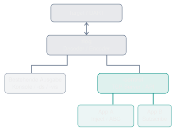

# Handoff: Zukunftsfähige tlog-CLI und Kommunikationsarchitektur

> **Status:** Wissensstand, Diskussionsgrundlage und Architektur-Handoff; **keine** Implementierungsfreigabe.  
> **Stand:** 10. November 2026.  
> **Projekt:** [rokath/trice](https://github.com/rokath/trice), untersuchter Branch `wip`, Commit [`f713ceab`](https://github.com/rokath/trice/commit/f713ceab876bdbaeaffe862745743632a6d5a63e).  
> **Geltungsbereich:** `tlog` / `trice log`, hostseitige Ein- und Ausgabe, externe Applikationen, Migration vorhandener CLI-Optionen.  
> **Nachfolge des Scratchpads:** Dieses Dokument soll die relevanten Inhalte von `docs/_scratchPad/scratchPad.md` **vollständig als Arbeitsgrundlage ablösen**. Auch dessen separate Randnotizen sind in Anhang F übertragen. Das Scratchpad darf danach geleert werden, ohne dass die Planung nur dort dokumentiert bleibt.

<a id="about"></a>
## About / Anlass

Ausgangspunkt war die Idee einer **interaktiven Trice-Bifurkationsdemo**: Ein STM32G0B1 berechnet die logistische Abbildung, überträgt Messwerte per UART an `tlog`, LabPlot visualisiert sie, und externe Apps steuern über Trice ABC den Parameterbereich. Der ursprüngliche Scratchpad-Handoff schlug dafür `-tcpListen` als TCP/JSON-Eingang vor.

Die Diskussion zeigte, dass vorher eine grundsätzlichere Entscheidung nötig ist: **Welche saubere, konsistente und zukunftsoffene Kommunikations- und CLI-Architektur soll `tlog` besitzen?** Insbesondere soll das bisher offenbar wenig genutzte `-tcp` im **Zielbild nicht fortgeführt** werden. Weitere historische Schalter könnten später als *deprecated* gekennzeichnet und erst nach einer geregelten Migration ersetzt werden.

**Reihenfolge ist verbindlicher Teil der Aufgabenabgrenzung:** Zuerst Bestandsaufnahme und Designentscheidungen für die heutige und künftige CLI-Kommunikation; **keine Arbeit an Demo, Encoder, UI, Firmware oder CLI-Code**, solange dieses Interface nicht konzeptionell geklärt ist. Die Demo bleibt ein anschaulicher Prüffall und ist in Anhang D für später konserviert.

## Wegweiser

| Erst lesen | Vertiefung bei Bedarf |
|---|---|
| [About / Anlass](#about) und [Teil I: Zielbild](#teil-i) | [Anhang A: Codebestand](#anhang-a), [B: Protokollskizzen](#anhang-b) |
| [Ist-Zustand](#abschnitt-2), [CLI-Varianten](#abschnitt-4), [Migration](#abschnitt-5) | [C: Deprecation und Migration](#anhang-c), [E: Bilder und Quellen](#anhang-e) |
| [Offene Entscheidungen](#abschnitt-6) | [D: Bewahrtes Demo-Konzept](#anhang-d), [F: Randnotizen](#anhang-f), [G: Diskussionsverlauf](#anhang-g), [H: Checkliste](#anhang-h) |

---

<a id="teil-i"></a>
# Teil I -- Architekturübersicht und Zielbild

<a id="abschnitt-1"></a>
## 1. Kurzfassung

1. **Einfachheit für Anwender:** Nicht für jede neue Funktion ein weiterer Netzwerkschalter. CLI-Begriffe sollen Transport, Datenrichtung und Aufgabe konsistent trennen.
2. **`-port` beibehalten:** Beschreibt die Verbindung zur Trice-Datenquelle bzw. zum Target; die neue Schnittstelle ist ein **gleichzeitiger zweiter Kommunikationsweg** und kann nicht einfach als weiterer Wert derselben `-port`-Variable betrachtet werden.
3. **`-tcp` im Zielbild streichen:** Der bestehende TCP-Ausgabestream ist funktional schmal (ein Client, keine allgemeine Steuer-API). Nutzungsarmut ist eine Annahme, keine belastbare Nutzungsstatistik; Migrationsfolgen vor einer Entfernung ermitteln.
4. **`-ds` nicht übereilt opfern:** Bereits bestehende Mehr-Logger-Anzeige über Go-RPC; eine Zusammenlegung ist allenfalls ein späterer, ausdrücklich zu prüfender Schritt.
5. **Generischer Applikationszugang:** Langfristig eine mehrclientfähige hostseitige Schnittstelle für `inject`, möglicherweise `subscribe`, `status`, `config` und spätere Operationen. Kein demospezifisches Protokoll.
6. **TCP und UDP differenziert:** TCP eignet sich für Kommandos, Antworten und Abonnements; UDP ist eine mögliche optionale Einspeisung. Mehrere Apps brauchen **nicht** automatisch mehrere Endpunkte.
7. **Kein vorzeitiges Festschreiben:** `-control tcp://...` mit `op` im JSON ist die zuletzt diskutierte Leitvariante; `-api` als besserer Oberbegriff und `-control inject:tcp://...` als Alternative bleiben offen.
8. **Vor Implementierung festlegen:** Semantik, Protokollversionierung, Clientmodell, Migration, Sicherheit, Fehlerantworten, UART-Schreibkoordination und Tests.

**Wichtig:** Die Architekturprinzipien und der Wunsch, `-tcp` abzulösen, sind Zielrichtung. Weder ein konkreter Flag-Name noch eine API-Version sind schon beschlossen.

<a id="abschnitt-2"></a>
## 2. Tatsächlicher Ist-Zustand (`wip`)

| Mechanismus | Rolle, Verbindung, Richtung | Ist-Funktion | Für das Zielbild |
|---|---|---|---|
| `-p` / `-port`, `-args` | Auswahl **einer** Quell-/Target-Verbindung | UART, RTT, Datei, `TCP4`, `UDP4` usw.; der gewählte Reader kann teils auch schreiben | **Behalten**; Bedeutung klar dokumentieren |
| `-port TCP4` | `tlog` **verbindet sich als Client** zu einem vorhandenen TCP-Server | Binäre Trice-Logs lesen; TCP-Socket kann grundsätzlich auch schreiben | Nicht mit neuem Control-Listener verwechseln |
| `-port UDP4` | `tlog` **lauscht** lokal auf UDP | Binäre Logs lesen; der Receiver hat keinen Reply-Peer, `Write` verweigert Kommandos | Nicht als generischen Steuerkanal auffassen |
| `-tcp <addr>` | `tlog` **lauscht** auf TCP | Kopiert bereits aufbereitete Ausgabe an **einen** Client, etwa PuTTY; wartet zunächst auf einen Client-Read | **Ablösekandidat**, keine neue Entwicklung auf dieser Basis |
| `-ds` (`-displayserver`) | `tlog` ist RPC-Client eines separat gestarteten `trice ds` | Formatierte Ausgabe mehrerer Logger zum Displayserver; lokale Tastaturkommandos können auf den Target-Schreibweg gehen | **Zunächst erhalten**, überlappt nur teilweise |
| `-vis` | Selektive Ausgaberegeln | Numerische Trice-Ereignisse als CSV/Text zu Datei oder **UDP-Ziel** (z.B. LabPlot) | **Zunächst erhalten**; spezieller Datensenker |
| `-logfile`, `-logFormat` | Lokale bzw. maschinenlesbare Ausgabe | Datei; Text/JSON/KV entsprechend Konfiguration | Bestehende Ausgabemodelle beim API-Design berücksichtigen |

**Korrektur einer leicht entstehenden Verwechslung:** `-ds` ist als Logausgabe ein RPC-Client zum Displayserver; die im CLI-Handbuch beschriebene interaktive Kommandoeingabe kommt aus dem **lokalen Standard-Input des Loggers** (`keybcmd.ReadInput`) und ist **keine** allgemeine ABC-Injection-RPC-Methode des Displayservers.

Die Codeprüfung ergab für `-tcp` konkret: ein Listener, genau **ein** `Accept()`, ein initialer `Read()` auf der Verbindung, anschließend Verwendung als `io.Writer` im `io.MultiWriter`. Kein mehrclientfähiges `Accept`-Loop, kein kontrolliertes Reconnect und kein Kommando-Protokoll. Fundstellen in Anhang A.

<a id="abschnitt-3"></a>
## 3. Das angestrebte Zielbild

```text
                            Host / tlog
    Target <-- UART/RX+TX --> +-----------------------------+
                             | Target receiver / decoder   |
                             | Target command encoder (neu)|
                             | Shared IDs / framing / logs |
                             +--------------+--------------+
                                            |
                +---------------------------+-------------------------+
                |                                                     |
         Existing outputs                                   External app interface
       stdout, logfile, -vis                                  (one shared endpoint)
       -ds (initially retained)                                          |
                                                               +--------+--------+
                                                               |                 |
                                                           App A / TCP       App B / TCP
                                                           inject/status     subscribe/...
```



Die Ziel-Schnittstelle ist **nicht** der Target-Eingang `-port` und **nicht** ein weiterer, isolierter `-tcpListen` nur für die Demo. Sie ist eine potentielle **gemeinsame API** zum Datenaustausch mit Anwendungen. Die Trice-spezifische Codierung bleibt unabhängig von Transport und Applikation.

**Prinzipien:** (a) ein klar benannter Zugang statt vieler paralleler Sonderoptionen, (b) ein Listener für mehrere Clients, (c) richtungsbewusste Operationen, (d) reproduzierbare Fehler, (e) keine Vermischung von RX-/TX-Logs, (f) sichere lokale Voreinstellungen, (g) getrenntes Migrationskonzept.

<a id="abschnitt-4"></a>
## 4. CLI- und API-Varianten (noch nicht entschieden)

| Variante | Beispielschema (*nicht implementiert*) | Vorteil | Nachteil / offene Frage |
|---|---|---|---|
| **A -- operationsbezogen** | `-control inject:tcp://127.0.0.1:9002` | Explizite Aktivierung einzelner Aufgaben | Für `subscribe`, `status` usw. potentiell eigene Endpunkte / CLI-Komplexität |
| **B -- gemeinsamer Endpunkt** | `-control tcp://127.0.0.1:9002` und `{"op":"inject",...}` | Ein Port und ein Schalter für mehrere Operationen, Multi-Client-fähig | Protokoll, Antwortkanal und Berechtigungen müssen gut definiert sein |
| **C -- wie B, anderer Name** | `-api tcp://127.0.0.1:9002` | `api` schließt Ausgaben, Status und Konfiguration begrifflich ein | Weitere Namensentscheidung erforderlich |
| **D -- dedizierte Einspeisung** | `-inject tcp://127.0.0.1:9002` | Sehr kleine, klare Eingangsfunktion | Verbaut nicht die Zukunft, erzwingt aber später ggf. weiteren Schalter |
| **Historisch (Scratchpad)** | `-tcpListen 127.0.0.1:9002` | Schnell für die Demo | TCP-zentriert; Name kollidiert semantisch mit vorhandenem `-tcp`; nicht bevorzugt |

**Diskussionstendenz:** B oder C, mit `op` im Anwendungsprotokoll und mehreren Clients am selben Endpoint. Aber weder die Einführung von `-control` noch der Name `-api`, die Syntax oder `subscribe` sind final entschieden. `inject:` vor der Transport-URI bleibt als bewusste Alternative notiert. Die CLI sollte nicht nur anhand des Demo-Bedarfs festgelegt werden.

### Braucht jede App einen eigenen Endpoint?

**Nein.** Ein TCP-Server kann viele gleichzeitige Verbindungen auf demselben `IP:Port` bedienen; bei UDP können mehrere Sender denselben UDP-Zielport nutzen. Mehrere Endpunkte sind nur für getrennte Transportarten, Sicherheitszonen, Protokolle oder bewusst getrennte Funktionen nötig. Das bestehende `-tcp` ist **noch nicht** entsprechend mehrclientfähig.

### TCP oder UDP?

- **TCP zuerst für das allgemeine API-Konzept:** geordneter Byte-Stream, bidirektional, Fehlerantworten/Subscriptions möglich. Nachrichtenabgrenzung (z.B. NDJSON oder length-prefix) muss definiert werden.
- **UDP als optionale Erweiterung:** Ein JSON-Objekt pro Datagramm ist möglich, aber Verluste, Vertauschung und Datagrammgrenzen sind relevant; ein dauerhafter Subscription-Stream passt nicht ohne weiteres. `status`/`config` mit Antworten erfordern eigenes Antwort- und Sicherheitsmodell.
- **Keine Pflicht zu beiden Protokollen zum Start.** Die Transportabstraktion sollte sie konzeptionell zulassen, ohne voreilig einen umfangreichen Universal-Server zu versprechen.

<a id="abschnitt-5"></a>
## 5. Umgang mit `-tcp` und anderen Altoptionen

**Ziel:** `-tcp` wird in einem späteren, konsolidierten CLI-Modell **nicht mehr benötigt**. Es ist aktuell als einfache netzwerkbasierte Spiegelung der Ausgabe dokumentiert (PuTTY-Beispiel); seine tatsächliche externe Nutzung ist unbekannt. Eine Entfernung ohne Ersatz könnte rohe TCP/Text-Clients brechen.

**Migrationsgedanke, nicht bereits beschlossen:**

1. Dokumentierte Nutzerfälle, CLI-Tests, Skripte und bisherige Ausgabesemantik erfassen; nicht aus wenigen Fundstellen auf Null-Nutzung schließen.
2. In der neuen gemeinsamen Schnittstelle `subscribe` als möglichen Ersatz für Log-Abonnements spezifizieren. Eine JSON-RPC-artige Verbindung ist **nicht direkt PuTTY-kompatibel**; ggf. schlanker Client, Modus für reinen Text oder übergangsweise altes `-tcp` nötig.
3. Erst bei dokumentiertem Ersatz `-tcp` als **deprecated** markieren und zeitversetzte Entfernung inkl. Versionspolitik, Help/README/Beispielen/Changelog festlegen.
4. `-ds`, `-vis` und gegebenenfalls weitere Optionen später **einzeln** auf Überschneidung prüfen. Keine pauschale Deprecation oder stille Verhaltensänderung.

**Grenze:** `-vis` stellt spezielle numerische Konvertierung zu Datei/UDP bereit; `-ds` aggregiert mehrere `tlog`-Prozesse. Beide haben einen belegten eigenen Nutzen und können selbst dann sinnvoll bleiben, wenn eine zentrale API `subscribe` bereitstellt.

<a id="abschnitt-6"></a>
## 6. Zunächst zu entscheidende Architekturfragen

| ID | Frage / gewünschtes Ergebnis | Stand |
|---|---|---|
| D1 | Benutzermodell: `-port` Target-Quelle, API externe Apps; eindeutige Terminologie für Input, Output, Control | **Zielrichtung klar** |
| D2 | Umfang: Nur Injection, oder bereits `inject` **und** `subscribe` als API-Vertrag? `status`/`config` zunächst nur reservieren? | **Offen** |
| D3 | CLI-Name und Syntax: `-control` vs. `-api`; `op` im JSON vs. `inject:` im URI-Präfix | **Offen** |
| D4 | Eine oder mehrere URI-Optionen, wiederholbare Flags, Standard-Bind-Adresse, IPv4/IPv6/Unix-Sockets | **Offen** |
| D5 | TCP-Multiclient-Server, Sequenzierung/Backpressure, Ab-/Wiederanmeldung, eventuelle UDP-Ergänzung | **Offen** |
| D6 | Nachrichtenformat, Versionierung, Responses, Correlation IDs, Fehler und ACK-Semantik | **Offen** |
| D7 | Sichtbarkeit von TX in Logs, Umgang mit `-vis`, Einordnung von Roh- vs. dekodierten Daten | **Offen** |
| D8 | Threat Model, lokale Defaults, Zugriffsschutz für mutierende Target-Kommandos | **Offen** |
| D9 | Prüfbare Migration von `-tcp` und Kriterien für spätere Deprecation anderer Flags | **Zielrichtung klar, Verfahren offen** |
| D10 | Langfristiges Verhältnis zu `-ds` und `-vis` ohne Doppelimplementierung | **Offen** |

### Ergebnis der nächsten Arbeitsphase (ohne Code)

Ein eigenes, kurzes **CLI-/API-Design-Decision-Dokument** soll die Fragen D1--D10 verbindlich beantworten: Syntax, Nutzerbeispiele, Transport- und Verbindungsmodell, Protokollbeispiele, Fehlerszenarien, Kompatibilitäts-/Deprecation-Plan und Abnahmekriterien. **Erst danach** ggf. Implementierung beauftragen; **erst danach** eine Demo wie die Bifurkationsvisualisierung weiterverfolgen.

---

<a id="teil-ii"></a>
# Teil II -- Technische Anhänge (Wissenssicherung, keine Implementierungsanweisung)

<a id="anhang-a"></a>
## Anhang A -- Verifizierter Code- und CLI-Bestand

**Quellenstand:** GitHub-Branch `wip`, Commit `f713ceab876bdbaeaffe862745743632a6d5a63e` vom 10.11.2026. Links sind auf diesen Commit fixiert; ein späteres Leeren des Scratchpads auf `wip` ändert die hier protokollierte Bestandsaufnahme nicht automatisch.

| Quelle | Verifizierte Beobachtung |
|---|---|
| [`internal/args/init.go`](https://github.com/rokath/trice/blob/f713ceab876bdbaeaffe862745743632a6d5a63e/internal/args/init.go) | `-port`/`-p` binden an dieselbe `receiver.Port`-Variable; `-args` an `receiver.PortArguments`. `-tcp` -> `do.TCPOutAddr`; `-ds` -> `emitter.DisplayRemote`; `-vis` wiederholbar. Zweites `-port` erzeugt **nicht** automatisch parallelen Quell- oder Kontrollkanal. |
| [`internal/receiver/receiver.go`](https://github.com/rokath/trice/blob/f713ceab876bdbaeaffe862745743632a6d5a63e/internal/receiver/receiver.go) | `-port TCP4`: `net.DialTCP` (Logger ist Client). `-port UDP4`: `net.ListenUDP`, `ReadFromUDP` ignoriert Senderadresse, `Write()` gibt Fehler mangels Antwortadresse zurück. Voreinstellung `0.0.0.0:17005`, kein Multicast-Join. |
| [`internal/do/do.go`](https://github.com/rokath/trice/blob/f713ceab876bdbaeaffe862745743632a6d5a63e/internal/do/do.go) | `-tcp`: `net.Listen`, **ein** `Accept()`, **ein** initialer `Read()`, anschließend `io.MultiWriter` auf Terminal/TCP/Datei. Blocking beim Connect/Read; keine Dispatch-/Control-API. |
| [`internal/emitter/server.go`](https://github.com/rokath/trice/blob/f713ceab876bdbaeaffe862745743632a6d5a63e/internal/emitter/server.go) | `trice ds` startet `net/rpc`-Server mit wiederholtem `Accept()` und `go rpcServer.ServeConn(conn)`. Methoden für Loganzeige/Palette/Shutdown, nicht generisches Target-Injection. |
| [`internal/emitter/remoteDisplay.go`](https://github.com/rokath/trice/blob/f713ceab876bdbaeaffe862745743632a6d5a63e/internal/emitter/remoteDisplay.go) | Logger verbindet sich mit `rpc.Dial("tcp", ...)` zum Displayserver und schickt Logzeilen. |
| [`internal/args/handler.go`](https://github.com/rokath/trice/blob/f713ceab876bdbaeaffe862745743632a6d5a63e/internal/args/handler.go) | `keybcmd.ReadInput(rwc, ...)` wird bei `-ds` gestartet; `-ds` mit `-port UDP4` wird abgewiesen, weil das Ziel nicht beschreibbar ist. |
| [`internal/vis/router.go`](https://github.com/rokath/trice/blob/f713ceab876bdbaeaffe862745743632a6d5a63e/internal/vis/router.go) | `-vis`-Sink für `udp://` mit `net.DialUDP`, neben Datei-Sinks. Das ist **Ausgabe** zu einem UDP-Empfänger, kein Trice-Injection-Eingang. |
| [`docs/rm/cli.md`](https://github.com/rokath/trice/blob/f713ceab876bdbaeaffe862745743632a6d5a63e/docs/rm/cli.md) | Dokumentiert PuTTY für `-tcp`, `TCP4` als binären Input, `UDP4` als receive-only, `-ds`-Mehrlogger-Anzeige und lokale Tastaturkommandos. |
| [`docs/rm/visualization.md`](https://github.com/rokath/trice/blob/f713ceab876bdbaeaffe862745743632a6d5a63e/docs/rm/visualization.md) | `-vis` kann File/UDP parallel bedienen; UDP hat keine Quittierung. Vorhandene LabPlot-Demo nutzt UDP-Port `9000`, 50 Samples/s und behält 500 Zeilen (nicht gleichzusetzen mit der zukünftigen Bifurkationsdemo). |
| [`cmd/trice/tcp4_test.go`](https://github.com/rokath/trice/blob/f713ceab876bdbaeaffe862745743632a6d5a63e/cmd/trice/tcp4_test.go) | Tests für bestehenden TCP-Input und TCP-Ausgabepfad; keine Aussage zur externen Nutzung. |

### Verbindungsrollen, sauber voneinander getrennt

```text
-port COM7        : Target UART         <--> tlog (RX, optional TX)
-port TCP4        : Remote TCP server   <--> tlog (tlog initiates connection)
-port UDP4        : UDP senders          --> tlog (binary Trice RX only)
-tcp HOST:PORT    : External TCP client <--  tlog (tlog listens; 1 client now)
-ds              : tlog                 --> trice ds (RPC display)
-vis @udp://...   : tlog                 --> External UDP viewer
-planned API      : External app(s)     <--> tlog (future shared endpoint)
```

**Nutzungshinweis:** Das heutige `-tcp` ist der einzige hier betrachtete schlichte TCP-Ausgabestream des Loggers; `-port TCP4` ist konzeptionell **das Gegenteil** hinsichtlich Listener-/Dial-Rolle. In Anleitungen und Flag-Hilfe sollte diese Differenz klar werden.

<a id="anhang-b"></a>
## Anhang B -- Diskutierte Protokollskizzen und technische Fragen

### B.1 Historische JSON-Nachrichten für Injection

Das Scratchpad verwendete Schlüssel, die Trice-Makronamen widerspiegeln. Diese Beispiele sind **Ideenstand**, keine finale oder implementierte API:

```json
{"trice":"msg:hi"}
{"trice16":"dbg:value=%u","values":[1234]}
{"triceC":"demo:reset"}
{"trice32C":"demo:setRange","values":[958314643,966367642]}
{"TRice32C":"demo:setRange","stamp":1234,"values":[958314643,966367642]}
```

Im historischen Entwurf unterschieden `trice32C` (ohne Stamp), `Trice32C` (16-Bit-Stamp) und `TRice32C` (32-Bit-Stamp) die Makrovarianten. Die Unterstützung sämtlicher Varianten, Werttypen und Formatprüfung ist **nicht** beschlossen.

### B.2 Allgemeinere API mit `op`

Denkbare, **noch unverbindliche** JSON-Nachrichten bei einem gemeinsamen TCP-Endpunkt:

```json
{"op":"inject","request_id":"r-12","triceC":"demo:reset"}
{"op":"subscribe","format":"text"}
{"op":"status","request_id":"r-13"}
```

Dabei ist noch offen, ob alle Operationen dieselbe JSON-Struktur nutzen, ob NDJSON oder ein length-prefix gewählt wird, wie `format` zur bestehenden `-logFormat`-Option passt und ob ein Subscription-Stream gleiche Verbindung und Antwortnachrichten multiplexen darf. Der Name `request_id` dient nur zur Erläuterung einer denkbaren Korrelation.

### B.3 Transport- und Request-Semantik

- **TCP:** Byte-Stream ohne automatische Nachrichtenabgrenzung; Vorschlag des Scratchpads: **NDJSON**, eine JSON-Nachricht pro Zeile. Alternativen und Maximalgrößen explizit prüfen.
- **UDP:** Eine JSON-Nachricht pro Datagramm; nur für Operationen verwenden, die Paketverlust und Neuordnung akzeptieren oder dies explizit absichern. `subscribe` per UDP wäre ein gesonderter API-Vertrag.
- **Multi-Client:** Ein Listener kann mehrere gleichzeitige Client-Sockets bedienen. Eine zentrale Queue oder serielle Target-Schreibpipeline ist für konkurrierende `inject`-Anfragen nötig. Unbegrenzte Warteschlangen vermeiden.
- **ACK-Level:** `accepted` (syntaktisch akzeptiert), `written` (UART-Schreibaufruf erfolgreich), `executed` (Target hat Kommando verarbeitet) sind verschiedene Aussagen. `executed` erfordert explizite Target-Bestätigung.
- **Backpressure und Logging:** Langsame Subscriber dürfen den RX-Decoder und andere Clients nicht ungeprüft blockieren; Dropping, Limits und Zustellgarantien festlegen.
- **Fehlerpfad:** Ungültiges JSON, unbekannte Operation/Makrovariante, fehlende/mehrdeutige ID, Wertebereich, Framing, Target nicht verfügbar, UART-Schreibfehler, Client getrennt; auswertbare Fehler statt nur stdout.
- **Sicherheit:** Standard-Listener nur Loopback; Zugriff aus dem Netzwerk ausdrücklich aktivieren; bei externem Zugriff Authentisierung/Transportverschlüsselung bzw. klare Vertrauensgrenzen prüfen. `inject` und `config` dürfen nicht versehentlich von fremden Netzen erreichbar sein.
- **Versionierung:** API-/Protokollversion und Kompatibilitätsgarantien vor Veröffentlichung festlegen; keine unbeabsichtigte Kopplung an die CLI-Syntax.

### B.4 Generischer Host-Trice-Encoder und IDs

Der ursprüngliche Entwurf sieht folgende Verarbeitung vor, aber **erst nach Abschluss des CLI-/API-Designs**:

```text
App request -> parse/validate -> determine macro type/format
            -> lookup in til.json -> select unique Trice ID
            -> encode values/record -> COBS/TCOBS framing
            -> serialized target TX -> optional TX log and client response
```

Wichtige übernommene Randbedingungen:

- Externe Apps müssen **keine numerischen Trice-IDs** kennen. `tlog` soll die passende ID aus `til.json` auflösen, passend zur Firmware-Version.
- Makrotyp und Formatstring/Kommandoname können mehreren ID-Einträgen entsprechen. **Mehrdeutigkeit zunächst als Fehler**; keine zufällige ID-Auswahl. Ein optionaler expliziter Disambiguator ist später denkbar.
- Die Trice-ID-Tabelle und der Encoder dürfen nicht an den TCP-Transport gekoppelt werden.
- Ursprüngliche Ausbauidee: zunächst ungestempelte 16-/32-Bit-Trices und ABC; später 8-/64-Bit sowie 16-/32-Bit-Stamps. Keine vorzeitige Festlegung des genauen API-Umfangs.
- Die aktuelle Framing-/Verschlüsselungskonfiguration des Targets muss berücksichtigt werden; nur ein einziger Writer soll den Target-TX-Stream kontrollieren.
- Normale Trices ohne ABC-Suffix lösen am Target **nicht automatisch** Funktionen aus. ABC ist eine definierte Target-Empfangsverarbeitung, keine beliebige Remote-Ausführung.

Ein historisches Beispiel zur Bind-Registrierung von ABC-Aufrufstellen (schematisch):

```c
void demoAbcDefinitions(void) {
    uint32_t range[2] = {0, 0};
    trice32C("demo:setRange", range, 2);
    triceC("demo:reset");
}
```

Die Funktion sollte nur für `trice bind` sichtbar sein, nicht zur Laufzeit ausgeführt werden; `trice generate -abc` erzeugt die entsprechende Target-Empfängertabelle. Dies ist **Demo-Kontext**, kein Auftrag zur sofortigen Umsetzung.

### B.5 Spiegelung ausgehender Nachrichten

Alte Scratchpad-Idee (noch zu spezifizieren):

```text
09:28:14.123 TX: demo:setRange(958314643,966367642)
09:28:14.124 INF: New range accepted
09:28:14.125 vis:r=958314643,x=32768
09:28:14.126 TX-ERR: Unknown Trice command
```

TX- und RX-Herkunft sollen erkennbar bleiben; gesendete Trices dürfen nicht unabsichtlich als empfangene Events erneut in `-vis` landen. Ein erfolgreicher UART-Write ist **keine** Ausführungsbestätigung. Festzulegen ist, welche Metadaten der Logkanal und welche der Antwortkanal transportieren.

<a id="anhang-c"></a>
## Anhang C -- Migrations- und Kompatibilitätsfragen

### C.1 Ersatz des bisherigen `-tcp`

Dokumentierter Aufruf:

```bash
trice log -p COM3 -tcp 127.0.0.1:23
```

Dokumentierte Verwendung: PuTTY verbindet sich zu `tlog`, zeigt den kopierten Ausgabestream. Damit die neue API `-tcp` wirklich ersetzen kann, muss **nicht nur** `subscribe` in JSON existieren: Ein alter PuTTY-Client versteht weder eine `{"op":"subscribe"}`-Initialnachricht noch ggf. gekapselte JSON-Ausgabe. Für den Migrationsplan sind Alternativen explizit zu bewerten:

| Ersatz für schlichte TCP-Textanzeige | Vorteil | Kosten |
|---|---|---|
| Kleiner CLI-Client, der `subscribe` spricht und Text ausgibt | Reines API-Design, lokal in Pipes verwendbar | Neues Client-Werkzeug/Unterkommando |
| Kompatibilitätsmodus im API-Server für Plain-Text-Subscriptions | PuTTY ähnlicher Workflow | Zusätzlicher Protokollmodus und Erkennungsregeln |
| `-tcp` übergangsweise weiterführen | Keine unmittelbaren Bestandsbrüche | Temporäre Doppelpflege |

**Keine Entscheidung darüber ist gefallen.** Eine säuber geplante Deprecation kann mehrere Releases umfassen; derzeit gibt es keine verbindliche Versionsfrist.

### C.2 Weitere mögliche Deprecations nur auf Basis von Nutzen

- `-ds`: Bewährtes Sammeln mehrerer Logger in einem Displayserver plus bestehende Kommandoeingabe; nicht vorschnell ersetzen.
- `-vis`: Stabiler Spezialpfad für numerische Transformation und Datei-/UDP-Ausgabe; nicht mit generischem `subscribe` gleichsetzen.
- `-p`/`-port` und `-args`: Kern der Target-Verbindungswahl; keine Umdeutung zu beliebig vielen simultanen Eingängen ohne eigenes Architekturprojekt.
- Bei künftiger CLI-Bereinigung auch Aliase, Parameterbenennung und Hilfe untersuchen, aber keine Umbenennung allein aus Kosmetikgründen.

### C.3 Test- und Abnahmekriterien für eine spätere Implementierungsphase

**Konzepttests vor Code:** Aus Sicht eines Einsteigers unterscheiden sich Target-Verbindung, externe Steuer-API, externe Anzeige und Visualisierung eindeutig. Ein Endpoint hat erklärte Rolle und sicheres Default. Zwei Applikationen können gleichzeitig Requests senden, ohne getrennte Listener konfigurieren zu müssen.

**Technische Tests nach Freigabe:** Zwei gleichzeitige TCP-Clients; geordnete Target-TX-Ausgabe; fehlende/frühe/mehrdeutige IDs; Versionierung; langsame Subscriber; Client-Abbruch und Wiederverbinden; Target-Reconnect; ungültige Daten; paralleles `-vis`; unveränderte `-ds`-Mehrlogger-Funktion; Schutz vor unerwünschten Netzwerkzugriffen; Kompatibilitätsbeispiele für bisherigen `-tcp`-Anwendungsfall.

**Dokumentation:** Neues Rollenmodell und einheitliche Kommunikationsübersicht zuerst, dann `-help`, User Manual, Beispiele, Changelog, Deprecation-Hinweise und ggf. neue Kommandoreferenz.

<a id="anhang-d"></a>
## Anhang D -- Bewahrtes Demo-Konzept als späterer Prüffall

> **Nicht jetzt umsetzen.** Dieser Anhang konserviert den fachlichen Demo-Gedanken des bisherigen Scratchpads, damit dessen Inhalt gefahrlos entfallen kann. Die eigentliche Aufgabenstellung bleibt die CLI-/Kommunikationsarchitektur.

### D.1 Wissenschaftliche und didaktische Idee

Interaktive Darstellung des Bifurkationsdiagramms der **logistischen Abbildung**:

\[
x_{n+1} = r x_n(1-x_n), \quad 0 < x_n < 1,\quad 3 \le r \le 4.
\]

Durch Periodenverdopplung geht das System in chaotisches Verhalten über; der Feigenbaum-Punkt liegt bei `r_infinity ~= 3.569945672`. Eine Visualisierung soll zunehmend feinere Strukturen durch neue Messungen des Targets sichtbar machen, nicht bloß bereits aufgenommene Pixel vergrößern.

Ursprüngliche Textskizze:

```text
x
1.0 |                              . .  . .
    |                         .  . .   . .
    |                    . . .   . . .  .
    |             ------<    . .   . . . .
    |        ----<        . . .  . .  .
    |-------<             . .   . . . .
    |        ----<        . . .  . .  .
    |             ------<    . .   . . .
0.0 +------------------------------------> r
    3.0          3.5       3.57       4.0
```

### D.2 Target- und Timing-Vorgaben aus dem Scratchpad

| Parameter | Vorgesehener Startwert |
|---|---|
| MCU / CPU-Takt | STM32G0B1, 16 MHz |
| Bereich | `r = 3.0 .. 4.0` |
| Schritt / Parameterwerte | `0.01`, also 101 Werte |
| Verweildauer / Parameter | 100 ms |
| Sample-Intervall / Parameter | 1 ms |
| Samples pro Parameter und Durchlauf | 100 |
| Dauer pro vollständigem Durchlauf | 10,1 s |
| Datenrate | rund 1000 XY-Punkte/s |
| Ausgangszustand | `x0 = 0.314159265` als Beispiel |
| Pro Parameter persistenter Zustand | 101 mal 32 Bit = 404 Byte |

Ein eigener Zustand `x[i]` für **jeden** Parameter wird über mehrere Durchläufe behalten. `r=3.00` liefert in Durchlauf 1 Iterationen 1..100, in Durchlauf 2 die Iterationen 101..200 usw. Die Einschwingwerte werden zunächst **nicht** verworfen. `x0=0` ist untauglich; `x0=0.5` ist bei `r=4` problematisch. Bevorzugt 32-Bit-Festkomma mit geeigneten 64-Bit-Zwischenprodukten; die gesendete Auflösung muss nicht der Rechenauflösung entsprechen.

Schematischer Ablauf:

```c
uint32_t x[101];
initialize_states(x);
while (1) {
    for (unsigned i = 0; i < 101; ++i) {
        r = calculate_r(i);
        for (unsigned j = 0; j < 100; ++j) {
            x[i] = logistic(r, x[i]);
            send_trice_sample(r, x[i]);
            delay_ms(1);
        }
    }
}
```

### D.3 Trice-UART und Datenvolumen

- **Eine** bidirektionale UART, von `tlog` geöffnet; kein RTT, kein UART-Splitter, keine zweite USB-Verbindung.
- Ein ungestempelter Trice mit 16-Bit-Nutzwert: nominal ca. **6 Byte** und somit bei 1000/s auf einer 8N1-UART etwa **60 kbit/s** ohne zusätzlichen Framing-Overhead.
- Zwei 16-Bit-Werte pro XY-Punkt: nominal **8 Byte**, also **80 kbit/s** vor Framing.
- Zwei 32-Bit-Werte: nominal **12 Byte**, also **120 kbit/s** vor Framing.
- Als Startpunkt **230400 Baud**, gegebenenfalls 460800 Baud; 115200 Baud bietet bei größeren Records weniger Reserve.
- Für tiefes Zoomen reicht ein absoluter 16-Bit-Wert über `[3,4]` nicht: Alternativen sind 32-Bit-Festkomma, relative 16-Bit-Kodierung im Zoomfenster oder 16-Bit-Parameterindex und PC-seitige Koordinatentransformation. Bewertung offen.

### D.4 LabPlot: Wachstum der Punktwolke

Bei 1000 Punkten/s entstehen etwa 10.000 Punkte in 10 Sekunden, 60.000/min, 600.000/10 min, 3,6 Mio./h. Gewünscht ist eine XY-Punktwolke ohne Verbindungslinien, die sich über mehrere Durchläufe verdichtet. Feste Achsen pro Durchlauf, keine willkürliche Begrenzung auf die letzten wenigen hundert Punkte. Performance/Downsampling bzw. 2D-Histogramm sind **ungeklärt**.

Achtung: Die **bereits vorhandene** `examples/LabPlotDemo`-Demo arbeitet laut Repository mit **50 Samples/s und 500 Zeilen**. Das ist ein anderer Lastfall als die geplante Bifurkationsdemo.

### D.5 Interaktion und externe Demo-App

Konzept: Kleine plattformübergreifende **Go-App mit eingebettetem HTML/JavaScript**; kein Qt-Zwang. Center-Slider, logarithmischer Zoom-Slider, Reset auf `[3,4]`, optional Pause und Rate. App kann auf anderem PC laufen, spricht nur symbolische JSON-Kommandos, nicht numerische Trice-IDs und nicht das UART-Framing.

```text
+------------------------------------------+
| Trice Bifurcation Controller              |
| Center [----------o----------]            |
| Zoom   [----o----------------]            |
| Current Range: 3.550000 ... 3.600000     |
| [Reset] [Pause]                           |
| Endpoint: host:9002   Status: Connected    |
+------------------------------------------+
```

Target-ABC: `demo:setRange` und `demo:reset`. Das Target übernimmt neue Grenzen in den Handlern und initialisiert die Berechnung im normalen Ablauf. Beim Zoom werden 101 neue `r`-Werte und Zustände erzeugt; alte und neue Zoom-Punktwolken dürfen nicht verwechselt werden. Beispiel-Zoomfolge: `[3.0,4.0] -> [3.50,3.60] -> [3.560,3.580] -> [3.5690,3.5710]`. Tiefe Zooms werden durch numerische Genauigkeit begrenzt. LabPlot-Achsenanpassung bleibt offen; mögliche einfache Lösung: normierte Koordinaten, sichtbarer realer Bereich in der App, Zurücksetzen der Punkte bei Wechsel.

### D.6 Historische Systemskizze, in das neue Zielbild eingeordnet

```text
+-----------------------+                   +-----------------------+
| Browser / Demo-App    |  future API       | tlog on host PC       |
| Center, Zoom, Reset   +------------------>| API/Encoder/til.json  |
+-----------------------+                   | UART RX and TX owner  |
                                            |   RX -> decoder/vis   +--> LabPlot
                                            |   TX <- ABC encoder   |
                                            +-----------+-----------+
                                                        |
                                                     UART 8N1
                                                        |
                                            +-----------v-----------+
                                            | STM32G0B1 @16 MHz     |
                                            | ABC handler           |
                                            | Logistic map generator|
                                            +-----------------------+
```

Der alte Scratchpad-Entwurf zeichnete stattdessen `-tcpListen` im `tlog` ein. Das ist **historisch**, keine Empfehlung für die CLI.

### D.7 Historische Realisierungsaufteilung -- nun bewusst vertagt

1. **A:** MCU-Bifurkationsgenerator und Datenstrom nach LabPlot.
2. **B:** Host-Trice-Encoder, TIL-IDs, Framing, Transportserver, TX-Spiegelung.
3. **C:** ABC-Handler, externe Go/HTML-Steuer-App, Koordination Zoom/Plots.

Diese Teile dürfen erst konkret geplant werden, nachdem die CLI-/API-Architektur beschlossen wurde. Keine parallele Demo-Implementierung während der Klärung.

<a id="anhang-e"></a>
## Anhang E -- Abbildungen und weiterführende Links

**Bilder werden nur verlinkt**, nicht in dieses ZIP eingebettet. Die Text-/ASCII-Skizzen der Demo sind in Anhang D enthalten. Die folgenden Dateinamen wurden im Repository-Stand `wip` kontrolliert; Links zeigen nach Möglichkeit auf den fixierten Commit.

| Thema | Bild- bzw. Animationslink | Einordnung |
|---|---|---|
| Bestehende `-tcp`-Anzeige | [PuTTY-Konfiguration, Bild 1](https://github.com/rokath/trice/blob/f713ceab876bdbaeaffe862745743632a6d5a63e/docs/ref/PuttyConfig1.PNG) | Dokumentierter TCP-Client |
| Bestehende `-tcp`-Anzeige | [PuTTY-Konfiguration, Bild 2](https://github.com/rokath/trice/blob/f713ceab876bdbaeaffe862745743632a6d5a63e/docs/ref/PuttyConfig2.PNG) | Verbindungseinstellungen |
| Bestehende `-tcp`-Anzeige | [PuTTY-Ausgabe, Screenshot](https://github.com/rokath/trice/blob/f713ceab876bdbaeaffe862745743632a6d5a63e/docs/ref/Putty.PNG) | Sichtbare Logausgabe |
| Heutige `-ds`-Kommandoeingabe | [UART-Kommandoanimation (GIF)](https://github.com/rokath/trice/blob/f713ceab876bdbaeaffe862745743632a6d5a63e/docs/ref/UARTCommandAnimation.gif) | Lokale Tastatureingabe / Target-Kommandos |
| Bestehende LabPlot-Integration | [LabPlot-Vorschau (PNG)](https://github.com/rokath/trice/blob/f713ceab876bdbaeaffe862745743632a6d5a63e/docs/ref/LabPlotDemo-preview.png) | Bestehende andere Demo |
| Bestehende LabPlot-Integration | [LabPlot-Live-Demo (GIF)](https://github.com/rokath/trice/blob/f713ceab876bdbaeaffe862745743632a6d5a63e/docs/ref/LabPlotDemo.gif) | UDP-Visualisierung mit Live-Plot |

Weitere Dokumente: [CLI-Referenz](https://github.com/rokath/trice/blob/f713ceab876bdbaeaffe862745743632a6d5a63e/docs/rm/cli.md), [Visualisierung](https://github.com/rokath/trice/blob/f713ceab876bdbaeaffe862745743632a6d5a63e/docs/rm/visualization.md), [bereits bestehende LabPlot-Demo](https://github.com/rokath/trice/tree/f713ceab876bdbaeaffe862745743632a6d5a63e/examples/LabPlotDemo), [Scratchpad-Ausgangsstand (historisch)](https://github.com/rokath/trice/blob/f713ceab876bdbaeaffe862745743632a6d5a63e/docs/_scratchPad/scratchPad.md).

<a id="anhang-f"></a>
## Anhang F -- Übernommene Randnotizen aus dem kommentierten Scratchpad-Kopf

Diese Themen stehen **außerhalb** der hier prioritären CLI-Kommunikationsarchitektur, waren aber in dem Scratchpad enthalten und sollen beim späteren Leeren **nicht verloren gehen**:

- `examples/TriceABC`: Shell-Skripte funktionieren, sind aber für weniger shell-erfahrene Nutzer abschreckend. Lesbarkeit und ausführliche Kommentare verbessern; README sollte Ort und Funktion der generierten `*.h`- und `*.c`-Dateien erklären.
- Historische Notiz: Begriff **MVP** in `docs/TriceBind/Trice_bind_90_MVP_User_Manual.md` durch passendere Bezeichnung ersetzen. Pfad/Existenz bei späterer Bearbeitung neu verifizieren.
- Fehlende/gewünschte Beispiele zu `-sl` und `-ce`.
- Angedachte Featureliste: `speed`, `space`, `tags`, `selection`, `routing`, `level`, `id`, `history`, `rtt`, `abc`, `vis`, `sl`, `ce`, `COBS/TCOBS`, `encryption`, `hs`, `ts`, `tsdelta`, `endianness`, `X0`, `li`, `small on wire`, `multi-targets`, `serial`, `udp in`, `tcp io`, `protection`, `bind`, `insert-cache`, `aliases`, `assert`, `self-contained`.
- Prüfen, ob der **RM-Demotext zu lang** ist.
- Hardwaretests und effizientere Bulk-Tests zur Verkürzung der Testlaufzeit prüfen. Frühere, nicht neu validierte Zeitnotiz: Windows ca. **11.770 s**, Mac ca. **4.400 s**, Debian vermutlich in Mac-Größenordnung.
- **N04 -- explizit entfallen (Nutzerentscheidung 05.11.2026):** Veraltete Links in fünf eigenen Wrapper-READMEs unter `third_party` wurden korrigiert. **Keine** zusätzliche automatische Prüfung; Ausschluss von `third_party` in `lychee.toml` bleibt. Künftige defekte Links dort werden nicht automatisch erkannt. **Nicht als offenen Arbeitsauftrag interpretieren.**

Dies sind archivierte Notizen, nicht automatisch aktuelle, zu priorisierende Aufgaben.

<a id="anhang-g"></a>
## Anhang G -- Verlauf der Architekturideen in diesem Chat

Damit ein späterer Bearbeiter historische Vorschläge nicht mit freigegebenen Entscheidungen verwechselt:

1. **Scratchpad / Demo-Ausgangslage:** `-abcListen` wurde verworfen; daraus wurde `-tcpListen 127.0.0.1:9002` für NDJSON-Trices/ABC. Eigentliches Ziel war die interaktive Bifurkationsdemo.
2. **UDP-Frage:** Zusätzliche UDP-Einspeisung und das vorhandene `-port UDP4` kamen auf; `-port UDP4` liest aber binäre Trices, nicht JSON-Kommandos, und kann nicht ohne weiteres auf dem Target zurückschreiben.
3. **Sorge wegen CLI-Komplexität:** Statt `-tcpListen` und `-udpListen` wurde ein einheitlicher, transportneutraler Schalter diskutiert (`-inject` oder `-control`).
4. **`-port` erweitern?** Vorläufig verneint, weil `-port` nur **eine** Quell-/Target-Verbindung konfiguriert und eine externe App eine **gleichzeitige zweite** Verbindung benötigt.
5. **`-inject` vs. `-control`:** `inject` bezeichnet Datenrichtung/Funktion klar; `control` ist semantisch weiter und könnte auch Logger-Status und -Konfiguration einschließen.
6. **Funktions-Präfix:** Vorschlag `-control inject:tcp://...` / `-control inject:udp://...`; Gegenentwurf mit **einem** Endpoint `-control tcp://...` und JSON-Operation `{"op":"inject"}`.
7. **Mehrere Apps:** Brauchen nicht mehrere Listener; ein gemeinsam genutzter Endpoint mit getrennten Clientverbindungen genügt, sofern der Server mehrclientfähig ist.
8. **`-ds` und `-tcp` geprüft:** `-ds` ist zentraler Go-RPC-Displayserver; `-tcp` ein einfacher einzelner TCP-Ausgabestream (PuTTY). Weitere Alternative `-api` als treffender Oberbegriff für bidirektionale Applikationsschnittstelle.
9. **Konsequenz bei Wegfall von `-tcp`:** Ein gemeinsamer API-Endpunkt mit `inject` und eventuell `subscribe` könnte es ablösen; Plain-Text-/PuTTY-Kompatibilität und Deprecation müssen ausdrücklich geplant werden.
10. **Neues Primärziel:** **Noch keine Demo bauen.** Erst den aktuellen und zukünftigen Zustand der tlog-CLI-Kommunikation definieren; altes Scratchpad anschließend entbehrlich machen.

<a id="anhang-h"></a>
## Anhang H -- Prüfliste für die nächste Designrunde

Die folgende Liste ist **kein Implementierungsauftrag**, sondern die Checkliste für ein späteres Architekturgespräch:

- [ ] Rollen aller gegenwärtigen Kommunikationsflags und ihrer Netzwerkrichtungen sind in einer einzigen CLI-Übersicht erfasst.
- [ ] Eine benennbare Zielgruppe erkennt `-port`, `-ds`, `-vis` und künftige App-Schnittstelle ohne Vorwissen als unterschiedliche Aufgaben.
- [ ] Entscheidung zwischen `-control` / `-api` und Operationsformat dokumentiert; nicht nur aufgrund der Demo gewählt.
- [ ] Multi-Client, ein/gemeinsame(r) Endpoint(s) und optionale UDP-Einspeisung sind konsistent definiert.
- [ ] API-Typen für `inject`, `subscribe`, ggf. `status`/`config` und beabsichtigte Nichtziele stehen fest.
- [ ] Eindeutige Semantik von Antworten/ACKs, Framing, ID-Auflösung, Fehlern und UART-TX-Koordination.
- [ ] Sicherheit und lokale Defaults sind beschrieben.
- [ ] Migrationsplan für `-tcp` berücksichtigt PuTTY und Plain-TCP-Clients; mögliche weitere Deprecations werden getrennt begründet.
- [ ] Testfälle und Dokumentationsänderungen sind konzeptionell abgenommen.
- [ ] **Erst dann** eine Implementierungsaufgabe und gegebenenfalls den Demo-Plan ableiten.

---

**Handoff-Ende.** Dieses Dokument erfasst den aktuellen Wissensstand und die Diskussionsalternativen. Es beschreibt **kein** bereits freigegebenes API und soll den bisherigen Inhalt von `docs/_scratchPad/scratchPad.md` als Referenz für diese Arbeiten ersetzen.
