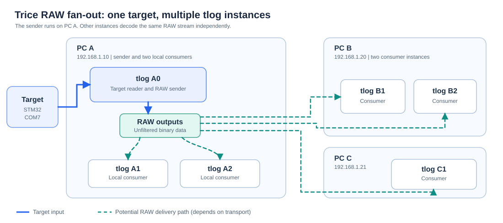

# handsoff_interfaces_v1 — Trice / tlog Schnittstellen und Migration

**Stand:** 17. November 2026 · **Status:** konsolidiertes Nachdenk- und Designdokument **v1**, kein Implementierungsauftrag.  
**Repository:** <https://github.com/rokath/trice> · **ausgewerteter Dokumentationsbranch:** `wip`, HEAD `f7b819207d7e435159890227b7a5fd360d3ec727` (17.11.2026).  
**Ist-Angaben:** geprüft gegen `wip`-CLI-Hilfe und Quellcode; **Zukunft-Angaben sind Syntaxvorschläge**, keine existierenden Optionen.  
**Bezug:** Vollstaendige Uebernahme von `handsoff_interfaces_v0.md` (einschliesslich aller 112 Jetzt/Zukunft-Minitabellen, DS, DLT, VCD, Migration und Arbeitsplan), `handsoff_tlog_schnittstellendesign(1).md` und der relevanten Handoffs aus `wip/docs/_scratchPad/`. Die zusaetzliche Analyse von sechs RAW-Transporten und den Legacy-Eingangsports ist neu in **v1**. **Dieses Dokument ersetzt v0 vollstaendig.**

## 0. Leseanleitung

Die folgende Fallliste ist **anwendungsfallorientiert**: Jede Minitabelle zeigt unmittelbar unter **Jetzt** eine oder mehrere denkbare **Zukunft**-Zeilen. Gleiche Syntax in beiden Zeilen bedeutet **unverändert lassen**. Leeres **Jetzt** bedeutet: **der konkrete neue Workflow ist noch nicht implementiert**. Ein Beispiel mit mehreren Befehlen durch Semikolon/Kommentare ist **auf getrennte Prozesse/Terminals aufzuteilen** und keine fertig ausführbare Einzeile. Alle künftigen Adressen, Namen von Bridge-Programmen und neue Flags sind Arbeitssyntax, nicht freigegebenes CLI.

Die Beispiele beanspruchen **nicht**, jede mögliche Kombination aller Schalter abzubilden; aufgeführt sind die relevanten *Anwendungsfälle* und die aktuellen `tlog`-Optionen einschließlich weniger sichtbarer Diagnose-, Alias-, Zeit-, DS- und Framing-Fälle. `tlog` entspricht dem Logmodus `trice log`; `trice ds`, `trice shutdown` und `trice generate` sind **andere** Trice-Subcommands und werden nur eingebunden, wenn sie für das Schnittstellendesign notwendig sind.

## 1. Verbindlicher Architekturvertrag

1. **Ein Prozess, genau eine Datenquelle / ein `-port`.** Keine wiederholten `-port`-Flags, kein `-port DS`, keine Mehr-Target-Dekodierung in `tlog`. `-p`, `-port`, `-args`, UART-/RTT-Parameter behalten im neuen Modell zunächst ihren Sinn.
2. **`-out` darf beliebig oft vorkommen.** Eine Output-Spezifikation bestimmt Sink, Serialisierung und ggf. numerische/signalbezogene Transformation. **Keine eigenen allgemeinen Log-Level-, `-pick`- oder `-ban`-Filter pro `-out`.**
3. **Alle nicht-raw-Ausgaben teilen genau eine Host-Filterentscheidung.** Die bestehenden globalen `-logLevel`, `-pick`, `-ban` und Tagdefinitionen gelten für alle dekodierten Ausgaben derselben Instanz. Formatgebundene Auswahl (nur numerische Structured Fields für VCD/CSV) ist eine Transformation, nicht eine abweichende allgemeine Log-Policy.
4. **Alle `format=raw`-Ausgaben erhalten die vor der Dekodierung abgegriffenen Bytes, ohne Hostfilter.** Enthaltenes COBS/TCOBS-Framing und typischerweise vorhandene Cycle Counter bleiben exakt erhalten. Bereits auf dem Target verworfene Ereignisse kann auch raw nicht rekonstruieren.
5. **Kein `-out` darf Empfang oder andere Ausgänge aufhalten.** Pro Sink, bei mehreren TCP-Clients pro Client, eine **begrenzte Queue** plus unabhängiger Writer. **Ist die Queue voll, wird der gesamte noch wartende Inhalt verworfen** (`clear-queue`); neue Daten werden angenommen. Keine blockierende Alternative und keine vollständige Raw-Aufzeichnungsgarantie.
6. **Mehrfaches `-ctrl` bezieht sich ausnahmslos auf dasselbe eine Target** der `-port`-Verbindung. Auch bei parallelen Clients gibt es nur einen serialisierten Target-TX-Writer. `-ctrl` ist keine Steueroberfläche für den DS oder für einen anderen Logger.
7. **Mehrere Targets sind mehrere `tlog`-Prozesse** mit eigener TIL, Framing, Dekodierung, Filterung und CLI. Der vorhandene `trice ds` sammelt deren **fertig dekodierte/formatierte Zeilen**; er dekodiert keine Trice-Binärdaten und hat **keine eigenen Trice-Level-/Tagfilter**.
8. **Bestehende CLI ist zuerst weiterhin gültig.** Neuer Code parallel zu altem, kein sofortiges Deprecation und keine stillen Verhaltensänderungen; getrennte, überprüfbare Migrationsphasen.

### 1.1 Datenwege

```text
                    genau ein Target
                          ^  |      z.B. UART / RTT / TCP
                          |  v
                 -port / -args / Reader
                    |          ^
             raw input       TX, ein Writer <--- -ctrl stdin:
                    |          ^             -ctrl tcp-listen://... (mehrfach)
       +------------+---------+
       |
       +---- RAW TAP (vor Decoder und Hostfilter)
       |        +--> bounded Queue -> -out raw:file:trace.bin
       |        +--> bounded Queue -> -out raw:tcp-listen://127.0.0.1:12345 -> weitere tlog
       |
       +---- Decoder / TIL / LI / typisierte Records
                       |
                  EINE globale Logauswahl
                       |
             +---------+---------+-------------+
             |         |         |             |
          Queue      Queue     Queue         Queue   (alle begrenzt)
          text       JSON      vis/VCD         DS
             |         |         |             |
          stdout     Datei    LabPlot/GTK     trice ds

  Andere Targets: eigene tlog-Prozesse -> gemeinsame DS-Anzeige.
  Alternative Filter: weitere tlog-Prozesse lesen denselben raw-Stream.
```

**Nicht verwechseln:** Eine `-out`-Queue ist ein Host-Transportpuffer, kein Target-Ringpuffer. Eine Datei als Raw-Sink kann Lücken haben; die Binärdatei stellt keine verlustfreie Aufzeichnung sicher. `-ctrl`-Befehle können dem Target absichtlich Daten schreiben, dürfen aber nicht mehrere Writer gleichzeitig auf dieselbe Verbindung loslassen.

### 1.2 Vorläufige Grammatik, bewusst unverbindlich

```text
-out 'sink=<URI>;format=<raw|text|json|kv|vis|vcd>;...'
-ctrl 'stdin:'
-ctrl 'tcp-listen://127.0.0.1:9002'
trice ds -listen ds://127.0.0.1:61497
trice shutdown -connect ds://127.0.0.1:61497
```

Die tatsächliche CLI könnte auch `-out vcd:datei.vcd` erlauben; die Minibeispiele verwenden beide **historisch diskutierten** Schreibweisen. Beide können erst nach Festlegung von Parsing, Quoting, gleichzeitigen Zielen, Dateisemantik und `stdout` umgesetzt werden. Client/Server-Rolle explizit angeben (`tcp-listen://` vs `tcp-connect://`); Netzwerk-Listener standardmäßig **Loopback**. Kein zusätzlicher Spezialschalter je Viewer.


### 1.3 Legacy-Netzwerkports: Richtung steht in `-port`, nicht in `-args`

Der reale `wip`-Code legt die Richtung **durch den Porttyp** fest. Die Adresse in `-args` beschreibt nur das jeweilige Ziel bzw. die lokale Bind-Adresse. Eine IP-Adresse ist kein Befehl, Server oder Client zu sein.

| Heutige Quelle | Rolle | Beispiel | Gesicherte Code-Semantik | Grenze |
|---|---|---|---|---|
| `-p UDP4` | **UDP-Listener** | `tlog -p UDP4 -args 0.0.0.0:12345` | `net.ListenUDP` bindet **lokal** Port 12345; `ReadFromUDP` akzeptiert Datagramme unterschiedlicher Sender | `Write` liefert Fehler; **kein Target-TX**, **kein Multicast-Gruppenbeitritt**, kein eingerichtetes Socket-Sharing fuer zwei Leser desselben Ports |
| `-p TCP4` | **TCP-Client** | `tlog -p TCP4 -args 192.168.1.10:12345` | `net.DialTCP` baut eine Verbindung **zu einem wartenden Server** auf; `Read` und `Write` sind vorhanden | **Kein TCP-Listener**. Eine andere Adresse in `-args` macht daraus keinen Server |
| `-p TCP4BUFFER` | endlicher **TCP-Client** | `tlog -p TCP4BUFFER -args 127.0.0.1:12345` | derselbe Dial-Pfad wie TCP4; bei Peer-EOF beendet sich der Testmodus | hauptsaechlich fuer Tests; ebenfalls kein Listener |
| `-p FILE` / `FILEBUFFER` | Dateileser | `tlog -p FILE -args trace.bin` | unabhaengige Filehandles und Lesepositionen | kein UDP-/TCP-Socket, kein Target-TX |

**`0.0.0.0:12345` am UDP-Empfaenger** bedeutet: lausche auf Port 12345 auf allen **lokalen IPv4-Adressen**, nicht: alle Datagramme des LANs mitschneiden. **`192.168.1.20:12345` am UDP-Sender** ist dagegen ein bestimmtes **Ziel**. UDP-Unicast erzeugt keine IP-Adresse; sie muss bereits einem Rechner gehoeren.

**Passende optionale Namen fuer neue Eingangs-URI-Syntax:**

```bash
# Bestehende Quelle unveraendert nutzbar:
tlog -p UDP4 -args 0.0.0.0:12345          # UDP listener
tlog -p TCP4 -args 192.168.1.10:12345   # TCP connect

# Denkbare neue URI-Aliase, keine Pflicht-Migration und noch NICHT implementiert:
tlog -port 'udp-listen://0.0.0.0:12345'
tlog -port 'tcp-connect://192.168.1.10:12345'

# Neue Rollen benoetigen neue Receiver-Funktionalitaet:
tlog -port 'udp-multicast://239.1.2.3:12345'  # join group
tlog -port 'tcp-listen://0.0.0.0:12345'      # TCP server / input
```

Der Displayserver ist eine andere Kategorie: `trice ds` hat **kein `-port` und kein `-ctrl`**. Er nimmt fertig dekodierte, vom jeweiligen Logger bereits gefilterte Logzeilen per Go-RPC entgegen. Seine `LogSetFlags`-RPC-Methode stellt Go-Logflags ein, **keine Trice-Tag-/Level-Filter**.

**Wichtige Control-Grenze beim RAW-Fan-out:** Dass der heutige `TCP4`-Reader technisch `Write` kann, bedeutet **nicht**, dass ein an A0s neuem RAW-`-out` angeschlossener Logger A1/B1 Steuerbefehle bis zum Target durchreichen darf. Ein RAW-Ausgang ist unidirektional zu verstehen; der Target-TX gehoert weiterhin **ausschliesslich** zur Target-Instanz A0 mit deren `-ctrl`-Zugaengen. Ein Rueckkanal muesste separat und explizit spezifiziert werden. `UDP4` kann schon heute keine Target-Kommandos zurueckschreiben.

**Verifiziert:** [`receiver.go` auf `wip`](https://github.com/rokath/trice/blob/wip/internal/receiver/receiver.go) (`newTCP4Connection`, `newUDPConnection`, `newTCP4Connection.Write`, `udp4.Write`, `NewReadWriteCloser`). Die Rollen sind *Ist-Code*, die URI-Aliase sind *Zukunftsvorschlaege*.

## 2. Alle relevanten Anwendungsfälle: Jetzt direkt über Zukunft

### A. Ein Target und dessen Eingangsweg

#### 01. UART unter Windows

| Stand | CLI / Prozessfolge |
|:---|:---|
| **Jetzt** | `tlog -p COM7 -baud 115200` |
| **Zukunft** | `tlog -p COM7 -baud 115200` |

Der eine -port bleibt bestehen; keine Mehrfach-Quelle in einer Instanz.

#### 02. UART unter Linux

| Stand | CLI / Prozessfolge |
|:---|:---|
| **Jetzt** | `tlog -p /dev/ttyUSB0 -baud 115200` |
| **Zukunft** | `tlog -p /dev/ttyUSB0 -baud 115200` |

Serielle Gerätenamen bleiben gültig; Schnittstellenentwurf ist betriebssystemneutral.

#### 03. Serielle Leitung mit anderem Baudwert

| Stand | CLI / Prozessfolge |
|:---|:---|
| **Jetzt** | `tlog -p COM7 -baud 230400` |
| **Zukunft** | `tlog -p COM7 -baud 230400` |

Bewährte Port-Parameter nicht ohne Not umbenennen.

#### 04. Serielle Rahmeneinstellungen

| Stand | CLI / Prozessfolge |
|:---|:---|
| **Jetzt** | `tlog -p COM7 -baud 115200 -databits 8 -parity even -stopbits 1` |
| **Zukunft** | `tlog -p COM7 -baud 115200 -databits 8 -parity even -stopbits 1` |

Line-Settings sind Parameter der Target-Verbindung, nicht von -out.

#### 05. SEGGER J-Link RTT

| Stand | CLI / Prozessfolge |
|:---|:---|
| **Jetzt** | `tlog -p J-LINK` |
| **Zukunft** | `tlog -p J-LINK` |

Zusätzliche J-Link-Parameter werden weiterhin über -args übergeben.

#### 06. J-Link mit spezifischer MCU

| Stand | CLI / Prozessfolge |
|:---|:---|
| **Jetzt** | `tlog -p J-LINK -args "-Device STM32F030R8 -if SWD -Speed 4000 -RTTChannel 0"` |
| **Zukunft** | `tlog -p J-LINK -args "-Device STM32F030R8 -if SWD -Speed 4000 -RTTChannel 0"` |

Komplexe -args-Strings funktionieren weiterhin; keine Pflicht, sie in -port umzuziehen.

#### 07. ST-Link RTT

| Stand | CLI / Prozessfolge |
|:---|:---|
| **Jetzt** | `tlog -p ST-LINK` |
| **Zukunft** | `tlog -p ST-LINK` |

Bestehender Reader bleibt unverändert.

#### 08. OpenOCD als Quelle

| Stand | CLI / Prozessfolge |
|:---|:---|
| **Jetzt** | `tlog -p OPENOCD` |
| **Zukunft** | `tlog -p OPENOCD` |

Im Receiver-Code als OPENOCD/OPEN-OCD/OOCD/OCD vorhanden; der konkrete OpenOCD-Adapter hat eigene Voraussetzungen.

#### 09. Binäre Logs per TCP empfangen

| Stand | CLI / Prozessfolge |
|:---|:---|
| **Jetzt** | `tlog -p TCP4 -args 127.0.0.1:17001` |
| **Zukunft** | `tlog -p TCP4 -args 127.0.0.1:17001` |

Dieser TCP4-Port ist ein **Dial-Client** (`net.DialTCP`) zum **Server** `127.0.0.1:17001`; die `-args`-Adresse beschreibt den Remote-Server. Er ist bereits ein brauchbarer Empfaenger fuer einen **zukuenftigen RAW-`tcp-listen`-Ausgang** von A0. Er ist **kein eigener Listener**, und sein technisch vorhandenes `Write` ist keine implizite Target-Steuerberechtigung beim Fan-out.

#### 10. Binäre Logs per UDP empfangen

| Stand | CLI / Prozessfolge |
|:---|:---|
| **Jetzt** | `tlog -p UDP4 -args 0.0.0.0:17005` |
| **Zukunft** | `tlog -p UDP4 -args 0.0.0.0:17005` |

Aktuell **UDP-Listener** (`net.ListenUDP`) fuer empfangene Trice-Bytes; `-args 0.0.0.0:17005` ist die **lokale** Bind-Adresse, keine Gegenstelle. Er kann UDP-Unicast und bei passenden LAN-Bedingungen Broadcast empfangen, **tritt aber keiner Multicast-Gruppe bei**; ein zweiter Prozess auf demselben lokalen Port scheitert normalerweise. `Write`/Target-TX ist nicht unterstuetzt.

#### 11. Fortlaufendes Nachlesen einer Binärdatei

| Stand | CLI / Prozessfolge |
|:---|:---|
| **Jetzt** | `tlog -p FILE -args trace.bin` |
| **Zukunft** | `tlog -p FILE -args trace.bin` |

FILE liest anhängende Bytes weiter, auch wenn der Writer seine Datei noch nicht geschlossen hat.

#### 12. Endliche Binärdatei wiedergeben

| Stand | CLI / Prozessfolge |
|:---|:---|
| **Jetzt** | `tlog -p FILEBUFFER -args trace.bin` |
| **Zukunft** | `tlog -p FILEBUFFER -args trace.bin` |

FILEBUFFER endet nach EOF; geeignet für deterministische Tests.

#### 13. Hexadezimale Testbytes

| Stand | CLI / Prozessfolge |
|:---|:---|
| **Jetzt** | `tlog -p HEX -args "48 65 6c 6c 6f 0a" -encoding CHAR` |
| **Zukunft** | `tlog -p HEX -args "48 65 6c 6c 6f 0a" -encoding CHAR` |

DUMP ist ein Alias für diesen Eingabetyp; der Inhalt sind bereits Bytes, keine Trice-IDs.

#### 14. Dezimale Testbytes

| Stand | CLI / Prozessfolge |
|:---|:---|
| **Jetzt** | `tlog -p DEC -args "72 101 108 108 111 10" -encoding CHAR` |
| **Zukunft** | `tlog -p DEC -args "72 101 108 108 111 10" -encoding CHAR` |

BUFFER ist ein alternativer Name der dezimalen Bytequelle.

#### 15. Endlicher TCP-Testmodus

| Stand | CLI / Prozessfolge |
|:---|:---|
| **Jetzt** | `tlog -p TCP4BUFFER -args 127.0.0.1:17001` |
| **Zukunft** | `tlog -p TCP4BUFFER -args 127.0.0.1:17001` |

Bestehender, derzeit primär testinterner Modus; muss nicht als offizieller öffentlicher Workflow beworben werden.

### B. Decoder, Protokoll, Tabellen

#### 16. TREX dekodieren

| Stand | CLI / Prozessfolge |
|:---|:---|
| **Jetzt** | `tlog -p COM7 -encoding TREX` |
| **Zukunft** | `tlog -p COM7 -encoding TREX` |

TREX ist voreingestellt; -out arbeitet erst nach den jeweiligen Decoder-Schritten.

#### 17. CHAR-Stream betrachten

| Stand | CLI / Prozessfolge |
|:---|:---|
| **Jetzt** | `tlog -p COM7 -encoding CHAR` |
| **Zukunft** | `tlog -p COM7 -encoding CHAR` |

Bei CHAR keine erfundene Trice-Event-Struktur für JSON/VCD annehmen.

#### 18. Hexdump statt Trice-Dekodierung

| Stand | CLI / Prozessfolge |
|:---|:---|
| **Jetzt** | `tlog -p COM7 -encoding DUMP -dc 16` |
| **Zukunft** | `tlog -p COM7 -encoding DUMP -dc 16` |

DUMP ist eine Decoder-/Monitoransicht; Rohdaten-Ausgang greift unabhängig davon vor der Dekodierung ab.

#### 19. TCOBS-Frames

| Stand | CLI / Prozessfolge |
|:---|:---|
| **Jetzt** | `tlog -p COM7 -pf TCOBSv1` |
| **Zukunft** | `tlog -p COM7 -pf TCOBSv1` |

Framing muss zum Target passen; bestehende Abkürzung -pf bleibt.

#### 20. COBS-Frames

| Stand | CLI / Prozessfolge |
|:---|:---|
| **Jetzt** | `tlog -p COM7 -pf COBS` |
| **Zukunft** | `tlog -p COM7 -pf COBS` |

Rohdaten bleiben mit ihren vorhandenen COBS-Frame-Delimitern erhalten.

#### 21. Ohne Paketframing

| Stand | CLI / Prozessfolge |
|:---|:---|
| **Jetzt** | `tlog -p COM7 -pf none` |
| **Zukunft** | `tlog -p COM7 -pf none` |

Dieser Sonderfall ist bei Raw-Queue-Verlust schwer resynchronisierbar; nicht unbemerkt auf COBS/TCOBS umstellen.

#### 22. Prüfung auf einzelnes Record pro Frame

| Stand | CLI / Prozessfolge |
|:---|:---|
| **Jetzt** | `tlog -p COM7 -singleFraming` |
| **Zukunft** | `tlog -p COM7 -singleFraming` |

Validierungsoption bleibt; nur verwenden, wenn das Target-Frame-Modell dazu passt.

#### 23. Doppelte 16-Bit-IDs

| Stand | CLI / Prozessfolge |
|:---|:---|
| **Jetzt** | `tlog -p COM7 -d16` |
| **Zukunft** | `tlog -p COM7 -d16` |

Dekoder-Konfiguration bleibt pro Target.

#### 24. Cycle-Counter-Fehler unterdrücken

| Stand | CLI / Prozessfolge |
|:---|:---|
| **Jetzt** | `tlog -p COM7 -noCycleCheck` |
| **Zukunft** | `tlog -p COM7 -noCycleCheck` |

Default bleibt die Fehlererkennung; das Flag deaktiviert den entsprechenden Bericht.

#### 25. Big-Endian-Target

| Stand | CLI / Prozessfolge |
|:---|:---|
| **Jetzt** | `tlog -p COM7 -triceEndianness bigEndian` |
| **Zukunft** | `tlog -p COM7 -triceEndianness bigEndian` |

Byteordnung betrifft Eingangsdekodierung; nicht einzelne Ausgänge.

#### 26. Default-Trice-Parameterbreite

| Stand | CLI / Prozessfolge |
|:---|:---|
| **Jetzt** | `tlog -p COM7 -defaultTRICEBitwidth 16` |
| **Zukunft** | `tlog -p COM7 -defaultTRICEBitwidth 16` |

Mit der Target-Konfiguration synchron halten.

#### 27. Verschlüsselte Trices dekodieren

| Stand | CLI / Prozessfolge |
|:---|:---|
| **Jetzt** | `tlog -p COM7 -password MySecret` |
| **Zukunft** | `tlog -p COM7 -password MySecret` |

Passwort bzw. Schlüssel gehören zum Decoder, nicht zu -out. Reelle Geheimnisse nicht in Shell-History ablegen.

#### 28. Schlüssel anzeigen

| Stand | CLI / Prozessfolge |
|:---|:---|
| **Jetzt** | `tlog -p COM7 -password MySecret -showKey` |
| **Zukunft** | `tlog -p COM7 -password MySecret -showKey` |

Bestehende Diagnose-/Entwicklerfunktion; neue -out-Option darf keine Schlüssel im Eventstrom verbreiten.

#### 29. Trice-ID-Tabelle

| Stand | CLI / Prozessfolge |
|:---|:---|
| **Jetzt** | `tlog -p COM7 -til til.json` |
| **Zukunft** | `tlog -p COM7 -til til.json` |

-i und -idlist sind vorhandene Alternativnamen.

#### 30. Source-Location-Tabelle

| Stand | CLI / Prozessfolge |
|:---|:---|
| **Jetzt** | `tlog -p COM7 -li li.json` |
| **Zukunft** | `tlog -p COM7 -li li.json` |

Standortinformationen bleiben vom allgemeinen Ausgaberouting getrennt.

#### 31. Location-Daten deaktivieren

| Stand | CLI / Prozessfolge |
|:---|:---|
| **Jetzt** | `tlog -p COM7 -li off` |
| **Zukunft** | `tlog -p COM7 -li off` |

Möglich ohne Aenderung der TIL-Dekodierung.

#### 32. Automatisches Neuladen der TIL/LI

| Stand | CLI / Prozessfolge |
|:---|:---|
| **Jetzt** | `tlog -p COM7 -til til.json -li li.json` |
| **Zukunft** | `tlog -p COM7 -til til.json -li li.json` |

Datei-Aenderungen werden im laufenden Logger bereits verfolgt; VCD ist Sonderfall wegen unveränderlichem Header-Schema.

#### 33. Macro-Alias definieren

| Stand | CLI / Prozessfolge |
|:---|:---|
| **Jetzt** | `tlog -p COM7 -alias MyTrace:info` |
| **Zukunft** | `tlog -p COM7 -alias MyTrace:info` |

Bestehende Alias-Optionen auch für künftiges typed Event-Modell berücksichtigen.

#### 34. String-Macro-Alias definieren

| Stand | CLI / Prozessfolge |
|:---|:---|
| **Jetzt** | `tlog -p COM7 -salias MyText:info` |
| **Zukunft** | `tlog -p COM7 -salias MyText:info` |

Abweichende Typ-Semantik für triceS() respektieren.

#### 35. Eigene Taggruppe registrieren

| Stand | CLI / Prozessfolge |
|:---|:---|
| **Jetzt** | `tlog -p COM7 -utag motor:450` |
| **Zukunft** | `tlog -p COM7 -utag motor:450` |

Wird global vor Filtern und Visualisierung aufgelöst; keine eigene Tagregel pro -out.

#### 36. typeX0-Benutzerpakete

| Stand | CLI / Prozessfolge |
|:---|:---|
| **Jetzt** | `tlog -p COM7 -typeX0 ignore` |
| **Zukunft** | `tlog -p COM7 -typeX0 ignore` |

Weitere vorhandene Werte wie counted:<format> bleiben; bei Rohdaten werden Pakete nicht vorher entfernt.

### C. Eine gemeinsame Logauswahl und Formatierung

#### 37. Alle Logereignisse anzeigen

| Stand | CLI / Prozessfolge |
|:---|:---|
| **Jetzt** | `tlog -p COM7 -logLevel all` |
| **Zukunft** | `tlog -p COM7 -logLevel all -out "sink=stdout;format=text"` |

Globale Auswahl gilt für alle nicht-raw Ausgänge. Bei Standard-stdout bleibt der alte Aufruf möglich.

#### 38. Alle dekodierten Logereignisse ausblenden

| Stand | CLI / Prozessfolge |
|:---|:---|
| **Jetzt** | `tlog -p COM7 -logLevel off -binaryLogfile trace.bin` |
| **Zukunft** | `tlog -p COM7 -logLevel off -out "sink=file:trace.bin;format=raw"` |

Raw-Daten werden trotzdem aufgezeichnet; Filter wirken nur auf dekodierte Ausgaben.

#### 39. Prioritätsschwelle setzen

| Stand | CLI / Prozessfolge |
|:---|:---|
| **Jetzt** | `tlog -p COM7 -logLevel wrn` |
| **Zukunft** | `tlog -p COM7 -logLevel wrn -out "sink=stdout;format=text"` |

Priorität global. Ein gleichzeitig aktiver JSON-Ausgang erhält ebenfalls nur diese Events.

#### 40. Tag-Auswahl durch -pick

| Stand | CLI / Prozessfolge |
|:---|:---|
| **Jetzt** | `tlog -p COM7 -pick err -pick wrn` |
| **Zukunft** | `tlog -p COM7 -pick err -pick wrn -out "sink=stdout;format=text"` |

Mehrfaches -pick ist bereits erlaubt; nicht zusammen mit -ban verwenden.

#### 41. Tags durch -ban ausblenden

| Stand | CLI / Prozessfolge |
|:---|:---|
| **Jetzt** | `tlog -p COM7 -ban dbg` |
| **Zukunft** | `tlog -p COM7 -ban dbg -out "sink=stdout;format=text"` |

Ein gemeinsamer Ausschluss für alle dekodierten -out.

#### 42. Schwelle mit zusätzlichem Pick

| Stand | CLI / Prozessfolge |
|:---|:---|
| **Jetzt** | `tlog -p COM7 -logLevel wrn -pick dbg` |
| **Zukunft** | `tlog -p COM7 -logLevel wrn -pick dbg -out "sink=stdout;format=text"` |

Bestehende Semantik nicht durch die neue CLI ändern.

#### 43. Text im Terminal

| Stand | CLI / Prozessfolge |
|:---|:---|
| **Jetzt** | `tlog -p COM7` |
| **Zukunft** | `tlog -p COM7 -out "sink=stdout;format=text"` |

Kein -out bedeutet in der Migrationsphase exakt das bisherige Terminalverhalten.

#### 44. Maschinenlesbares NDJSON

| Stand | CLI / Prozessfolge |
|:---|:---|
| **Jetzt** | `tlog -p COM7 -logFormat json` |
| **Zukunft** | `tlog -p COM7 -out "sink=stdout;format=json"` |

Eine JSON-Zeile pro Event; Diagnosen separat halten. Nur für passende TREX-Dekodierung.

#### 45. Key-Value-Ausgabe

| Stand | CLI / Prozessfolge |
|:---|:---|
| **Jetzt** | `tlog -p COM7 -logFormat kv` |
| **Zukunft** | `tlog -p COM7 -out "sink=stdout;format=kv"` |

Nicht den formatierten Terminaltext erneut parsen.

#### 46. Hostzeitstempel anpassen

| Stand | CLI / Prozessfolge |
|:---|:---|
| **Jetzt** | `tlog -p COM7 -hs UTCmicro` |
| **Zukunft** | `tlog -p COM7 -hs UTCmicro -out "sink=stdout;format=text"` |

Hostzeit ist Empfangszeit, nicht Targetzeit. -hs off/zero etc. bleiben vorhanden.

#### 47. Target-Timestamp allgemein

| Stand | CLI / Prozessfolge |
|:---|:---|
| **Jetzt** | `tlog -p COM7 -ts ms` |
| **Zukunft** | `tlog -p COM7 -ts ms -out "sink=stdout;format=text"` |

Zeitauflösung wird pro Target bestimmt, nicht pro Viewer.

#### 48. 16-Bit-Zeitstempel

| Stand | CLI / Prozessfolge |
|:---|:---|
| **Jetzt** | `tlog -p COM7 -ts16 ms` |
| **Zukunft** | `tlog -p COM7 -ts16 ms -out "sink=stdout;format=text"` |

Wraparound und Skalierung weiterhin aus der Decoder-/Timestamp-Konfiguration.

#### 49. 32-Bit-Zeitstempel

| Stand | CLI / Prozessfolge |
|:---|:---|
| **Jetzt** | `tlog -p COM7 -ts32 us` |
| **Zukunft** | `tlog -p COM7 -ts32 us -out "sink=stdout;format=text"` |

Vorhandene optionale ts32-Formate unbeschädigt lassen.

#### 50. 16-Bit-Delta

| Stand | CLI / Prozessfolge |
|:---|:---|
| **Jetzt** | `tlog -p COM7 -ts16delta us` |
| **Zukunft** | `tlog -p COM7 -ts16delta us -out "sink=stdout;format=text"` |

Deltaberechnung bleibt eine Darstellungsoption.

#### 51. 32-Bit-Delta

| Stand | CLI / Prozessfolge |
|:---|:---|
| **Jetzt** | `tlog -p COM7 -ts32delta us` |
| **Zukunft** | `tlog -p COM7 -ts32delta us -out "sink=stdout;format=text"` |

Für VCD die unabhängige Tickfrequenz-/Counterfrage beachten.

#### 52. Zeitspalte ohne Targetstamp

| Stand | CLI / Prozessfolge |
|:---|:---|
| **Jetzt** | `tlog -p COM7 -ts0 "" -ts0delta ""` |
| **Zukunft** | `tlog -p COM7 -ts0 "" -ts0delta "" -out "sink=stdout;format=text"` |

Keine erfundene Targetzeit bei ungestempelten Records.

#### 53. Timestamp-Arithmetik

| Stand | CLI / Prozessfolge |
|:---|:---|
| **Jetzt** | `tlog -p COM7 -ts32 "printf("t:%d",ts/48)"` |
| **Zukunft** | `tlog -p COM7 -ts32 "printf("t:%d",ts/48)" -out "sink=stdout;format=text"` |

Stamp-Expressions stehen für Text bereit; die VCD-Zeitlogik muss konsistente Counterbasis haben.

#### 54. Präfix

| Stand | CLI / Prozessfolge |
|:---|:---|
| **Jetzt** | `tlog -p COM7 -prefix "source: "` |
| **Zukunft** | `tlog -p COM7 -prefix "source: " -out "sink=stdout;format=text"` |

Bei DS-Aggregation zur Unterscheidung der Targets nützlich.

#### 55. Suffix

| Stand | CLI / Prozessfolge |
|:---|:---|
| **Jetzt** | `tlog -p COM7 -suffix ";"` |
| **Zukunft** | `tlog -p COM7 -suffix ";" -out "sink=stdout;format=text"` |

Textdarstellung, nicht Rohdaten manipulieren.

#### 56. Farben

| Stand | CLI / Prozessfolge |
|:---|:---|
| **Jetzt** | `tlog -p COM7 -color light` |
| **Zukunft** | `tlog -p COM7 -color light -out "sink=stdout;format=text"` |

ANSI-Sequenzen dürfen nicht in JSON/VCD/Raw geraten.

#### 57. Quellort anzeigen

| Stand | CLI / Prozessfolge |
|:---|:---|
| **Jetzt** | `tlog -p COM7 -li li.json -liFmt "file:%s:%d "` |
| **Zukunft** | `tlog -p COM7 -li li.json -liFmt "file:%s:%d " -out "sink=stdout;format=text"` |

Location-Formatformat an die bestehende printf-Syntax anpassen; Beispiel ist schematisch.

#### 58. Pfadtiefe für Location begrenzen

| Stand | CLI / Prozessfolge |
|:---|:---|
| **Jetzt** | `tlog -p COM7 -li li.json -liMaxDirs 2` |
| **Zukunft** | `tlog -p COM7 -li li.json -liMaxDirs 2 -out "sink=stdout;format=text"` |

Beeinflusst nur die Darstellung/Statistik, nicht die TIL.

#### 59. Trice-ID anzeigen

| Stand | CLI / Prozessfolge |
|:---|:---|
| **Jetzt** | `tlog -p COM7 -showID "id:%d "` |
| **Zukunft** | `tlog -p COM7 -showID "id:%d " -out "sink=stdout;format=text"` |

Zeilenausgabe kann mehrere Records zusammensetzen; ID bezieht sich auf den ersten.

#### 60. Newline automatisch ergänzen

| Stand | CLI / Prozessfolge |
|:---|:---|
| **Jetzt** | `tlog -p COM7 -addNL` |
| **Zukunft** | `tlog -p COM7 -addNL -out "sink=stdout;format=text"` |

Legacy-Zeilenkomposition weiter testen.

#### 61. Mehrzeilige Ausgabe einrücken

| Stand | CLI / Prozessfolge |
|:---|:---|
| **Jetzt** | `tlog -p COM7 -newlineIndent 8` |
| **Zukunft** | `tlog -p COM7 -newlineIndent 8 -out "sink=stdout;format=text"` |

Textformatter-Eigenschaft, keine Filtereigenschaft.

#### 62. Unsigned-Semantik

| Stand | CLI / Prozessfolge |
|:---|:---|
| **Jetzt** | `tlog -p COM7 -unsigned=false` |
| **Zukunft** | `tlog -p COM7 -unsigned=false -out "sink=stdout;format=text"` |

Vorzeichenformate nicht unbemerkt ändern.

#### 63. Trice-Statistiken

| Stand | CLI / Prozessfolge |
|:---|:---|
| **Jetzt** | `tlog -p COM7 -triceStat` |
| **Zukunft** | `tlog -p COM7 -triceStat` |

Zählt erfolgreich dekodierte ID-basierte Events auch vor Host-Filter.

#### 64. Tag-Statistiken

| Stand | CLI / Prozessfolge |
|:---|:---|
| **Jetzt** | `tlog -p COM7 -tagStat` |
| **Zukunft** | `tlog -p COM7 -tagStat` |

Separate Statistik über effektiv erkannte Tags.

#### 65. Kombinierte Statistik

| Stand | CLI / Prozessfolge |
|:---|:---|
| **Jetzt** | `tlog -p COM7 -stat` |
| **Zukunft** | `tlog -p COM7 -stat` |

Bleibt Diagnosefunktion. Späterer Drop-Report muss zusätzlich pro -out anzeigen.

#### 66. Decoder-Debug

| Stand | CLI / Prozessfolge |
|:---|:---|
| **Jetzt** | `tlog -p COM7 -debug` |
| **Zukunft** | `tlog -p COM7 -debug` |

Zeigt interne TREX-/Deframing-/Decryption-Schritte. Nicht vergessen; Diagnose nicht in JSON/Pipes mischen.

#### 67. Eingangsbytes anzeigen

| Stand | CLI / Prozessfolge |
|:---|:---|
| **Jetzt** | `tlog -p COM7 -showInputBytes` |
| **Zukunft** | `tlog -p COM7 -showInputBytes` |

Byte-Chunks zeigen; keine zweite Raw-Ausgabe mit garantierten Framegrenzen.

#### 68. Verbose-Betrieb

| Stand | CLI / Prozessfolge |
|:---|:---|
| **Jetzt** | `tlog -p COM7 -v` |
| **Zukunft** | `tlog -p COM7 -v` |

Zusätzliche Betriebsdiagnose; anders als der Decoder-Schalter -debug.

#### 69. Test-Tabellenformat

| Stand | CLI / Prozessfolge |
|:---|:---|
| **Jetzt** | `tlog -p COM7 -testTable` |
| **Zukunft** | `tlog -p COM7 -testTable` |

Bestehender Sondermodus; keine Annahme, dass JSON/DS gleichzeitig kompatibel sind.

### D. Bestehende Ausgaben, Aufzeichnung, Visualisierung

#### 70. Text in eine Datei schreiben

| Stand | CLI / Prozessfolge |
|:---|:---|
| **Jetzt** | `tlog -p COM7 -logfile trace.log` |
| **Zukunft** | `tlog -p COM7 -out "sink=file:trace.log;format=text;mode=append"` |

Legacy-Dateilog appendet. Neuer Sink darf vorhandene Dateisemantik nicht versehentlich ändern.

#### 71. Textdatei mit Zeitnamen

| Stand | CLI / Prozessfolge |
|:---|:---|
| **Jetzt** | `tlog -p COM7 -logfile auto` |
| **Zukunft** | `tlog -p COM7 -out "sink=file:auto;format=text;mode=append"` |

Auto-Namen sind eine separate Dateinamens-Policy und bedürfen Tests.

#### 72. Rohdaten an eine Binärdatei anhängen

| Stand | CLI / Prozessfolge |
|:---|:---|
| **Jetzt** | `tlog -p COM7 -binaryLogfile trace.bin` |
| **Zukunft (Variante 1)** | `tlog -p COM7 -out "sink=file:trace.bin;format=raw;mode=append"` |
| **Zukunft (Variante 2)** | `tlog -p COM7 -out raw:trace.bin` |

Raw-Ausgabe vor Decoder und Filter; auch mit -logLevel off. Nonblocking bedeutet: Datei kann bei Überlast Lücken haben.

#### 73. Rohdaten nach automatisch benannter Datei

| Stand | CLI / Prozessfolge |
|:---|:---|
| **Jetzt** | `tlog -p COM7 -blf auto` |
| **Zukunft** | `tlog -p COM7 -out "sink=file:auto;format=raw;mode=append"` |

Die bestehende -blf-Alias-Schreibweise bleibt während der Parallelmigration.

#### 74. Textausgabe über einen TCP-Listener

| Stand | CLI / Prozessfolge |
|:---|:---|
| **Jetzt** | `tlog -p COM7 -tcp 127.0.0.1:64000` |
| **Zukunft (Variante 1)** | `tlog -p COM7 -out "sink=tcp-listen://127.0.0.1:64000;format=text"` |
| **Zukunft (Variante 2)** | `tlog -p COM7 -out 'tcp-listen://127.0.0.1:64000;format=text'` |

Heute einfacher Textstream mit nur einem angenommenen Client; neuer Listener soll mehrere Clients über getrennte Queues erlauben.

#### 75. Numerische CSV-Datei via -vis

| Stand | CLI / Prozessfolge |
|:---|:---|
| **Jetzt** | `tlog -p COM7 -utag motor -vis='motor:printf("%d,%d\n",v0,v1)@motor.csv'` |
| **Zukunft** | `tlog -p COM7 -utag motor -out 'sink=file:motor.csv;format=vis;tag=motor;expr=printf("%d,%d\n",v0,v1)'` |

Schematische spätere Syntax. Transformations-spezifische Tag-Auswahl ist nicht ein unabhängiger allgemeiner -out-Filter.

#### 76. Live-CSV via UDP an LabPlot

| Stand | CLI / Prozessfolge |
|:---|:---|
| **Jetzt** | `tlog -p COM7 -utag motor -vis='motor:printf("%d\n",v0)@udp://127.0.0.1:9000'` |
| **Zukunft** | `tlog -p COM7 -utag motor -out 'sink=udp-unicast://127.0.0.1:9000;format=vis;tag=motor;expr=printf("%d\n",v0)'` |

LabPlot erhält pro Messpunkt ein Datagramm; UDP ist best effort.

#### 77. Mehrere numerische -vis-Ausgaben

| Stand | CLI / Prozessfolge |
|:---|:---|
| **Jetzt** | `tlog -p COM7 -vis='motor:printf("%d\n",v0)@motor.csv' -vis='motor:printf("%d\n",v0)@udp://127.0.0.1:9000'` |
| **Zukunft** | `tlog -p COM7 -out 'sink=file:motor.csv;format=vis;tag=motor;expr=printf("%d\n",v0)' -out 'sink=udp-unicast://127.0.0.1:9000;format=vis;tag=motor;expr=printf("%d\n",v0)'` |

Wiederholbarkeit existiert heute für -vis und soll später allgemein für -out gelten.

#### 78. Werte umrechnen und CSV-Header schreiben

| Stand | CLI / Prozessfolge |
|:---|:---|
| **Jetzt** | `tlog -p COM7 -utag motor -vis='motor:printf("%d,%.3f\n",v0,v1/1000)@motor.csv;header="rpm,A\n"'` |
| **Zukunft** | `tlog -p COM7 -utag motor -out 'sink=file:motor.csv;format=vis;tag=motor;expr=printf("%d,%.3f\n",v0,v1/1000);header="rpm,A\n"'` |

Werte v0..v11, ts, ts16/32 und Formelparser heute vorhanden; Grammatik/Quoting später testen.

#### 79. Legacy -vis mit log=drop

| Stand | CLI / Prozessfolge |
|:---|:---|
| **Jetzt** | `tlog -p COM7 -vis='motor:printf("%d\n",v0)@motor.csv;log=drop'` |
| **Zukunft** | `tlog -p COM7 -out 'sink=file:motor.csv;format=vis;tag=motor;expr=printf("%d\n",v0)'` |

Bewusst NICHT semantisch identisch: Neuer -out darf andere Ausgänge nicht unterdrücken. Alte log=drop-Semantik bis zur Migration erhalten.

#### 80. Ungefilterte Aufzeichnung trotz Terminalfilter

| Stand | CLI / Prozessfolge |
|:---|:---|
| **Jetzt** | `tlog -p COM7 -binaryLogfile all.bin -logLevel wrn` |
| **Zukunft** | `tlog -p COM7 -out "sink=file:all.bin;format=raw" -out "sink=stdout;format=text" -logLevel wrn` |

Das ist der zentrale Beleg für den raw-Tap vor der globalen Host-Auswahl.

#### 81. Filter und JSON gleichzeitig (gleiche Auswahl)

| Stand | CLI / Prozessfolge |
|:---|:---|
| **Jetzt** | `tlog -p COM7 -logLevel wrn -logFormat json` |
| **Zukunft** | `tlog -p COM7 -logLevel wrn -out "sink=stdout;format=text" -out "sink=file:events.jsonl;format=json"` |

Beide dekodierten Ausgänge zeigen dieselbe globale Auswahl. Wenn unterschiedliche gewünscht, zweiten tlog auf raw starten.

### E. Displayserver, Aggregation und Steuerung heute

#### 82. Lokalen DS starten

| Stand | CLI / Prozessfolge |
|:---|:---|
| **Jetzt** | `trice ds` |
| **Zukunft** | `trice ds -listen ds://127.0.0.1:61497` |

DS hat kein Target--port; ein separater Server für formatierte Logzeilen. -listen ist Zukunfts-Syntax.

#### 83. Lokalen DS mit festem Endpoint

| Stand | CLI / Prozessfolge |
|:---|:---|
| **Jetzt** | `trice ds -ipa 127.0.0.1 -ipp 61497` |
| **Zukunft (Variante 1)** | `trice ds -listen ds://127.0.0.1:61497` |
| **Zukunft (Variante 2)** | `trice ds -listen tcp://127.0.0.1:61497 -protocol ds` |

Ersetzt getrennte IP/Port-Flags durch eine Endpoint-Angabe.

#### 84. Eine tlog-Instanz an DS senden

| Stand | CLI / Prozessfolge |
|:---|:---|
| **Jetzt** | `tlog -p COM7 -ds` |
| **Zukunft** | `tlog -p COM7 -out "sink=ds://127.0.0.1:61497;format=text"` |

Heute -ds ist ein Remote-Display-Client, kein eigener DS-Filter.

#### 85. Remote-DS adressieren

| Stand | CLI / Prozessfolge |
|:---|:---|
| **Jetzt** | `tlog -p COM7 -ds -ipa 192.168.1.20 -ipp 61497` |
| **Zukunft** | `tlog -p COM7 -out "sink=ds://192.168.1.20:61497;format=text"` |

DS-Endpunkt muss erreichbar sein; Sicherheitsfreigabe für fremde Netze gesondert prüfen.

#### 86. Zwei Targets zusammen in einem DS anzeigen

| Stand | CLI / Prozessfolge |
|:---|:---|
| **Jetzt** | `trice ds  # eigener Prozess; tlog -p COM3 -ds  # Terminal A; tlog -p COM4 -ds  # Terminal B` |
| **Zukunft** | `trice ds -listen ds://127.0.0.1:61497  # eigener Prozess; tlog -p COM3 -out "sink=ds://127.0.0.1:61497"; tlog -p COM4 -out "sink=ds://127.0.0.1:61497"` |

Genau ein Port pro tlog; DS summiert fertig dekodierte/formatierte Zeilen, nicht mehrere Target-Decoder in einem Prozess.

#### 87. DS mit eigener Farbpallette

| Stand | CLI / Prozessfolge |
|:---|:---|
| **Jetzt** | `trice ds -color dark` |
| **Zukunft** | `trice ds -color dark -listen ds://127.0.0.1:61497` |

Der DS besitzt eine Palette, aber keinen Tag-/Prioritätsfilter für Trice-Events.

#### 88. DS-Ausgabe zusätzlich protokollieren

| Stand | CLI / Prozessfolge |
|:---|:---|
| **Jetzt** | `trice ds -logfile aggregate.log` |
| **Zukunft** | `trice ds -listen ds://127.0.0.1:61497 -logfile aggregate.log` |

DS-eigene Textaufzeichnung ist von Target-raw-Aufzeichnungen zu trennen.

#### 89. DS gezielt herunterfahren

| Stand | CLI / Prozessfolge |
|:---|:---|
| **Jetzt** | `trice shutdown -ipa 127.0.0.1 -ipp 61497` |
| **Zukunft** | `trice shutdown -connect ds://127.0.0.1:61497` |

Prozesssteuerung des DS ist kein -ctrl des Targets.

#### 90. Tastaturkommando zum Target

| Stand | CLI / Prozessfolge |
|:---|:---|
| **Jetzt** | `trice ds  # starten; tlog -p COM7 -ds  # Kommando in dessen stdin tippen` |
| **Zukunft (Variante 1)** | `tlog -p COM7 -ctrl stdin: -out "sink=stdout;format=text"` |
| **Zukunft (Variante 2)** | `tlog -p COM7 -ctrl 'source=stdin;protocol=legacy-keyboard'` |

Heutiger Keyboard-Pfad hängt am -ds-Modus des Loggers; neue -ctrl-Eingabe unabhängig von der Loganzeige vorsehen.

#### 91. DS mit vorgefiltertem Logging

| Stand | CLI / Prozessfolge |
|:---|:---|
| **Jetzt** | `tlog -p COM7 -ds -logLevel wrn  # DS zeigt nur die vom tlog übertragenen Zeilen` |
| **Zukunft** | `tlog -p COM7 -logLevel wrn -out "sink=ds://127.0.0.1:61497;format=text"` |

DS selbst besitzt keine eigene -pick/-ban/-logLevel-Logik; die Filterung geschieht im Logger.

#### 92. Paralleler, heute realer Datei-Fan-out

| Stand | CLI / Prozessfolge |
|:---|:---|
| **Jetzt** | `tlog -p COM7 -binaryLogfile shared.bin  # Writer; tlog -p FILE -args shared.bin -pick err  # Leser B; tlog -p FILE -args shared.bin -pick wrn  # Leser C` |
| **Zukunft** | `tlog -p COM7 -out "sink=file:shared.bin;format=raw"; tlog -p FILE -args shared.bin -pick err; tlog -p FILE -args shared.bin -pick wrn` |

Gleichzeitiges Lesen derselben fortgeschriebenen Datei mit unabhängigen Filtern ist bereits möglich; jeder Leser benötigt passende TIL/Framing/Keys.

#### 93. Offline-Fan-out einer abgeschlossenen Aufnahme

| Stand | CLI / Prozessfolge |
|:---|:---|
| **Jetzt** | `tlog -p FILEBUFFER -args shared.bin -pick err  # A; tlog -p FILEBUFFER -args shared.bin -logLevel wrn  # B; tlog -p FILEBUFFER -args shared.bin -logFormat json  # C` |
| **Zukunft** | `tlog -p FILEBUFFER -args shared.bin -pick err -out "sink=stdout;format=text"; tlog -p FILEBUFFER -args shared.bin -logLevel wrn -out "sink=stdout;format=text"; tlog -p FILEBUFFER -args shared.bin -out "sink=stdout;format=json"` |

Die drei Instanzen starten getrennt; jede hat ihren eigenen Decoder und die eigene globale Filterkonfiguration.

### F. Neue Anwendungsfaelle ohne heutige Spezialoption

#### 94. Raw-TCP-Multiclient-Fan-out

| Stand | CLI / Prozessfolge |
|:---|:---|
| **Jetzt** | — *noch kein entsprechender allgemeiner Workflow implementiert* |
| **Zukunft (Variante 1)** | `tlog -p COM7 -out "sink=tcp-listen://127.0.0.1:9100;format=raw"; tlog -p TCP4 -args 127.0.0.1:9100 -pick err; tlog -p TCP4 -args 127.0.0.1:9100 -pick wrn` |
| **Zukunft (Variante 2)** | `tlog -p COM7 -out 'raw:tcp-listen://127.0.0.1:9100'` |

Neue Funktion. TCP-Listener mit mehreren Clients, jede Client-Queue getrennt, Daten stets vor Dekodierung.

#### 95. Raw-Datei und Raw-TCP gleichzeitig

| Stand | CLI / Prozessfolge |
|:---|:---|
| **Jetzt** | — *noch kein entsprechender allgemeiner Workflow implementiert* |
| **Zukunft** | `tlog -p COM7 -out "sink=file:trace.bin;format=raw" -out "sink=tcp-listen://127.0.0.1:9100;format=raw"` |

Neue -out-Routing-Variante. Auch wenn -logLevel off gesetzt ist, bleiben beide raw.

#### 96. Gleichzeitige Text-, JSON- und Raw-Ausgabe

| Stand | CLI / Prozessfolge |
|:---|:---|
| **Jetzt** | — *noch kein entsprechender allgemeiner Workflow implementiert* |
| **Zukunft** | `tlog -p COM7 -logLevel info -out "sink=stdout;format=text" -out "sink=file:events.jsonl;format=json" -out "sink=file:trace.bin;format=raw"` |

Text und JSON erhalten dieselbe globale Auswahl, Raw keine Hostfilter.

#### 97. Zwei unabhängige TCP-Steuer-Clients am selben Target

| Stand | CLI / Prozessfolge |
|:---|:---|
| **Jetzt** | — *noch kein entsprechender allgemeiner Workflow implementiert* |
| **Zukunft** | `tlog -p COM7 -ctrl tcp-listen://127.0.0.1:9002` |

Ein einziger Listener kann viele Clients bedienen; alle Requests werden auf genau denselben Target-Schreibweg serialisiert.

#### 98. Zwei verschiedene Steuereingänge für ein Target

| Stand | CLI / Prozessfolge |
|:---|:---|
| **Jetzt** | — *noch kein entsprechender allgemeiner Workflow implementiert* |
| **Zukunft** | `tlog -p COM7 -ctrl stdin: -ctrl tcp-listen://127.0.0.1:9002` |

Mehrfaches -ctrl ist erlaubt; niemals mehrere Target--ports oder konkurrierende Target-Writer.

#### 99. Symbolisches ABC-Injection-Kommando

| Stand | CLI / Prozessfolge |
|:---|:---|
| **Jetzt** | — *noch kein entsprechender allgemeiner Workflow implementiert* |
| **Zukunft** | `tlog -p COM7 -til til.json -ctrl tcp-listen://127.0.0.1:9002` |

Künftiges Requestschema etwa {"op":"inject","request_id":"r1","triceC":"demo:reset"}; IDs aus TIL eindeutig auflösen.

#### 100. DLT Viewer über externe Bridge

| Stand | CLI / Prozessfolge |
|:---|:---|
| **Jetzt** | — *noch kein entsprechender allgemeiner Workflow implementiert* |
| **Zukunft** | `tlog -p COM7 -logLevel all -out "sink=tcp-listen://127.0.0.1:9101;format=json"; trice-dlt-bridge --source tcp://127.0.0.1:9101 --listen tcp://127.0.0.1:3490` |

Bridge/Flags sind schematisch. Kein DLT in tlog oder Firmware; DLT-Control-Filter gelten nur in der Bridge.

#### 101. GTKWave: VCD-Aufnahme aus Binärdatei

| Stand | CLI / Prozessfolge |
|:---|:---|
| **Jetzt** | — *noch kein entsprechender allgemeiner Workflow implementiert* |
| **Zukunft (Variante 1)** | `trice log -p FILEBUFFER -args capture.bin -til til.json -vcdTickHz 1000000 -out vcd:session.vcd` |
| **Zukunft (Variante 2)** | `trice log -p FILEBUFFER -args capture.bin -til til.json -vcdTickHz 1000000 -out 'sink=file:session.vcd;format=vcd'` |

VCD aus typisierten Structured Fields, eindeutiger Zeitbasis; keine signals.yaml-Pflicht.

#### 102. GTKWave: dauerhafte View erzeugen

| Stand | CLI / Prozessfolge |
|:---|:---|
| **Jetzt** | — *noch kein entsprechender allgemeiner Workflow implementiert* |
| **Zukunft** | `trice generate -gtkw=generated/session.gtkw -til=til.json` |

Generator liegt ausserhalb von tlog; kein VCD beim Generate und kein automatisches Überschreiben manueller Views.

#### 103. GTKWave: Live-VCD als Datei

| Stand | CLI / Prozessfolge |
|:---|:---|
| **Jetzt** | — *noch kein entsprechender allgemeiner Workflow implementiert* |
| **Zukunft** | `trice log -p COM7 -til til.json -vcdTickHz 1000000 -out vcd:session.vcd` |

Laufende VCD-Updates; Viewer-Liveverhalten versionsabhängig, insbesondere GTKWave 3 vs 4.

#### 104. GTKWave: VCD in eine Pipe

| Stand | CLI / Prozessfolge |
|:---|:---|
| **Jetzt** | — *noch kein entsprechender allgemeiner Workflow implementiert* |
| **Zukunft** | `trice log -p FILEBUFFER -args capture.bin -til til.json -vcdTickHz 1000000 -out vcd:- > session.vcd` |

stdout im VCD-Modus exklusiv; Diagnosen nach stderr. Verlorene Events sind als Lücken zu behandeln.

#### 105. Perfetto/Chrome Trace

| Stand | CLI / Prozessfolge |
|:---|:---|
| **Jetzt** | — *noch kein entsprechender allgemeiner Workflow implementiert* |
| **Zukunft** | `tlog -p COM7 -out "sink=file:trace.ndjson;format=json"; trice-perfetto-bridge trace.ndjson > trace.json` |

Konverter externer Adapter; Event-, Counter- und Duration-Semantik erst aus typisierten Metadaten festlegen.

#### 106. Eclipse Trace Compass / CTF

| Stand | CLI / Prozessfolge |
|:---|:---|
| **Jetzt** | — *noch kein entsprechender allgemeiner Workflow implementiert* |
| **Zukunft** | `tlog -p COM7 -out "sink=file:trace.ndjson;format=json"; trice-ctf-bridge trace.ndjson` |

CTF/Trace-Compass-Adapter kann später folgen, keine neue Spezialoption in tlog.

#### 107. Serial Studio Live-Dashboard

| Stand | CLI / Prozessfolge |
|:---|:---|
| **Jetzt** | — *noch kein entsprechender allgemeiner Workflow implementiert* |
| **Zukunft** | `tlog -p COM7 -utag motor -out 'sink=udp-unicast://127.0.0.1:9000;format=vis;tag=motor;expr=printf("%d\n",v0)'` |

Nur der Transport und ein vereinbartes numerisches Format sind erforderlich; konkrete Viewer-Konfiguration separat testen.

#### 108. Node-RED als interaktive Target-Oberfläche

| Stand | CLI / Prozessfolge |
|:---|:---|
| **Jetzt** | — *noch kein entsprechender allgemeiner Workflow implementiert* |
| **Zukunft** | `tlog -p COM7 -ctrl tcp-listen://127.0.0.1:9002 -out "sink=tcp-listen://127.0.0.1:9101;format=json"` |

Node-RED kann Status aus JSON lesen und Kommandos senden, ohne selbst UART oder Trice-Framing zu implementieren.

#### 109. Grafana/Loki-Langzeitarchiv

| Stand | CLI / Prozessfolge |
|:---|:---|
| **Jetzt** | — *noch kein entsprechender allgemeiner Workflow implementiert* |
| **Zukunft** | `tlog -p COM7 -out "sink=file:trace.ndjson;format=json"  # Agent/Bridge importiert` |

Externer Agent schreibt Loki-Protokoll; globale Hostfilter bleiben verbindlich.

#### 110. Rerun / numerische Telemetrie

| Stand | CLI / Prozessfolge |
|:---|:---|
| **Jetzt** | — *noch kein entsprechender allgemeiner Workflow implementiert* |
| **Zukunft** | `tlog -p COM7 -out "sink=tcp-listen://127.0.0.1:9101;format=json"  # Rerun-Adapter liest mit` |

Rerun-Typisierung/Entitätsschema im Adapter statt in tlog festlegen.

#### 111. Optionale Raw-UDP-Weitergabe

| Stand | CLI / Prozessfolge |
|:---|:---|
| **Jetzt** | — *noch kein entsprechender allgemeiner Workflow implementiert* |
| **Zukunft** | `tlog -p COM7 -out "sink=udp-unicast://127.0.0.1:9100;format=raw"` |

Nur Zukunftskandidat; Datagramme sollten vollständige Frames transportieren, IP-MTU und Verlustsemantik beachten.

#### 112. Raw auf Standardausgabe / Pipe

| Stand | CLI / Prozessfolge |
|:---|:---|
| **Jetzt** | — *noch kein entsprechender allgemeiner Workflow implementiert* |
| **Zukunft** | `tlog -p COM7 -out "sink=stdout;format=raw"` |

Nur mit exklusivem stdout sinnvoll; niemals Textbanner, Debug oder Diagnosen in die Binary-Pipe mischen.

---


## 3. Sechs konkrete RAW-Fan-out-Szenarien: A0, A1, A2, B1, B2, C1

### 3.0 Testaufbau, Legende und die ausdrueckliche UDP-Namenswahl

**A0** ist der einzige Logger am Target (`COM7`) und ist der RAW-Sender. Auf **PC A** (`192.168.1.10`) laufen daneben **A1 und A2**, zwei voneinander unabhaengige `tlog`-Empfaenger; dies ist der **haeufigste Anwendungsfall**. Auf **PC B** (`192.168.1.20`) laufen **B1 und B2**; auf **PC C** (`192.168.1.21`) laeuft **C1**. Alle drei Rechner seien fuer die LAN-Faelle im selben IPv4-Netz `192.168.1.0/24`. Die Befehle laufen in **getrennten Prozessen/Terminals**.



[Open the original SVG](./trice_raw_fanout_A0_A1_A2.svg) (English labels). Die gestrichelten Pfeile zeigen **moegliche** RAW-Wege; **nicht** jeder der sechs Transporte bedient alle Pfeile.

**Legende:** ✅ = Empfaenger erhaelt RAW-Daten bei den angegebenen Voraussetzungen; ❌ = Empfaenger bekommt mit der gezeigten Kombination **keine** Daten bzw. kann seinen Port nicht oeffnen; ⚠️ = zusaetzliche Netzwerk-/OS-/Socket-Bedingung. Ein negatives Ergebnis bedeutet **nicht**, dass ein UDP- oder TCP-Server einen Client aktiv zurueckweist. Bei UDP gibt es normalerweise gar keine Verbindung/Anmeldung, bei demselben belegten lokalen UDP-Port ggf. nur einen Bind-Fehler.

**Empfehlung fuer die Syntax:** Die implizite Abkuerzung `raw:udp://...` soll **nicht** zum kanonischen neuen Interface werden. Stattdessen alle drei Adressierungsarten gleichwertig und explizit benennen:

```bash
-out 'raw:udp-unicast://192.168.1.20:12345'
-out 'raw:udp-broadcast://192.168.1.255:12345'
-out 'raw:udp-multicast://239.1.2.3:12345'
```

`raw:` bezeichnet die **ungefilterten Bytes vor dem Decoder**. Die konkreten URI-Schemata sind **vorgeschlagene neue Syntax**, nicht heute implementiert. Die bekannte `-port UDP4`-/`TCP4`-Syntax bleibt parallel erhalten. Die Statusbewertungen beziehen sich immer auf **genau den einen** RAW-Ausgang in Tabellenzeile 0; weitere Ausgaenge koennten sie selbstverstaendlich aendern. Bei `-out raw` werden Trice-Hostfilter niemals angewendet.

### 3.1 UDP-Unicast: A0 sendet an genau eine Ziel-IP auf PC B

| Zeile | Sender-/Empfaenger-Befehl | Ergebnis |
|---|---|:---:|
| **0 - Zukunft** | **A0:** `tlog -p COM7 -out 'raw:udp-unicast://192.168.1.20:12345'` | - |
| **1 - Legacy** | **A0:** kein allgemeiner RAW-UDP-Ausgang. **Empfang** mit `-p UDP4` ist bereits implementiert. | - |
| **A1 (PC A)** | `tlog -p UDP4 -args 0.0.0.0:12345` | ❌ |
| **A2 (PC A)** | derselbe Befehl wie A1 | ❌ |
| **B1 (PC B)** | `tlog -p UDP4 -args 0.0.0.0:12345` | ✅ |
| **B2 (PC B)** | derselbe Befehl wie B1 | ❌ |
| **C1 (PC C)** | `tlog -p UDP4 -args 0.0.0.0:12345` | ❌ |

**Erklaerung:** Die Sender-Ziel-IP ist **nur** `192.168.1.20`. A1, A2 und C1 koennen zwar einen UDP-Socket oeffnen (A2 nur, wenn kein anderer Prozess denselben Port haelt), bekommen von diesem Sender aber **keine** Datagramme. B1 empfaengt. B2 kann wegen `net.ListenUDP` ohne besondere Port-Wiederverwendung denselben Port auf B normalerweise nicht gleichzeitig oeffnen. `0.0.0.0` ist bei B1 nur die lokale Wildcard-Bind-Adresse, **kein** Abonnement aller Datagramme im LAN. Selbst besondere Socket-Reuse-Konfiguration vervielfaeltigt Unicast nicht verlaesslich an jeden Prozess.

**Optionale Erweiterung / Alternative:** A0 kann je Empfaenger einen eigenen `-out 'raw:udp-unicast://<IP>:<port>'` definieren. Fuer A1 und A2 auf PC A also beispielsweise getrennt `127.0.0.1:12346` und `127.0.0.1:12347`, fuer C1 `192.168.1.21:12345`. Bestehende `UDP4`-Empfaenger koennen diese Datagramme lesen; allerdings sendet A0 dann jede Kopie einzeln. **Kein zusaetzlicher Eingangsporttyp erforderlich.** Beim Absetzen von A0s RAW-Paketen kein Target-Rueckkanal ueber `UDP4`.

**Wann fuer Trice?** Ein einzelner bekannter entfernter Logger oder ein einfacher UDP-Telemetrieempfaenger. **Weniger geeignet** fuer A1 und A2 als lokale parallele Auswerter.

### 3.2 UDP-Broadcast: alle interessierten Rechner im lokalen Broadcast-Bereich

| Zeile | Sender-/Empfaenger-Befehl | Ergebnis |
|---|---|:---:|
| **0 - Zukunft** | **A0:** `tlog -p COM7 -out 'raw:udp-broadcast://192.168.1.255:12345'` | - |
| **1 - Legacy** | **A0:** kein allgemeiner RAW-UDP-Ausgang; bestehender **`-p UDP4`-Empfaenger** braucht keinen Gruppenbeitritt. | - |
| **A1 (PC A)** | `tlog -p UDP4 -args 0.0.0.0:12345` | ⚠️ |
| **A2 (PC A)** | derselbe Befehl wie A1 | ❌ |
| **B1 (PC B)** | `tlog -p UDP4 -args 0.0.0.0:12345` | ✅ |
| **B2 (PC B)** | derselbe Befehl wie B1 | ❌ |
| **C1 (PC C)** | `tlog -p UDP4 -args 0.0.0.0:12345` | ✅ |

**Erklaerung:** Bei einem angenommenen `/24`-Netz ist `192.168.1.255` die lokale Broadcast-Adresse. B1 und C1 koennen Broadcast-Datagramme erhalten, sofern Router/Switch/WLAN/Firewall sie zulassen. Der **sendende Host A** erhaelt seine eigenen Broadcasts nicht auf allen Systemen identisch; deshalb A1 ⚠️. A2 und B2 versuchen denselben lokalen UDP-Port wie A1 bzw. B1 zu oeffnen und scheitern mit dem vorhandenen `UDP4`-Receiver normalerweise. Die IP-Adressen B/C spielen beim lokalen **Bind** der Empfaenger keine Rolle; Broadcast wird an das Netzsegment verteilt.

**Optionale Erweiterung:** Empfaenger mit expliziter Socket-Reuse-Unterstuetzung fuer mehrere Prozesse auf demselben Host; bei Broadcast ist die Mehrfachzustellung plattformabhaengig und separat zu testen. Der bestehende `UDP4`-Listener kann Broadcast **ohne neuen -port-Namen** empfangen, ist aber **kein garantierter Mehrprozess-Broadcast-Fan-out**.

**Wann fuer Trice?** Allenfalls LAN-Discovery oder kurze Demonstration. Dauerhaftes RAW-Broadcast ist unnoetig breit und haeufig schlechter als Multicast oder TCP-Listen.

### 3.3 UDP-Multicast: mehrere Empfaenger, auch auf demselben PC

| Zeile | Sender-/Empfaenger-Befehl | Ergebnis |
|---|---|:---:|
| **0 - Zukunft** | **A0:** `tlog -p COM7 -out 'raw:udp-multicast://239.1.2.3:12345'` | - |
| **1 - Legacy** | **`-p UDP4 -args 0.0.0.0:12345`** ist **nicht ausreichend**, denn es fehlt ein **Multicast-Gruppenbeitritt** und ein einheitlicher Multi-Socket-Vertrag. | - |
| **A1 (PC A)** | `tlog -port 'udp-multicast://239.1.2.3:12345'` | ✅ |
| **A2 (PC A)** | derselbe Befehl wie A1 | ✅ |
| **B1 (PC B)** | derselbe Befehl wie A1 | ✅ |
| **B2 (PC B)** | derselbe Befehl wie A1 | ✅ |
| **C1 (PC C)** | derselbe Befehl wie A1 | ✅ |

**Erklaerung:** `239.1.2.3` ist keine IP eines Rechners, sondern **eine Multicast-Gruppenadresse**. Jeder Empfaenger bittet sein **eigenes Betriebssystem**, UDP-Datagramme dieser Adresse und dieses Ports anzunehmen; ein zentraler Gruppenserver existiert nicht. Der neue Receiver muss die Gruppe per Socket/API abonnieren (das Netz informiert die Router bei Bedarf ueber IGMP), passende Netzwerkinterfaces waehlen und Socket-Wiederverwendung unter Windows, Linux, macOS testen. Fuer **A1/A2 auf dem Sender-PC** muss die lokale Multicast-Rueckzustellung (Loopback) aktiv sein. A0 sendet **ein Datagramm**, das prinzipiell an alle angemeldeten Empfaenger gelangt. Die ✅-Ergebnisse sind **Funktionsziele des neuen Receivers**, keine Behauptung, dass `UDP4` dies heute kann.

**Optionale Erweiterung:** Ein `-port udp-multicast://239.1.2.3:12345` (oder sinngleicher neuer `-port`-Typ) ist erforderlich, weil `UDP4` `net.ListenUDP` ohne Gruppenbeitritt verwendet. Der Sender kann eine auswaehlbare Netzwerkschnittstelle, TTL/Hoplimit und explizites Loopback anbieten. IPv4-Multicast muss vom Netz unterstuetzt werden; WLAN/VPN/Router koennen problematisch sein. UDP garantiert keine Zustellung oder Reihenfolge. Ganze Trice-Frames pro Datagramm bevorzugen und IP-Fragmentierung vermeiden, ohne RAW-Bytes inhaltlich zu aendern.

**Wann fuer Trice?** Sehr gut fuer **A1+A2+B1+B2+C1** als unabhaengige Live-Dekoder im passenden LAN, wenn man wirklich mehrere RAW-Empfaenger benoetigt. Hoeherer plattformuebergreifender Einfuehrungs- und Testaufwand als TCP-Listen.

### 3.4 TCP-Listen: A0 wartet, jeder Logger verbindet sich mit A0

| Zeile | Sender-/Empfaenger-Befehl | Ergebnis |
|---|---|:---:|
| **0 - Zukunft** | **A0:** `tlog -p COM7 -out 'raw:tcp-listen://192.168.1.10:12345'` | - |
| **1 - Legacy** | `-tcp` ist **nur ein formatierter Text-Listener** (bislang fuer einen Client), **kein** RAW-Fan-out; **`-p TCP4` als RAW-Empfaenger** ist heute schon da. | - |
| **A1 (PC A)** | `tlog -p TCP4 -args 192.168.1.10:12345` | ✅ |
| **A2 (PC A)** | derselbe Befehl wie A1 | ✅ |
| **B1 (PC B)** | derselbe Befehl wie A1 | ✅ |
| **B2 (PC B)** | derselbe Befehl wie A1 | ✅ |
| **C1 (PC C)** | derselbe Befehl wie A1 | ✅ |

**Erklaerung:** A0 ist der neue **TCP-Server** fuer RAW-Ausgaben. Jeder der fuenf `tlog`-Empfaenger ist bereits heute durch `-p TCP4` ein **TCP-Client** (`net.DialTCP`). A1 und A2 auf demselben PC funktionieren gleichzeitig, weil jede Verbindung einen eigenen dynamischen lokalen Quellport besitzt. A0 fuehrt separate, begrenzte Ausgabepuffer je Client und muss bei Ueberlast ausschliesslich dessen Queue leeren bzw. eine haengende Verbindung schliessen. Das neue `-out` muss **mehrere Clients** akzeptieren; der Legacy-`-tcp`-Text-Listener ist kein Ersatz.

**Optionale Erweiterung:** Alternativer lesbarer Alias `-port 'tcp-connect://192.168.1.10:12345'` fuer den **bereits vorhandenen** `TCP4`-Client. **Nicht erforderlich** fuer den ersten RAW-Fan-out; `-p TCP4 -args ...` reicht. A0s ausgehender RAW-Strom ist **nur RX-Datenverteilung**: `TCP4.Write()` von A1/A2/B1/B2/C1 darf nicht automatisch als Target-Steuerung an COM7 interpretiert werden. Nur A0s eigene `-ctrl` steuern das Target. Bei Bedarf lokale Schleife mit `127.0.0.1` als sicherer Standard; fuer B/C muss A0 ausdruecklich auf einer LAN-Adresse lauschen.

**Wann fuer Trice?** **Erste empfehlenswerte Netzwerk-Erweiterung:** haeufiger lokaler Fall A1/A2 und B/C zugleich; vorhandene `TCP4`-Empfaenger dienen direkt als Integrations- und Regressionstest.

### 3.5 TCP-Connect: A0 baut die Verbindung zu einem Server auf B auf

| Zeile | Sender-/Empfaenger-Befehl | Ergebnis |
|---|---|:---:|
| **0 - Zukunft** | **A0:** `tlog -p COM7 -out 'raw:tcp-connect://192.168.1.20:12345'` | - |
| **1 - Legacy** | Kein entsprechender RAW-`-out`. Der heutige `-p TCP4` ist **ebenfalls ein Client** und daher **kein geeigneter Empfangsserver**. | - |
| **A1 (PC A)** | eigener Server/Empfaenger auf A, aber A0 adressiert nur B | ❌ |
| **A2 (PC A)** | eigener Server/Empfaenger auf A, aber A0 adressiert nur B | ❌ |
| **B1 (PC B)** | `tlog -port 'tcp-listen://0.0.0.0:12345'` (**neuer** TCP-Server-Eingang) | ✅ |
| **B2 (PC B)** | zweiter TCP-Server auf **demselben** B-Port | ❌ |
| **C1 (PC C)** | Server auf C, aber A0 adressiert nur B | ❌ |

**Erklaerung:** Bei `tcp-connect` waehlt A0 selbst den Empfaenger B. **B1 muss als neuer `tcp-listen`-Receiver warten/lauschen**, z.B. mit `net.Listen`. `tlog -p TCP4 -args 0.0.0.0:12345` hilft **nicht**: Der Code waere immer noch ein verbindungsaufbauender Client statt eines Servers. B2 kann normalerweise nicht denselben Server-Port binden und bekommt ohne Fan-out des B1-Servers keine RAW-Kopie. Ein externer Ersatz wie `nc -l 12345 > trace.bin` kann schon jetzt Bytes speichern, ist aber **keine zweite `tlog`-Instanz** und dekodiert keine Trices. Der neu vorgeschlagene `tcp-listen`-Input muss innerhalb der Regel **ein `-port`, genau ein Datenlieferant pro tlog** bleiben; ein zweiter TCP-Producer wird abgewiesen, nicht zu einem Multi-Target-Input aggregiert.

**Optionale Erweiterung:** Der neue **`-port 'tcp-listen://0.0.0.0:12345'`-Eingang** kann B1 als dekodierenden `tlog`-Server betreiben. Er ist **nicht** im alten `TCP4` enthalten und fuer den ersten TCP-Listen-Fan-out auf A0 **nicht erforderlich**. Zweite Empfaenger benoetigen entweder weitere A0-`-out`-Ziele oder einen B-seitigen Fan-out.

**Wann fuer Trice?** Bestehenden entfernten TCP-Collector anschliessen. **Nicht** die erste Wahl fuer A1/A2 als zwei lokale Logger.

### 3.6 Binärdatei: RAW heute schon einmal schreiben, mehrmals lesen

| Zeile | Sender-/Empfaenger-Befehl | Ergebnis |
|---|---|:---:|
| **0 - Zukunft** | **A0:** `tlog -p COM7 -out 'raw:file:trace.bin'` | - |
| **1 - Legacy** | **A0:** `tlog -p COM7 -blf trace.bin` (**bereits implementiert**, Append-Semantik) | ✅ |
| **A1 (PC A)** | `tlog -p FILE -args trace.bin -pick err` | ✅ |
| **A2 (PC A)** | `tlog -p FILE -args trace.bin -pick dbg` | ✅ |
| **B1 (PC B)** | `tlog -p FILE -args trace.bin` ohne Zugriff auf die Datei von A | ❌ |
| **B2 (PC B)** | derselbe Befehl auf B, ohne gemeinsamen Dateipfad | ❌ |
| **C1 (PC C)** | derselbe Befehl auf C, ohne gemeinsamen Dateipfad | ❌ |

**Erklaerung:** Die **zwei lokalen Leser A1 und A2** besitzen eigene Dateideskriptoren und Lesepositionen; dieselbe noch wachsende Datei kann mit `-p FILE` wiederholt abgefragt werden. `-p FILEBUFFER` dient dem endlichen Offline-Import: EOF beendet den Prozess. B1/B2/C1 koennen die Datei lesen, sobald sie kopiert oder etwa per Netzfreigabe sichtbar ist. Bei fortlaufender Netzfreigabe sind Caching und Sichtbarkeit von Append-Daten zu pruefen. Jeder Leser hat eigene TIL/LI, Dekodier- und globale Filtereinstellungen.

**Optionale Erweiterung:** Neuer `-out raw:file:...`-Sink ersetzt die Funktion von `-blf` nach Parallelmigration. **Semantik-Unterschied bewusst markieren:** Das heutige `-blf` schreibt synchron; der beschlossene neue RAW-`-out` mit begrenzter, nicht blockierender Queue kann bei Ueberlast **Luecken** enthalten. Kein blockierender Ausnahmemodus. Ein File-Sink braucht deutliche Drop-/Fehlerzaehler, nicht stillschweigende Vollstaendigkeitsversprechen.

**Wann fuer Trice?** **Haeufigster Fall A1/A2: schon heute nutzbar und einfachster Referenztest.** Fuer echte Netzwerk-Live-Verteilung danach TCP-Listen; Multicast als spaetere Erweiterung.

### 3.7 Schnellmatrix: Wer bekommt beim genau einen angegebenen Sender-`-out` Daten?

| Ausgang von A0 | A1 (PC A) | A2 (PC A) | B1 (PC B) | B2 (PC B) | C1 (PC C) |
|---|:---:|:---:|:---:|:---:|:---:|
| UDP-Unicast zu B | ❌ | ❌ | ✅ | ❌ | ❌ |
| UDP-Broadcast, lokales /24 | ⚠️ | ❌ | ✅ | ❌ | ✅ |
| UDP-Multicast, korrekter neuer Gruppen-Receiver | ✅ | ✅ | ✅ | ✅ | ✅ |
| TCP-Listen, neuer Multi-Client-RAW-Sink | ✅ | ✅ | ✅ | ✅ | ✅ |
| TCP-Connect zu B-Server | ❌ | ❌ | ✅ | ❌ | ❌ |
| Datei `trace.bin` nur auf A | ✅ | ✅ | ❌ | ❌ | ❌ |

**Konkrete Entscheidung:** Zuerst **Datei-Fan-out** als unveraenderte Referenz und **RAW-TCP-Listen** als erste neue Netzwerkfunktion. Dabei kann der vorhandene `TCP4`-Client sofort als Empfaenger dienen. **UDP-Unicast** ist dann ein relativ kleiner unabhaengiger Zusatz, **UDP-Multicast** braucht zusaetzlich eine neue Receiver-Implementation samt Plattformtests. **UDP-Broadcast** und **TCP-Connect** erst bei konkretem Bedarf. Ein optionaler RAW-Ausgang auf einem **anderen seriellen Port** ist transportseitig ebenfalls denkbar, er verteilt aber nicht an zwei Prozesse auf demselben COM-Port; kein siebter Kernfall in dieser Gegenueberstellung.

### 3.8 Frame-Grenzen, Fehler und ein sehr wichtiger Target-TX-Schutz

- UDP-Unicast/-Broadcast/-Multicast behalten **Datagrammgrenzen**. Ein `Read()`-Chunk aus dem UART muss jedoch **nicht** mit einem Trice-Frame uebereinstimmen; bei Bedarf ganze Frames pro Datagramm sammeln, moeglichst unter der Netzwerk-MTU, ohne COBS/TCOBS-Bytes zu aendern. Paketverluste bleiben moeglich.
- TCP garantiert innerhalb **einer laufenden Verbindung** geordnete Bytes und segmentweise Wiederholung, aber nicht, dass ein abgekoppelter oder zu langsamer Logger lueckenlos bleibt. Bei Queue-Reset/reconnect an einer gueltigen Framing-Grenze neu beginnen, soweit moeglich.
- Die beschlossene `clear-queue`-Regel verwirft **ausschliesslich wartende Daten des betroffenen Ausgangs**. Ein bereits haengender `Write()` wird durch Queue-Leeren nicht unterbrochen; erfordert Deadline/Schliessen des Clients. Keine Target-Blockierung und kein `overflow=block`.
- **Kein Network-Fan-out ist ein Steuerkanal.** Ein verbundenes A1/B1 besitzt nur einen Datenstrom. Die technisch vorhandene `TCP4.Write()`-Methode begruendet keine Berechtigung, an A0s Target zu schreiben. Fuer reale Target-Kommandos ausschließlich `-ctrl` an **A0** verwenden. Der DS hat weiterhin **kein `-ctrl`**.
- Verlustzähler soweit messbar pro Sink/Client (`dropped_bytes`, `dropped_frames`, `queue_resets`, `write_errors`, `disconnects`), getrennt von den Nutzdaten berichten. Cycle Counter helfen bei Verlustdiagnose, nicht bei Datenrekonstruktion.

## 4. Queue- und Fehlervertrag (aus dem aktualisierten Schnittstellendesign)

### 4.1 Was passiert bei langsamen Empfängern?

| Fall | Gewünschtes Verhalten | Technische Folge |
|---|---|---|
| Kurzzeitige Lastspitze | Eigene Queue puffert; alle anderen Ausgänge laufen weiter | Etwas RAM, geringe zusätzliche Latenz |
| Queue erreicht Limit | **Die komplette noch wartende Queue dieses Sinks/Clients wird verworfen** | Nur dort eine Lücke; `queue_resets`, Drop-Zähler erhöhen |
| Derselbe TCP-Client bleibt langsam | Weitere komplette Queue-Resets; ggf. Verbindung schliessen | Socket-`Write()` braucht Deadline/Close; Queue-Clear kann einen laufenden Write nicht unterbrechen |
| Datei schreibt langsam | Worker schreibt unabhängig; seine Queue kann verworfen werden | Aufnahme muss als unvollständig gelten, auch wenn Dateischreiben später wieder geht |
| Datei voll / I/O-Fehler | Nur diesen Sink deaktivieren und melden | Keine Blockade des Readers oder anderer Sinks |
| UDP-Datagramme gehen unterwegs verloren | Best effort, lokal erkennbare Schreibfehler protokollieren | Empfangsseitige Paketverluste sind i.d.R. nicht verlässlich zählbar |
| `stdout` wird langsam oder Pipe bricht | Worker separieren; bei nicht auflösbarem Write-Problem Sink isolieren | Kein weiterer Mischverkehr in `stdout`; `EPIPE` diagnostizieren |

**Es gibt keinerlei `overflow=block`, `reliability=strict`, `lossless` oder ähnliche Option.** Die MCU darf wegen eines Host-Outputs nie absichtlich angehalten werden. Target-Überlaeufe können unabhängig davon auftreten; dies wird nicht durch einen Host-Sink repariert.

**Puffer-Größe ist noch nicht festgelegt**, am besten Bytebudget pro Sink (für Raw sinnvoll: ganze Frames als Queue-Elemente; für dekodiert: ganze Events) und ein deterministischer Grenzwert in Tests. Ist der Puffer voll, wird nur die *wartende* Queue geleert; im Systemcall bereits begonnene Writes können nicht zurückgenommen werden. `clear` ist hier **discard**, nicht `Flush()` zum Empfänger.

**Raw-Framing:** Trice-Daten sind typischerweise COBS/TCOBS-geframet; Frame-Grenze ist nicht identisch mit einem `Read()`-Chunk. Nach Queue-Clear sollte bei framed Raw ab einer vollständigen nächsten Framegrenze weitergesendet werden. Falls bereits ein halber Frame beim Client war, kann erst der nächste gültige Delimiter die Dekodierung resynchronisieren. Cycle Counter (wenn aktiv) erkennen fehlende Trices; sie ersetzen keine verlorenen Bytes. Bei **ungeframten** Quellen gibt es u.U. keine sichere automatische Re-Synchronisation; diesen Sonderfall getrennt diagnostizieren.

**Diagnosezaehler je Sink/Client, soweit messbar:** `dropped_bytes`, `dropped_frames`, `dropped_events`, `queue_resets`, `write_errors`, `disconnects`, `queue_high_watermark`. Warnungen bei Zustandswechseln bzw. aggregiert ausgeben, nicht ein Log pro verworfenem Byte. Diagnosen auf `stderr` oder gesondertem Kanal, niemals in `raw`/NDJSON/VCD mischen. Zusätzliche Input-Dekoder-Cycle-Fehler sind **nicht identisch** mit Output-Queue-Verlusten.

### 4.2 Fehlerreihenfolge und Shutdown

1. **Vor Verbindungsaufbau** Syntax und Kombinationen prüfen; keine versehentliche Anlage von Ziel-Dateien bei invalidem CLI.
2. **Fehlender/ungültiger Target-Port**: kontrollierter Setup-Fehler, existierende Reconnect-Strategien nicht grundlos ändern.
3. **Ein Sink faellt aus**: Fehler lokal melden, Output isolieren/deaktivieren oder gemaess einem später festgelegten, begrenzten Reconnect-Plan wiederherstellen. Kein Ausfall der anderen Sinks.
4. **TCP-Listener/Client**: bounded Queue pro Client. Bei `Write()`-Hänger Deadline und Close/Disconnect, keine unbegrenzten goroutines oder speichernde Retrys. Keine automatische Replay-Garantie nach Reconnect.
5. **Dateien**: für gewoehnliche Text-/Raw-Dateien Legacy-Append beibehalten, wenn aus Legacy-Flag übersetzt. Neu angelegte VCD-Dateien dagegen mit Header *neu anlegen*, nicht an einen aelteren Header anhängen.
6. **Stop**: Workers geordnet beenden, soweit kurzfristig möglich; keinen unbegrenzten `Wait()` auf blockierten Output. Shutdown-Verluste ggf. zaehlen. Keine gezaehlten Erfolge vortaeuschen, wenn Bytes nur in Queue standen.
7. **`-ctrl`-Fehler**: Request-spezifische Antworten; `accepted` (validiert), `written` (Target-Write erfolgreich) und `executed` (Target durch explizite Antwort bestaetigt) unterscheiden. Kein blindes Auto-Retry, welches Kommandos doppelt ausfuehrt.

**Absichtliche Grenze:** Nichtblockierende `tlog`-Sinks können nicht garantieren, dass ein Betriebssystem niemals CPU oder Kernelzeit beansprucht; garantiert werden soll, dass *das Warten auf einen Sink* nicht Teil des Target-Lesepfades ist. Tests prüfen diesen Architekturvertrag mit blockiertem Writer.

## 5. Bestehender Displayserver und heutiger Binary-Fan-out

### 5.1 DS, heute implementiert

```sh
# Terminal 0: Start des Displayservers (kein -port!)
trice ds -ipa 127.0.0.1 -ipp 61497

# Terminal 1: Target A und eigene globale Hostfilter
tlog -p COM3 -ds -ipa 127.0.0.1 -ipp 61497 -logLevel wrn

# Terminal 2: Target B, andere Filter
tlog -p COM4 -ds -ipa 127.0.0.1 -ipp 61497 -pick dbg

# Terminal 3, bei Bedarf: geordneter Shutdown
trice shutdown -ipa 127.0.0.1 -ipp 61497
```

`trice ds` ist ein **Go-net/rpc-Server mit Listener**; mehrere Logger senden fertig aufbereitete Zeilen/Fragmente dorthin, `trice ds` zeigt sie farbig an und kann selbst eine Textdatei fuehren. **Kein DS-eigener `-logLevel`, `-pick`, `-ban`-Filter**. `DisplayServer.LogSetFlags` setzt nur Go-`log`-Flags, nicht Trice-Log-Auswahl. `trice ds` hat **keinen `-port`**. Die Tastaturbefehle beim Logger mit `-ds` gehen über dessen eigenes `stdin` an die beschreibbare Target-Verbindung; DS ist keine allgemeine Target-Injection-API.

### 5.2 Binary-Fan-out ist schon heute möglich (ohne neue -out)

```sh
# Writer auf dem Target-PC:
tlog -p COM7 -binaryLogfile trace.bin

# Mehrere Leser, in je eigenem Terminal / Prozess:
tlog -p FILE -args trace.bin -pick err
tlog -p FILE -args trace.bin -logLevel wrn
tlog -p FILE -args trace.bin -logFormat json
```

`-binaryLogfile` schreibt Empfangsbytes *vor* Dekodierung und Hostfilter. `-port FILE` liest eine weiterhin wachsende Datei; die drei Leser haben eigene Filter. `-port FILEBUFFER` liest dagegen bis EOF. Das Linux/Windows/macOS-Dateisystem kann eine fortgeschriebene Datei mehrfach öffnen; in realen Testumgebungen File-Sharing-Rechte, Startreihenfolge, Schreib-/Lesepufferung und mögliche Teil-Frames testen. Alle Leser brauchen zum Writer passende `til.json`, `-pf`, `-encoding`, Passwort/Endian etc. **Hostzeitstempel der urspruenglichen Aufnahme werden nicht automatisch als Empfangszeit rekonstruiert**.

Die Zukunft kann denselben Fan-out live per **Raw-TCP** ohne Dateisystemzwischenstufe bereitstellen. Weiterhin dekodiert jede nachgeschaltete Instanz eigenständig; das ist gewollt und erspart per-Ausgang-Filter im Produzenten.

### 5.3 DS-Zukunft

```sh
# Aggregator (weiterhin eigenes Subcommand)
trice ds -listen ds://127.0.0.1:61497

# Zwei Logger mit jeweils exakt einem Target
tlog -p COM3 -out 'sink=ds://127.0.0.1:61497;format=text'
tlog -p COM4 -out 'sink=ds://127.0.0.1:61497;format=text'
```

Der DS bleibt ein simpler Zeilen-Aggregator. Es wird **kein `-port DS`** benötigt, und `tlog` wird **kein Multi-Port-Aggregator**. Optional kann ein späterer DS auch Metadaten zusätzlich anzeigen; zur Ablösung des heutigen DS-RPC-Protokolls ist das **keine Voraussetzung**.

## 6. Steuerkanäle (`-ctrl`) — ein Target, mehrere Eingänge

Neues Zielbild:

```sh
tlog -p COM7   -ctrl stdin:   -ctrl tcp-listen://127.0.0.1:9002   -out 'sink=stdout;format=text'
```

**Beide** Clientarten steuern nur COM7. Der Target-TX-Writer serialisiert die Befehle und darf keine Bytes vermischen. Für eine spätere ABC-Injection sind Tokenisierung/NDJSON oder length-prefix, `request_id`, Protokollversion, Maximalgroesse, ID-Aufloesung über TIL, Parametertyp-/Wertebereichpruefung, COBS/TCOBS, ggf. Verschluesselung und ein klarer Statuspfad noetig. Mehrdeutige TIL-IDs **nicht zufaellig waehlen**. Das Request-Schema bleibt offen. Beispiel nur zur Illustration:

```json
{"op":"inject","request_id":"r-12","triceC":"demo:reset"}
{"op":"inject","request_id":"r-13","trice32C":"demo:setRange","values":[958314643,966367642]}
```

ABC-Receivers können heute Target-seitig mit `trice generate -abc ...` erzeugt werden; eine **generische Host-TCP-Steuer-API ist heute noch nicht vorhanden**. Normale Trices loesen nicht automatisch Target-Aktionen aus. Schreibberechtigung ist sicherheitsrelevant: Listener standardmaessig nur `127.0.0.1`; für Remote-Clients TLS/Auth/Berechtigungen getrennt planen. `-ctrl` ist keine Fernadministration eines gesamten DS oder der Hostlog-Filter.

## 7. DLT und weitere OSS-Anbindungen

### 7.1 DLT-Bridge bleibt extern

```text
Target -> tlog -> (gefiltertes) JSON/NDJSON -> trice-dlt-bridge -> DLT/TCP -> COVESA DLT Viewer
                                                          ^ DLT Control Requests
```

**Wichtige Revision gegenüber einem frueheren Handoff:** Es gibt **keine pro-`-out`-Ausnahme**, die ungefilterte JSON-Events trotz global `-logLevel wrn` liefert. Wenn die Bridge alle dekodierten Events bekommen soll, laeuft dieser `tlog` mit `-logLevel all`. Für eine gleichzeitig lokal andere Filteransicht wird **ein weiterer `tlog` auf derselben Raw-Quelle** verwendet. Eine reine Bridge kann DLT-Viewer-Filter anschliessend für ihre eigene Ausgabe anwenden; DLT `SET_LOG_LEVEL` bedeutet **nicht** automatisch, dass die MCU weniger Trices erzeugt.

**MVP: DLT v1 verbose**, keine DLT-Abhaengigkeit in `tlog`, kein DLT auf dem Target, keine Injection über DLT. Adapter erzeugt DLT-Nachrichten mit ECU/APID/CTID, Nachrichtenzaehler und plausiblen Metadaten. Viewer-Handshake und `GET_LOG_INFO`, `SET_LOG_LEVEL`, `SET_TRACE_STATUS` **korrekt** im Adapter implementieren bzw. als nicht unterstuetzt behandeln. `GET_SOFTWARE_VERSION` nur aus einer tatsaechlich empfangenen **frischen** zyklischen Trice-Firmwareversion beantworten; nach Reset/alter Information invalidieren. `GET_LOG_INFO` am echten COVESA DLT Viewer testen. `DLT_TRACE_STATUS` ist **nicht** Trice-Level `TRACE`.

| Effektiver Trice-Tagweight | DLT-v1-Level (Vorschlag) |
|---|---|
| FATAL 900 | FATAL 1 |
| CRITICAL 800 | FATAL 1; eigene Stufe geht verloren |
| ERROR 700 | ERROR 2 |
| WARNING 600 | WARN 3 |
| INFO 500 | INFO 4 |
| DEBUG 300 | DEBUG 5 |
| TRACE 100 | VERBOSE 6 |
| VERBOSE 0 | VERBOSE 6 |

Die Tags können eigenregistrierte Gewichte erhalten; Zuordnung nach **effektivem Gewicht**, nicht blind nach dem Namen. DLT v1 bietet nur vier Zeichen für APID/CTID: entweder Tags kollisionsfrei auf Context-IDs abbilden oder Module/Struktur als Context verwenden und Tags als Nutzdaten/Metadatum mitfuehren. DLT v2 mit laengeren IDs/Tags ist ein späterer Kompatibilitaetstest, **keine** vorausgesetzte Funktion. Trice-ID, Target-/Host-Zeitstempel, SL/CE-Felder und Ereignisquelle explizit abbilden; Diagnosefehler nicht als normale Applikationslogs maskieren.

### 7.2 Weitere Adapter (Auswahl, keine Implementierungszusagen)

| OSS-Programm | Zweck | Host-Schnittstelle / externer Adapter |
|---|---|---|
| LabPlot | numerische Live-Messwerte | Bestehendes `-vis` CSV/UDP; später `-out vis` |
| GTKWave | digitale/numerische Zeitverlaeufe | `-out vcd`, plus einmaliges `trice generate -gtkw` |
| COVESA DLT Viewer | Automotive-Logging | eigenständige DLT-v1-Bridge nach NDJSON |
| Perfetto | Timing, Counter, ISR/Task-Traces | externer Konverter in Trace-JSON/Perfetto-Schema |
| Eclipse Trace Compass | Event-/RTOS-Spuren | externer CTF-Adapter, später wenn Datenmodell traegt |
| Serial Studio | Live-Dashboard numerischer Werte | CSV/UDP/TCP-Ausgabe mit passendem Schema |
| Node-RED | Steuer-/Monitoring-App | NDJSON über `-out`, Befehle via `-ctrl` |
| Grafana + Loki | Langzeitanalyse | externer Agent/Adapter liest NDJSON |
| Rerun | multivariate, zeitabhaengige Telemetrie | typisierender externer Adapter |

**Kein** spezieller `-out dlt`, `-out perfetto`, `-out node-red`-Flag in `tlog` erforderlich. Rohes `raw` ist für andere `tlog`-Dekoder, nicht automatisch für heterogene Viewer decodierbar. Neue Formate nur auf Basis realer Daten- und Zeitsemantik freigeben.

## 8. VCD/GTKWave: technischer Anschlussentwurf aus `handsoff_vcd-gtkw_v3.md`

### 8.1 Rolle der Komponenten

`trice generate -gtkw=generated/session.gtkw -til til.json` ist ein **einmaliger View-Generator**, der aus TIL nur die `.gtkw` erzeugt; **keine** VCD, **keine** Veraenderung von Firmware, Sources oder TIL. `trice log ... -out vcd:<Datei|->` ist ein separater Writer für **endliche** (`FILEBUFFER`) wie **fortlaufende** (COM/RTT/TCP) Eingaben. Beide benutzen denselben TIL-Snapshot/kanonischen Namensgenerator. `log` darf eine vom Nutzer bearbeitete `.gtkw` niemals bei jedem Lauf neu erstellen oder überschreiben. **Keine** Pflicht-`signals.yaml`, kein `-vcdConfig`, keine neuen Target-Makros/Wire-Aenderungen. Das Viewer-4-Format `.gwprj` ist kein MVP-Ziel.

### 8.2 Feldidentitaet und Typvereinigung

**Kanonische Structured-Logging-Feldnamen sind die Signalidentitaet, nie ID, Tag, C-Typ oder Aufrufstelle.** `TRice8("info:{x:%u}", u8)` plus `TRice32("wrn:{x:%d}", i32)` plus `TRice32("dbg:{x:%.3f}", aFloat(xf))` erzeugen **ein** `x`-Signal. Jede Trice-ID kann 0 bis mehrere Felder enthalten; mehrere IDs dürfen dasselbe Feld aktualisieren. `motor.rpm` und `rpm` bleiben verschieden; Punkt-Hierarchien müssen in VCD und `.gtkw` **identisch** gemappt werden.

Vereinigung **vor** `$enddefinitions`, aus *allen* geeigneten TIL-Quellschemas: bool -> 1-bit wire; nur Integer mit unterschiedlichen Breiten/Sign -> ausreichend breiter Bitvektor (Zweierkomplement bei negativen Werten); irgendein float zusammen mit int/bool -> `real 64` für dasselbe Signal. Nicht bei gemischten numerischen Typen abbrechen. Bei Integerwerten über `2^53` in `real` praezise Warnung für möglichen Verlust; reine 64-Bit-Integer als Bitvektor behalten. Strings/Pointer/Buffers zunaechst nicht in VCD abbilden. `NaN`/`Inf` nicht in Null umdeuten. Identische Updates dürfen entfallen; mehrere Feldupdates eines Records tragen denselben Timestamp. Unbekannte Initialzustaende nicht als 0 erfinden.

Das V3-Beispiel enthaelt **14** Felder: `axis.position_steps`, `ctrl.cycle`, `ctrl.demand`, `ctrl.fault_flags`, `ctrl.mode`, `imu.ax_g`, `imu.ay_g`, `imu.az_g`, `irq.TIM2_active`, `motor.rpm`, `power.current_mA`, `power.supply_mV`, `sensor.temperature_c`, `x`. `x` ist trotz drei ID-/Typquellen **ein** Signal. `irq.TIM2_active` besteht aus expliziten 0/1-Events; Freitext `IRQ enter/exit` wird nicht automatisch gemappt. Der Boot-Record ohne Felder erzeugt kein Signal, darf aber die Zeitnull definieren.

### 8.3 Zeitbasis und Recordauswahl

Target-Timestamps sind keine UTC-Zeit und `TRice`-Stampbreite kein Tickfrequenz-Nachweis. Eine explizite Quelle wie `-vcdTickHz 1000000` ist im MVP plausibel; später kann der vorhandene Timestamp-Expression-Mechanismus mit genutzt werden. VCD-Zeitnull: **erster erfolgreich dekodierter gestempelter Record**, auch ohne Structured Field. Counter-/Wrap-Zustand *vor globaler Logauswahl* beobachten, damit wegselektierte Records nicht Wrap-Erkennung oder Zeitursprung verschlechtern. 32-Bit-Upcounter und eindeutig erkennbare `2^32`-Wraps zuerst; ungeloeste Resets, nichtmonotone Stamps und fehlende Timestamps **diagnostizieren, nicht erfinden**. `ts16`/`ts32`-Mischung nur bei definierter gemeinsamer Basis; Downcounter/Expressions später. Integer-/rationale Rundung für VCD-Ticks bevorzugen, ggf. Quantisierung offenlegen.

**Abgleich mit der globalen Filterregel:** `-pick motor` selektiert im gesamten Logger die Records. Der VCD-Sink greift daraus geeignete benannte Felder ab; er darf weder eine eigene allgemeine Hostfilterstufe einfuehren noch andere -out-Pfade unterdrücken. Das erzeugte GTKWave-View kann alle möglichen TIL-Felder umfassen, auch wenn eine einzelne Capture einige davon nie aktualisiert. Historische/stale Eintraege in TIL sind möglich; Auswahl nach tatsaechlicher Capture waere ein optionaler späterer Generator-Modus, keine neue Pflichtkonfigurationsdatei.

### 8.4 File, Pipe, Live und Formatvertragsgrenzen

```sh
# Vorschlag; noch nicht implementiert
trice generate -gtkw=generated/session.gtkw -til=til.json
trice log -p FILEBUFFER -args capture.bin -til til.json   -vcdTickHz 1000000 -out vcd:generated/session.vcd
trice log -p FILEBUFFER -args capture.bin -til til.json   -vcdTickHz 1000000 -out vcd:- > session.vcd
# Legacy-Live-Pipe nur nach echtem GTKWave-3.3-Smoke-Test:
trice log -p COM7 -til til.json -vcdTickHz 1000000 -out vcd:-   | shmidcat | gtkwave -v -I generated/session.gtkw
```

VCD-Header vollständig **vor** Samples schreiben; bei Live-Streams nachliefern und flushen, nicht bis EOF warten. Eine VCD-Datei **neu anlegen**, nie ungeprüft an alte VCD anhängen. `stdout` für VCD exklusiv; Diagnosen nach `stderr`. Schema ist nach Header fest und kann bei Live-TIL-Aenderung nicht beliebig erweitert werden; bei inkompatiblen neuen Feldern diagnostizieren/überspringen und neue Aufnahme anfordern. Gleichnamige Signale stable sortieren, `@`-Ansichtflags/radix mit GTKWave 3.3 real prüfen. Fremdtool-Tests dürfen optional sein; VCD selbst mit Parser testen. GTKWave 4 hat anders gelagerte Live-/`.gwprj`-Entwicklung; **keine** unbelegte Live-Unterstuetzung behaupten.

**Sonderfall Queue-Clear bei VCD:** Ein VCD-Stream kann nach verlorenen Updates syntaktisch lesbar bleiben, aber zeitliche Zustandsübergaenge verpassen; für Datei und Pipe **Lücken explizit diagnostizieren**. Eine *vollständig* ununterbrochene VCD-Aufzeichnung ist wegen des festgelegten Nichtblockier-Defaults nicht versprochen. Für unverzichtbare Nachvollziehbarkeit zusätzlich eine Rohdatenerfassung am Target/Transport erwägen; auch die ist nicht automatisch verlustfrei.

### 8.5 Hardwarefreies Demo- und Testinventar

`examples/VCD/` mit `main.c`, `triceConfig.h`, `til.json`, `README.md`, `run.sh`, `expected/`, `generated/session.gtkw`, beim Replay erzeugter `session.vcd`. Reale PC-Trice-Binaerrecords mit Bind/Insert, **keine** frei erfundenen produktiven IDs. Teste Records mit **0/1/2/3/4** benannten Feldern, verschiedene Updatefrequenzen, einen IRQ-Zustand 0/1, `x` aus uint8/int32/float32, mehrere Captures bei unveränderter manuell bearbeiteter `.gtkw`, endliche und Live-Ausgabe, File und Pipe, Timestamp-Wrap und nichtmonotone Daten, stdout-Reinheit, stale TIL-Schemas, Speicherverbrauch O(Signale) statt O(Recordzahl). Validieren, dass es in `generate` keinen Konflikt mit vorhandenen `-abc`, `-logC`, `-onelineJSON`, `-bindReport`, `-colors` gibt. Alle Regressionstests für `log`, `-vis`, Structured Logging, `bind/insert/clean` erhalten.

**Bewusst nicht jetzt:** `.gwprj`, FST, eigener GTKWave-Viewer, frei textbasiertes Enter/Exit-Mapping, automatische GUI-Prozesssteuerung, neue Firmware-Makros, Multi-Target, zusätzliche `signals.yaml`-Pflicht.

## 9. Bifurkations- / ABC-Demo als späterer Integrationstest

Die alten CLI-/ScratchPad-Handoffs beschreiben eine **Bifurkationsdemo**: STM32G0B1 (16 MHz), logistische Abbildung `x[n+1] = r*x[n]*(1-x[n])`, `r` zwischen 3 und 4, 101 Parameterwerte bei `0.01` Schritt, eigener Zustand je `r` (101 x 4 Byte = 404 Byte), 100 ms pro `r`, nominal 1000 Messpunkte/s und ein Lauf von ca. 10,1 s. Ein möglicher Startwert ist `x0 = 0.314159265`; Ein- und Ausschwingphasen und Numerik (32-Bit-Festkomma mit 64-Bit-Zwischenprodukten) prüfen. Die Datenrate hängt von Recordbreite und Framing ab; vorgeschlagene UART-Baudraten sind 230400/460800, kein garantierter Durchsatz. Die bestehende LabPlot-Demo mit 50 Samples/s und 500 Zeilen ist **nicht** dieser Lastfall.

Die GUI-Idee ist eine kleine Go-App mit eingebettetem HTML/JS: Center-Slider, logarithmischer Zoom, Reset und ggf. Pause/Rate. Symbolische ABC-Requests wie `demo:setRange` und `demo:reset` gehen über `-ctrl` und **denselben Target-TX**, nie über eine zweite UART-Oeffnung. LabPlot muss eine anwachsende Punktwolke statt bloss der letzten 500 Zeilen zeigen; etwa 3,6 Mio. Punkte/h bei 1000/s verlangen Grenz-/Downsampling-Tests. Zoomreihen `3..4 -> 3.50..3.60 -> 3.560..3.580 -> 3.5690..3.5710`; für tiefen Zoom 16-bit absolute r-Kodierung unzureichend, 32-Bit oder relative Kodierung untersuchen. Targetzustand, Zoomparameter und Viewer-Achsen koordinieren. Generischer Host-Trice-Encoder und Requestvalidierung sind **spätere** Module; der historische Switch `-tcpListen` wird **nicht** neu eingefuehrt.

Aus alten ScratchPad-Randnotizen **nicht** als sofortige Schnittstellenaufgaben werten: `examples/TriceABC`-Skripte/README verständlicher machen, `trice-fields` und generierte Dateien auffindbar machen, `-sl`/`-ce`-Beispiele erweitern, laengenreiche RM-Demos kuerzen, ältere 'MVP'-Dokumentnamen prüfen, Feature-Teaser pflegen. Historische Testzeiten Win ca. 11770 s / Mac ca. 4400 s **nicht ohne erneute Messung als aktuell verwenden**. Der `third_party`-README-Linkcheck-Auftrag **N04 ist seit 05.11.2026 entfallen**; keinen neuen Linkcheck dafür einplanen.

## 10. Migration: neue Wege parallel zur alten CLI

**Grundsatz:** Alle heutigen Switches bleiben anfangs weiter implementiert und dokumentiert. Zuerst neue Ausgabepfade **parallel** einführen, mit denselben Input- und Filtereinstellungen beweisen, dass Legacy-Beispiele weiter funktionieren. Erst bei dokumentierter Ersetzung und ausreichender Nutzungs-/Versionsfrist eine Warnung und später eine Entfernung. `deprecated` ist ein **Prozess**, keine sofortige Aenderung des Defaultverhaltens.


**Legacy-Ports im Mischbetrieb (neu in v1):** Die vorhandenen Quellnamen `UDP4` und `TCP4` sind **nicht** durch ein neues `-out` automatisch ueberfluessig. Im Gegenteil:

| Neuer A0-Ausgang | Sofort einsetzbare Legacy-Empfaenger | Grenzen / optionaler Ausbau |
|---|---|---|
| `raw:udp-unicast://...` | `-p UDP4 -args <localIP>:<port>` | genau die adressierte Host/IP; kein automatisches Mehrprozess-Fan-out, kein Target-TX |
| `raw:udp-broadcast://...` | `-p UDP4 -args 0.0.0.0:<port>` | ein Prozess je bindbarem Host-Port ohne Reuse, Broadcast/Loopback nicht universell |
| `raw:udp-multicast://...` | **kein verlässlicher Legacy-Multicast-Gruppenbeitritt** | neuen `-port udp-multicast://...`-Reader mit Reuse/Join/Loopback/Interface-Abdeckung schaffen |
| `raw:tcp-listen://...` | **`-p TCP4 -args <A0-IP>:<port>`** | mehrere bestehende Clients koennen den **neuen** Multi-Client-Sink nutzen; RAW-Ausgangs-Rueckrichtung nicht als `-ctrl` verwenden |
| `raw:tcp-connect://...` | **kein** passender heutiger `TCP4`-Server | externer Listener (`nc`, Collector) oder neuer `-port tcp-listen://...`-Eingang |
| `raw:file:trace.bin` | **`-p FILE`** (live) / `FILEBUFFER` (endlich) | Dateien auf A; Remote-Rechner brauchen Zugriff; Legacy `-blf` schreibt synchron, neuer RAW-Sink nicht blockierend |

Das Ergaenzen von `-port udp-multicast://...` oder `tcp-listen://...` ist eine **optionale Erweiterung**, keine allgemeine Umbenennungspflicht fuer vorhandene `UDP4`/`TCP4`-Installationen. Ohne solche neuen Eingangsports kann TCP-Listen-Raw bereits mit dem alten `TCP4` als empfangendem Client umgesetzt werden. **Syntax-Umstellung und Transportimplementierung sind voneinander getrennte Arbeitspakete.**

| Bestehender Schalter/Funktion | Vorgesehener neuer Weg | Behandlung |
|---|---|---|
| `-port`, `-p`, `-args`, `-baud`, RTT-/Serial-Parameter | gleiche Bedeutung | **Behalten**, nicht deprecaten aus diesem Projekt |
| `-logLevel`, `-pick`, `-ban`, `-utag` | globale Hostfilter | **Behalten**, nicht in einzelnen -out duplizieren |
| `-binaryLogfile`, `-blf` | `-out ...format=raw` Datei | Vorerst parallel; Append-/Autoname-Kompatibilitaet testen |
| `-logfile`, `-lf` | `-out ...format=text` Datei | Parallel; Format, Append, Banner und Mehrzeilen testen |
| `-tcp` | `-out ...tcp-listen;format=text` | Parallel; alte PuTTY-Telnet-Semantik und Blockierungsverhalten nicht still ersetzen |
| `-ds`, `-displayserver` bei `log` | `-out ...ds://...` | Parallel; DS-Go-RPC-Methode und Farblayout respektieren |
| `-ipa`, `-ipp` bei `log`, `ds`, `shutdown` | `-out ds://...`, `-listen`, `-connect` | Parallel; verschiedene Subcommands getrennt testen |
| `-vis` | `-out ...format=vis` mit Transformation | Parallel; bestehendes `log=drop` bleibt im Altpfad funktionsfaehig, neues -out darf andere Sinks nicht unterdrücken |
| `-logFormat` | `format=` je -out, eine globale Filterung | Parallel; keine unerwartete doppelte stdout-Ausgabe |
| Keyboard im `-ds`-Logger | `-ctrl stdin:` | Parallel; DS-Pflicht danach nur bei bewusst gewaehltem Altmodus |
| `-debug`, `-showInputBytes`, `-v`, `-stat` etc. | Diagnose neben Outputs | Weiterhin gültig, Diagnosen sauber vom Datenstrom trennen |
| DS `-color` / DS `-logfile` | ggf. weiterhin DS-eigene Optionen | **Behalten**; keine unnötige Neuimplementierung |

**Mischbetrieb/Mehrdeutigkeit im Migrationsfenster:** Je nach Funktion kann eine Altoption neben `-out` absichtlich einen **zusätzlichen** Sink liefern. Defaults und Doppelziele müssen aber explizit spezifiziert werden. Vorschlag: `tlog` ohne neue Flags byteweise wie zuvor; wenn `-out` gesetzt ist, explizite Sinkliste statt einer impliziten zweiten stdout-Ausgabe, es sei denn ein Legacy-Flag wird ausdrücklich übersetzt. Zwei Konfigurationen, die **dieselbe Datei gleichzeitig öffnen**, vorab ablehnen oder klar als ein gemeinsamer Sink zusammenfassen (nicht unkontrolliert zwei Filehandles). Legacy-Funktionen dürfen in v1 nicht still ohne Kompatibilitaetsadapter umgestellt werden. Unpassende Kombinationen (`-logFormat json` mit Legacy-DS usw.) bleiben bis zur separaten Freigabe unverändert oder werden explizit diagnostiziert.

**Warn- und Entfernungsfolge:** (1) Ersatz implementiert und Tests grün; (2) dokumentierte, funktional aequivalente Beispielkommandos; (3) optionale Hinweise auf neue Syntax ohne warn-spam; (4) formales deprecated ab angekuendigter Version; (5) Entfernung nur in einer späteren, bewusst geplanter Breaking-Version. Keine Termine oder Versionen jetzt erraten. Release Notes, Helptext, Shell Completion, Demos, CI und Windows/macOS/Linux vor jeder Stufe prüfen.

## 11. Ausgewertete `wip/docs/_scratchPad`-Dokumente und Loeschkandidaten

**v1 ersetzt `handsoff_interfaces_v0.md` vollstaendig.** Die neue Eingangsrollen-/Fan-out-Ausarbeitung ergaenzt dessen gesamten Materialbestand. Die Loeschkandidaten der bisherigen drei ueberholten tlog-Handoffs bleiben gleich; die separaten, sehr detaillierten VCD-/Demo-/CI-Arbeiten bleiben aus den unten genannten Gruenden gesondert erhalten.

**Pruefstand:** `wip` HEAD `f7b819207d7e435159890227b7a5fd360d3ec727` vom 17.11.2026; die folgende Einordnung gilt für genau diesen Stand. **Ich habe im Repository nichts verändert oder gelöscht.** Nach Aufnahme dieser Datei in `wip` und Sichtpruefung können veraltete Entwurfs-Handoffs gelöscht werden. Das Entfernen des Dateinamens aus Git ist nicht gleich dem Loeschen seiner Historie.

| Datei in `docs/_scratchPad` | Fachliche Abdeckung hier | Empfehlung zur Löschung |
|---|---|---|
| `_handsoff_tlog_CLI_Architektur.md` | TCP/API/ABC, DS, Demo, Altoptionen, historische verworfene Varianten | **Ja**, nach Einpflegen/Review von v1; durch spätere Diskussion überholt |
| `handsoff_tlog_out.md` | `-out`, DLT-Bridge, per-Sink-Probleme, Migration, Demo, Altflags | **Ja**, nach Review; die alte Forderung nach individuellen -out-Filtern wird hier ausdrücklich verworfen |
| `handsoff_tlog_schnittstellendesign.md` | letzte verbindliche Grundentscheidungen, Queues, Fehler, DS | **Ja**, nach Review; alle Kernregeln übernommen |
| `scratchPad.md` | Bifurkations-, ABC- und LabPlot-Demo, historische Nebenaufgaben | **Bedingt**: Schnittstellen- und Demo-Kern ist hier zusammengefasst; nur löschen, wenn Detailpseudocode/GUI-Skizzen nicht als eigenes vollständiges Demo-Lastenheft gebraucht werden |
| `handsoff_vcd-gtkw_v3.md` | Signalname/Typvereinigung, TIL, Zeitbasis, .gtkw/VCD/Pipe, Test-/MVP-Grenzen | **Bedingt**: technisch integrierter Entwurf; vor Loeschung gegen v3-Definition-of-Done zeilenweise gegenprüfen, da v3 ein detaillierter Implementierungsauftrag ist |
| `handsoff_benchmark.md` | Benchmark-Thema hier nur als möglicher Folge-Lasttest | **Nein**, eigenes Mess- und Vergleichsvorhaben |
| `handsoff_publications.md` | Publikationsstrategie nicht Teil des Interface-Redesigns | **Nein**, eigenes Thema |
| `handsoff_MCU-Simulation.md` | LabWired-Eignung als Demo-Testkontext, nicht in CLI implementiert | **Nein**, eigenständiges Simulator-Handoff |
| `Test_Optimization_Plan.md` | Test-Infrastruktur als Querschnittsthema, nicht ersetzt | **Nein**, eigener umfassender CI-/Testplan |
| `Control-API.svg` | schematische Grafik | **Nein**, Medienquelle nicht durch Markdown ersetzt |
| `test_logs/` | archivierte Laeufe | **Nein**, keine Text-Handoffs, Daten nicht löschen |

**Praktischer Loeschvorschlag:** Erst v1 in einem kleinen Doku-PR aufnehmen; danach die **drei mit „Ja“ markierten** Handsoffs auf `wip` entfallen lassen. `scratchPad.md` und `handsoff_vcd-gtkw_v3.md` erst nach einem ausdrücklichen Review der jeweiligen Detailanhaenge entfernen, nicht rein aufgrund eines ähnlichen Titels. Die uebrigen Dateien bleiben.

## 12. Quellen und Geltungsbereich

### Primärquellen auf `wip` (17.11.2026)

- [`_handsoff_tlog_CLI_Architektur.md`](https://github.com/rokath/trice/blob/wip/docs/_scratchPad/_handsoff_tlog_CLI_Architektur.md): historische CLI- und ABC-Entscheidungen, TCP-Kommandoeingang, Demo-Kontext.
- [`handsoff_tlog_out.md`](https://github.com/rokath/trice/blob/wip/docs/_scratchPad/handsoff_tlog_out.md): wiederholbares -out, DLT-Bridge, fruehere Filtern-Varianten (durch neuere Entscheidung überholt).
- [`handsoff_tlog_schnittstellendesign.md`](https://github.com/rokath/trice/blob/wip/docs/_scratchPad/handsoff_tlog_schnittstellendesign.md): verbindlicher neuester Stand zu einem Port, mehrfach -out/-ctrl, raw, bounded queues, DS.
- [`handsoff_vcd-gtkw_v3.md`](https://github.com/rokath/trice/blob/wip/docs/_scratchPad/handsoff_vcd-gtkw_v3.md): VCD/GTKWave-Signalidentitaet, Zeitbasis, Demo, Tests.
- [`scratchPad.md`](https://github.com/rokath/trice/blob/wip/docs/_scratchPad/scratchPad.md): historische Bifurkationsdemo und offene Nebenideen; überholtes `-tcpListen`.
- [`handsoff_MCU-Simulation.md`](https://github.com/rokath/trice/blob/wip/docs/_scratchPad/handsoff_MCU-Simulation.md), [`handsoff_benchmark.md`](https://github.com/rokath/trice/blob/wip/docs/_scratchPad/handsoff_benchmark.md), [`handsoff_publications.md`](https://github.com/rokath/trice/blob/wip/docs/_scratchPad/handsoff_publications.md), [`Test_Optimization_Plan.md`](https://github.com/rokath/trice/blob/wip/docs/_scratchPad/Test_Optimization_Plan.md): gesichtet, thematisch getrennt.

### Ist-Verifikation aus CLI und Code

- [`docs/ref/trice-help-all.txt`](https://github.com/rokath/trice/blob/wip/docs/ref/trice-help-all.txt), [`internal/args/init.go`](https://github.com/rokath/trice/blob/wip/internal/args/init.go) — CLI-Optionen, Aliase, Defaults.
- [`internal/args/handler.go`](https://github.com/rokath/trice/blob/wip/internal/args/handler.go), [`internal/receiver/receiver.go`](https://github.com/rokath/trice/blob/wip/internal/receiver/receiver.go), [`internal/translator/translator.go`](https://github.com/rokath/trice/blob/wip/internal/translator/translator.go) — Input, Raw-Capture, Decoding, Filterfolge.
- [`internal/vis/router.go`](https://github.com/rokath/trice/blob/wip/internal/vis/router.go) — bisheriger -vis-Sink und log=drop.
- [`internal/emitter/server.go`](https://github.com/rokath/trice/blob/wip/internal/emitter/server.go), [`internal/emitter/remoteDisplay.go`](https://github.com/rokath/trice/blob/wip/internal/emitter/remoteDisplay.go) — DS-Server und Logger-RPC-Client.
- [`docs/rm/cli.md`](https://github.com/rokath/trice/blob/wip/docs/rm/cli.md), [`docs/rm/visualization.md`](https://github.com/rokath/trice/blob/wip/docs/rm/visualization.md), [`docs/rm/structured_logging.md`](https://github.com/rokath/trice/blob/wip/docs/rm/structured_logging.md) — dokumentierte Verwendung.

## 13. Arbeitsplanentwurf — kleine, testbare Arbeitspakete

Jedes Paket ist **ein eigenständiger, kleiner PR** mit klarer Definition of Done, reproduzierbarem lokalem Test, plattformneutralen Testfixtures und ohne den Zwang, gleichzeitig DLT/VCD/Control fertigzustellen. Die Schritte bauen aufeinander auf, können nach bestandener Stufe beendet oder umgeordnet werden. Kein vorzeitiger Grossumbau.

| Schritt | Kleinster sinnvoller Change | Nachweis / Abnahmetest |
|---:|---|---|
| **0** | CLI-/Verhaltens-Snapshots, Fixtures für alle wichtigen Eingabeformate und DS; Dokument v1 reviewen | Golden Tests fuer `-port UDP4` (**ListenUDP**, lokale Bind-Adresse, Write-Fehler), `-port TCP4` (**DialTCP**, Read/Write), `-args`, `-logFormat`, `-vis`, `-binaryLogfile`, `-debug`, DS; bestehende CI bleibt gruen |
| **1** | `-out`-Parser und Datenmodell, noch **ohne aktive Sinks** | gültige/ungültige Beispiele, `-help`, Quoting, wiederholte Optionen, Default-stdout, kein Ziel-Oeffnen bei Fehler |
| **2** | Rohbytes-Tap vor Decoder/Filtern; bestehendes Legacy-Logging unverändert | Hex-Identitaet des kompletten Inputs; `-logLevel off` ändert Raw nicht; Cycle/COBS/TCOBS-Vergleich |
| **3** | Generischer Sink-Dispatcher mit **einer begrenzten Queue pro Sink** und `clear-queue` | Fake-Writer blockiert; andere Outputs/Target-Reader laufen weiter; Queue voll -> vollständiger Drop und Zähler |
| **4** | Neuer `-out ...format=raw` zu Datei | Vergleiche gegen `-binaryLogfile` im nicht-überlasteten Fall, `auto`/append, `FILEBUFFER`-Replay, Teil-Frame-/Reset-Test |
| **5** | Neuer Text-Sink `stdout`, File; globale Filter nur einmal | Goldene Textzeilen identisch; mehrere -out; kein ungewollter zweiter stdout; Legacy `-logfile` unverändert |
| **6** | JSON/NDJSON und KV mit separatem Diagnosekanal | JSON-parser je Zeile; keine ANSI/Status-Banner; gleiche gefilterte Ereignismenge wie Text; Raw weiter ungefiltert |
| **7** | TCP-Listener-Sink für Text und Raw, mehrere Clients, pro-Client-Queue | A1+A2 auf Sender-PC sowie B1+B2+C1 remote, **alle mit dem heutigen `-p TCP4`**; ein langsamer Client stoppt Lesen, nur dessen Queue wird geleert/Client getrennt; andere laufen; Reconnect; `TCP4.Write()` aus Empfaenger wird nicht zur Target-Injection |
| **7a (optional)** | RAW-UDP-Unicast-Sink mit expliziter URI | A0 sendet nur an B1 mit **heutigem `-p UDP4`**; A1/A2/C1 erhalten keine Pakete; zweites Ziel getrennt testen; keine Target-Injection auf UDP4 |
| **7b (optional)** | RAW-UDP-Broadcast-Sink | B1/C1 empfangen im selben LAN mit **heutigem `-p UDP4`**; zweiter Prozess am selben Port scheitert ohne Reuse; lokales Echo und Windows/macOS/Linux dokumentieren |
| **7c (optional)** | RAW-UDP-Multicast-Sink plus **neuer Gruppen-Receiver** | A1+A2+B1+B2+C1 erhalten je eine Kopie bei aktiviertem Loopback, Multicast-Join und Port-Reuse; Legacy `UDP4` ohne Gruppenbeitritt reicht **nicht**; Scope auf LAN/IPv4 begrenzen |
| **7d (optional)** | RAW-TCP-Connect-Sink, optional neuer TCP-Listen-Input | A0 verbindet sich zu einem externen B-Server; `-p TCP4` auf B **ist kein Listener**; neuer Receiver-Listener separat testen; kein impliziter Mehr-Client-Fan-out |
| **8** | Numerischer `vis`-Writer als `-out`-Transformation | CSV/UDP gegen -vis vergleichen; alter `log=drop` funktioniert weiter, neuer Sink unterdrueckt andere nicht |
| **9** | `-out ds://` mit bisherigem DS-RPC-Protokoll | zwei tlogs/ein DS, getrennte globale Filter, gleiche Zeilen/Farben wie Legacy; kein DS-eigener Logfilter |
| **10** | `trice ds -listen`, `trice shutdown -connect` neben `-ipa/-ipp` | Default/IPv4/Hostname, Shutdown, Legacy-Aufruf unverändert, Fehladressierung diagnostiziert |
| **11** | `-ctrl stdin:` ohne notwendiges `-ds` | bisheriges Tastaturkommando an writable UART/TCP4, genau ein Target, `quit`, EOF, fehlerhafte Writes |
| **12** | `-ctrl tcp-listen://` und serialisierter Target-Writer (ohne ABC-Schema) | zwei Clients schreiben konkurrierend, Bytes niemals vermischt, bounded Requests, Abbruch, Loopback-Default |
| **13** | Optionale symbolische ABC-Requestcodierung mit TIL-Lookup | gültige/ungültige IDs, Ambiguitaet, Wertebereich, Framing, Offline/ACK, keine Doppel-Retries; Target-Simulator |
| **14a** | TIL-Signalindex und deterministische Typvereinigung für VCD | `x` aus 3 IDs/Typen ist 1 `real`; Integer 64 Bit; 14 Demo-Signale; kein signals.yaml |
| **14b** | `trice generate -gtkw`, ohne VCD/Target-Log-Pfad | deterministische View, kein ungefragtes Überschreiben, stabile Namen bei TIL-ID-Aenderungen |
| **14c** | VCD-Writer über vorhandenes -out zu Datei/Pipe | Parserpruefung, Timestamp-Wrap, Live-Header, stdout-Reinheit, zwei Captures/gleiche .gtkw, GTKWave 3.3 smoke wenn verfuegbar |
| **15** | Externe, minimale DLT-v1-Bridge (separates Repository/Programm) | DLT Viewer verbindet sich, `GET_LOG_INFO`/Levels korrekt, Tags/Version, keine MCU-Level-Aenderung, keine Injection |
| **16** | Optional Perfetto/Node-RED/Trace-Compass-Adapter, nach realem Bedarf | Echte Beispiel-Datei/Viewer, reproduzierbarer Roundtrip, keine proprietaere tlog-Sink-Kopplung |
| **17** | Dokumentation, Migrationshilfen, Deprecation-Entscheidung **separat** | Legacy-Kommandos unverändert bis zur angekuendigten Versionsgrenze, Beispiele, Hilfe, Release Notes, Win/Linux/macOS-Smoketests |

### 13.1 Kleinste Testmatrix pro Ausgabe

- **Rohdaten:** vor Hostfilter, mit `-logLevel off`, Byteidentitaet ohne Overflow, bei Overflow `clear-queue`, bei COBS/TCOBS erneute gültige Framegrenze, Cycle-Verlustbericht soweit möglich.
- **Dekodiert:** eine gemeinsame globale Auswahl für Text/JSON/KV/Vis/VCD/DS. Bei `-pick err` nie über den zweiten -out Debug-Events zurueckbekommen. Legacy -vis-`log=drop` bleibt eigenständig vorhanden.
- **Nichtblockierung:** eine absichtlich haengende Datei/Socket/`stdout`-Pipe, zwei gesunde Outputs, ein schneller Input. Messwert: gesunde Inputs/Outputs arbeiten trotz Hang weiter; keine unbounded Queue oder wachsender goroutine-Bestand.
- **CLI-Kompatibilitaet:** `trice help -all`, case-insensitive Mehrzeichenflags, gleiches Legacy-Bind-Verhalten, default stdout, ungeplante Doppeldateien, alte DS-RPC-Clients, `-ipa/-ipp` und `-args`.
- **Sicherheit:** Listener nur lokal, keine unerwarteten offenen Ports; Schreibberechtigungen sind auf das eine Target beschraenkt.
- **Ressourcen:** definierte Speichergrenzen pro Sink/Client auch bei 1000+ Ereignissen/s, möglichst ohne echte Hardware im CI; reale UART/RTT-Smokes optional separat dokumentieren.

### 13.2 Offene Entscheidungen fuer ein kleines v1-Designreview

1. Exakte URI/Optionsgrammatik und Shell-Escaping; `-out vcd:file` vs `-out sink=file:...;format=vcd`.
2. Default-`stdout`, `-out` mit `-logFormat`/`-logfile` gleichzeitig, Dopplungen, Dateimodi/Headers.
3. Konkrete Queue-Größen, Speichermesswerte, Timeout-/Close-Verhalten **ohne** blockierende Modi; `raw` bei unframed Input.
4. TCP-Multiclient-Fan-out mit vorhandenen `-p TCP4`-Empfaengern, Reconnect, Loopback-Bind, Fehler-/Drop-Metriken und geordneter Stop. Keine automatische Target-TX-Weiterleitung aus dem RAW-Socket.
5. Neue UDP-Unicast-/Broadcast-/Multicast-Rollen ausdruecklich unterscheiden: Receiver-Port-Reuse, Gruppenbeitritt, lokales Multicast-Loopback, Interface-Auswahl, MTU/Framing, Plattformtests; UDP4-Legacy und TCP4-Legacy bleiben erhalten.
6. Minimaler `-ctrl`-Requestvertrag und Statuscode-Liste; Sicherheitsvorgaben; kein DS-Control mit Target-Control verwechseln.
7. VCD-Zeitbasis/Stamp-Mischung und `.gtkw`-Parser-Tests; DLT-APID/CTID-Mapping ausserhalb des tlog-Kerns.

**Nicht erneut als Grundsatz diskutieren:** mehrmals `-port`, per-Ausgang-Logfilter, DS als Multitarget-Decoder, blockierender -out, Raw nach Hostfiltern oder DLT-Implementation im Target.

---

**Ende von v1.** Der Arbeitsplanentwurf ist bewusst der Schluss des Dokuments.
