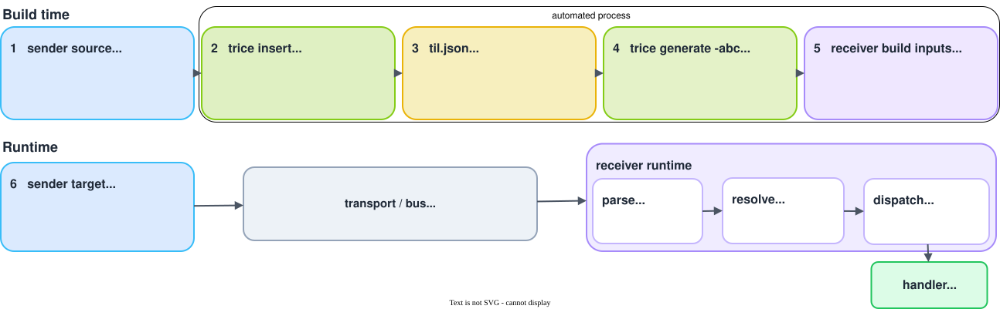
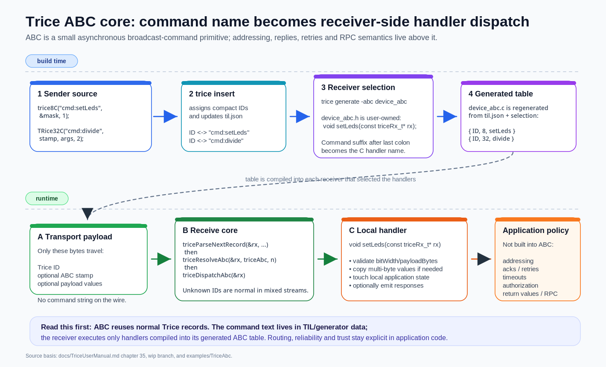
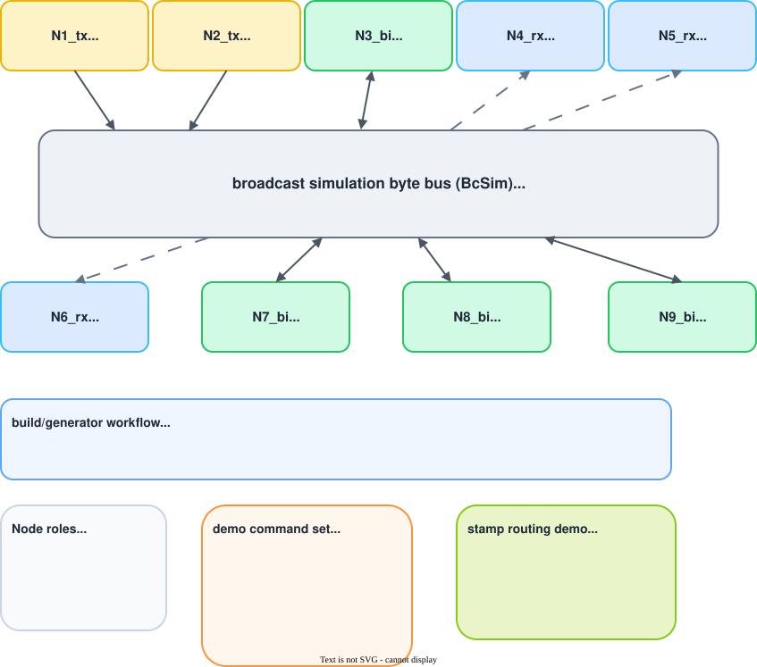
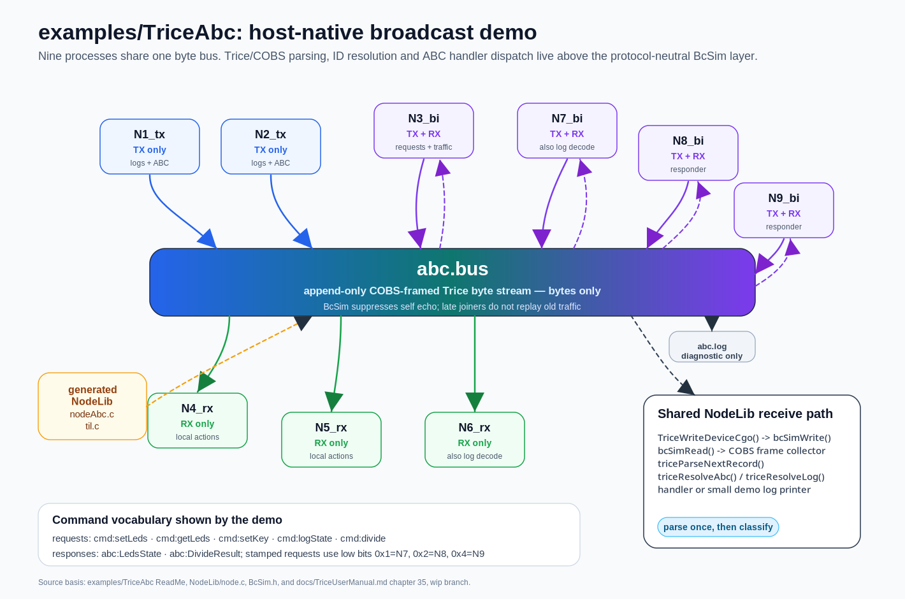

# Asynchronous Broadcast Commands

<details markdown="1">
<summary>Contents</summary>

<!-- mdtoc -->

- [1. Quick use](#quick-use)
- [2. ABC macro families](#abc-macro-families)
- [3. Command names and handler names](#command-names-and-handler-names)
- [4. Receiver selection and generated table](#receiver-selection-and-generated-table)
- [5. Receive runtime contract](#receive-runtime-contract)
- [6. Handler payload handling](#handler-payload-handling)
- [7. Responses](#responses)
- [8. What ABC is not](#what-abc-is-not)
- [9. Example: examples/TriceAbc](#example-examplestriceabc)
  - [9.1. ABC Demo Layout, Startup, and Runtime Policy](#abc-demo-layout-startup-and-runtime-policy)
- [10. BcSim Broadcast Byte-Stream Simulator](#bcsim-broadcast-byte-stream-simulator)
- [11. Host tests](#host-tests)
- [12. Building RPC-like protocols on top](#building-rpc-like-protocols-on-top)
- [13. Security boundary](#security-boundary)
- [14. Summary](#summary)

<!-- numbering=true min=2 max=4 slug=github anchor=true link=true toc=true bullets=auto -->
<!-- /mdtoc -->

</details>

Trice ABC adds command-style communication to normal Trice records. The API is intentionally small and meant as a building block.

The [TriceAbc example](../../examples/TriceAbc) demonstrates ABC communication with COBS framing and without encryption. Its node configurations define the framing explicitly; when experimenting with a different transport setup, update the sender, receiver and logging options together.

ABC means:

- **Asynchronous:** the sender emits a record and continues.
- **Broadcast:** zero, one, or several receivers may observe the same record.
- **Commands:** selected receivers may execute locally compiled handlers.

The key idea is the generated ID/function-pointer list on the receiver:

```text
sender source
  trice8C("cmd:setLeds", &mask, 1)
        |
        | trice insert
        v
til.json
  ID <-> "cmd:setLeds"
        |
        | trice generate -i til.json -abc device_abc
        v
device_abc.c
  { ID, 8, setLeds }
        |
        | receive runtime
        v
TriceParseRecord() -> TriceResolveAbc() -> TriceDispatchAbc() -> setLeds(&rx)
```

Only the Trice ID, optional ABC stamp, and optional payload are transferred. The command string stays in the TIL data and is used during receiver-code generation.

## 1. <a id="quick-use"></a>Quick use



1. Enable sending and/or receiving in `triceConfig.h`:

```c
#define TRICE_TX_ABC_SUPPORT 1 // needed for ABC send macros
#define TRICE_RX_ABC_SUPPORT 1 // needed for ABC receive/dispatch
```

Sending and receiving are independent. A device may be send-only, receive-only, or both.

2. Send a command with an ABC macro:

```c
#include "trice.h"

void SetLeds(uint8_t mask) {
    trice8C("cmd:setLeds", &mask, 1);
}
```

3. Insert IDs into the sources and TIL file:

```bash
trice insert -til til.json -li li.json -src ./project_src
```

4. Generate the receiver selection/header pair and table:

```bash
trice generate -i til.json -abc ./device_abc
```

This creates:

```text
device_abc.h   generated once, then user-owned receiver selection header
device_abc.c   generated table, regenerated from til.json and device_abc.h
```

5. Edit `device_abc.h` and keep only the commands this target shall receive:

```c
#ifndef DEVICE_ABC_H_
#define DEVICE_ABC_H_

#include "triceRx.h"

#ifdef __cplusplus
extern "C" {
#endif

void setLeds(const triceRx_t* rx);

#ifdef __cplusplus
}
#endif

#endif /* DEVICE_ABC_H_ */
```

6. Implement the selected handlers:

```c
#include <stdint.h>
#include "device_abc.h"

static uint8_t boardLeds;

void setLeds(const triceRx_t* rx) {
    if (rx == 0 || rx->payloadBytes != 1u) {
        return;
    }
    boardLeds = rx->payload[0];
}
```

7. Feed decoded Trice records to the receive runtime:

```c
triceRx_t rx;
int used = TriceParseRecord(&rx, record, recordLen);

if (used > 0 && TriceResolveAbc(&rx, triceAbc, triceAbcElements) == TRICE_RX_RESULT_OK) {
    (void)TriceDispatchAbc(&rx);
}
```

`triceRx` parses already deframed and decrypted Trice records. UART, RTT, file, socket, COBS, TCOBS, and encryption handling stay outside this small receive core.

<!---->



## 2. <a id="abc-macro-families"></a>ABC macro families

The suffix `C` means command. The optional number in the macro name is the payload element width.

no stamp   | 16-bit stamp | 32-bit stamp | payload element width
------------|--------------|--------------|-----------------------
`triceC`   | `TriceC`     | `TRiceC`     | no payload
`trice8C`  | `Trice8C`    | `TRice8C`    | 8-bit
`trice16C` | `Trice16C`   | `TRice16C`   | 16-bit
`trice32C` | `Trice32C`   | `TRice32C`   | 32-bit
`trice64C` | `Trice64C`   | `TRice64C`   | 64-bit

Examples:

```c
triceC("cmd:motorStop"); // no stamp, no value

uint16_t seq16 = NextSeq16();
TriceC("cmd:getLeds", seq16); // 16-bit stamp, no value

uint32_t unixTime = BoardTime();
trice32C("cmd:setTime", &unixTime, 1); // no stamp, one 32-bit value

int16_t step[] = { -50, 0, 300, 0 };
TRice16C("cmd:motorStep", 0x12345678, step, 4); // 32-bit stamp, 4 16-bit values
```

For stamped ABC macros, the explicit ABC stamp follows the command string and precedes the payload arguments.

ABC stamps are application-defined correlation values. They are not automatically generated Trice timestamps. Pass `TriceStamp16` or `TriceStamp32` explicitly if a real timestamp is desired.

```c
TriceC("cmd:sample", TriceStamp16);
TRiceC("cmd:sample", TriceStamp32);
```

## 3. <a id="command-names-and-handler-names"></a>Command names and handler names

The ABC command name is written where a normal Trice format string would stand. Treat it as a command name, not as a printf format string.

```c
triceC("cmd:motorStop");
trice32C("cmd:setTime", &unixTime, 1);
```

Everything before the last colon is tag/grouping text. The generator uses the part after the last colon as C handler name:

```text
cmd:motorStop       -> motorStop
cmd:deviceA:sample  -> sample
abc:LedsState       -> LedsState
```

The prefixes are not ABC addresses. They are useful for readable TIL data, filtering, grouping, and examples.

The final command part must be a valid C identifier. Do not add a trailing newline to ABC command strings.

## 4. <a id="receiver-selection-and-generated-table"></a>Receiver selection and generated table

`trice generate -abc target` creates `target.h` and `target.c` in `-genDir` (default `./generated`). The header is user-owned after its first creation: edit and version it to select the commands compiled into that target. The repository ignores generated C files but leaves this editable header visible to Git. An explicit target path such as `-abc path/target` keeps its existing location relative to the TIL directory.

The generator regenerates the C table from the intersection of:

- ABC entries found in `til.json`, and
- active handler declarations found in `device_abc.h`.

A command present in `til.json` but not declared in `device_abc.h` is ignored by this receiver. A declaration without a matching TIL entry is a build/configuration issue.

Generated `device_abc.c` has the essential shape:

```c
#include "device_abc.h"

const triceAbc_t triceAbc[] = {
    /* id, bitWidth, function pointer */
    { 5150u, 8u, setLeds },
    { 4818u, 0u, getLeds },
};

const unsigned triceAbcElements = sizeof(triceAbc) / sizeof(triceAbc[0]);
```

Do not edit `device_abc.c`. Implement the selected handlers in normal application code. Missing handler implementations fail as normal linker errors.

## 5. <a id="receive-runtime-contract"></a>Receive runtime contract

The common receive API is in `src/triceRx.h` and `src/triceRx.c`.

Use `TriceParseRecord()` to parse one decoded Trice record. It fills a `triceRx_t`:

```c
uint16_t id;              // Trice ID
uint8_t  bitWidth;        // payload element width after resolution
uint8_t  stampBits;       // 0, 16, or 32
uint32_t stamp;           // application-defined ABC stamp
const uint8_t* payload;   // points into caller-owned input buffer
uint16_t payloadBytes;    // payload byte count
```

The payload is not copied. Do not store `rx->payload` beyond the lifetime of the input buffer unless the handler copies the data.

`TriceResolveAbc()` looks up the parsed ID in the generated `triceAbc[]` table and attaches the resolved bit width and function pointer to `rx`.

`TriceDispatchAbc()` validates the payload size against the resolved bit width and calls the selected handler. Unknown IDs are normal in mixed streams and can be ignored.

For simple one-record receive paths, `TriceAbcOnReceive(pBuf, len)` is available as a convenience wrapper. Stream receivers should usually parse records explicitly, advance by the positive consumed byte count, and decide per record whether it is ABC, normal log traffic, counted typeX0 traffic, or unknown traffic.

## 6. <a id="handler-payload-handling"></a>Handler payload handling

Handlers get only `const triceRx_t*`. Application state must come from normal program context.

Use `rx->bitWidth`, `rx->payloadBytes`, and `rx->payload` to interpret the payload. For multi-byte values, prefer copying from the byte buffer instead of casting the pointer (alignment).

```c
#include <string.h>

void setTime(const triceRx_t* rx) {
    uint32_t t;

    if (rx == 0 || rx->bitWidth != 32u || rx->payloadBytes != sizeof(t)) {
        return;
    }

    memcpy(&t, rx->payload, sizeof(t));
    BoardSetTime(t);
}
```

Use the configured Trice transfer order consistently if payload values are exchanged between different endian architectures.

## 7. <a id="responses"></a>Responses

ABC has no built-in response model. A handler may send no response, one response, or several responses.

A common pattern is:

```c
// request
TriceC("cmd:getLeds", seq16);

// response from interested receiver
TRice8C("abc:LedsState", responseStamp32, &leds, 1);
```

The response is just another Trice message. It may be a normal log message or another ABC command. Use stamps to correlate responses with requests.

## 8. <a id="what-abc-is-not"></a>What ABC is not

ABC is not RPC by itself.

ABC does not define:

- addressed delivery,
- exactly-one receiver semantics,
- acknowledgements,
- retries,
- timeouts,
- authorization,
- discovery,
- routing,
- quorum logic,
- waiting for a return value.

Build these policies above ABC when needed.

ABC is also not remote code execution. A receiver can execute only handlers already compiled into the firmware and selected by its generated ABC table.

## 9. <a id="example-examplestriceabc"></a>Example: `examples/TriceAbc`

The host-native demo shows ABC without embedded hardware.

Run it from the example directory:

```bash
cd examples/TriceAbc
./build.sh
./demo.sh
```



The demo uses `BcSim` as a small byte bus. It transports bytes only; the Trice-specific logic is in `NodeLib` and the node programs.

The build script demonstrates the full workflow:

```bash
trice insert ...
trice generate -i ../../demoTIL.json -abc NodeLib/nodeAbc
trice generate -i ../../demoTIL.json -src . -logC=NodeLib/til.c
```

It produces:

```text
NodeLib/nodeAbc.h   shared user-owned ABC selection header
NodeLib/nodeAbc.c   shared generated ABC table
NodeLib/til.c       compact generated log metadata for normal-log resolving
```

The demo nodes have different roles:

- `N1_tx`, `N2_tx`: send ABC commands.
- `N3_bi`, `N7_bi`, `N8_bi`, `N9_bi`: send and receive.
- `N4_rx`, `N5_rx`, `N6_rx`: receive only.
- `N6_rx` and `N7_bi`: additionally resolve normal Trice log traffic.

The demo commands include:

- `cmd:setLeds`
- `cmd:getLeds`
- `cmd:setKey`
- `cmd:logState`
- `cmd:divide`
- `abc:LedsState`
- `abc:DivideResult`

`cmd:getLeds` and `cmd:divide` show request/response behavior built above ABC. The stamped requests use low stamp bits as a small responder bitmap in the demo. That is application policy, not ABC core behavior.

The shared runtime flow is:

```text
normal Trice macro / ABC macro
  -> TriceWriteDevice()
  -> BcSim byte bus
  -> COBS frame collector
  -> TriceParseRecord()
  -> TriceResolveAbc() / TriceResolveLog()
  -> node handler or demo log printer
```

The example intentionally parses once and then decides whether the record is ABC, normal log traffic, counted typeX0 traffic, or unknown traffic. This is the recommended style for mixed receive streams.

An example log snippet:

```txt
...
N3_tx: ABC-> cmd:setLeds(0c)
N6_rx: log:tick=203
N6_rx: log:from=3 phase=3
N6_rx: log:text=N3 bidirectional
N6_rx: x0 3 bytes: 33 34 35
N6_rx: leds=[  **    ]
N7_bi: log:tick=203
N7_bi: log:from=3 phase=3
N7_bi: log:text=N3 bidirectional
N7_bi: x0 3 bytes: 33 34 35
N7_bi: leds=[  **    ]
N5_rx: x0 3 bytes: 33 34 35
N5_rx: leds=[  **    ]
...
```

The broadcast simulation _abc.bus_ log starts with:

```txt
# BcSim traffic log
# bc.bus is a pure binary byte stream. This text log is diagnostic only.
# offset and len are decimal values. Bytes are hexadecimal %02x values.
#   offset  len device       dir status               bytes
# -------- ---- ------------ --- -------------------- --------------------------------
         0   10 N3_bi        TX  trice                06 d2 53 c0 04 c8 01 01 01 00
        10   14 N3_bi        TX  trice                06 54 55 c0 08 03 01 01 01 01 01 01 01 00
        24   22 N3_bi        TX  trice                15 99 53 c0 10 4e 33 20 62 69 64 69 72 65 63 74 69 6f 6e 61 6c 00
        46    6 N3_bi        TX  trice                02 02 03 30 31 00
         0   52 N8_bi        RX  poll                 06 d2 53 c0 04 c8 01 01 01 00 06 54 55 c0 08 03 01 01 01 01 01 01 01 00 15 99 53 c0 10 4e 33 20 62 69 64 69 72 65 63 74 69 6f 6e 61 6c 00 02 02 03 30 31 00
         0   52 N6_rx        RX  poll                 06 d2 53 c0 04 c8 01 01 01 00 06 54 55 c0 08 03 01 01 01 01 01 01 01 00 15 99 53 c0 10 4e 33 20 62 69 64 69 72 65 63 74 69 6f 6e 61 6c 00 02 02 03 30 31 00
...
```

With `tlog.sh` one can see the Trice logs as well:

```txt
th@Thomass-MacBook-Pro-7 TriceAbc % ./tlog.sh 
Jul 27 22:26:51.574387  FILEBUFFER:          N3_bi/main.c    14              log:(from node=N3_bi) tick=200
Jul 27 22:26:51.574475  FILEBUFFER:          N3_bi/main.c    18              log:(from node=N3_bi) from=3 phase=0
Jul 27 22:26:51.574491  FILEBUFFER:          N3_bi/main.c    22              log:(from node=N3_bi) text=N3 bidirectional
Jul 27 22:26:51.574503  FILEBUFFER:                                          typeX0 buffer: [48 49]
Jul 27 22:26:51.574729  FILEBUFFER:          N3_bi/main.c    14              log:(from node=N3_bi) tick=201
Jul 27 22:26:51.574773  FILEBUFFER:          N3_bi/main.c    18              log:(from node=N3_bi) from=3 phase=1
Jul 27 22:26:51.574921  FILEBUFFER:          N3_bi/main.c    22              log:(from node=N3_bi) text=N3 bidirectional
Jul 27 22:26:51.574942  FILEBUFFER:                                          typeX0 buffer: [49 50 51]
Jul 27 22:26:51.574952  FILEBUFFER:          N3_bi/main.c    50        0_103 cmd:getLeds
Jul 27 22:26:51.574964  FILEBUFFER:        NodeLib/node.c   654        0_103 abc:LedsState(00)
...
Jul 27 22:26:51.576238  FILEBUFFER:          N3_bi/main.c    22              log:(from node=N3_bi) text=N3 bidirectional
Jul 27 22:26:51.576246  FILEBUFFER:                                          typeX0 buffer: [59 60 61]
Jul 27 22:26:51.576254  FILEBUFFER:          N3_bi/main.c   102    0,000_103 cmd:getLeds
Jul 27 22:26:51.576262  FILEBUFFER:        NodeLib/node.c   656    0,000_103 abc:LedsState(80)
Jul 27 22:26:51.576271  FILEBUFFER:        NodeLib/node.c   656    0,000_103 abc:LedsState(80)
Jul 27 22:26:51.576279  FILEBUFFER:        NodeLib/node.c   656    0,000_103 abc:LedsState(80)
Jul 27 22:26:51.576287  FILEBUFFER:          N2_tx/main.c    14              log:(from node=N2_tx) tick=107
Jul 27 22:26:51.576296  FILEBUFFER:          N2_tx/main.c    18              log:(from node=N2_tx) from=2 phase=0
Jul 27 22:26:51.576304  FILEBUFFER:          N2_tx/main.c    22              log:(from node=N2_tx) text=N2 sends data
Jul 27 22:26:51.576312  FILEBUFFER:                                          typeX0 buffer: [39 41 43 45 47]
Jul 27 22:26:51.576320  FILEBUFFER:          N2_tx/main.c    62        0_102 cmd:getLeds
Jul 27 22:26:51.576328  FILEBUFFER:        NodeLib/node.c   654        0_102 abc:LedsState(80)
Jul 27 22:26:51.576337  FILEBUFFER:        NodeLib/node.c   654        0_102 abc:LedsState(80)
th@Thomass-MacBook-Pro-7 TriceAbc %
```



### 9.1. <a id="abc-demo-layout-startup-and-runtime-policy"></a>ABC Demo Layout, Startup, and Runtime Policy

The [host-native example](../../examples/TriceAbc/) requires Bash and a C compiler (`gcc`, `clang`, or `cc`); `CC` selects a compiler explicitly. Its build script uses `TRICE_BIN` if supplied, otherwise Go when available, or `trice` in `PATH`. It builds all nine executables below `build` (`.exe` on Windows).

```sh
TRICE_ID_WORKFLOW=bind ./build.sh   # Bind headers in build/sidecars
TRICE_ID_WORKFLOW=insert ./build.sh # Legacy Insert/Clean (current default)
```

Both workflows prepare private source copies under `build/source`, so switching does not rewrite the original sources. Insert runs Clean on those copies after a successful preparation, including after a compiler failure or cancellation. The shared `demoTIL.json` and local `demoLI.json` still collect decoding metadata; `TRICE_TIL_JSON`, `TRICE_LI_JSON` and `TRICE_LI_ROOT` select other files, with relative paths resolved from the repository root. Generated dispatch and log tables live in `build/source/NodeLib`. `NodeLib/nodeAbc.h` remains the shared user-owned command selection; keep your edits there.

The layout separates [BcSim](../../examples/TriceAbc/BcSim/) (reusable protocol-neutral transport), [BcSimChk](../../examples/TriceAbc/BcSimChk/) (standalone random-byte check), [NodeLib](../../examples/TriceAbc/NodeLib/) (shared Trice runtime and generated tables), and the nine node directories. `tx`, `rx`, and `bi` describe bus capability, not command vocabulary. `N1_tx`/`N2_tx` emit logs, counted typeX0 buffers, and commands; `N3_bi` also receives and replies; `N4_rx`/`N5_rx` execute commands only; `N6_rx` adds received log presentation; `N7_bi` combines replies and log presentation; `N8_bi`/`N9_bi` reply without the normal-log printer.

`demo.sh` starts receive-capable nodes first, then pure transmitters. It waits until every node has joined before releasing traffic. Receivers remain active until all transmitters finish, then drain requests and replies before closing. This uses explicit completion markers instead of a fixed startup delay. Direct node runs keep their original lifetime.

A BcSim participant joins at the current end of the bus and does not replay earlier traffic. Runtime files are `abc.bus` (binary framed stream), `abc.log` (human hex log), and `abc.bus.lock/` (writer lock). They are separate from BcSimChk's `bc.*` files. `abc.console.lock/` keeps each complete node or shell status line together; the console lock waits rather than falling back to interleaved writes. A killed lock owner may require manual cleanup after all participants stop.

Use this map when changing the ABC example:

Location | Purpose and ownership
--- | ---
[NodeLib/node.c](../../examples/TriceAbc/NodeLib/node.c) and [node.h](../../examples/TriceAbc/NodeLib/node.h) | Shared application handlers, receive integration and node runtime; edit as application code.
[NodeLib/nodeAbc.h](../../examples/TriceAbc/NodeLib/nodeAbc.h) | User-owned selection of commands and responses; keep your edits.
`build/source/NodeLib/nodeAbc.c` | Generated dispatch table connecting selected IDs to the handlers.
`build/source/NodeLib/til.c` | Generated table for normal log presentation; regenerated by the build script.
Node directories, such as [N3_bi](../../examples/TriceAbc/N3_bi/) | Each node's `main.c` and `triceConfig.h` select its behavior.
`build/` | Node executables, private source copies and Bind sidecars; runtime bus files are separate as described above.

Rebuild after changing calls or the selection header. The handler implementations remain ordinary application code. This example explicitly places generated tables under `build/source/NodeLib`; a simple `generate -abc device_abc` instead uses the selected `-genDir`, as shown in the [generated-file layout](bind.md#command-line).

The command shapes and effects are intentionally small:

Command | Payload and effect
--- | ---
`cmd:setLeds` | One 8-bit mask; update the local simulated LED bar.
`cmd:getLeds` | No payload; every other bidirectional node can answer `abc:LedsState` with an 8-bit mask. Receive-only nodes cannot reply.
`cmd:setKey` | Counted 8-bit byte buffer; store a local key.
`cmd:logState` | No payload; local printf side effect, without a Trice/ABC response.
`cmd:divide` | Two 32-bit floats; bidirectional nodes answer `abc:DivideResult` with one float.

Unstamped requests broadcast, so several identical-looking replies are expected. For stamped `getLeds` and `divide`, the demo's application policy uses low bits `0x0001`, `0x0002`, and `0x0004` to select `N7_bi`, `N8_bi`, and `N9_bi`. `N3_bi` demonstrates one and multiple selected responders. Replies retain stamp width and value. This is demonstration routing above ABC, not a built-in addressing protocol.

The node-local `triceConfig.h` files select TX, ABC RX, normal-log resolution, and direct output. Transmitting nodes select `TRICE_DIRECT_OUT_FRAMING TRICE_FRAMING_COBS`, for example in [N3_bi/triceConfig.h](../../examples/TriceAbc/N3_bi/triceConfig.h); the shared [NodeLib/node.c](../../examples/TriceAbc/NodeLib/node.c) collects and decodes COBS frames. All participants must agree on framing. The former separate `triceRxConfig.h` is no longer present. NodeLib implements the real generated handlers once; runtime `canSend` decides whether a node replies, avoiding forwarding wrappers in each node.

The host bridge preserves the normal send macros through `TriceWriteDevice()`. A persistent input buffer splits COBS frames at zero delimiters, keeps the incomplete tail, then iterates logical records inside each decoded frame. It skips record-alignment bytes only when the expected bytes are zero. Parsing happens once, followed by ABC, normal-log, typeX0, or unknown-record dispatch; `TriceAbcOnReceive()` is not the primary demo entry point. Selector-0 buffers have no ID or TIL lookup and are displayed as raw bytes. Nodes without normal-log resolution show ignored IDs; the small generated-`til.c` log printer is not a replacement for the Go host decoder and has no source-location column.

Self-written bus ranges are filtered, so a node does not receive its own frames or display its own logs as received traffic. `nodeSleepMs()` handles shared pacing. Process-local `TRICE_ENTER_CRITICAL_SECTION` hooks cannot protect a multi-process console; NodeLib's separate console lock does that. Each node formats a full line before acquiring the lock. LED output uses `*` for on and space for off, for example:

```text
N4_rx: leds=[**  *   ]
N6_rx: key=bravo7 leds=[***     ]
N7_bi: abc:DivideResult=3.140000
N6_rx: log:tick=4
N7_bi: x0 5 bytes: 10 11 12 13 14
```

## 10. <a id="bcsim-broadcast-byte-stream-simulator"></a>BcSim Broadcast Byte-Stream Simulator

[BcSim](../../examples/TriceAbc/BcSim/) is a standalone C module: several PC processes append to a shared local file and poll bytes written by others. It knows nothing about IDs, framing, encryption, packet boundaries, source addresses, commands, or handlers. `bc.bus` contains exactly the supplied bytes, with no inserted name, timestamp, length, or metadata; optional `bc.log` is human-readable diagnostic output only.

Each process owns one `BcSim_t`. `bcSimOpen()` opens a local view and starts reading at the current end of the bus. `bcSimWrite()` appends bytes and remembers its own written offset ranges; `bcSimRead()` filters those ranges from subsequent reads; `bcSimClose()` closes the view and resets state. Filtering by offsets rather than byte contents preserves identical data legitimately sent by different processes or repeated by one process.

Writers serialize through an atomically created `bc.bus.lock/` directory: acquire lock, obtain file size, append, remember the `[start,end)` range, optionally append the TX log line, then remove the lock. Competing writers retry until the timeout. Reads normally take no writer lock and may see partial data, which the higher stream layer must buffer. Define `BCSIM_READ_USES_LOCK 1` for deterministic reads under the same writer lock.

The [public API](../../examples/TriceAbc/BcSim/BcSim.h) is:

```c
int bcSimOpen(BcSim_t* io, const char* busPath,
              const char* logPath, const char* deviceName);
int bcSimRead(BcSim_t* io, uint8_t* p, size_t max, const char* status);
int bcSimWrite(BcSim_t* io, const uint8_t* p, size_t n, const char* status);
void bcSimClose(BcSim_t* io);
```

The three integer-returning functions return a non-negative byte count or a negative `BCSIM_ERR_*` value. The log starts with a header, then one TX/RX line per event: right-aligned decimal offsets and lengths without leading zeros, device, direction, optional status, and space-separated two-digit lowercase hexadecimal bytes.

```text
# BcSim traffic log
# bus file: bc.bus
# Columns: offset, len, device, direction, status, bytes
      0      12  A                 TX   tx-0                    35 6a 11 8e ...
     12      12  B                 RX   poll-1                  35 6a 11 8e ...
```

Try the transport alone, without Trice tables:

```sh
cd examples/TriceAbc/BcSimChk
./demo.sh
```

Its [build script](../../examples/TriceAbc/BcSimChk/build.sh) compiles `main.c` and `../BcSim/BcSim.c`; `CC` and `CFLAGS` allow experiments, such as `CFLAGS='-DBCSIM_READ_USES_LOCK=1' ./build.sh`. The demo starts four participants with random byte blocks and shows `bc.log` and a bus hex dump. The reusable library files are `BcSim_config.h`, `BcSim.h`, and `BcSim.c`; BcSimChk is not needed by applications reusing the transport.

This is a local demonstration medium, not high-performance IPC or a real embedded link. The bus grows until removed, only finitely many self-write ranges are remembered, and a restarted process cannot identify a previous instance's writes. A killed writer can leave a lock directory requiring cleanup. Network filesystems may not offer the same atomic directory and visibility behavior as local filesystems.

## 11. <a id="host-tests"></a>Host tests

`_test/abc_tx_host` checks the transmit side. It compiles a small C fixture with ABC TX support, emits selected `triceC`, `TriceC`, `TRiceC`, `trice8C`, `trice16C`, and `trice32C` calls, and compares the produced bytes with fixed fixtures. It verifies wire format generation only; it does not use a receiver table.

`_test/abc_rx_host` checks the receive side against the production `src/triceRx.c` runtime and a generated `device_abc` pair. The tests cover selected IDs, unknown IDs, no-payload records, 8/16/32/64-bit payloads, 16/32-bit stamps, malformed payload lengths, truncated records, nested dispatch, long-count payload encoding, log-resolution coexistence, and one-record-at-a-time stream consumption.

Together, these tests document the current ABC boundary: transmit macros create normal Trice records, the generated table maps selected IDs to handlers, and the receive runtime parses/resolves/dispatches one decoded record at a time.

## 12. <a id="building-rpc-like-protocols-on-top"></a>Building RPC-like protocols on top

Use ABC as the transport primitive and define the RPC policy in the application.

A minimal RPC-like pattern is:

1. Define request commands, for example `rpc:getValue`. (requester)
2. Define response commands, for example `rpc:getValueResult`. (a receiver acting as "requester" in a response)
3. Put a correlation value into the 16-bit or 32-bit ABC stamp.
4. Encode arguments in the payload.
5. Let the receiver validate the payload, execute local code, and send a response (`rpc:getValueResult`) with the same or derived stamp.
6. Let the requester also be an ABC receiver and keep a pending-request table.
7. Implement timeout, retry, duplicate handling, authorization, and addressing at application level.

For addressed RPC over a broadcast bus, put the destination into the stamp or payload and let non-matching receivers ignore the command. ABC itself still broadcasts the record.

## 13. <a id="security-boundary"></a>Security boundary

ABC receiving allows incoming Trice records to trigger selected local application handlers. Do not enable ABC receive processing on untrusted inputs without an application-level trust model.

Typical protections are:

- enable ABC receive only on trusted transports,
- filter by time to avoid burst attacks,
- validate every payload,
- add authentication or encryption around the transport,
- compile out `TRICE_RX_ABC_SUPPORT` where it is not needed.

## 14. <a id="summary"></a>Summary

ABC turns selected Trice IDs into asynchronous broadcast commands.

The small core is:

```text
ABC send macro
  -> Trice ID in til.json
  -> generated *_abc.h selection
  -> generated *_abc.c ID/function-pointer table
  -> user handler(const triceRx_t* rx)
```

Everything else, including addressing, responses, reliability, retries, authorization, and RPC semantics, belongs to the application layer above ABC.

Using Trice ABC for the same (remote) handler from different devices assigns different IDs to the same handler. This way one can consider a Trice ABC ID as senders address and the activated handler has access over the passed triceRx_t pointer to it.

