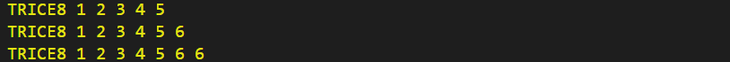

# Abstract

<details markdown="1">
<summary>Contents</summary>

<!-- mdtoc -->
<!-- numbering=true min=2 max=4 slug=github anchor=true link=true toc=true bullets=auto -->
<!-- /mdtoc -->

</details>

If you develop software for an embedded system, you need some kind of system feedback. Debuggers are awesome tools, but when it comes to analyzing dynamic behavior in the field, they are not usable.

Logging then, usually done with printf-like functions, quickly yields a result after having i.e. `putchar()` implemented. This turns out to be an expensive way in terms of processor clocks and needed FLASH memory, when you regard the library code and all the strings needing FLASH memory space. For small microcontrollers that's it.

Bigger microcontrollers are coming with embedded trace hardware. To use it, an expensive tool is needed. Useful for analyzing complex systems, but for in-field related issues at least unhandy.

Unhappy with this situation, the developer starts thinking of using digital pins or starts emitting some proprietary LED blinking codes or byte sequences, difficult to interpret.

The Trice technique tries to fill this gap, being minimal invasive for the target and as comfortable as possible. It is the result of a long-year dissatisfaction and several attempts to find a loophole to make embedded programming more fun and this way more effective.

Trice is an unusual software tracer-logger, using [internally](how_it_works_the_main_idea.md) IDs instead of format strings to get maximum [speed](trice_features_overview.md#execution-speed) but provides the user with a printf-like comfort:

```C
trice("Hello! 👋🙂");

int a = -4;
float x = 3.14159265;
trice("info:π/%d is %f with the bit pattern %032b\n", a, aFloat(x/a), x );

string s = "world";
triceS("msg:A runtime generated string: %s", s);
```

Replacing a `printf` library, the [Trice target source code](../../src) occupies 1-4 KB Flash [memory](trice_memory_needs.md) and less than 1 KB RAM depending on the configuration which is done with a user file named `triceConfig.h`:

```C
#define TRICE_DEFERRED_OUTPUT 1
#define TRICE_BUFFER TRICE_DOUBLE_BUFFER
#define TRICE_DEFERRED_UARTA 1
#define TRICE_UARTA USART2
```

The open-source Trice PC tool is executable on all [Go](https://go.dev) platforms, at least:

* [x] Linux
* [x] macOS
* [x] Windows

In the future other ports are possible:

* C/C++ or Rust program to run on a separate controller board
* [Go-mobile](https://github.com/golang/mobile)
* [tinyGo](https://tinygo.org/)
* [Wasm](https://webassembly.org/)
* [Python](https://en.wikipedia.org/wiki/Python_(programming_language))



<p align="right">(<a href="#abstract">back to top</a>)</p>

