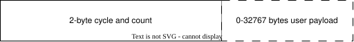
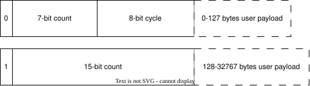
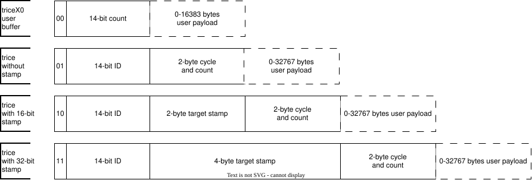
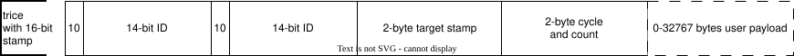

# Binary Format, Framing and Encryption

<details markdown="1">
<summary>Contents</summary>

<!-- mdtoc -->

* [1. Overview](#overview)
* [2. Symbols](#symbols)
* [3. Package Format](#package-format)
  * [3.1. typeX0 Records](#typex0-records)
  * [3.2. Framing - NONE or with COBS or TCOBS encoding](#framing---none-or-with-cobs-or-tcobs-encoding)
* [4. Framing and encoder dependencies](#framing-and-encoder-dependencies)
* [5. Endianness](#endianness)
* [6. Optional XTEA encryption](#optional-xtea-encryption)
* [7. Minimal Transfer Bytes Amount](#minimal-transfer-bytes-amount)

<!-- numbering=true min=2 max=4 slug=github anchor=true link=true toc=true bullets=auto -->
<!-- /mdtoc -->

</details>

## 1. <a id="overview"></a>Overview

- An arriving Trice buffer is framed. `tlog` expects TCOBS as default.
- The Trice buffer arrives in a known endianness. `tlog` expects little endian as default.
- The first 2 bytes are a 16-bit value with 2 most significant bits as selector bits. If both are `00` a special TypeX0 user buffer is detected. `tlog` then is expecting the 14 LSB as a payload count per default. Else we have a real Trice buffer. They all contain 2 bytes serving as cycle and payload count in a combined way:



Most trice messages are with small payloads (<128) and take advantage of a cycle counter which allows to detect transmission issues with a high probability. Some Trice messages may contain more payload bytes. Then the cycle counter is incremented too but not transmitted and the cycle byte serves as additional count bits.



The 2 selector bits control the Trice header layout in the following way:



For speed and alighnemt reasons the target internal representation is:



The leading doubled 2 bytes are removed before framing. But there are cases, these doubled 2 bytes are transmitted too. That is when using direct mode is used over RTT, a for developers important setting. To tell that `tlog` the CLI switch `-d16` is needed.

## 2. <a id="symbols"></a>Symbols

Symbol  | Meaning
:-------:|------------------------------------------------------------------------------
`i`   | ID bit
`I`   | `iiiiiiii` = ID byte
`n`   | number bit
`z`   | count selector bit
`s`   | stamp selector bit
`N`   | `znnnnnnnn` = count selector bit plus 7-bit number byte
`c`   | cycle counter bit
`C`   | z==0 ? `cccccccc` : `nnnnnnnn` = cycle counter byte or number byte extension
`t`   | (time)stamp bit
`T`   | `tttttttt` = (time)stamp byte
`d`   | data bit
`D`   | `dddddddd` = data byte
`...`  | 0 to 32767 data bytes
`"..."` | format string
`W`   | bit width 8, 16, 32 or 64 (uW stands for u8, u16, or u64)
`x`   | unspecified bit
`X`   | =`xxxxxxxx` unspecified byte

The long count field can represent up to 32767 payload bytes. This is the binary format limit, not the amount that the current target buffer macros can write. `TRICE_N`, `TRICE_S`, and the buffer macros built on `TRICE_N` cap the payload at `TRICE_SINGLE_MAX_SIZE - 12` bytes. `TRICE_SINGLE_MAX_SIZE` is the reserved size of one aligned target-side record and cannot exceed 32764 bytes; therefore the largest payload through these macros is 32752 bytes. The limit for a runtime string counts its characters, excluding the terminating zero byte.

The 12-byte allowance covers up to 8 bytes for the ID, a 32-bit timestamp, and the count field, plus one 4-byte word for alignment and output scratch space. The target rounds the stored payload up to a 32-bit boundary; some output paths also need space after the record, for example when padding for XTEA encryption. At the macro's maximum payload size, the aligned record uses at most `TRICE_SINGLE_MAX_SIZE - 4` bytes, leaving that word inside the reserved size. Package framing can add further bytes on the transport.

## 3. <a id="package-format"></a>Package Format

* Because of **TCOBS** or **COBS** package framing, package sizes are detectable by the Trice tool without additional length information from the payload itself.
* A decoded frame of 0 bytes is ignored. A 1-byte frame is unsupported. Frames with 2 or 3 bytes are selector-0 candidates when their selector bits are `00`; valid counted `typeX0` handling then still depends on the embedded count. Otherwise they are unsupported short user data.

  bytes       | Comment
  :------------|---------------------------------------------------------------------------------------------------------------
  ` `         | This is an empty package, which can have also a meaning. It is detectable by 2 consecutive 0-delimiter bytes.
  `X`         | 1-byte message, unsupported and reserved for extensions or user data
  `X` `X`     | 2-byte message, counted `typeX0` if selector `00`, otherwise unsupported and reserved
  `X` `X` `X` | 3-byte message, counted `typeX0` if selector `00`, otherwise unsupported and reserved

* In decoded frames with at least 2 bytes, the first 2 bytes contain 2 selector bits at the most significant position in the known endianness.
* The `0` selector is usable for any user encoding. The Trice tool handles such packages according to the CLI switch `-typeX0`.
* The `1`, `2` and `3` selector bits are followed by the 14-bit ID.

  16-bit groups                      | Selector (2 msb) | Comment                                                                                   | Endianness sizes
  :-----------------------------------|:----------------:|-------------------------------------------------------------------------------------------|:--------------------------------
  _________ `00xxxxxxX ...`          |        0         | [typeX0 record](binary_encoding.md#typex0-records), >= 2-byte message, reserved for extensions or user data | ___ `u16 ?...?`
  _________ `01iiiiiiI NC  ...`      |        1         | >= 4-byte message, Trice format without     stamp                                         | ___ `u16 u16 [uW] ... [uW]`
  _________ `10iiiiiiI TT NC ...`    |        2         | >= 4-byte message, Trice format with 16-bit stamp                                         | ___ `u16 u16 u16 [uW] ... [uW]`
  `10iiiiiiI 10iiiiiiI TT NC ...`    |        2         | First 16bit are doubled. Info over `-d16` trice switch.                                   | `u16 u16 u16 u16 [uW] ... [uW]`
  _________ `11iiiiiiI TT TT NC ...` |        3         | >= 4-byte message, Trice format with 32-bit stamp                                         | ___ `u16 u32 u16 [uW] ... [uW]`

* The selector `2` encoding has 2 possibilities. When using `TRICE_DIRECT_SEGGER_RTT_32BIT_WRITE` or encryption, for alignment reasons the first 16bit ID field is doubled. The Trice tool discards these 2 doubled bytes when the CLI switch `-d16` is given or encryption is active.
* Default endianness is little endian as most MCUs use little endianness. Otherwise the `-triceEndianness=bigEndian` CLI switch is needed.
* The receiving tool first evaluates the 2 selector bits and follows these rules:
  * 0: handle it according to `-typeX0` or report an error and ignore the whole package when no X0 handling is selected.
  * 1:                                    next 14 bits are the ID                                                              followed by 2 bytes u16=NC and optional parameter values. Package size is >= 4 bytes.
  * 2 and `-d16` CLI switch not provided: next 14 bits are the ID                            and convert then u16=TT=stamp16   followed by 2 bytes u16=NC and optional parameter values. Package size is >= 6 bytes.
  * 2 and `-d16` CLI switch     provided: next 14 bits are the ID, discard 2 following bytes and convert then u16=TT=stamp16   followed by 2 bytes u16=NC and optional parameter values. Package size is >= 8 bytes.
  * 3:                                    next 14 bits are the ID                            and convert then u32=TTTT=stamp32 followed by 2 bytes u16=NC and optional parameter values. Package size is >= 8 bytes.
* Use the ID to get parameter width `W`=8,16,32,64 and parameter count from file *til.json*, then convert the payload accordingly.
  * Within one trice message the parameter bit width `W` does not change.

> Example for Trices without timestamps

* The ([T]COBS decoded) binary Trice data normally starts with a little endian u16 Trice ID value.
* All following values are encoded in the known endianness.

value   | byte offset | type              | comment
---------|------------:|-------------------|--------------------------------------------------------------------------------------------------------------------------------------------------------------------------------------------------------------------------------------------------------------------------------------------------------------------------------
IdLo    |           0 | byte              | The first byte is always the Trice ID lower 8 bits.
IdHi    |           1 | byte              | The second byte 2 most significant bits are `01` and the 6 least significant bits are the Trice ID upper 6 bits.
NC      |           2 | u16               | The most significant bit is the count selector bit `z` and usually **0**, telling, that the following 7 bits are the payload byte count and that the 8 least significant bits are the cycle counter. If `z` is **1**, the current Trice contains no cycle counter and has a 15-bit payload count instead (for payloads > 127).
payload |           4 | u8\|u16\|u32\|u64 | The payload contains a number of equal size values.

### 3.1. <a id="typex0-records"></a>typeX0 Records

The user can insert any data with a well-defined structure into the Trice data stream. When interpreting the Trice binary data, the Trice tool handles selector-0/typeX0 records according to the CLI switch `-typeX0`.

One possible use case is to have user **printi** statements parallel to Trices (see [Legacy User Code Option Print Buffer Wrapping and Framing](legacy_user_code.md#legacy-user-code-option-print-buffer-wrapping-and-framing)). For the counted typeX0 variant, the user prepends a generated **printi** buffer with its payload size as a 16-bit count smaller than `16384`. See [./_test/userprint_dblB_de_tcobs_ua/TargetActivity.c](../../_test/userprint_dblB_de_tcobs_ua/TargetActivity.c) for an implementation option. See chapter [20. typeX0 User Packets](typex0_user_packets.md) for further details.

### 3.2. <a id="framing---none-or-with-cobs-or-tcobs-encoding"></a>Framing - NONE or with COBS or TCOBS encoding

> Summary Information for Trice Data Parsing

* With COBS or TCOBS framing (TCOBS includes compression):
  * 1-3 package delimiter zeroes possible between 2 packages.
  * One or more Trices packed together and only at the package end are 0-3(7) padding zero bytes possible.
  * Counted `typeX0` records can occur together with normal Trices in one package because their length is checkable. X0 formats without length information need their own package framing.

* With NONE framing:
  * With XTEA encryption and `-pf=none` or `-pf=none64` 64-bit alignment: 0-7 zero bytes after a single Trice.
  * Without encryption the stream is compact or 32-bit aligned. That does not change for one session and is detectable.
    * `-pf=none` -> detect stream (deprecated, only for backward compatibility)
    * `-pf=none8` -> stream is compact
    * `-pf=none32` -> stream is 32-bit aligned
  * A stream with alignment is allowed to have only a single Trice between two alignments. An alignment is just a multiple of 4(8)-bytes distance.
  * These combinations are forbidden, because we cannot safely know the actual padding count: `|TriceATriceB0|TriceC00|` <- Is the `0` after `TriceB` a padding zero or part of `TriceC`?
    * Framing NONE && TRICE_MULTI_PACK_MODE && 32-bit write
    * Framing NONE && TRICE_MULTI_PACK_MODE && XTEA encryption

> Details

* For maximum storage speed each Trice message starts at a 32-bit boundary and has 1-3 padding bytes inside the target device RAM.
* The macro `TRICE_LEAVE` and/or function `TriceTransfer` ([Trice Target Code Implementation](target_implementation.md)) are the Trice data output.
  * In **direct mode** each single message gets its own transfer buffer.
  * In **deferred mode** any count of Trice messages is in the transfer buffer.
  * Additional counted **typeX0 records** can share a transfer buffer with normal Trices. Non-counted selector-0 user data needs a separate transfer buffer because its length is not checkable.

<!--
* To create the transfer buffer, there are different policies possible:
  1. **TRICE_MULTI_PACK_MODE**: Compact RAM buffer by removing all padding bytes, encode it as a single (T)COBS package, append one 0-delimiter and transmit. This allows to reduce the transmitted data amount by paying the price of possibly more data loss in case of an error. Also the Trice tool internal data interpretation can perform less checks. TRICE_MULTI_PACK_MODE makes only sense for deferred output.
     * When Trice is used without framing, the data stream interpretation is possible, but not 100% secure for 32-bit writes, because in some cases we do not know, if 1-3 zeroes after a Trice, part of those are padding bytes or not. We allow such configuration, but will issue a warning: *Combination TRICE_MULTI_PACK_MODE && framing NONE && 32-bit write is depreachiated.*
  2. **TRICE_SINGLE_PACK_MODE**: Encode each Trice separate as (T)COBS, append a 0-delimiter for each and pack them all together before transmitting. This increases the transmit data slightly but minimizes the amount of lost data in case of a data disruption.
     * When Trice is used without framing, the data stream interpretation is possible, but not 100% secure for 32-bit writes, because in some cases we do not know, if 1-3 zeroes after a Trice, part of those are padding bytes or not. To avoid that specify `-pf=none32`. We allow such configuration, because even with `pf=none` a one-time detection will work well in almost every case.
  3. Additional **typeX0 records**: Those messages are not mixed into (T)COBS packages. They get their own (T)COBS packages.
-->

*Framing NONE Overview Table:*

*mode* | *packed* | `-pf=`   | encr | *wr* | *use* | pad | stream  | remark
--------|----------|----------|------|------|-------|-----|---------|----------
*di*   | *single* | `none32` | NONE | *32* | *32*  | 0-3 | aligned | done
*de*   | *single* | `none8`  | NONE | *8*  | *8*   | 0   | compact | done
*de*   | *single* | `none32` | NONE | *8*  | *32*  | 0   | aligned | **plan**
*de*   | *multi*  | `none8`  | NONE | *8*  | *8*   | 0   | compact | done
*de*   | *multi*  | `none32` | NONE | *8*  | *32*  | 0   | unknown | forbid
*de*   | *multi*  | `none`   | NONE | *8*  | *32*  | 0   | unknown | forbid
*di*   | *single* | `none64` | XTEA | *32* | *32*  | 0-7 | aligned | done
*de*   | *single* | `none64` | XTEA | *8*  | *8*   | 0-7 | aligned | done
*de*   | *single* | `none64` | XTEA | *8*  | *32*  | 0-7 | aligned | **plan**
*de*   | *multi*  | `none`   | XTEA | *8*  | *8*   | 0-7 | unknown | forbid
*de*   | *multi*  | `none`   | XTEA | *8*  | *32*  | 0-7 | unknown | forbid

* wr: The internal write function bit width.
* use: The possible user write function bit width (auxiliary write)

## 4. <a id="framing-and-encoder-dependencies"></a>Framing and encoder dependencies

* Trice messages are framed binary data, if framing is not disabled.
* Framing is important for data disruption cases and is done with [TCOBS](https://github.com/rokath/tcobs) (has included data compression) but the user can force to use [COBS](https://github.com/rokath/COBS), what makes it easier to write an own decoder in some cases or disable framing at all.
  * Set `TRICE_DIRECT_OUT_FRAMING` and/or `TRICE_DEFERRED_OUT_FRAMING` inside `triceConfig.h` and use the Trice tool `-packageFraming` switch accordingly.
* For robustness each Trice can get its own (T)COBS package (`TRICE_DEFERRED_TRANSFER_MODE == TRICE_SINGLE_PACK_MODE`). That is configurable for transfer data reduction. Use `#define TRICE_DEFERRED_TRANSFER_MODE TRICE_MULTI_PACK_MODE` inside `triceConfig.h` (is now default). This allows to reduce the data size a bit by avoiding many 0-delimiter bytes but results in some more data loss in case of data disruptions.

Encoder dependencies follow the **active outputs**. Select direct framing with `TRICE_DIRECT_OUT_FRAMING` and deferred framing with `TRICE_DEFERRED_OUT_FRAMING`. An inactive output's framing setting adds no dependency. For example, a direct-only COBS application does not need TCOBS despite the deferred framing default.

Active output framing | Required encoder source | Encoder sources that can be omitted
--- | --- | ---
TCOBS only | `src/tcobsv1Encode.c` | `src/cobsEncode.c`
COBS only | `src/cobsEncode.c` | `src/tcobsv1Encode.c`
NONE only | None | Both encoder sources
Direct COBS and deferred TCOBS, or the reverse | Both encoder sources | Neither

These selective builds work without LTO, optimization or linker removal of unused sections. Encryption-disabled builds need no `src/xtea.c`; builds without RTT need no `src/SEGGER_RTT.c` or project RTT configuration. With the Trice backend disabled (`TRICE_OFF` or `TRICE_CLEAN`, without counted typeX0 transmission), retained UART settings do not require `triceUart.h` or UART hardware hooks. The [minimal demos](examples.md#minimal-pc-demos-direct-and-deferred) still compile `src/*.c` for simplicity; removing unreferenced code from such a complete-library build remains a separate [image-size optimization](memory_usage.md).

`TriceEncode(encrypt, framing, dst, buf, len)` keeps its runtime framing argument. By default, `TRICE_COBS_ENCODE_SUPPORT` and `TRICE_TCOBS_ENCODE_SUPPORT` include exactly the encoders needed by active outputs. If your own code calls this API with additional framing methods, enable the corresponding support in `triceConfig.h` and link its encoder source. For example, add runtime COBS to an otherwise TCOBS-only application with:

```c
#define TRICE_COBS_ENCODE_SUPPORT 1
```

Use `TRICE_TCOBS_ENCODE_SUPPORT 1` to add runtime TCOBS instead. Both switches accept only `0` or `1`; disabling an encoder required by an active output is a compile-time error. A request for a framing method not included in the build returns `0`, leaves the source and destination untouched, and produces no fallback frame. Unknown framing values also return `0`. NONE remains available without either encoder; its return value is the copied byte count, without a delimiter. Check the return value before sending the destination buffer.

The [encoder dependency tests](../../internal/id/encoder_dependencies_test.go) link isolated native projects at `-O0`, decode their real output, and check disabled outputs and runtime opt-ins. They also inspect ARM GCC objects when that toolchain is installed; no test relies on LTO or unused-section removal.

## 5. <a id="endianness"></a>Endianness

* To interpret a decoded package, it´s endianness needs to be known.
* For efficiency, binary trice data are normally stored and transmitted in MCU endianness and the Trice tool expects binary data in little endian format as most MCUs are little endian.
* On big endian MCUs the compiler switch `TRICE_MCU_IS_BIG_ENDIAN` needs to be defined as 1 and `TRICE_TRANSFER_ORDER_IS_BIG_ENDIAN` should have the same value. The Trice tool has a CLI switch "triceEndianness" which needs to be set to "bigEndian" then.
* If trice transmit data are needed to be not in MCU order for some reason, that increases the critical trice storage time and target code amount.
* De facto different values for  `TRICE_MCU_IS_BIG_ENDIAN` and `TRICE_TRANSFER_ORDER_IS_BIG_ENDIAN` are mainly used to test the Trice CLI switch `-triceEndianness bigEndian` automatically.

## 6. <a id="optional-xtea-encryption"></a>Optional XTEA encryption

Trice supports optional [XTEA](https://en.wikipedia.org/wiki/XTEA) encryption. Configure it in the application's `triceConfig.h`, using the settings documented in [triceDefaultConfig.h](../../src/triceDefaultConfig.h):

| Setting | Use |
| --- | --- |
| `XTEA_ENCRYPT_KEY` | Target encryption key. |
| `TRICE_DIRECT_XTEA_ENCRYPT 1` | Encrypt direct output; adds work in the call's critical path. |
| `TRICE_DEFERRED_XTEA_ENCRYPT 1` | Encrypt deferred output during transfer. |

Run `trice log -port ... -password MySecret -showKey` once to obtain the matching key definition, then use the same password when decoding. The example password is not a project secret.

Encryption pads data to an 8-byte boundary before framing; decryption follows frame decoding. COBS is the usual choice. Select `-pf cobs` on the host and `TRICE_FRAMING_COBS` for the encrypted target output. TCOBS offers little compression on encrypted data.

This format provides no message-authentication mechanism. Do not interpret successful decryption as proof of the sender's identity or of unmodified data.

## 7. <a id="minimal-transfer-bytes-amount"></a>Minimal Transfer Bytes Amount

A Trice message is 4 bytes long (2 ID bytes and 2 count bytes) plus optional time stamps and/or values. In conjunction with the compressing [TCOBS](https://github.com/rokath/tcobs) framing the Trice data stream is as small as possible. Use the `-debug` switch to see the compressed and framed packages alongside the decompressed ones together with the decoded messages.

To see the encoding for each single message `#define TRICE_DEFERRED_TRANSFER_MODE TRICE_SINGLE_PACK_MODE` inside the project specific _triceConfig.h_.

Without `-debug` CLI switch:

```bash
ms@MacBook-Pro G0B1_inst % trice log -p /dev/tty.usbmodem0007722641261 -prefix off -li off -hs off -ts off
...
This is a message without values and without stamp.
...
```

With `-debug` CLI switch:

```bash
ms@MacBook-Pro G0B1_inst % trice log -p /dev/tty.usbmodem0007722641261 -prefix off -li off -hs off -ts off -debug
...
TCOBSv1: c1 74 e2 23 00
->TRICE: c1 74 e2 00
This is a message without values and without stamp.
...
```

The TCOBS encoding cannot compress in the example above, because the data are too small, but here is a significant compression result shown:

```bash
ms@MacBook-Pro G0B1_inst % trice log -p /dev/tty.usbmodem0007722641261 -prefix off -hs off -debug
...
TCOBSv1: b8 76 7b 18 84 fe e1 fd e1 fc e1 fb e1 fa e1 00
->TRICE: b8 76 7b 18 ff ff ff ff fe ff ff ff fd ff ff ff fc ff ff ff fb ff ff ff fa ff ff ff
_test/testdata/triceCheck.c   805              value=-1, -2, -3, -4, -5, -6
...
```

* The `TRICE_SINGLE_PACK_MODE` inserts after each Trice a package delimiter `0`.
* The `TRICE_MULTI_PACK_MODE` inserts after a group of Trice messages a package delimiter `0`, what minimizes the transmit data amount.

When encryption is active, a compression makes no sense, but the `TRICE_MULTI_PACK_MODE` can help to reduce the total amount of padding bytes, because each encrypted package must have a multiple of 8 as length.

```bash
ms@MacBook-Pro G0B1_inst % trice log -p /dev/tty.usbmodem0007722641261 -prefix off -hs off -pw MySecret -pf cobs -debug
...
cobs: 21 84 b7 60 8b 21 89 1e e3 07 6d dc d9 2d 6f 59 04 8e 50 8f 24 1c a2 63 2e 3d 4a 57 ef 39 63 01 cb 00
->TRICE: 84 b7 60 8b 21 89 1e e3 07 6d dc d9 2d 6f 59 04 8e 50 8f 24 1c a2 63 2e 3d 4a 57 ef 39 63 01 cb
-> DEC:  cc b6 63 01 71 02 ff fe cd 76 72 03 ff fe fd ce f6 64 81 00 00 73 04 ff fe fd fc 00 00 00 00 00
_test/testdata/triceCheck.c   827        0_355 value=-1, -2
_test/testdata/triceCheck.c   828              value=-1, -2, -3
_test/testdata/triceCheck.c   829    0,033_124 value=-1, -2, -3, -4
cobs: 19 50 70 79 d7 75 6f d7 99 dc d8 ec 06 e1 66 e7 a7 c1 0d 96 85 df 19 25 55 00
->TRICE: 50 70 79 d7 75 6f d7 99 dc d8 ec 06 e1 66 e7 a7 c1 0d 96 85 df 19 25 55
-> DEC:  cf b6 64 01 74 05 ff fe fd fc fb d0 76 75 06 ff fe fd fc fb fa 00 00 00
_test/testdata/triceCheck.c   830        0_356 value=-1, -2, -3, -4, -5
_test/testdata/triceCheck.c   831              value=-1, -2, -3, -4, -5, -6
...
```

