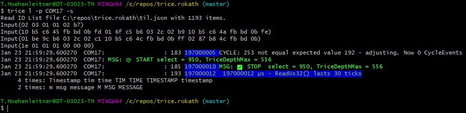
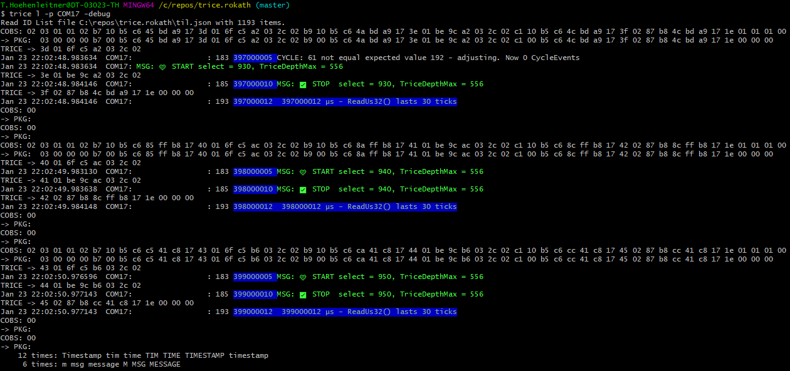
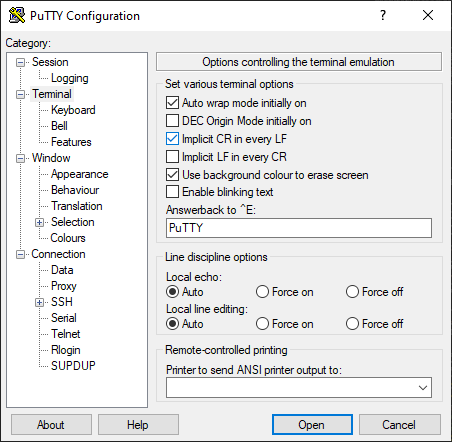
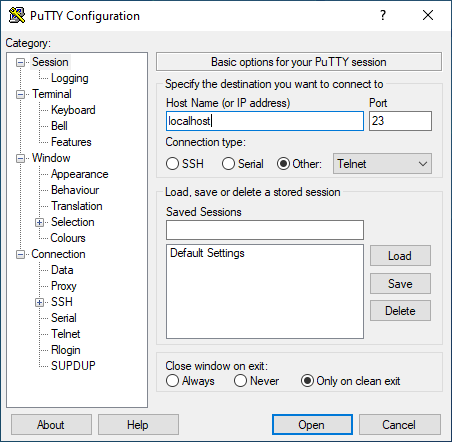
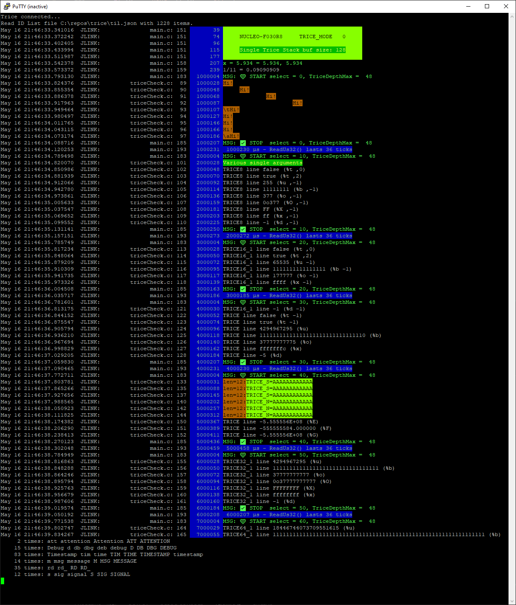
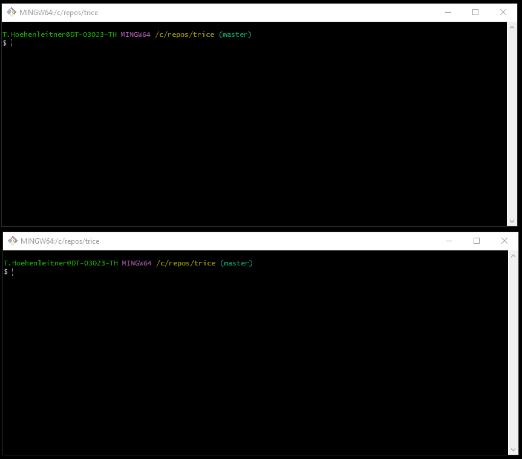
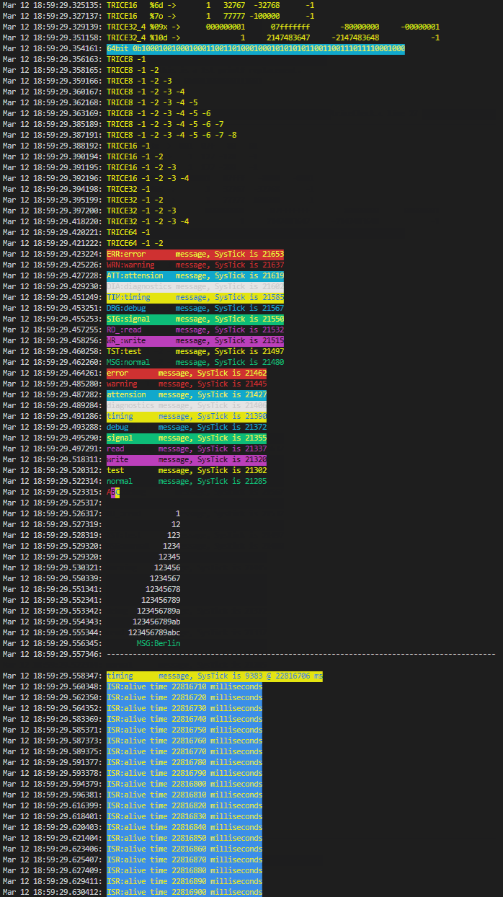

# Logging and Command-Line Tools

<details markdown="1">
<summary>Contents</summary>

<!-- mdtoc -->

* [1. Common information](#common-information)
* [2. Automatic dictionary reload](#automatic-dictionary-reload)
* [3. Some Log examples](#some-log-examples)
* [4. Logging over a display server](#logging-over-a-display-server)
* [5. Logfile output](#logfile-output)
* [6. Binary Logfile](#binary-logfile)
* [7. TCP4 output](#tcp4-output)
* [8. TCP4 input](#tcp4-input)
* [9. UDP4 input](#udp4-input)
* [10. Stimulate target with a user command over UART](#stimulate-target-with-a-user-command-over-uart)
* [11. Location Information](#location-information)
* [12. Example output](#example-output)
* [13. Logfile viewing](#logfile-viewing)
* [14. Using the Trice tool with 3rd party tools](#using-the-trice-tool-with-3rd-party-tools)
* [15. Several targets at the same time](#several-targets-at-the-same-time)

<!-- numbering=true min=2 max=4 slug=github anchor=true link=true toc=true bullets=auto -->
<!-- /mdtoc -->

</details>

## 1. <a id="common-information"></a>Common information

* `trice h -all` shows all options of the current version.
* `trice ver` prints version information.
* `trice s` shows you all found serial ports for your convenience.
* `trice l -p COM17` could fail if something is wrong. Additional switches are for help tracking the issue:
  * Use log witch `-s[howInputBytes]` to check if any bytes are received at all. 
  * With `-debug` you can see the [T]COBS packages and decoded Trice packages. 

* Use `trice bind` as a build dependency to generate IDs and compiler headers. Initialize `til.json` and `li.json` once for a new project and preserve them; see [Bind build integration](bind.md#build-integration).

* `trice ds` starts a display server listening on default ip address *127.0.0.1:61487* or any specified value. This is possible also on a remote device, lets say with ip address 192.168.1.200.
* `trice l -p COM18 -ds` sends the log strings to a display server with default ip address *127.0.0.1:61487* or any specified value, if for example `-ipa 192.168.1.200` the trice logs go to the remote device. You can start several trice log instances, all transmitting to the same display server.

## 2. <a id="automatic-dictionary-reload"></a>Automatic dictionary reload

Making it facile for a user to use Trice was the driving point just to have

* one Trice tool
* one additional [target code](../../src/) source folder
* a project specific simple to use [triceConfig.h](../../examples/F030_inst/Core/Inc/triceConfig.h)
* and to get away with the one macro `trice` for most situations.

Trice understands itself as a silent helper in the background to give the developer more focus on its real task. If, for example, `trice log` is running and you re-flash the target, there is ***no need to restart*** the Trice tool just to load changed decoding tables. When [til.json](../../demoTIL.json) is updated in a pre-build step, the Trice tool automatically reloads it during logging. The location table selected with `-li` is also reloaded if it was present when logging started.

For example, keep `trice log -i til.json -li li.json` running while you rebuild with `trice bind` or `trice insert`. New IDs, changed structured field names, and updated source locations become available to subsequent records in text, JSON, and KV output. Both ordinary file writes and replacement by a newly generated file are supported. Each save is read after a short settling interval (normally about 100 ms), including saves made shortly after one another. Active visualization rules check new or changed records against their existing rules; a rule already disabled because of an incompatible format stays disabled until the logger is restarted.

If a file is temporarily missing, empty, or invalid JSON while being saved, the logger keeps that table's last valid contents, reports a warning on stderr, and retries automatically. The two files reload independently; updating them is not a single atomic transaction. A valid JSON object replaces the respective in-memory table completely, including removal of keys no longer in the file. `{}` intentionally clears a table. Successful reloads are silent unless `-v` is enabled; reload diagnostics never enter the application logfile or JSON/KV output.

Use `-li off` to disable location information. If no location file existed at startup, create it before starting the logger to enable its automatic reload. File watching requires an available local directory; if setup fails, the logger warns which path cannot be watched and continues using the loaded data. Restart it after resolving that problem. Reloading dictionaries does not repair a disconnected RTT server or other transport connection, and location information still needs to match the firmware actually running on the target.

The Trice tool comes with many command line switches (`trice help -all`) for tailoring various needs, but mostly these are not needed. <small>The generated file [ref/trice-help-all.txt](../ref/trice-help-all.txt) contains this information as well.</small>


## 3. <a id="some-log-examples"></a>Some Log examples

* Log trice messages on COM3 8N1 115200 baud

```bash
trice log -i ./myProject/til.json -p=COM3
```

* Log trice messages on COM3 8N1 9600 baud and use default til.json

```bash
trice l -s COM3 -baud=9600
```

## 4. <a id="logging-over-a-display-server"></a>Logging over a display server

* Start displayserver on ip 127.0.0.1 (localhost) and port 61497

```bash
trice ds
```

* Log trice messages on COM3 and display on display server

```bash
trice l -ds -p COM3
```

* Shutdown remote display server on IP 192.168.1.23 port 45678

```bash
trice sd -r 192.168.1.23:45678
```

The IP address and port are free selectable. Using a display server, allows to watch the logs of one or many MCUs on a local or remote machine with the same or different display servers.

A local Trice instance sends Trice messages to a display server only, when a log line is complete (if consisting of several Trices). By using the CLI switches `-prefix` and `-suffix` you can decorate the loglines target specific to distinguish them in the output window(s).

## 5. <a id="logfile-output"></a>Logfile output

```bash
trice l -p COM3 -logfile auto
```

This creates a new logfile `2022-05-16_2216-40_trice.log` with the actual timestamp on each Trice start.

```bash
trice l -p COM3 -logfile trice.log
```

This creates a new logfile `trice.log` on first start and appends to it on each next Trice start.

Logfiles are text files one can see with 3rd party tools. Example: `cat trice.log`. They contain also the PC reception timestamps if where enabled.

## 6. <a id="binary-logfile"></a>Binary Logfile

```bash
trice l -p COM3 -binaryLogfile auto
```

This creates a new binary logfile `2022-05-16_2216-40_trice.bin` with the actual timestamp on each Trice start.

```bash
trice l -p COM3 -binaryLogfile trice.bin
```

This creates a new binary logfile `trice.bin` on first start and appends to it on each next Trice start.

Binary logfiles store the Trice messages as they come out of the target in binary form. They are much smaller than normal logfiles, but the Trice tool with the matching *til.json* is needed for displaying them and the PC timestamps are the displaying time: `trice l -p FILEBUFFER -args trice.bin`.

Recording happens before decoding, `-pick`, `-ban`, `-logLevel`, and visualization. These host options therefore do not remove received bytes from the binary recording, even with `-logLevel off`. Partial or malformed input is also recorded; a recording write failure is returned as an error. Data already lost or suppressed on the target cannot be recovered from this file.

Replay can use a different selection, for example `trice log -p FILEBUFFER -args trice.bin -pick err -pick wrn`. Keep the matching dictionary and decoding settings (encoding, framing, and encryption) with the recording. An explicit binary filename is appended to across runs; use a new filename when separate captures are needed. Keep binary recording disabled during replay, or write to a different file, never the replay input itself.

Binary logfiles are handy in the field for long data recordings.

When using RTT, the data are exchanged over a file interface. These binary logfiles are stored in the project [./temp] folder and accessible for later view: `trice l -p FILEBUFFER -args ./temp/logfileName.bin`. Of course the host timestamps are the playing time then.

## 7. <a id="tcp4-output"></a>TCP4 output

```bash
trice l -p COM3 -tcp 127.0.0.1:23
```

This additionally sends Trice output to a 3rd party TCP listener, for example like Putty:

 


## 8. <a id="tcp4-input"></a>TCP4 input

```bash
trice l -p TCP4 -args "192.168.2.3:45678"
```

This expects a TCP4 server at IP address `192.168.2.3` with port number `45678` to read binary Trice data from.

## 9. <a id="udp4-input"></a>UDP4 input

The pull request [\#529](https://github.com/rokath/trice/pull/529) introduces key enhancement:

```b
    IPv4 UDP Receiver
    Adds support for receiving data over IPv4 using UDP. This enables integration with systems that broadcast or transmit telemetry, logs, or other messages over the network.
```

-port UDP4 Example

To receive Trice logs over IPv4 UDP, use the -port UDP4 option. By default, it listens on 0.0.0.0:17005, which accepts packets on all network interfaces. You can specify a different address or multicast group via -args.

trice log -p UDP4

## 10. <a id="stimulate-target-with-a-user-command-over-uart"></a>Stimulate target with a user command over UART

Sometimes it is handy to stimulate the target during development. For that a 2nd screen is helpful what is possible using the display server option:



## 11. <a id="location-information"></a>Location Information

The `add`, `bind`, `insert`, and `clean` commands generate the file selected by `-li|locationInformation`. Each entry stores one canonical source path and its line number:

```json
{
  "1234": {
    "File": "examples/TriceABC/src/main.c",
    "Line": 42
  }
}
```

`File` is relative to `-liRoot` and always uses `/` separators. The default root is the directory containing the selected `li.json`. An explicit relative `-liRoot` is resolved from the current working directory. If a relative path cannot be represented, for example across Windows volumes, Trice stores a normalized absolute path without resolving symbolic links.

For example, when `build/demoLI.json` and `examples/TriceABC/src/main.c` are below the project directory, the default stores `../examples/TriceABC/src/main.c`. To store a project-relative path instead, run:

```bash
trice bind -li build/demoLI.json -liRoot . -src examples/TriceABC
```

During logging, `-liMaxDirs` controls how much of the stored path is shown. Its default `0` shows only the filename. For `examples/TriceABC/src/main.c`, values `1`, `2`, and `3` show `src/main.c`, `TriceABC/src/main.c`, and the complete stored path respectively. Leading `..` components describe the relation to `-liRoot` and are not displayed or counted. `-liFmt` continues to control the surrounding filename and line-number format.

Location information must match the exact firmware version. In field deployments, keeping `li.json` private and showing the numeric ID with `-showID` can be preferable. Use `trice log -li off` to disable location loading and display explicitly, even when a local LI exists.

LI also supplies source ownership evidence during ID processing. Keep the local file between Bind, Clean, and Insert runs even if you log without source locations: identical messages can occur at different sites, and TIL alone does not preserve their source associations. Removing LI can change ID reuse, particularly in partial scans. Passing `-li off` to an ID-processing command disables its LI use and generation too; use the switch only on `log` when you want to retain that evidence.

The repository's active demo location tables are generated locally and ignored by Git; their build and ID-workflow scripts create a missing LI before processing IDs. A custom workflow must initialize a missing LI as well when LI is enabled, because ID processing requires an existing file. Preserve the matching LI as a firmware or capture artifact when later location lookup matters. Keeping LI in version control remains an option for applications that need to preserve source ownership across checkouts.

## 12. <a id="example-output"></a>Example output

With `trice log -port COM12` you can visualize the trices on the PC, if for example `COM12` is receiving the data from the embedded device at the 115200 default baudrate.

The following capture output comes from an (old) example project inside [../examples](../../examples).

[](../ref/life.gif)

Select the preview to open the full animation.

See [../_test/testdata/triceCheck.c](../../_test/testdata/triceCheck.c) for reference. The *Trices* can come mixed from inside interrupts (light blue `ISR:...`) or from normal code. For usage with a RTOS, *Trices* are protected against breaks (`TRICE_ENTER_CRITICAL_SECTION`, `TRICE_LEAVE_CRITICAL_SECTION`). Regard the differences in the read SysTick values inside the linked animation. These differences are the MCU clocks needed for one trice (~0,25µs@48MHz).

Use the `-color off` switch for piping output in a file. More convenient is the `-lf auto` switch.

## 13. <a id="logfile-viewing"></a>Logfile viewing

Logfiles, Trice tool generated with sub-command switch `-color off`, are normal ASCII files. If they are with color codes, these are ANSI escape sequences.

* Simply `cat trice.log`. One view option is also `less -R trice.log`. The Linux command `less` is also available inside the windows git bash.
* Under Windows one could also download and use [ansifilter](https://sourceforge.net/projects/ansifilter/) for logfile viewing. A monospaced font is recommended.
* See also [Color issues under Windows](tags_color_and_weights.md#color-issues-under-windows)

## 14. <a id="using-the-trice-tool-with-3rd-party-tools"></a>Using the Trice tool with 3rd party tools

Parallel output as logfile, TCP or binary logfile is possible. See examples above.

## 15. <a id="several-targets-at-the-same-time"></a>Several targets at the same time

Connect each target to its own logger and send their output to one [display server](cli.md#logging-over-a-display-server). Give each logger a distinct prefix so interleaved lines remain identifiable.

