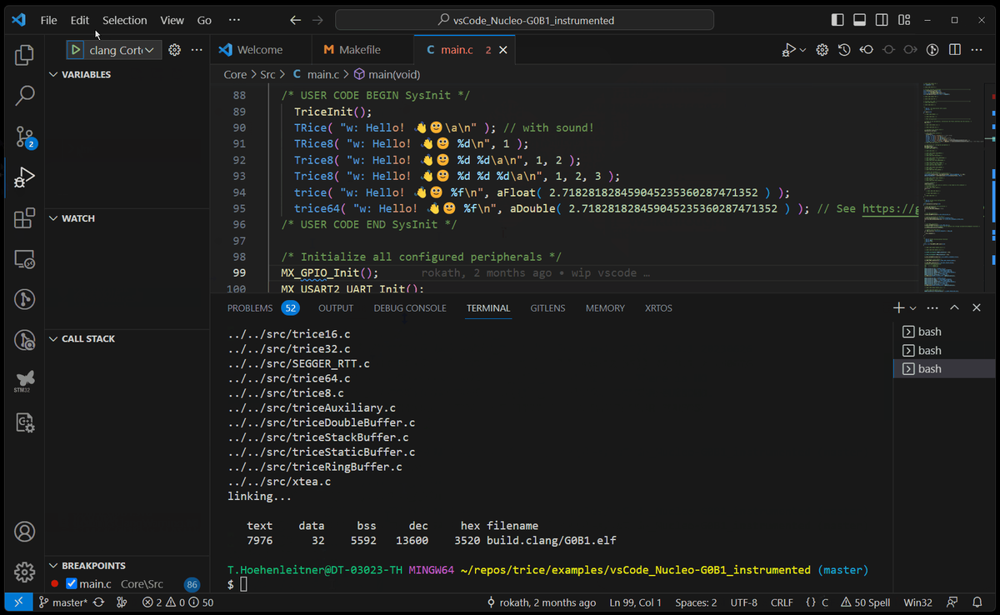
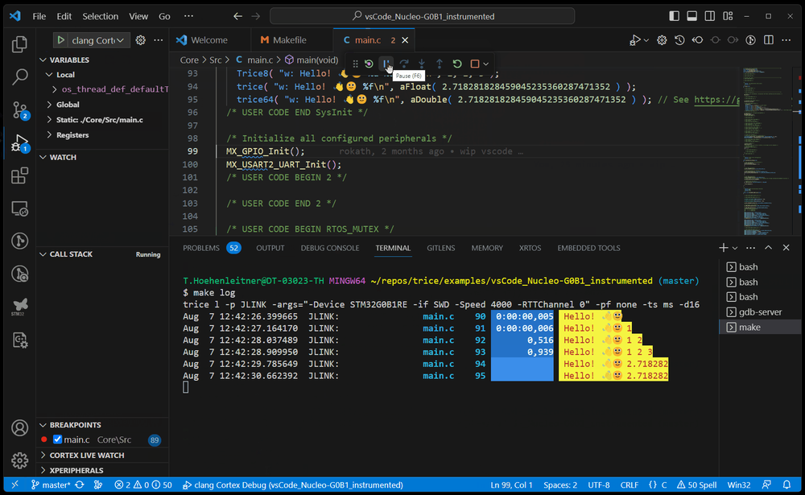

# Development Environment Setup

<details markdown="1">
<summary>Contents</summary>

<!-- mdtoc -->

- [1. Common Information](#common-information)
- [2. Important to know](#important-to-know)
- [3. Animation](#animation)
- [4. Setup Linux PC - Example with Debian12 - KDE Desktop](#setup-linux-pc---example-with-debian12---kde-desktop)
  - [4.1. Basic setup](#basic-setup)
  - [4.2. GitHub](#github)
  - [4.3. VS Code](#vs-code)
  - [4.4. Go](#go)
  - [4.5. Gitkraken (or other GUI for git)](#gitkraken-or-other-gui-for-git)
  - [4.6. arm-none-eabi toolchain (or other target system compiler)](#arm-none-eabi-toolchain-or-other-target-system-compiler)
    - [4.6.1. Recommended complete Arm GNU Toolchain](#recommended-complete-arm-gnu-toolchain)
    - [4.6.2. GNU assembler unable to rebuffer file warning](#gnu-assembler-unable-to-rebuffer-file-warning)
  - [4.7. J-Link (if needed)](#j-link-if-needed)
  - [4.8. Beyond Compare (if no other diff tool)](#beyond-compare-if-no-other-diff-tool)
- [5. Setup Windows PC Example](#setup-windows-pc-example)
  - [5.1. Choose the right Windows compiler](#choose-the-right-windows-compiler)
  - [5.2. Setup Trice](#setup-trice)
  - [5.3. Setup ARM Environment Example](#setup-arm-environment-example)
    - [5.3.1. Install make](#install-make)
    - [5.3.2. Install ARM GCC](#install-arm-gcc)
    - [5.3.3. macOS](#macos)
    - [5.3.4. Install ARM Clang (optional)](#install-arm-clang-optional)
    - [5.3.5. Check Project Makefile (if it already exists)](#check-project-makefile-if-it-already-exists)
  - [5.4. Inventory, select, and remove compiler versions](#inventory-select-and-remove-compiler-versions)
  - [5.5. Setup STM32](#setup-stm32)
    - [5.5.1. Generate Base Project](#generate-base-project)
    - [5.5.2. Update NUCLEO Onboard Debugger (other ST evaluation boards too)](#update-nucleo-onboard-debugger-other-st-evaluation-boards-too)
  - [5.6. Setup Onboard J-Link on NUCLEO (other ST evaluation boards too)](#setup-onboard-j-link-on-nucleo-other-st-evaluation-boards-too)
  - [5.7. Setup VS-Code](#setup-vs-code)
- [6. Makefile with Clang too](#makefile-with-clang-too)
- [7. Download Locations](#download-locations)
  - [7.1. Clang](#clang)
  - [7.2. GCC](#gcc)
- [8. Install Locations](#install-locations)
- [9. Environment Variables](#environment-variables)
- [10. Build command](#build-command)
- [11. Run & Debug](#run--debug)
- [12. Logging](#logging)
- [13. Setting up a new project](#setting-up-a-new-project)
- [14. Third-party packages and retained versions](#third-party-packages-and-retained-versions)

<!-- numbering=true min=2 max=4 slug=github anchor=true link=true toc=true bullets=auto -->
<!-- /mdtoc -->

</details>

* Trice is usable with any C-compiler for any processor type, bit width and endianness. The example projects here are STM32 ones but illustrate how to setup Trice.
* The [examples](../../examples) folder contains some instrumented example projects together with bare counterparts. Comparing a bare project with its intrumented counterpart gives a quick overview what needs to be done to get started.

## 1. <a id="common-information"></a>Common Information

- All used tools are **Open Source** (despite the [ARM-Keil µVision IDE](https://www2.keil.com/mdk5/uvision/), for new projects VS Code is a better choice).
- All provided information is just as example and needs adaptation to your needs.
- There is no need to setup the environment in the given order.

## 2. <a id="important-to-know"></a>Important to know

The [ARM-Keil µVision IDE](https://www2.keil.com/mdk5/uvision/) does sometimes not recognize external file modifications. That means for example: After editing `main.c` by adding a `trice( "Hi!\n" )` and executing `trice insert` as pre-compile step it could happen, that an updated `trice( iD(12345), "Hi!\n" )`  was inserted and correct compiled but the update in `main.c` is not shown. Simply close and reopen `main.c` before editing again. This seems to be a [ARM-Keil µVision IDE](https://www2.keil.com/mdk5/uvision/) "feature" or be caused Windows not signaling a file change.

## 3. <a id="animation"></a>Animation

(The trice IDs occur just during the compilation.)

  [](../ref/Animation.gif)

Select the preview to open the full animation.

## 4. <a id="setup-linux-pc---example-with-debian12---kde-desktop"></a>Setup Linux PC - Example with Debian12 - KDE Desktop

### 4.1. <a id="basic-setup"></a>Basic setup

* Add yourself to the sudo group:

```bash
su
apt install sudo
adduser <your_user_name> sudo
exit
```

* Logout and login.
* Install and verify:

```bash
groups
sudo apt update
sudo apt upgrade
sudo apt install build-essential
make --version
gcc --version
git --version
git config --global user.email "you@example.com"
git config --global user.name "Your Name"
```

### 4.2. <a id="github"></a>GitHub

* Create github account.
* Create ssh pair:

    ```bash
    ssh-keygen -t ed25519
    ```

* Add ssh key to your github account.
* Clone Trice repository:

    ```bash
    cd ~
    mkdir repos
    cd repos
    git clone git@github.com:rokath/trice.git
    ```

### 4.3. <a id="vs-code"></a>VS Code

* Download VS Code from https://code.visualstudio.com/.
* Install VS Code (adapt to downloaded version) and start it inside the Trice folder:

    ```bash
    sudo apt update
    sudo apt upgrade
    sudo apt install ~/Downloads/code_1.96.2-1734607745_amd64.deb
    code .
    ```

Open the repository root to use the shared [Go launch configurations](../../.vscode/launch.json).
Install the Go extension and its debugger tools first. The configurations use
`${workspaceFolder}` rather than a particular checkout location. UART and TCP
entries ask for the serial port or RTT endpoint at launch; these are VS Code
[input variables](https://code.visualstudio.com/docs/reference/variables-reference#_input-variables).

The G0B1 and L432 hardware entries use the root `demoTIL.json` and `demoLI.json`,
which belong to those instrumented examples. Build and flash the corresponding
example before connecting. The G0B1 UART entry matches its encrypted COBS output
at 115200 baud with password `MySecret`; the RTT entries match unframed direct
output with doubled IDs. TCP4 expects that same G0B1 RTT stream forwarded by a
server, normally at `localhost:17001`. These settings do not apply to arbitrary
firmware or captures: use the ID/location tables and framing from that firmware.

The `generate` entry creates `generated/til.c` from the current G0B1 main source;
run the example's bind/build step first so that its sidecars and ID table agree.
The insert/clean entries operate on that main source and update the root tables;
they are maintenance commands, not log viewers. Already bound code follows the
normal insert/clean ownership rules. After a fresh checkout, run the repository's
Bind workflow to initialize the locally generated `demoLI.json` before using
these maintenance entries, or create the missing file with `touch demoLI.json`
from the repository root. Retain an existing LI for ID ownership evidence.
The test entry runs one existing bind test.
For a hardware-free decoder session, select `trice l -p DUMP`: its retained
capture uses `testTIL.json`/`testLI.json` and includes a missing cycle-counter value
194, so one cycle-error diagnostic is expected. Entries whose captures, source
folders or command variants no longer exist have been removed.

When opening a G0B1 example itself, its C/C++ configuration finds
`arm-none-eabi-gcc` through `PATH`. Start VS Code from an environment containing
the installed ARM compiler and install the C/C++ and Makefile Tools extensions.
Only `USE_HAL_DRIVER` and `STM32G0B1xx` are supplied as project defines; builtin
defines are queried from the compiler with `-mcpu=cortex-m0plus` rather than
copied from an older version or inferred for the compiler's default CPU.
IntelliSense uses `gcc-arm` instead of the host platform's default architecture.

The shared [JetBrains settings](../../.idea/ReadMe.md) retain the CLion CMake review
host, project inspections and XML spelling dictionary. Choose the host toolchain
locally; workspace layout and personal state are ignored. IDE launch, serial/RTT
connections and indexing still need checking in your installed IDE and hardware
environment; parsing the templates alone cannot establish those results.

### 4.4. <a id="go"></a>Go

* Download the **Go** language from https://go.dev/doc/install and install:

    ```bash
    cd ~/Downloads
    sudo rm -rf /usr/local/go && sudo tar -C /usr/local -xzf go1.23.4.linux-amd64.tar.gz
    ```

    Extend PATH variable with `/usr/local/go/bin:~/go/bin` for example by by adding a file like `/etc/profile.d/gopath.sh`:

    ```bash
    su
    sudo echo export PATH='$PATH':/usr/local/go/bin:/home/<your_user_name>/go/bin > /etc/profile.d/gopath.sh
    exit
    ```

* Log out and back in so the new environment is active. Then [build the checkout tools](tool_build_release.md#build-trice-tool-from-go-sources) and follow [the native Linux test instructions](target_tests.md#prepare-linux). The old Debian test transcript is retained in [the test documentation archive](../_scratchPad/obsolete/testing/test_instructions_excerpts.md).

### 4.5. <a id="gitkraken-or-other-gui-for-git"></a>Gitkraken (or other GUI for git)

* Gitkraken download from https://www.gitkraken.com/download and Install:

  ```bash
  mv ./gitkraken-amd64.deb /tmp; sudo apt install /tmp/gitkraken-amd64.deb
  ```

### 4.6. <a id="arm-none-eabi-toolchain-or-other-target-system-compiler"></a>arm-none-eabi toolchain (or other target system compiler)

```bash
sudo apt install gcc-arm-none-eabi
sudo apt install binutils-arm-none-eabi
sudo apt install gdb-arm-none-eabi
sudo apt install openocd
arm-none-eabi-gcc --version
arm-none-eabi-gcc (15:12.2.rel1-1) 12.2.1 20221205
Copyright (C) 2022 Free Software Foundation, Inc.
This is free software; see the source for copying conditions.  There is NO
warranty; not even for MERCHANTABILITY or FITNESS FOR A PARTICULAR PURPOSE.
```
 * See installed toolchain:

  ```bash
  ls -l /usr/bin/ | grep arm-none-eabi
  -rwxr-xr-x 1 root root     1033504 Feb 28  2023 arm-none-eabi-addr2line
  -rwxr-xr-x 2 root root     1066088 Feb 28  2023 arm-none-eabi-ar
  -rwxr-xr-x 2 root root     2095024 Feb 28  2023 arm-none-eabi-as
  -rwxr-xr-x 2 root root     1514496 Dec 22  2022 arm-none-eabi-c++
  -rwxr-xr-x 1 root root     1032992 Feb 28  2023 arm-none-eabi-c++filt
  -rwxr-xr-x 1 root root     1514496 Dec 22  2022 arm-none-eabi-cpp
  -rwxr-xr-x 1 root root       43640 Feb 28  2023 arm-none-eabi-elfedit
  -rwxr-xr-x 2 root root     1514496 Dec 22  2022 arm-none-eabi-g++
  -rwxr-xr-x 2 root root     1514496 Dec 22  2022 arm-none-eabi-gcc
  -rwxr-xr-x 2 root root     1514496 Dec 22  2022 arm-none-eabi-gcc-12.2.1
  -rwxr-xr-x 1 root root       35376 Dec 22  2022 arm-none-eabi-gcc-ar
  -rwxr-xr-x 1 root root       35376 Dec 22  2022 arm-none-eabi-gcc-nm
  -rwxr-xr-x 1 root root       35376 Dec 22  2022 arm-none-eabi-gcc-ranlib
  -rwxr-xr-x 1 root root      749664 Dec 22  2022 arm-none-eabi-gcov
  -rwxr-xr-x 1 root root      585688 Dec 22  2022 arm-none-eabi-gcov-dump
  -rwxr-xr-x 1 root root      610328 Dec 22  2022 arm-none-eabi-gcov-tool
  -rwxr-xr-x 1 root root     1104256 Feb 28  2023 arm-none-eabi-gprof
  -rwxr-xr-x 4 root root     1709968 Feb 28  2023 arm-none-eabi-ld
  -rwxr-xr-x 4 root root     1709968 Feb 28  2023 arm-none-eabi-ld.bfd
  -rwxr-xr-x 1 root root    24982344 Dec 22  2022 arm-none-eabi-lto-dump
  -rwxr-xr-x 2 root root     1054720 Feb 28  2023 arm-none-eabi-nm
  -rwxr-xr-x 2 root root     1180744 Feb 28  2023 arm-none-eabi-objcopy
  -rwxr-xr-x 2 root root     1867744 Feb 28  2023 arm-none-eabi-objdump
  -rwxr-xr-x 2 root root     1066120 Feb 28  2023 arm-none-eabi-ranlib
  -rwxr-xr-x 2 root root      973400 Feb 28  2023 arm-none-eabi-readelf
  -rwxr-xr-x 1 root root     1033280 Feb 28  2023 arm-none-eabi-size
  -rwxr-xr-x 1 root root     1037504 Feb 28  2023 arm-none-eabi-strings
  -rwxr-xr-x 2 root root     1180744 Feb 28  2023 arm-none-eabi-strip
  ```

* For some reason `sudo apt install gdb-arm-none-eabi` gives the message `Note, selecting 'gdb-multiarch' instead of 'gdb-arm-none-eabi'` and *arm-none-eabi-gdb* is not installed afterwards.

#### 4.6.1. <a id="recommended-complete-arm-gnu-toolchain"></a>Recommended complete Arm GNU Toolchain

For the Trice bare-metal examples, use a complete, internally consistent toolchain containing GCC, GNU Binutils, Newlib, and Newlib-Nano. The official [Arm GNU Toolchain installation guide](https://learn.arm.com/install-guides/gcc/arm-gnu/) covers matching packages for Linux, macOS, and Windows. Select the package for the host platform whose target name ends in `arm-none-eabi`, and verify its accompanying SHA-256 file before installing it.

Arm GNU Toolchain 15.3.Rel1 is the currently tested version for the Trice GCC example builds. It reports:

```text
arm-none-eabi-gcc (Arm GNU Toolchain 15.3.Rel1 (Build arm-15.149)) 15.3.1 20260627
GNU assembler (Arm GNU Toolchain 15.3.Rel1 (Build arm-15.149)) 2.45.1.20260126
```

Install new releases side by side instead of replacing a working toolchain immediately. Prepend the selected installation's `bin` directory to `PATH` for the current shell or configure it permanently using the host operating system's normal environment-variable settings. On Linux and macOS, an unpacked archive can be selected temporarily as follows:

```bash
toolchain_dir="$HOME/opt/arm-gnu-toolchain-15.3.rel1"
export PATH="$toolchain_dir/bin:$PATH"
```

On Windows, keep versioned installations side by side and prepend the selected
`bin` directory for the current terminal. See
[Inventory, select, and remove compiler versions](development_environment_setup.md#inventory-select-and-remove-compiler-versions).
Make the selection persistent only after it passes the tests. Do not combine
GCC, `as`, libraries, or specifications from different toolchain installations.

Check which installation is active and whether the required runtime files are present:

```bash
command -v arm-none-eabi-gcc
command -v arm-none-eabi-as
arm-none-eabi-gcc --version
arm-none-eabi-as --version
arm-none-eabi-gcc -print-file-name=nano.specs
arm-none-eabi-gcc -print-file-name=libnosys.a
```

Use `where.exe` instead of `command -v` in a Windows command prompt. The last two commands must print resolved paths. Output containing only `nano.specs` or `libnosys.a` means that the active installation is incomplete.

On macOS, `brew install --cask gcc-arm-embedded` installs an official complete Arm package, but the cask can lag behind the newest Arm release. In contrast, the Homebrew formula installed by `brew install arm-none-eabi-gcc` builds GCC with `--without-headers` and installs GCC plus `libgcc`, but not Newlib/Newlib-Nano. A newer GCC version number from that formula therefore does not make it a complete replacement for the official package used by these examples.

#### 4.6.2. <a id="gnu-assembler-unable-to-rebuffer-file-warning"></a>GNU assembler `unable to rebuffer file` warning

The G0B1 build requests assembler listings with `-Wa,-a,...`. While generating such a listing, GNU `as` reopens and rereads source text associated with the temporary compiler-generated assembly file. A diagnostic such as

```text
ccXXXX.s: Warning: unable to rebuffer file: path/to/source.c
```

means that this second source-file read returned fewer bytes than expected. It is an assembler-listing diagnostic, not a C-language warning. The object and executable may still have been generated correctly, but the Trice full test intentionally treats every warning as a failure.

The warning was observed once with Arm GNU Toolchain 15.2.Rel1 on macOS and did not recur when the identical G0B1 build was repeated. The complete test with 15.3.Rel1, including the G0B1 X0 matrix and listing generation, completed without warnings. This establishes the warning as intermittent; it does not prove that 15.3.Rel1 contains a specific fix for it.

If the warning occurs:

1. Keep listing generation and strict warning checks enabled.
2. Confirm the active GCC and assembler paths and versions with the commands above.
3. Ensure that no editor, generator, formatter, synchronization tool, or parallel build step rewrites the named source file while `as` is running.
4. Repeat the affected build once with the complete 15.3.Rel1 package.
5. If it is reproducible, retain the complete compiler command, tool versions, source file, and generated listing and report the case as a GNU Binutils or Arm GNU Toolchain issue.

### 4.7. <a id="j-link-if-needed"></a>J-Link (if needed)

* Download and install from https://www.segger.com/downloads/jlink/

```bash
sudo apt install ~/Downloads/JLink_Linux_V812_x86_64.deb
```

* Logout & login & check:

```bash
th@P51-DebianKDE:~/Downloads$ JLinkRTTLogger -?
SEGGER J-Link RTT Logger
Compiled Dec 18 2024 15:48:21
(c) 2016-2017 SEGGER Microcontroller GmbH, www.segger.com
         Solutions for real time microcontroller applications

Default logfile path: /home/th/.config/SEGGER

------------------------------------------------------------ 

Available options:
-Device <devicename>
-If <ifname>
-Speed <speed>
-USB <SN>
-IP <SN>
-RTTAddress <RTTAddress>
-RTTSearchRanges "<Rangestart> <RangeSize>[, <Range1Start> <Range1Size>, ...]
"-RTTChannel <RTTChannel>
-JLinkScriptFile <PathToScript>
<OutFilename>

Shutting down... Done.th@P51-DebianKDE:~/Downloads$ 
```

### 4.8. <a id="beyond-compare-if-no-other-diff-tool"></a>Beyond Compare (if no other diff tool)

* Download and install from https://www.scootersoftware.com

## 5. <a id="setup-windows-pc-example"></a>Setup Windows PC Example

Setting up a PC is for Linux mostly straightforward but Windows PCs are more problematic. The steps shown here are just one example.

- Create folder `repos` in your home directory.
  - Clone all repositories here.
- Create `C:\bin` folder.
  - When installing toolchains, put them here then and avoid spaces in created paths.
- Add `C:\bin` to PATH variable at the beginning.
  - This allows to copy tools like `trice.exe` simply into `C:\bin`.
- Install "Git for windows" from https://git-scm.com/downloads/ to get the neat git bash.
  - Select the Standalone Installer. This gives you useful context menu entries in the Windows explorer.
- BTW: For managing git repositories I like https://www.gitkraken.com/. Its free of charge for open source programs.
- Install VS-Code
  - This is my favorite editor with many optional Add-Ons. It is used for debugging as well.
- Install Go if you wish to compile Go programs.
  - `go test ./...` should succeed in a terminal window.
  - Some Go tests use CGO and therefore additionally need a Windows host C
    compiler. This is not the ARM compiler used for the embedded examples.
    See [Choose the right Windows compiler](development_environment_setup.md#choose-the-right-windows-compiler).
- Setup J-Link if you use this debug probe as hardware or software (see below).
  - Install SEGGER [J-Link Software and Documentation Pack](https://www.segger.com/downloads/jlink/)
- Install [Make for Windows](development_environment_setup.md#install-make) and add its installation bin folder location to the PATH variable.

### 5.1. <a id="choose-the-right-windows-compiler"></a>Choose the right Windows compiler

Three different compiler roles occur in this repository. A higher GCC version
number does not make one role a replacement for another:

Role                               | Command or target                                                | Used for                                                                       | Recommended source
------------------------------------|------------------------------------------------------------------|--------------------------------------------------------------------------------|--------------------------------------------------------------------------------------------------------------------------------------------------
ARM bare-metal GCC cross-toolchain | `arm-none-eabi-gcc`; target `arm-none-eabi`                      | Firmware and `scripts/_210_gcc_example_builds_all_workflows.sh`                | Official [Arm GNU Toolchain installation guide](https://learn.arm.com/install-guides/gcc/arm-gnu/); choose a Windows package ending in `arm-none-eabi`
Windows host GCC                   | `gcc`; target such as `x86_64-w64-mingw32` or `i686-w64-mingw32` | CGO and native Windows C tests                                                 | Optional MinGW-w64 distribution, for example [WinLibs](https://winlibs.com/)
Clang frontend                     | `clang`; use `--target=arm-none-eabi` for firmware               | Optional ARM firmware builds and, when correctly configured, native host tests | Official [LLVM releases](https://github.com/llvm/llvm-project/releases/latest)

WinLibs is a third-party distribution of upstream GCC and MinGW-w64 for
Windows. Its GCC 16.1 packages are Windows host compilers, not
`arm-none-eabi-gcc`. They cannot build the ARM examples or replace the Arm GNU
Toolchain. WinLibs is useful only when a Windows host GCC is needed. Normally
choose its Win64 `x86_64` build for a 64-bit Go installation; a Win32 package
reports `i686-w64-mingw32`. Use `go env GOARCH` to check the Go architecture;
`amd64` normally needs the Win64 host compiler.

CGO needs a working host C compiler and C runtime. [TDM-GCC](https://jmeubank.github.io/tdm-gcc/download/) is another MinGW-w64 option; its minimal online installation is sufficient for host tests. Match the compiler architecture to Go and put the selected host compiler first in `PATH`.

Some regression tests also run Clang when it is in `PATH`. A GNU-target Clang can reuse the MinGW-w64 runtime; an MSVC-target Clang needs the Visual Studio C++ Build Tools and a Windows SDK. Verify that every visible host compiler can include `string.h` before running `go test ./...`. For Clang, use `printf '#include <string.h>\n' | clang -std=c99 -fsyntax-only -x c -`. Keep `C_INCLUDE_PATH` unset globally so ARM headers do not leak into host and CGO builds.

Do not infer the compiler target from the download page, folder name, or
`--version` alone. Check it explicitly:

```bash
arm-none-eabi-gcc -dumpmachine # must print: arm-none-eabi
gcc -dumpmachine               # host GCC normally prints: x86_64-w64-mingw32
clang --target=arm-none-eabi -dumpmachine
```

For example, a `C:\bin\mingw32\bin\gcc.exe` reporting GCC 16.1 and
`i686-w64-mingw32` is an optional 32-bit Windows host compiler. The executable
needed by Step 12 is named `arm-none-eabi-gcc.exe` and comes from a separate
Arm GNU Toolchain installation.

At the time of writing, GCC 16.1 is the newest upstream GCC major release and
WinLibs offers it as its current Windows host build. The current official Arm
GNU Toolchain version can differ because Arm publishes an integrated
cross-toolchain on its own release schedule. Use the version identified as
tested in [Recommended complete Arm GNU Toolchain](development_environment_setup.md#recommended-complete-arm-gnu-toolchain)
for the ARM examples; do not select a host GCC merely because its GCC number
is higher.

### 5.2. <a id="setup-trice"></a>Setup Trice

- from inside folder `repos` clone trice repo with `git clone https://github.com/rokath/trice.git`.
- Run `go install ./cmd/trice/...` from folder `repos/trice`.

OR

- Download the latest release archive and extract.
- Put trice binary into C:\bin.
- Put trice/src into `repos` if you want access the trice library code from several projects and have it only once.
  - Alternatively copy it into your project.

### 5.3. <a id="setup-arm-environment-example"></a>Setup ARM Environment Example

#### 5.3.1. <a id="install-make"></a>Install make

* Fast lane: Go to https://sourceforge.net/projects/ezwinports/files/, download ans extract **make-4.4.1-without-guile-w32-bin.zip**. Put the *make.exe* file somewhere in you $PATH.

* OR open the Windows Powershell and:

```bash
ms@PaulPCWin11 MINGW64 ~/repos/trice/examples (devel)
$ winget install ezwinports.make
The `msstore` source requires that you view the following agreements before using.
Terms of Transaction: https://aka.ms/microsoft-store-terms-of-transaction
The source requires the current machine's 2-letter geographic region to be sent to the backend service to function properly (ex. "US").

Do you agree to all the source agreements terms?
[Y] Yes  [N] No: Y
Found ezwinports: make [ezwinports.make] Version 4.4.1
This application is licensed to you by its owner.
Microsoft is not responsible for, nor does it grant any licenses to, third-party packages.
Downloading https://downloads.sourceforge.net/project/ezwinports/make-4.4.1-without-guile-w32-bin.zip
  ██████████████████████████████   383 KB /  383 KB
Successfully verified installer hash
Extracting archive...
Successfully extracted archive
Starting package install...
Path environment variable modified; restart your shell to use the new value.
Command line alias added: "make"
Successfully installed

ms@PaulPCWin11 MINGW64 ~/repos/trice/examples (devel)
```

* Check:

```bash
$ make --version
GNU Make 4.4.1
Built for Windows32
Copyright (C) 1988-2023 Free Software Foundation, Inc.
License GPLv3+: GNU GPL version 3 or later <https://gnu.org/licenses/gpl.html>
This is free software: you are free to change and redistribute it.
There is NO WARRANTY, to the extent permitted by law.
```

#### 5.3.2. <a id="install-arm-gcc"></a>Install ARM GCC

- Use the official [Arm GNU Toolchain installation guide](https://learn.arm.com/install-guides/gcc/arm-gnu/)
  to select a Windows package whose name ends in `arm-none-eabi`.
- Prefer a ZIP package for testing versions side by side. Verify the published
  checksum and extract each version to its own directory, for example:

  ```text
  C:\bin\ArmGNUToolchain-13.2.Rel1
  C:\bin\ArmGNUToolchain-15.3.Rel1
  ```

- Do not merge or copy files between toolchain directories. Compiler,
  assembler, linker, Newlib, specifications, and DLLs must stay from the same
  package.
- Do not uninstall the previous working version before the new version passes
  the tests. Select one version for the current terminal as described in
  [Inventory, select, and remove compiler versions](development_environment_setup.md#inventory-select-and-remove-compiler-versions).
- Keep `C_INCLUDE_PATH` unset globally. The repository setup derives the ARM
  headers needed by Clang from the selected `arm-none-eabi-gcc`; a global ARM
  include path can break CGO and other host builds.
- Verify the complete selected toolchain in Git Bash:

  ```bash
  type -a arm-none-eabi-gcc
  type -a arm-none-eabi-as
  arm-none-eabi-gcc -dumpmachine
  arm-none-eabi-gcc --version
  arm-none-eabi-as --version
  arm-none-eabi-gcc -print-file-name=nano.specs
  arm-none-eabi-gcc -print-file-name=libnosys.a
  ```

  The target must be `arm-none-eabi`. The last two commands must print absolute
  paths inside the selected installation, not only `nano.specs` or
  `libnosys.a`.

#### 5.3.3. <a id="macos"></a>macOS

- In terminal `brew install arm-none-eabi-gcc`
- Restart terminal
- In teminal `arm-non-eabi-gcc --version` delivers `arm-none-eabi-gcc (GCC) 14.2.0`
- In terminal `brew install arm-none-eabi-clang`
- Restart terminal
- In teminal `clang -target arm-none-eabi --version` delivers:
    ```bash
    Apple clang version 15.0.0 (clang-1500.3.9.4)
    Target: arm-none-unknown-eabi
    Thread model: posix
    InstalledDir: /Library/Developer/CommandLineTools/usr/bin
    ```
- In terminal `brew install arm-none-eabi-gdb`
- In terminal `brew install --cask gcc-arm-embedded`
- In terminal to get objcopy:

  ```bash
  brew install binutils
  echo 'export PATH="/usr/local/opt/binutils/bin:$PATH"' >> ~/.zshrc
  source ~/.zshrc
  ```

#### 5.3.4. <a id="install-arm-clang-optional"></a>Install ARM Clang (optional)

With the ARM Clang you get quicker compilation runs and smaller images.

- You need to install ARM GCC as well to use ARM Clang for the embedded examples.
  - Clang supplies the compiler frontend, but it does not supply the ARM C library, target headers, linker, or debugger.
  - The repository setup script derives the required ARM header locations from `arm-none-eabi-gcc` and exports them through `CLANG_SYS_INCLUDES`.
  - Keep `C_INCLUDE_PATH` unset globally. A global value can leak ARM headers into host builds and CGO tests.
- Download a Windows x64 package from the official
  [LLVM releases](https://github.com/llvm/llvm-project/releases/latest).
  Install versions side by side, for example `C:\bin\LLVM-22.1.6`.
- Select the intended version temporarily in `PATH`; do not uninstall other
  Clang installations merely to hide them.
- Verify the ARM frontend explicitly with
  `clang --target=arm-none-eabi --version` and
  `clang --target=arm-none-eabi -dumpmachine`.
  - The reported target must be `arm-none-unknown-eabi`.
  - A plain `clang --version` reports the default host target and therefore does not verify the ARM build configuration.

On Windows, a globally visible `clang` is also detected by some Go regression tests as a host C compiler. LLVM does not include a Windows C runtime or its standard headers. Therefore, a host Clang installation must use one of these runtime setups:

- MSVC target: Install the Visual Studio C++ Build Tools and a Windows SDK. This is the native Microsoft setup, but it is a comparatively large installation.
- GNU target: Install a matching 64-bit MinGW-w64 distribution, such as TDM-GCC, and make its `bin` directory available in `PATH`. If Clang otherwise defaults to the MSVC target, create `clang.cfg` next to `clang.exe` containing:

  ```text
  --target=x86_64-w64-windows-gnu
  ```

  Explicit embedded options such as `--target=arm-none-eabi` still override this host default.

Check the host installation before running the Go test suite:

```bash
printf '#include <string.h>\n' | clang -std=c99 -fsyntax-only -x c -
```

The command must finish without diagnostics. An error such as `fatal error: 'string.h' file not found` means that the compiler executable exists, but its matching host C runtime headers are not configured. Do not add ARM include directories globally to work around that host error.

#### 5.3.5. <a id="check-project-makefile-if-it-already-exists"></a>Check Project Makefile (if it already exists)

- Do not hard-code a global `C_INCLUDE_PATH` or mix paths from different ARM
  toolchain versions in the Makefile.
- Select the intended ARM GCC and Clang `bin` directories in the terminal
  before invoking `make`. The repository setup script then computes
  `CLANG_SYS_INCLUDES` from the active complete ARM GCC installation.
- `make version` should give output like this:

```bash
$ make version
/c/bin/ArmGNUToolchain/bin/arm-none-eabi-gcc
arm-none-eabi-gcc (Arm GNU Toolchain 12.3.Rel1 (Build arm-12.35)) 12.3.1 20230626
Copyright (C) 2022 Free Software Foundation, Inc.
This is free software; see the source for copying conditions.  There is NO
warranty; not even for MERCHANTABILITY or FITNESS FOR A PARTICULAR PURPOSE.

/c/bin/ArmClang/bin/clang --target=arm-none-eabi
clang version 17.0.0
Target: arm-none-unknown-eabi
Thread model: posix
InstalledDir: C:\bin\ArmClang\bin
```

The paths and versions must match the installations selected in the current
terminal.

### 5.4. <a id="inventory-select-and-remove-compiler-versions"></a>Inventory, select, and remove compiler versions

An extracted ZIP toolchain is usually not registered as an installed Windows
application. Therefore no single Windows dialog lists every compiler. Inspect
both command resolution and likely installation directories before changing
anything.

In PowerShell, list every matching executable visible through `Path`:

```powershell
Get-Command arm-none-eabi-gcc,gcc,clang -All -ErrorAction SilentlyContinue |
    Format-Table Name,Source
where.exe arm-none-eabi-gcc
where.exe gcc
where.exe clang

arm-none-eabi-gcc -dumpmachine
gcc -dumpmachine
clang --version

[Environment]::GetEnvironmentVariable('Path', 'User') -split ';'
[Environment]::GetEnvironmentVariable('Path', 'Machine') -split ';'
Get-ChildItem C:\bin -Directory
```

In Git Bash, use:

```bash
type -a arm-none-eabi-gcc
type -a gcc
type -a clang
arm-none-eabi-gcc -dumpmachine
gcc -dumpmachine
clang --version
printf '%s\n' "$PATH" | tr : '\n'
```

`where.exe` and `type -a` show all visible duplicates in search order. The first
entry is executed. `winget list` and Windows **Installed apps** provide an
additional list of registered installers, but they do not include manually
extracted archives.

Install compiler versions side by side and test a selection in a fresh terminal
before modifying the persistent user `Path`. For example, select Arm GNU
Toolchain 15.3.Rel1 for only the current PowerShell session:

```powershell
$savedPath = $env:Path
$env:Path = 'C:\bin\ArmGNUToolchain-15.3.Rel1\bin;' + $savedPath

where.exe arm-none-eabi-gcc
arm-none-eabi-gcc -dumpmachine
arm-none-eabi-gcc --version

# Restore the session when the test is complete.
$env:Path = $savedPath
```

The equivalent Git Bash commands are:

```bash
saved_path=$PATH
export PATH="/c/bin/ArmGNUToolchain-15.3.Rel1/bin:$saved_path"
hash -r

type -a arm-none-eabi-gcc
arm-none-eabi-gcc -dumpmachine
arm-none-eabi-gcc --version

# Restore the session when the test is complete.
export PATH="$saved_path"
hash -r
```

Use the same pattern for Clang or host GCC by prepending that version's `bin`
directory. Start from a fresh terminal for each comparison so that a path from
the previous test cannot leak into the next one. Shell command caches are
cleared by `hash -r` in Git Bash. Do not put several directories containing the
same compiler command permanently in `Path`; their order otherwise becomes an
implicit and easily missed version switch.

After selecting ARM GCC, test the known serial baseline and then the desired
parallelism from the repository root:

```bash
MAKE_JOBS=-j1 ./scripts/_210_gcc_example_builds_all_workflows.sh
MAKE_JOBS=-j4 ./scripts/_210_gcc_example_builds_all_workflows.sh
```

Record `type -a arm-none-eabi-gcc`, both tool versions, `MAKE_JOBS`, and the
`temp/log/_5*_test_gcc_*.log` files with every comparison. Windows exit
code `-1073741819` is `0xC0000005` (`STATUS_ACCESS_VIOLATION`): a compiler
process crashed; it is not a normal C diagnostic. If `-j1` succeeds but a
bounded parallel build crashes, preserve the evidence and compare another
complete official Arm GNU Toolchain before concluding that source code or job
count is the root cause.

Remove an old compiler only after all of the following are true:

1. A new terminal resolves every command to the intended replacement.
2. The relevant ARM, CGO, and Clang tests pass with that replacement.
3. Neither the user nor machine `Path`, a Makefile, `clang.cfg`, IDE setting, or
   debugger configuration refers to the old directory.
4. The old package name, version, source URL, and checksum have been recorded
   so that the setup can be reproduced.

Use **Installed apps** or the package manager that installed a registered
toolchain. For a manually extracted archive, first remove its `Path` entry,
open a new terminal, repeat the inventory commands, and only then delete that
one version directory. Keep at least one complete `arm-none-eabi` toolchain;
ARM Clang needs its target headers and libraries. Keep one Windows host compiler
when CGO tests require it. A 32-bit `i686-w64-mingw32` WinLibs installation is
normally unnecessary when Go and the required host builds are all 64-bit, but
verify that no project depends on 32-bit output before removing it.

### 5.5. <a id="setup-stm32"></a>Setup STM32

#### 5.5.1. <a id="generate-base-project"></a>Generate Base Project

- Install and start STM32CubeMX code generator.
- Board-Selector -> STM32G0B1KE` or `STM32L432KC` or ...
- (Auto-)Initialize with default values.
- Clock-Generation -> Change PLL *N from "X 16" to "X 32" to get 64 MHz clocks.
  - Running at max clock speed and using `WFE` instructions in wait loops is slightly more energy efficient.
- Project Manager
  - Project
    - Set Project Name
    - Select Project Location
    - Toolchain / IDE -> Select Makefile
  - Code Generator
    - Select "Copy only the necessary library files".
  - Advanced Settings
    - Switch from HAL to LL at least for UART
- Generate Code as Makefile project

#### 5.5.2. <a id="update-nucleo-onboard-debugger-other-st-evaluation-boards-too"></a>Update NUCLEO Onboard Debugger (other ST evaluation boards too)

(https://www.st.com/en/development-tools/stsw-link007.html)

This step is recommended before re-flashing with the J-Link onboard debugger software.

- Connect STM evaluation board over USB
- Start ST-Link Upgrade (trice\third_party\st.com or look for a newer version at STM.).
  - Device Connect
  - Upgrade Firmware (select version **with** mass storage option)
    - Selecting the other option, would not allow to update with the SEGGER STLinkReflash tool.
  - Close

### 5.6. <a id="setup-onboard-j-link-on-nucleo-other-st-evaluation-boards-too"></a>Setup Onboard J-Link on NUCLEO (other ST evaluation boards too)

(https://www.segger.com/products/debug-probes/j-link/models/other-j-links/st-link-on-board/)

Using the J-Link onboard debugger software allows parallel debugging and RTT usage.

Unfortunately this is not possible with **v3** onboard debugger hardware! But you can use a J-Link hardware instead. Also it is possible to use a v2 onboard debugger from a different evaluation board or a "Bluepill" Development Board Module with ARM Cortex M3 processor".

- Start STLinkReflash (trice\third_party\segger.com)
  - Accept and Accept
  - 1: Upgrade to J-Link
  - 0: Quit
- Download, extract & start https://raw.githubusercontent.com/rokath/trice/main/third_party/segger.com/STLinkReflash_190812.zip
  - Re-Flash onboard debugger.
    - You can undo this step anytime.

### 5.7. <a id="setup-vs-code"></a>Setup VS-Code

- Start VS Code
  - Install Go rich language support if you want to use Go as well (not needed for ARM debugging).
  - Install "Cortex Debug" extension.
  - Open the generated project directory.
  - Click on Run and Debug.
    - Click Generate launch.json and select "Cortex Debug"
  - Open and edit .vscode/launch.json
    - change "executable" value into: "./build/STM32G0B1KE_generated.elf" (example)
  - add lines:
    - `"device": "STM32G0B1KE",` or `"STM32L432KC"` or ...
    - `"svdFile": "./STM32G0B1KE.svd",` or `"./STM32L4x2.svd"` or ...
    - `"runToMain": true`
  - Set the commas right.
- Latest SVD Files can be found here: https://www.st.com/content/st_com/en/search.html#q=svd-t=resources-page=1
- Download file `STM32G0B1.svd` from https://www.st.com/resource/en/svd/stm32G0_svd.zip (example)
  - Alternatively copy it from `"C:\ST\STM32CubeIDE_1.13.1\STM32CubeIDE\plugins\com.st.stm32cube.ide.mcu.productdb.debug_2.1.0.202306151215\resources\cmsis\STMicroelectronics_CMSIS_SVD\STM32G0B1.svd"` if you have the STM32CubeIDE installed.
  - Download file `STM32L4x2.svd` from https://www.st.com/resource/en/svd/stm32l4_svd.zip (example)
- Installing the **Cortex Debug** extension allow you to debug the target code.

## 6. <a id="makefile-with-clang-too"></a>Makefile with Clang too

- After STM32 CubeMX code generation the Makefile was edited and spitted.
- STM32 CubeMX code generation accepts the edited Makefile, so re-generation is no issue.
  - It modifies the settings according to the changes.

## 7. <a id="download-locations"></a>Download Locations

### 7.1. <a id="clang"></a>Clang

https://releases.llvm.org/download.html -> https://github.com/llvm/llvm-project/releases/ (example)

The LLVM download supplies Clang and its builtin headers. It does not supply the target C runtime:

- ARM builds additionally need the ARM GNU toolchain headers and libraries.
- Windows host builds need either an MSVC/Windows SDK installation or a matching MinGW-w64 runtime.

### 7.2. <a id="gcc"></a>GCC

- ARM firmware: official
  [Arm GNU Toolchain installation guide](https://learn.arm.com/install-guides/gcc/arm-gnu/);
  select a Windows package ending in `arm-none-eabi`.
- Windows host and CGO tests only: a MinGW-w64 host distribution such as
  [WinLibs](https://winlibs.com/).

These downloads are not interchangeable. Confirm the target with
`-dumpmachine` after selecting the compiler.

## 8. <a id="install-locations"></a>Install Locations

Do not use locations containing spaces, like `C:\Program Files`. Take `C:\bin`
for example. This avoids trouble caused by spaces inside path names.

Keep roles and versions distinguishable. For example, use
`C:\bin\ArmGNUToolchain-15.3.Rel1` for `arm-none-eabi-gcc`,
`C:\bin\LLVM-22.1.6` for Clang, and `C:\bin\WinLibs-GCC-16.1-x86_64`
for a MinGW-w64 host compiler. A compiler executable in `Path` is not sufficient
by itself; its matching standard headers, libraries, support programs, and DLLs
must also remain in the same installation.

## 9. <a id="environment-variables"></a>Environment Variables

Prepend only the currently selected compiler's `bin` directory to `Path`.
Prefer a temporary terminal selection while comparing versions. If the
selection is made persistent, place it before other directories containing the
same command and verify it from a new terminal with `where.exe` or `type -a`.
See
[Inventory, select, and remove compiler versions](development_environment_setup.md#inventory-select-and-remove-compiler-versions).

The debugger path can be added independently, for example
`C:\Program Files\SEGGER\JLink` or a versioned `JLink_V...` directory.

## 10. <a id="build-command"></a>Build command

- Clang: `make` or to get it faster `make -j`.
- GCC: `make GCC`.

## 11. <a id="run--debug"></a>Run & Debug

- In terminal after `make` click Run&Debug & click green triangle.

## 12. <a id="logging"></a>Logging

- In terminal type `make log`. This executes the command in project folder:

`trice l -p JLINK -args="-Device STM32G0B1RE -if SWD -Speed 4000 -RTTChannel 0" -pf none -ts ms -d16` (example)

  [](../ref/Animation.gif)

Select the preview to open the full animation.

## 13. <a id="setting-up-a-new-project"></a>Setting up a new project

- Copy this project folder under a new name like `myAwesomeNewProject` or name it as you like.
- Make a temporary folder `myTemp` and generate with STM CubeMX the base project.
- Copy the *.ioc file from `myTemp` to `myAwesomeNewProject` and name it to the project name.
- Compare `myTemp\Makefile` with `myAwesomeNewProject\Makefile` and overwrite/extend in `myAwesomeNewProject\Makefile` the relevant settings, mainly the filenames, include path settings and DEFINES.
- Replace all generated files in `myAwesomeNewProject` with the ones in `myTemp`
- Replace the *.svd file if the MCU is different. You can find it in the internet.
- Run `make -j8` inside `myAwesomeNewProject` to check if all is ok.
- Open the copied *ioc file inside `myAwesomeNewProject` and re-generate and re-build to check.
- Compare the relevant files like `main.c` with the starting project and edit accordingly.
- Adapt `.vscode/launch.json` to the used MCU.
- Than the awesome new project should be ready to go for development.

## 14. <a id="third-party-packages-and-retained-versions"></a>Third-party packages and retained versions

The [third_party directory](../../third_party) stores optional transport tools,
terminal software, vendor documentation, and reference source snapshots.
It is not a list of mandatory installations. The example projects contain
their required target sources, including configured RTT sources where used;
building them does not require extracting these ZIPs. Select additional host
tools only for the transport you intend to use. The packages below are stored
versions, not a statement that they are current or compatible with every host.

Stored archive | Contents and retained role
--- | ---
[cobs-c-0.5.0.zip](../../third_party/cobs-c-0.5.0.zip) and [cobs-c-version_1.0.zip](../../third_party/cobs-c-version_1.0.zip) | Craig McQueen's COBS/COBS-R source snapshots, both with `LICENSE.txt` and `README.rst`. They are comparison/reference sources, not the COBS files compiled from `src`. No active build extracts either version; the reason a manual user may still need both is unconfirmed, so both are retained.
[cJSON-1.7.15.zip](../../third_party/cJSON-1.7.15.zip) | cJSON source snapshot with its MIT `LICENSE` and README. No active Trice build or structured-log output depends on this ZIP. Its original/manual use is unconfirmed; retaining it does not introduce a JSON dependency.
[SEGGER_RTT_V812a.zip](../../third_party/segger.com/SEGGER_RTT_V812a.zip) | Older RTT target sources, configuration, examples, README, and `LICENSE.md`, retained as a historical source reference. The current files in `src` come from the official SEGGER GitHub repository; see [Trice over RTT](rtt.md). Normal builds do not extract this archive.
[JLinkRTTLogger.zip](../../third_party/segger.com/JLinkRTTLogger.zip) | Windows `JLinkRTTLogger.exe` and `JLinkARM.dll`, retained for the optional J-Link transport. No version manifest or license file is bundled in this ZIP; its exact version and redistribution provenance are unconfirmed.
[STRTTLogger.zip](../../third_party/goST/STRTTLogger.zip) | Windows `stRttLogger.exe` and `libusb-1.0.dll`, retained for optional ST-Link RTT logging. The earlier repository notes identify [phryniszak/strtt](https://github.com/phryniszak/strtt) and [gostlink](https://github.com/search?q=gostlink) as related sources. The ZIP has no license or version manifest; that relationship does not verify the exact binary build.
[STLinkReflash_190812.zip](../../third_party/segger.com/STLinkReflash_190812.zip) | Windows `STLinkReflash.exe` and `JLinkARM.dll` for the documented onboard ST-Link/J-Link conversion. Retained as a dated vendor utility; the ZIP has no license or version manifest.
[en.stsw-link007_V2-37-26.zip](../../third_party/st.com/en.stsw-link007_V2-37-26.zip) | ST-Link firmware upgrade package with Windows and Java/native platform tools. Its README lists V2J37S7/V2J37M26 and STLINK-V3 V3J7M2 firmware. Retained for the documented upgrade/conversion setup.
[stsw-link007.zip](../../third_party/st.com/stsw-link007.zip) | Earlier upgrade package whose README lists V2J24S4/V2J24M11 firmware and older host prerequisites. It is a distinct legacy snapshot, not a duplicate of the V2-37-26 package. The continuing need for that old version is unconfirmed, so it is retained without recommending it as the default.
[en.stsw-link009_v2.0.2.zip](../../third_party/st.com/en.stsw-link009_v2.0.2.zip) | Stored Windows USB driver package. Its README identifies Windows 7/8/10 and 32/64-bit support. It is an optional driver reference, not a verified claim of support for newer Windows versions.
[Alacritty.zip](../../third_party/alacritty/Alacritty.zip) | A single Windows `Alacritty.exe`. Earlier repository notes identify it as the renamed `Alacritty-v0.7.2-portable.exe` from [Alacritty](https://github.com/alacritty/alacritty). No version/license manifest is bundled; the exact binary provenance is unconfirmed. It is an optional ANSI-capable terminal, not a Trice build dependency.

For automatic RTT capture, the host tool resolves `JLinkRTTLogger` or
`stRttLogger` through `PATH`; it does not automatically unpack or locate these
ZIPs under `third_party`. For example, on Windows, extract a selected logger
and its accompanying DLL into the same directory and add that directory to
`PATH`. Installing the appropriate vendor package is another way to provide
the logger. See [Trice over RTT](rtt.md) for the capture workflow and
[onboard probe conversion](rtt.md#convert-evaluation-board-onboard-st-link-to-j-link)
for the device-specific setup. No probe firmware is changed by a Trice build.

The stored [J-Link manual](../../third_party/segger.com/UM08001_JLink.pdf) and
[online-manual snapshot](../../third_party/segger.com/UM08001_JLink_Online.pdf)
are offline vendor references. Their chapter numbers and platform details
belong to those copies. The [J-Link download page](https://www.segger.com/downloads/jlink/),
[RTT page](https://www.segger.com/products/debug-probes/j-link/technology/about-real-time-transfer/),
and [ST website](https://www.st.com) provide the original vendor context.

Preserve the copyright and license notices supplied with source snapshots;
the Trice MIT license does not replace third-party terms. Replacing RTT
sources in `src` or an example is a separate, reviewed vendor update, including
its configuration and target validation. An archive's age or lack of an active
build reference alone does not authorize its removal. No archive contents,
vendor sources, or `Drivers`/`Middlewares` directories are changed by this
inventory.

