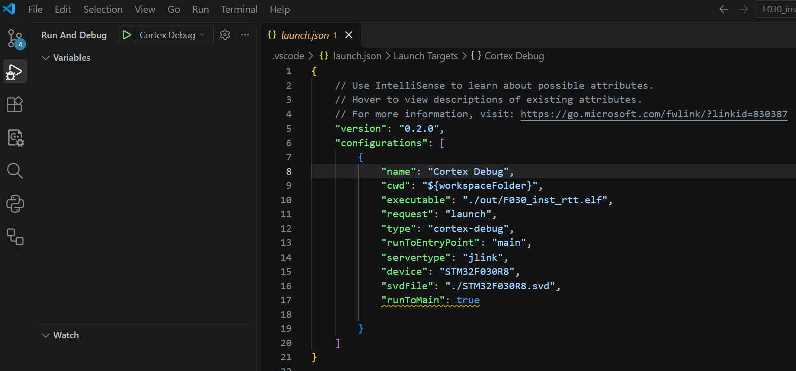
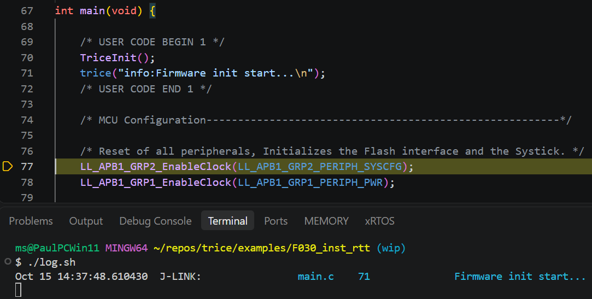
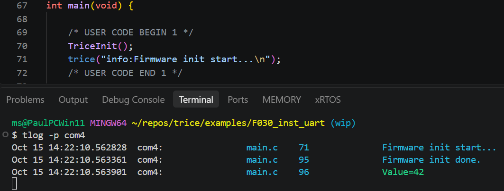
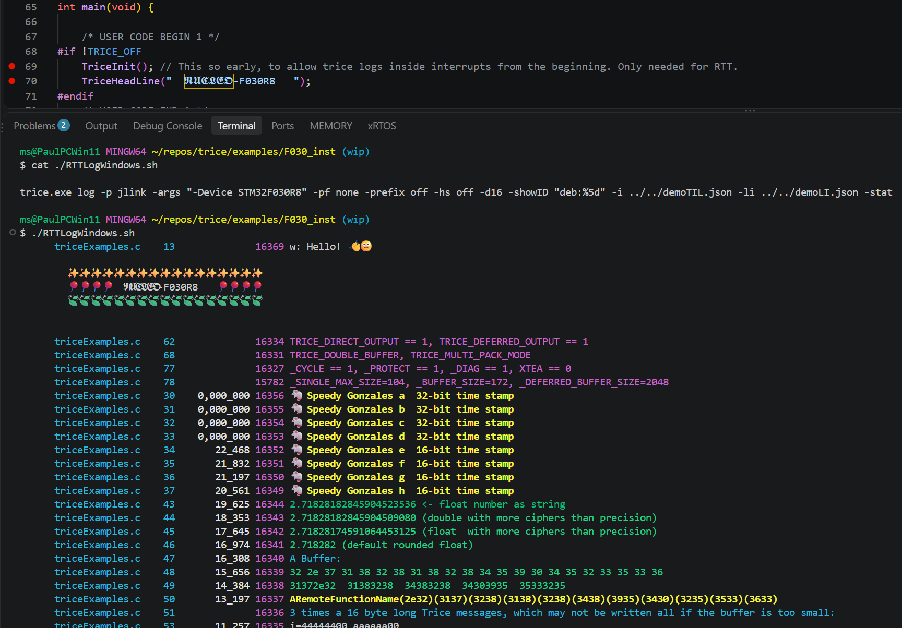
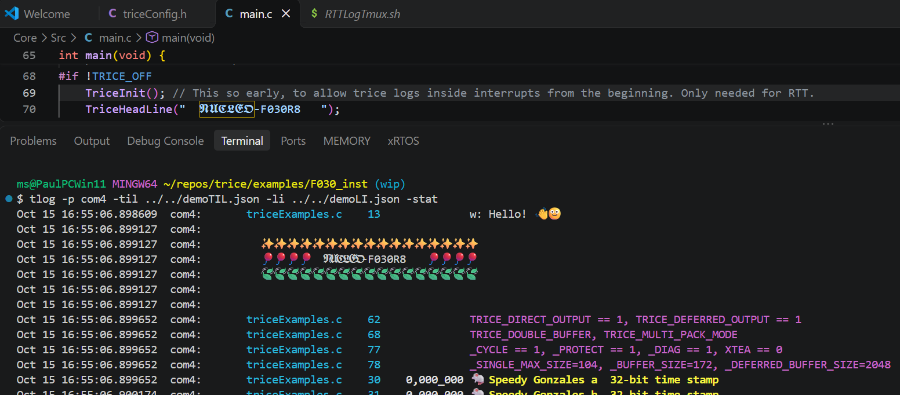
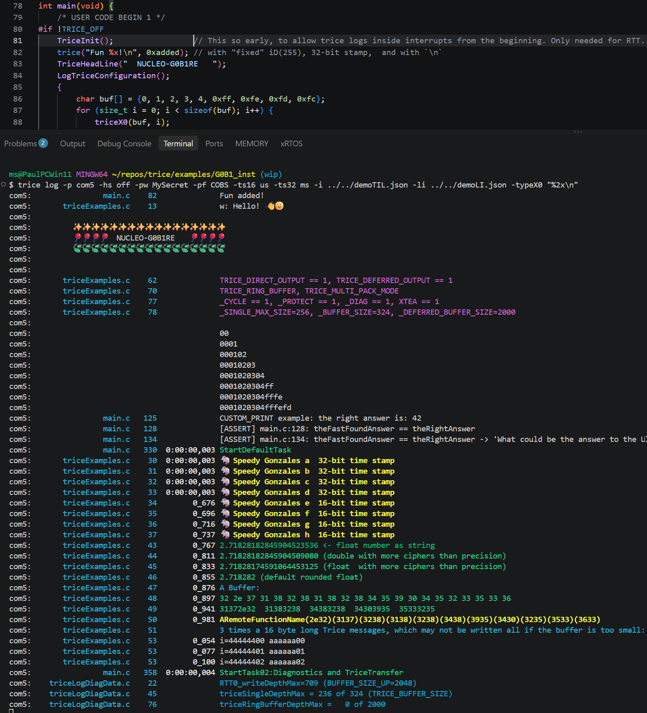
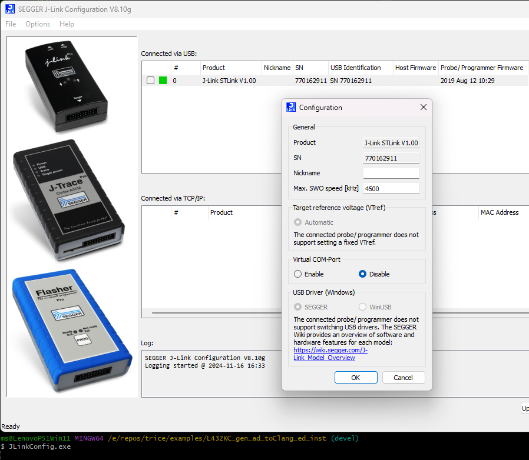

# Example Projects

<details markdown="1">
<summary>Contents</summary>

<!-- mdtoc -->

- [1. Minimal PC Demos: Direct and Deferred](#minimal-pc-demos-direct-and-deferred)
  - [1.1. Watch a running application](#watch-a-running-application)
- [2. PC Feature Tour](#pc-feature-tour)
  - [2.1. Updating the PC Tour's Output Checks](#updating-the-pc-tours-output-checks)
- [3. G0B1 Feature Tour](#g0b1-feature-tour)
- [4. Local Logging Example Projects](#local-logging-example-projects)
  - [4.1. PC Local Logging](#pc-local-logging)
  - [4.2. G0B1 FreeRTOS Local Logging](#g0b1-freertos-local-logging)
- [5. Shared Example Producers](#shared-example-producers)
- [6. Nucleo-F030R8 Examples](#nucleo-f030r8-examples)
  - [6.1. F030_bare](#f030_bare)
    - [6.1.1. Steps performed as potential guide:](#steps-performed-as-potential-guide)
    - [6.1.2. Hint](#hint)
  - [6.2. F030_inst_rtt](#f030_inst_rtt)
  - [6.3. F030_inst_uart](#f030_inst_uart)
  - [6.4. F030_inst](#f030_inst)
    - [6.4.1. Intrumenting:](#intrumenting)
- [7. Nucleo-G0B1 Examples](#nucleo-g0b1-examples)
  - [7.1. G0B1_bare](#g0b1_bare)
    - [7.1.1. G0B1_bare Description](#g0b1_bare-description)
    - [7.1.2. Setting Up G0B1_bare](#setting-up-g0b1_bare)
  - [7.2. G0B1_inst](#g0b1_inst)
    - [7.2.1. Setting Up](#setting-up)
    - [7.2.2. Instrumenting](#instrumenting)
- [8. Nucleo-L432KC Examples](#nucleo-l432kc-examples)
  - [8.1. L432_bare](#l432_bare)
  - [8.2. L432_inst](#l432_inst)
    - [8.2.1. Build:](#build)
    - [8.2.2. "Hardware" Changes](#hardware-changes)
    - [8.2.3. Using RTT with on-board J-Link and JLinkRTTLogger](#using-rtt-with-on-board-j-link-and-jlinkrttlogger)
    - [8.2.4. Using RTT with on-board J-Link and OpenOCD](#using-rtt-with-on-board-j-link-and-openocd)
    - [8.2.5. Using RTT with on-board ST-Link and OpenOCD](#using-rtt-with-on-board-st-link-and-openocd)
    - [8.2.6. Using On-board ST-Link and VS-Code Cortex-Debug Extension](#using-on-board-st-link-and-vs-code-cortex-debug-extension)

<!-- numbering=true min=2 max=4 slug=github anchor=true link=true toc=true bullets=auto -->
<!-- /mdtoc -->

</details>

Project Name                                    | Description
-------------------------------------------------|-------------------------------------------------------------------------------------------------------------------------------------------------------------------------------------------------------------------------------------------------------------------------------------
|                                                 | |
[F030_bare](../../examples/F030_bare)           | This is a minimal STM32CubeMX generated Makefile project adapted to Clang and GCC. It serves as a reference for diff to `F030_inst*` so see quickly the needed instrumentation steps you need for your own project.
[F030_inst_uart](../../examples/F030_inst_uart) | Recommended starting point when RTT is not the aim
[F030_inst_rtt](../../examples/F030_inst_rtt)   | To use RTT start here
[F030_inst](../../examples/F030_inst)           | This example shows how to use RTT and serial parallel.
|                                                 | |
[G0B1_bare](../../examples/G0B1_bare)           | This is a minimal FreeRTOS STM32CubeMX generated Makefile project adapted to Clang and GCC.
[G0B1_inst](../../examples/G0B1_inst)           | This is a minimal FreeRTOS STM32CubeMX generated Makefile project adapted to Clang and GCC and afterward instrumented with the Trice library.
[PC_features](examples.md#pc-feature-tour)                 | Small PC capture with structured fields, CE, tags, runtime strings, timestamps, and text/JSON/KV decoder scripts.
[G0B1_features](examples.md#g0b1-feature-tour)             | A copy of G0B1_inst showing CE task handles from two FreeRTOS tasks and matching decoder scripts.
|                                                 | |
[L432_bare](../../examples/L432_bare)           | This is a minimal FreeRTOS STM32CubeMX generated Makefile project extended to compile also with Clang trying to perform minimal changes. It produces some warnings, because it is not finetuned. The [L432_inst](../../examples/L432_inst) project is then a next step performable.
[L432_inst](../../examples/L432_inst)           | This is a minimal FreeRTOS STM32CubeMX generated Makefile project adapted to Clang and GCC and afterward instrumented with the Trice library.
|                                                 | |

## 1. <a id="minimal-pc-demos-direct-and-deferred"></a>Minimal PC Demos: Direct and Deferred

The two programs under [demo](../../demo/) use the same binary output channel in two modes. `direct` writes each record immediately to `build/log.bin`; `deferred` first stores records in a ring buffer and drains it through `TriceTransfer()`. Both compile the repository's `src` directly, without copying a library or requiring a separate build system.

The direct file writer is only a demonstration of **when the output callback runs**. Writing to a file is far too slow and unpredictable for a typical fast direct-output path: here that work takes place inside the log call. A typical Direct Mode application uses [SEGGER RTT](quickstarts.md#quickstart-segger-rtt-direct-mode-with-j-link), where records are written to a RAM buffer and read through the debug probe. You can debug the firmware and receive immediate log output alongside it. Demonstrating that setup requires a compatible target and debug probe, so it cannot be part of this hardware-free PC introduction. The file demo does not measure Direct Mode performance.

Put `trice` and a native C compiler in `PATH`, then use a POSIX shell (Git Bash on Windows). The scripts use `cc`; change `compiler=cc` to `compiler=gcc` if needed:

```sh
cd demo/deferred
./run.sh
cd ../direct
./run.sh
```

The two independent scripts ([deferred](../../demo/deferred/run.sh), [direct](../../demo/direct/run.sh)) are both named `run.sh` and sit next to their respective `main.c`. Each binds only that file, compiles one program, runs it and decodes its capture using `trice log -p FILEBUFFER`. Their comments explain each step. If an extracted source archive has lost the executable permission, use `sh ./run.sh` in the selected demo folder. No `LC_ALL` setting is needed. `tlog` is not required, and the scripts install nothing. The programs are named `demo_deferred.exe` and `demo_direct.exe` inside their respective `build` directories; these filenames work on Windows, Linux and macOS.

Ignoring optional location/prefix columns, the messages are:

```text
Hello from deferred mode.
Deferred value=42.
Hello from direct mode.
Direct value=42.
```

The layout separates project data from generated outputs:

```text
demo/deferred/run.sh          build, run and decode the deferred demo
demo/deferred/main.c          deferred application
demo/deferred/triceConfig.h   deferred configuration
demo/deferred/til.json        persistent ID-to-format dictionary
demo/deferred/li.json         source locations within this demo
demo/deferred/build/          executable and log.bin
  generated_sidecars/         this demo's sidecars and field registry
demo/direct/run.sh            build, run and decode the direct demo
demo/direct/main.c            direct application
demo/direct/triceConfig.h     direct configuration
demo/direct/til.json          this demo's dictionary
demo/direct/li.json           this demo's locations
demo/direct/build/            executable and log.bin
  generated_sidecars/         this demo's sidecars and field registry
demo/live/run.sh              build and run the live demo
demo/live/main.c              live application
demo/live/triceConfig.h       independent deferred-output configuration
demo/live/til.json            this demo's dictionary
demo/live/li.json             this demo's locations
demo/live/build/              executable and growing log.bin
  generated_sidecars/         this demo's sidecars and field registry
```

Binding uses `til.json` and `li.json` in each project's folder and `-genDir build/generated_sidecars` for the generated headers and field registry. No tables, generated headers or configuration files are shared between demos. To reuse a demo, copy its whole folder and adjust only `trice_src=../../src` in its script to point to your Trice library. The script works regardless of the directory from which you start it. On the first bind, a missing generated `#include "trice_sidecar_main_c_...h"` is inserted automatically; users neither invent nor maintain its name. Each compiler command includes `src/*.c`, so there is no individual library source list to maintain. The fallback RTT header is supplied by `src/default_conf`; no project RTT configuration is needed. Optional compiler checks are commented out. See [Trice Project Image Size Optimization](memory_usage.md) if you want to add unused-section removal to these deliberately minimal builds.

Compare [direct/main.c](../../demo/direct/main.c) and [deferred/main.c](../../demo/deferred/main.c): the latter explicitly transfers until its ring buffer is empty. Change the value `42` and rerun the corresponding script. Each script spells out the complete workflow so you can follow and modify either example independently.

### 1.1. <a id="watch-a-running-application"></a>Watch a running application

The [live application](../../demo/live/main.c) uses its own [deferred-output configuration](../../demo/live/triceConfig.h) and produces one counter record per second until you stop it. It works without hardware or additional network tools on macOS, Linux and Windows with Git Bash and a native C compiler.

In **terminal 1**, starting from the repository root:

```sh
cd demo/live
./run.sh
```

The [script](../../demo/live/run.sh) binds IDs, compiles the application and leaves it running. Once it prints the decoder command, open **terminal 2** at the repository root:

```sh
cd demo/live
trice log -p FILE -args build/log.bin
```

You should see the counter advance while the application continues running:

```text
Live counter=0.
Live counter=1.
Live counter=2.
```

`FILE` keeps reading when it reaches the current end of the file; `FILEBUFFER`, used by the short demos above, stops there. The application flushes its file buffer after each transfer so the parallel reader can see the new bytes immediately. The logger first displays any records already in the file, then follows new records.

Stop **both terminals** with Ctrl+C before restarting. A new application run recreates `demo/live/build/log.bin`; the capture grows for as long as the application runs. From `demo/live`, replay the stopped capture with `trice log -p FILEBUFFER -args build/log.bin`. The decoder finds this project's own `til.json` and `li.json` in the same directory. This is a simple live-logging demonstration, not a timing measurement or a bounded capture system.

## 2. <a id="pc-feature-tour"></a>PC Feature Tour

The [PC program](../../examples/PC_features/main.c) emits a short `capture.bin` for the normal host decoder. It groups Structured Logging, a runtime string, Context Enrichment (CE), tags, an untagged message, a buffer record, and both target-stamp widths in one editable application.

With `trice` and `cc` or `gcc` in `PATH`, run:

```sh
cd examples/PC_features
./build_and_run.sh
./show_text.sh
./show_json.sh
./show_kv.sh
./check_output.sh
```

The [build script](../../examples/PC_features/build_and_run.sh) binds local IDs and applies `-ce 'ctx:", cycle={cycle:%u}", pc_sample_phase'`. The shared `emit_sample` call therefore gains a `cycle` field without editing its `Supply {voltage_mv:%u}` format. The device name uses `TriceS` because CE does not append runtime arguments to string Trices. `til.json` and `li.json` are versioned project tables; the capture, executable, and generated headers are build outputs. Rebuild after changing the source or CE rule.

Feature                           | Source to edit                                                       | Observable result
-----------------------------------|----------------------------------------------------------------------|------------------------------------------------------------------------------------
Numeric fields and runtime string | `emit_sample` and the device-name `TriceS`                           | JSON `fields.voltage_mv` and `fields.device`; the device is `pump A`.
CE at one shared call site        | `info:ctx:` and `pc_sample_phase`                                    | Supply readings contain `cycle=7` and `cycle=11`.
Built-in and custom tags          | `wrn:`, `dbg:`, `sensor:`                                            | Warning threshold filters events; `sensor` has weight 450 in the show scripts.
Two stamp widths                  | `TRice16` for Phase, `Trice8` for Humidity, and `TRice32` for Supply | Phase has a 32-bit stamp; Humidity has a 16-bit stamp.
Stamp delta                       | Two Supply calls                                                     | Second 32-bit stamp is 125 ms, with a 25 ms delta.
Untagged message and buffer       | Last calls in `main`                                                 | Message `A message without a tag`, metadata tag `untagged`, and bytes `41 00 ff `.

The [text](../../examples/PC_features/show_text.sh), [JSON](../../examples/PC_features/show_json.sh), and [KV](../../examples/PC_features/show_kv.sh) scripts append your extra arguments to their `trice log` command:

```sh
./show_json.sh -logLevel wrn
./show_text.sh -pick info
./show_json.sh -ulabel sensor:650 -logLevel wrn
./show_text.sh -tagStat
```

The first retains Warning and higher weights; the third raises `sensor` so it also passes that threshold. JSON produces one object per event (NDJSON). Tag statistics count decoded groups, including events hidden by filters. For a complete macro/format corpus see [triceCheck.c](../../_test/testdata/triceCheck.c); for live plotting see [the data producers](visualization.md#setting-up-the-labplot-demo), and for local formatting see [the local-log examples](examples.md#local-logging-example-projects).

### 2.1. <a id="updating-the-pc-tours-output-checks"></a>Updating the PC Tour's Output Checks

[check_output.sh](../../examples/PC_features/check_output.sh) checks concrete values from `main.c`, the CE rule, and the show-script options. After editing any of those, rebuild, inspect JSON and KV output, update the corresponding shell `case` pattern, and run the check again. Keep each check tied to an observable result. If a feature is removed, deliberately replace or remove its assertion rather than leaving a commented-out check and a misleading `PASS` message.

Macro capitalization chooses stamp width: `trice...` has no target stamp, `Trice...` has 16 bits, and `TRice...` has 32 bits. Changing `Trice16(...)` to `TRice16(...)` changes the stamp, not the 16-bit payload value. The `-ts16` and `-ts32` options change display only. In this tour the 16-bit stamp represents a sample phase; the 32-bit stamp counts milliseconds. Adding stamped events can change subsequent `ts16Delta` or `ts32Delta` expectations. JSON displays a source newline as the two characters `\n`, which shell patterns must match literally.

## 3. <a id="g0b1-feature-tour"></a>G0B1 Feature Tour

[G0B1_features](../../examples/G0B1_features/) is a direct copy of `G0B1_inst` with a short tour in its two existing FreeRTOS tasks. The original hardware configuration remains in place; the large `TriceCheck` loop is omitted to make task records easy to find. Its companion is the hardware-free [PC feature tour](examples.md#pc-feature-tour).

With `trice`, GNU Make, and the Arm GNU toolchain in `PATH`:

```sh
cd examples/G0B1_features
./demo_build.sh
./check_build.sh
```

The [build script](../../examples/G0B1_features/demo_build.sh) binds this copy and its shared `exampleData` producers into a private `til.json`, applying `-ce 'ctx:", task={task:%p}", osThreadGetId()'`. The call in `LogFeatureSample` executes from both tasks, so the records have different task handles at the same C call site. The neighboring `triceS` transports the worker name. Edit [Core/Src/main.c](../../examples/G0B1_features/Core/Src/main.c) to experiment with the named `sample` and `load_pct` fields, 16-/32-bit stamps, Warning, untagged text, buffer output, and the custom `sensor:` tag.

[check_build.sh](../../examples/G0B1_features/check_build.sh) verifies the generated task adapter and the string, field, stamp, tag, and buffer entries; it needs no board. It is a compiler/build check, not evidence that firmware ran on an MCU.

Three scopes matter here: the files selected by Bind, the files compiled by the Makefile, and the functions actually called at runtime. A shared producer can need a sidecar because it is scanned or compiled even when the feature tour never calls its demo function. The current `demo_build.sh` selects `Core/Src` and `../exampleData`; it does not select `_test/testdata/triceCheck.c`. A `trice_triceCheck_c_...` header in a generation directory may therefore come from another or earlier repository-wide Bind run. Its presence alone does not show that this tour runs `TriceCheck`. Use [`generate -bindReport`](generate.md#bind-artifact-report) with the relevant source selection to inspect references; an absent scan reference is not proof that another build no longer needs the file.

Flash `out.gcc/G0B1.elf` using the [original board setup](examples.md#g0b1inst). In a separate terminal capture RTT channel 0 with J-Link:

```sh
mkdir -p temp
JLinkRTTLogger -Device STM32G0B1RE -If SWD -Speed 4000 -RTTChannel 0 temp/trice.bin
```

Stop the logger once startup records have arrived, then decode the saved capture:

```sh
./show_text.sh
./show_json.sh
./show_kv.sh
./show_json.sh -pick info
./show_kv.sh -logLevel wrn
```

The [text](../../examples/G0B1_features/show_text.sh), [JSON](../../examples/G0B1_features/show_json.sh), and [KV](../../examples/G0B1_features/show_kv.sh) decoder scripts expect this project's `til.json` and accept extra `trice log` arguments. They use 16-bit stamps as microseconds and 32-bit stamps as milliseconds; JSON is NDJSON. The custom tag has weight 450. Rebuild and recapture after editing calls or CE rules. A board and J-Link are required for capture, but an existing `temp/trice.bin` can be decoded without hardware.

## 4. <a id="local-logging-example-projects"></a>Local Logging Example Projects

These applications demonstrate [local deferred text logging](target_implementation.md#local-deferred-text-log): producers remain binary and short; one background consumer formats records on the target. `TriceLog()` and `TriceTransfer()` must never consume the same deferred buffer together.

### 4.1. <a id="pc-local-logging"></a>PC Local Logging

The [PC application](../../examples/PC_log/main.c) uses a ring buffer, system `snprintf`, and standard output. With `trice` and `cc` or `gcc` in `PATH`:

```sh
cd examples/PC_log
./build_and_run.sh
```

The [script](../../examples/PC_log/build_and_run.sh) binds the application and shared `triceCheck.c` corpus, generates `build/til.c` with `trice generate -logC`, compiles against `../../src`, and runs the result. Sidecars are in `generated`; the table and executable are in `build`. No serial connection, RTT/J-Link installation, or host decoder is needed. A startup sequence shows integers, a runtime `%s`, string width/precision, `aFloat()`, `aDouble()`, Trice-specific conversions, and a buffer; the shared corpus then runs line by line.

The explicit switches in [triceConfig.h](../../examples/PC_log/triceConfig.h) are a readable full-feature configuration. Command/RPC and selector-0 cases are disabled only for local logging; the two host-only dynamic-string byte-dump forms are likewise guarded only by `TRICE_LOCAL_LOG`, preserving ordinary corpus users.

### 4.2. <a id="g0b1-freertos-local-logging"></a>G0B1 FreeRTOS Local Logging

The independent [G0B1_log](../../examples/G0B1_log/) copy retains the original CubeMX setup, task names, priorities, and stack sizes. With `trice` and the Arm GNU toolchain in `PATH`:

```sh
cd examples/G0B1_log
./build.sh
```

The [build script](../../examples/G0B1_log/build.sh) binds the application and shared corpus, generates `build/til.c`, and builds `out.gcc/G0B1_log.elf`; Bind sidecars remain in `generated`. The default task executes the corpus. The idle diagnostics task `StartTask02` alone calls `TriceLog()` with nanoprintf and may block while transmitting already formatted text:

```text
tasks and interrupts -> binary Trice ring buffer
                    -> idle StartTask02 -> TriceLog + nanoprintf
                    -> USART2 text at 115200 baud
```

Producer contexts neither call printf nor wait for USART2. Connect the USART2 virtual COM port to a serial terminal at 115200 baud. At runtime no `trice log`, TIL file, or binary host decoder is needed. The startup feature set matches the PC local-log example, including runtime strings, bounded string formatting, float/double, special conversions, and a buffer.

Both configurations enable ANSI colors and strip recognized all-lower-case tags independently. Set `TRICE_LOCAL_LOG_USE_ANSI_COLORS` to `0` for plain redirected text; an ANSI-capable terminal is required to display colors. `TRICE_LOCAL_LOG_STRIP_LOWER_CASE_TAGS` separately controls retaining tags. Floating-point nanoprintf support increases target code size; integer/string-only applications can disable both the corresponding nanoprintf options and Trice local-log options. See [configuration switches and formatter hooks](target_implementation.md#local-deferred-text-log) and the [local-log integration tests](../../internal/id/local_log_integration_test.go) for their behavior and limits.

## 5. <a id="shared-example-producers"></a>Shared Example Producers

The C files under [examples/exampleData](../../examples/exampleData/) are shared producer sources used by several installed examples; this is not a standalone application. A Bind scan can generate sidecars for included shared producers even when an application does not invoke their demo functions at runtime. The large [triceCheck.c](../../_test/testdata/triceCheck.c) corpus is separate and supplies the PC target tests and installed local-log examples.

## 6. <a id="nucleo-f030r8-examples"></a>Nucleo-F030R8 Examples


Use [F030_bare](../../examples/F030_bare/) as the uninstrumented baseline and compare it with [F030_inst_rtt](examples.md#f030instrtt) or [F030_inst_uart](examples.md#f030instuart) for the first instrumentation steps. The three `build.sh` scripts change to their own project directory and pass their arguments to `make`; the instrumented variants additionally run `trice bind`. Put `make` and the Arm GNU tools on PATH, plus `trice` and `tlog` for the instrumented variants. Use `./build.sh -j2` for two compiler jobs. These scripts build firmware without flashing it.

The instrumented variants keep `triceConfig.h` and the persistent ID-to-format dictionary `til.json` in version control. Their build scripts run `trice bind` and `make`, producing firmware in `out/`, regenerable headers in `out/sidecars` and the local `li.json` location index. Sidecars and `li.json` are ignored by Git; the latter records current source paths and line numbers. [F030_inst](examples.md#f030inst) is the larger parallel RTT/UART example and retains its existing build workflow.

### 6.1. <a id="f030_bare"></a>F030_bare

Folder: [../examples/F030_bare/](../../examples/F030_bare/)

This is a STMCubeMX generated project without Trice instrumentation for easy compare with [F030_inst](../../examples/F030_inst) to figure out the needed changes to set up trice.

Build the current project from the repository root with:

```sh
cd examples/F030_bare
./build.sh
```

The firmware files are `out/F030_bare.elf`, `out/F030_bare.hex` and `out/F030_bare.bin`. The original CubeMX setup walkthrough below shows the former `build/` output directory; use `out/` with the current Makefile and debugger configuration.

#### 6.1.1. <a id="steps-performed-as-potential-guide"></a>Steps performed as potential guide:

- Install STM32CubeMX to `C:\SMT32SubeMX`.
- Select NUCLEO-F030R8 board.
- Initialize with default values.
- Optionally set system clock to 32MHz for faster target timestamps.
- Optionally set UART baud rate to 115200.
- Set UART word length to **8 bits (including parity)**, parity to **None**, and stop bits to **1** (8N1).
- Enable USART2 global interrupt.
- In Project Manager *Project*:
  - Set toolchain folder location to `E:\repos\trice\examples\F030_bare\`.
  - Set project name to `F030_bare`.
  - Set toolchain / IDE to `Makefile`.
- In Project Manager *Code Generator*:
  - Select "Copy only the necessary library files".
- In Project Manager *Advanced Settings*:
  - In Driver Selector change all to *LL*.
- Generate Code
- Start VS Code and open folder F030_bare with it.
- Start a terminal and type `make`. The output should be similar to:

```bash
PS E:\repos\trice\examples\F030_bare> make -j
mkdir build
arm-none-eabi-gcc -c -mcpu=cortex-m0 -mthumb   -DUSE_FULL_LL_DRIVER -DHSE_VALUE=8000000 -DHSE_STARTUP_TIMEOUT=100 -DLSE_STARTUP_TIMEOUT=5000 -DLSE_VALUE=32768 -DHSI_VALUE=8000000 -DLSI_VALUE=40000 -DVDD_VALUE=3300 -DPREFETCH_ENABLE=1 -DINSTRUCTION_CACHE_ENABLE=0 -DDATA_CACHE_ENABLE=0 -DSTM32F030x8 -ICore/Inc -IDrivers/STM32F0xx_HAL_Driver/Inc -IDrivers/CMSIS/Device/ST/STM32F0xx/Include -IDrivers/CMSIS/Include -Og -Wall -fdata-sections -ffunction-sections -g -gdwarf-2 -MMD -MP -MF"build/main.d" -Wa,-a,-ad,-alms=build/main.lst Core/Src/main.c -o build/main.o

...

arm-none-eabi-gcc -x assembler-with-cpp -c -mcpu=cortex-m0 -mthumb   -DUSE_FULL_LL_DRIVER -DHSE_VALUE=8000000 -DHSE_STARTUP_TIMEOUT=100 -DLSE_STARTUP_TIMEOUT=5000 -DLSE_VALUE=32768 -DHSI_VALUE=8000000 -DLSI_VALUE=40000 -DVDD_VALUE=3300 -DPREFETCH_ENABLE=1 -DINSTRUCTION_CACHE_ENABLE=0 -DDATA_CACHE_ENABLE=0 -DSTM32F030x8 -ICore/Inc -IDrivers/STM32F0xx_HAL_Driver/Inc -IDrivers/CMSIS/Device/ST/STM32F0xx/Include -IDrivers/CMSIS/Include -Og -Wall -fdata-sections -ffunction-sections -g -gdwarf-2 -MMD -MP -MF"build/startup_stm32F030x8.d" startup_stm32F030x8.s -o build/startup_stm32F030x8.o
arm-none-eabi-gcc build/main.o build/stm32f0xx_it.o build/stm32f0xx_ll_gpio.o build/stm32f0xx_ll_pwr.o build/stm32f0xx_ll_exti.o build/stm32f0xx_ll_usart.o build/stm32f0xx_ll_rcc.o build/stm32f0xx_ll_dma.o build/stm32f0xx_ll_utils.o build/system_stm32f0xx.o build/sysmem.o build/syscalls.o build/startup_stm32F030x8.o  -mcpu=cortex-m0 -mthumb   -specs=nano.specs -TSTM32F030R8Tx_FLASH.ld  -lc -lm -lnosys  -Wl,-Map=build/F030_bare.map,--cref -Wl,--gc-sections -o build/F030_bare.elf
C:/bin/ArmGNUToolchain/bin/../lib/gcc/arm-none-eabi/13.2.1/../../../../arm-none-eabi/bin/ld.exe: warning: build/F030_bare.elf has a LOAD segment with RWX permissions
arm-none-eabi-size build/F030_bare.elf
   text    data     bss     dec     hex filename
   2428      12    1564    4004     fa4 build/F030_bare.elf
arm-none-eabi-objcopy -O ihex build/F030_bare.elf build/F030_bare.hex
arm-none-eabi-objcopy -O binary -S build/F030_bare.elf build/F030_bare.bin
PS E:\repos\trice\examples\F030_bare>
```

- Install VS Code Cortex-Debug extension.
- Create a launch.json file inside the *.vscode* subfolder and edit it to get

```json
{
    // Use IntelliSense to learn about possible attributes.
    // Hover to view descriptions of existing attributes.
    // For more information, visit: https://go.microsoft.com/fwlink/?linkid=830387
    "version": "0.2.0",
    "configurations": [
        {
            "name": "Cortex Debug",
            "cwd": "${workspaceFolder}",
            "executable": "./build/F030_bare.elf",
            "request": "launch",
            "type": "cortex-debug",
            "runToEntryPoint": "main",
            "servertype": "jlink",
            "device": "STM32F030R8",
            "svdFile": "./STM32F030R8.svd",
            "runToMain": true

        }
    ]
}
```

- Download [STM32F0x0.svd](https://raw.githubusercontent.com/Open-CMSIS-Pack/STM32F0xx_DFP/main/CMSIS/SVD/STM32F0x0.svd) and save it in the workspace as `STM32F030R8.svd` to match the `svdFile` setting above. This SVD covers the STM32F030R8; it is also available with STM32CubeIDE.
- You may need to extract and install the [STM32 USB drivers](https://www.st.com/en/development-tools/stsw-link009.html). You can find them also in `./third_party/st.com/en.stsw-link009_v2.0.2.zip`.
- It is assumed, that you converted the OB ST-Link to an OB J-Link already. See [Convert Evaluation Board onboard ST-Link to J-Link](rtt.md#convert-evaluation-board-onboard-st-link-to-j-link) for details.
- Press the Debug-Button or "CTRL+SHIFT+D" and start debugging.

#### 6.1.2. <a id="hint"></a>Hint

- During the code generation, the CubeMX tool did not copy `syscalls.c` and `sysmem.c` but added them to the Makefile. This seems to be a STM32CubeMX "feature".
  - You do not need these files for the example project, but you can add them manually to avoid some warnings or extend the code with:
  ```C
  __weak int _close(void) { return -1; }
  __weak int _lseek(void) { return -1; }
  __weak int _read (void) { return -1; }
  __weak int _write(void) { return -1; }
  ```

### 6.2. <a id="f030_inst_rtt"></a>F030_inst_rtt

If you have a STM F030 evaluation board or something similar [changing the onboard STLINK to an onboard JLINK](https://github.com/rokath/trice/blob/main/docs/rm/rtt.md#convert-evaluation-board-onboard-st-link-to-j-link) is recommended. That allows easy debugging together with direct Trice output.

Folder: [../examples/F030_inst_rtt/](../../examples/F030_inst_rtt/)

Compare this project with [F030_bare](../../examples/F030_bare/) to see the changes required for RTT logging. The vendor files are identical. `main.c` adds the Trice include, initialization and three startup log calls; [triceConfig.h](../../examples/F030_inst_rtt/Core/Inc/triceConfig.h) selects direct 32-bit RTT output with a stack buffer. The Makefile adds the Trice library and generated headers. No UART logging or RPC support is enabled.

```sh
cd examples/F030_inst_rtt
./build.sh
```

[build.sh](../../examples/F030_inst_rtt/build.sh) follows the [shared F030 Bind workflow and file-ownership rules](#nucleo-f030r8-examples).

No project-specific `SEGGER_RTT_Conf.h` is needed. The include path ends with [src/default_conf](../../src/default_conf/), which supplies the shared fallback. When RTT is enabled, Trice automatically loads the selected SEGGER configuration and inherits its buffer sizes and channel counts. The example needs neither a SEGGER include nor matching aliases in `triceConfig.h`. Explicit `TRICE_*` overrides remain possible, but `trice.c` rejects values that disagree with the SEGGER configuration. The fallback's down-buffer and printf-buffer sizes remain `16` and `64`.

Flash `out/F030_inst_rtt.elf` onto a NUCLEO-F030R8 board using your debugger. For example in VC Code with the cortex debug extension press the green triangle after adapting the launch.json to your needs:



With the SEGGER J-Link tools installed and a J-Link connection to the board, run [log.sh](../../examples/F030_inst_rtt/log.sh), then reset the board:

```sh
./log.sh
```



The startup records print `Firmware init start...`, `Firmware init done.` and `Value=42`. `TriceInit` runs at the beginning of `main`, allowing logging during peripheral initialization. RTT writes directly to its RAM buffer; no transfer call or UART interrupt is needed. Since this example logs only from `main`, it does not define its own critical-section macros.

For the corresponding UART steps, compare [F030_inst_uart](examples.md#f030instuart). [F030_inst](examples.md#f030inst) demonstrates RTT and UART in parallel.

### 6.3. <a id="f030_inst_uart"></a>F030_inst_uart

Folder: [../examples/F030_inst_uart/](../../examples/F030_inst_uart/)

Compare this project with [F030_bare](../../examples/F030_bare/) to see the changes required for UART logging. The vendor files are identical. `main.c` adds the Trice include, initialization and three startup log calls. Its loop calls `TriceTransfer` to encode and send queued records. USART2 uses 115200 baud, 8N1, matching the bare project's setting. Its interrupt handler serves the transmit interrupt.

[triceConfig.h](../../examples/F030_inst_uart/Core/Inc/triceConfig.h) selects deferred UART output with a ring buffer, while [triceUart.h](../../examples/F030_inst_uart/Core/Inc/triceUart.h) connects the four transmit operations to the STM32 LL API. The Makefile adds the Trice library and generated headers. No RTT logging, receive backchannel or RPC support is enabled, and no project-specific `SEGGER_RTT_Conf.h` is needed.

The critical-section macros remain necessary even though application log calls run only in `main`: the UART driver shares its transmit pointer, index and remaining-byte count between `TriceTransfer` and the USART interrupt. Saving PRIMASK, disabling interrupts and restoring the previous mask protects this state, including nested critical sections.

```sh
cd examples/F030_inst_uart
./build.sh
```

[build.sh](../../examples/F030_inst_uart/build.sh) follows the [shared F030 Bind workflow and file-ownership rules](#nucleo-f030r8-examples).

Flash `out/F030_inst_uart.elf` onto a NUCLEO-F030R8 board using your debugger. USART2 TX is PA2, connected to the board's ST-LINK virtual COM port. Run [log.sh](../../examples/F030_inst_uart/log.sh), then reset the board. The default port is COM7; select another port with the normal `tlog` switch `-p`:

```sh
./log.sh
# For example, on Linux:
./log.sh -p /dev/ttyACM0
```



The startup records print `Firmware init start...`, `Firmware init done.` and `Value=42`. `TriceInit` runs at the beginning of `main`; records generated before USART initialization stay in RAM until the loop calls `TriceTransfer`. The UART then sends asynchronously through TX-empty interrupts.

For the corresponding RTT steps, compare [F030_inst_rtt](examples.md#f030instrtt). [F030_inst](examples.md#f030inst) demonstrates RTT and UART in parallel.

### 6.4. <a id="f030_inst"></a>F030_inst

Folder: [../examples/F030_inst/](../../examples/F030_inst/)

This example enables deferred UART output and parallel direct RTT output in [triceConfig.h](../../examples/F030_inst/Core/Inc/triceConfig.h). It uses the shared example producers. Its remaining [obsolete RPC configuration](target_implementation.md#obsolete-rpc-support) is not part of the recommended integration. Encryption is disabled by default. For setup see [Trice over RTT](rtt.md) and adapt steps from [F030_bare](../../examples/F030_bare/).

The project-specific [SEGGER_RTT_Conf.h](../../examples/F030_inst/Core/Inc/SEGGER_RTT_Conf.h) sets the RTT down-buffer and printf-buffer sizes to `0`. Trice automatically inherits these values from the selected SEGGER configuration. Removing the project file would select the shared fallback with sizes `16` and `64` instead; either configuration passes the consistency checks unless an explicit `TRICE_*` override disagrees with it.

#### 6.4.1. <a id="intrumenting"></a>Intrumenting:

- Extend the Makefile with the information you get from comparing the *Makefile* here and in [../F030_bare/](../../examples/F030_bare/).
- Add *build.sh* and *clean.sh*.
- For a new RTT project, copy and adapt the small [fallback `SEGGER_RTT_Conf.h`](../../src/default_conf/SEGGER_RTT_Conf.h) into [./Core/Inc/](../../examples/F030_inst/Core/Inc/), or use the fallback include directory unchanged. Existing examples keep their full project configuration; see [Trice over RTT](rtt.md).
- Copy and adapt a file [triceConfig.h](../../examples/F030_inst/Core/Inc/triceConfig.h) to [./Core/Inc/](../../examples/F030_inst/Core/Inc/). You can choose from another example project or one of the test folders.
- Create 2 empty files: `touch til.json li.json`inside [./](../)
- Run `build.sh`. This should build all.
- Add `#include "trice.h"` to *main.c* and to *stm32f0xx_it.c* and edit these files according to diff.
- Add to `int main( void )` some `Trice( "..." );` messages.

- Run `trice s` to determine the relevant comport.
- You can have this output parallel:




- The Trices with 16-bit timestamps are about 150 clocks away from each other. @32MHz this is a time of less 5 µs.

## 7. <a id="nucleo-g0b1-examples"></a>Nucleo-G0B1 Examples


### 7.1. <a id="g0b1_bare"></a>G0B1_bare

Folder: [../examples/G0B1_bare/](../../examples/G0B1_bare/)

#### 7.1.1. <a id="g0b1_bare-description"></a>G0B1_bare Description

- This is a working example with CLang and also GCC.
- This is a STMCubeMX generated project. It was then manually adapted to Clang.
- It is without TRICE instrumentation for easy compare with [../G0B1_inst](../../examples/G0B1_inst) to figure out the needed changes to set up trice.

#### 7.1.2. <a id="setting-up-g0b1_bare"></a>Setting Up G0B1_bare

- See and adapt steps from [F030_bare](examples.md#f030bare).
- Then add/modify the files to reach this folder layot.

### 7.2. <a id="g0b1_inst"></a>G0B1_inst

Folder: [../examples/G0B1_inst/](../../examples/G0B1_inst/)

This is an example with direct out without framing over RTT and deferred out in TCOBS framing over UART.

#### 7.2.1. <a id="setting-up"></a>Setting Up

- See and adapt steps from [G0B1_bare](examples.md#g0b1bare).

#### 7.2.2. <a id="instrumenting"></a>Instrumenting

- The steps are similar to the steps in [F030_bare](examples.md#f030bare).
- See comments in [triceConfig.h](../../examples/G0B1_inst/Core/Inc/triceConfig.h) and commandlines in screenshot.



## 8. <a id="nucleo-l432kc-examples"></a>Nucleo-L432KC Examples


### 8.1. <a id="l432_bare"></a>L432_bare

Folder: [../examples/L432_bare/](../../examples/L432_bare/)

<!-- * [NUCLEO L432 User Manual](../../ref/dm00231744-stm32-nucleo32-boards-mb1180-stmicroelectronics.pdf) (example) -->
* This example is without Trice istrumentation and serves for comparing with [L432_inst](../../examples/L432_inst/) to see the needed instrumentation steps quickly.
* This is a STMCubeMX generated project.
* See and adapt steps from [F030_bare](../../examples/F030_bare) example.
* It was then manually adapted additionally to Clang.
* It was additionally configured for FreeRTOS.

### 8.2. <a id="l432_inst"></a>L432_inst

Folder: [../examples/L432_inst/](../../examples/L432_inst/)

* This is the with Trice instrumented example project [L432_bare](../../examples/L432_bare).
* It is for easy compare to figure out the needed setup changes.
* See and adapt steps in [F030_bare](../../examples/F030_bare).
* Then add/modify the files to reach this folder layout.

#### 8.2.1. <a id="build"></a>Build:

Run `./build.sh` for configuration 0 or `./build.sh CONFIGURATION=34` for example.

##### Deferred Mode for max Speed

The stamps are MCU clocks here, so `🐁 Speedy Gonzales` lasts 9 processor clocks here.

```bash
ms@DESKTOP-7POEGPB MINGW64 ~/repos/trice_wt_devel/examples/L432_inst (devel)
$ trice l -p com8 -hs off -prefix off
      triceExamples.c    10        0_272  Hello! 👋🙂

        ✨✨✨✨✨✨✨✨✨✨✨✨✨✨✨✨✨
        🎈🎈🎈🎈  𝕹𝖀𝕮𝕷𝕰𝕺-L432KC   🎈🎈🎈🎈
        🍃🍃🍃🍃🍃🍃🍃🍃🍃🍃🍃🍃🍃🍃🍃🍃🍃


        triceConfig.h   369              CONFIGURATION == 34 - UART, no cycle counter, no critical sections.
      triceExamples.c    45              TRICE_DIRECT_OUTPUT == 0, TRICE_DEFERRED_OUTPUT == 1
      triceExamples.c    51              TRICE_DOUBLE_BUFFER, TRICE_MULTI_PACK_MODE
      triceExamples.c    60              _CYCLE == 0, _PROTECT == 0, _DIAG == 0, XTEA == 0
      triceExamples.c    61              _SINGLE_MAX_SIZE=512, _BUFFER_SIZE=580, _DEFERRED_BUFFER_SIZE=4096
      triceExamples.c    15    0,000_731 🐁 Speedy Gonzales
      triceExamples.c    16    0,000_745 🐁 Speedy Gonzales
      triceExamples.c    17    0,000_754 🐁 Speedy Gonzales
      triceExamples.c    18    0,000_763 🐁 Speedy Gonzales
      triceExamples.c    19    0,000_772 🐁 Speedy Gonzales
      triceExamples.c    20    0,000_781 🐁 Speedy Gonzales
      triceExamples.c    21    0,000_790 🐁 Speedy Gonzales
      triceExamples.c    22    0,000_799 🐁 Speedy Gonzales
      triceExamples.c    24        0_981 2.71828182845904523536 <- float number as string
      triceExamples.c    25        1_230 2.71828182845904509080 (double with more ciphers than precision)
      triceExamples.c    26        1_268 2.71828174591064453125 (float  with more ciphers than precision)
      triceExamples.c    27        1_296 2.718282 (default rounded float)
      triceExamples.c    28        1_310 A Buffer:
      triceExamples.c    29        1_348 32 2e 37 31 38 32 38 31 38 32 38 34 35 39 30 34 35 32 33 35 33 36
      triceExamples.c    30        1_603 31372e32  31383238  34383238  34303935  35333235
      ...
      triceExamples.c    32              10 times a 16 byte long Trice messages, which not all will be written because of the TRICE_PROTECT:
      triceExamples.c    34        2_072 i=44444400 aaaaaa00
      triceExamples.c    34        2_119 i=44444401 aaaaaa01
      triceExamples.c    34        2_166 i=44444402 aaaaaa02
```

#### 8.2.2. <a id="hardware-changes"></a>"Hardware" Changes

* The used evaluation board is delivered with an on-board ST-Link software for debugging.
* This was changed to an on-board J-Link software for better debugging and RTT support.
* See [Trice over RTT](rtt.md) about that.

#### 8.2.3. <a id="using-rtt-with-on-board-j-link-and-jlinkrttlogger"></a>Using RTT with on-board J-Link and JLinkRTTLogger

* You need to install the "J-Link Software and Documentation pack" for yout OS.
* [./Core/Inc/triceConfig.h](../../examples/L432_inst/Core/Inc/triceConfig.h) contains example Trice log commands.

#### 8.2.4. <a id="using-rtt-with-on-board-j-link-and-openocd"></a>Using RTT with on-board J-Link and OpenOCD

##### With Windows not possible

* OpenOCD does not support the installed JLink driver.

* Changing to the WinUSB buld device driver is here not supported :-(

##### Darwin (macOS)

* See **OpenOCD with Darwin** in [Trice over RTT](rtt.md)

#### 8.2.5. <a id="using-rtt-with-on-board-st-link-and-openocd"></a>Using RTT with on-board ST-Link and OpenOCD

**Terminal 1:**

```bash
ms@LenovoP51Win11 MINGW64 /e/repos/trice/examples/L432_inst (devel)
$ openocd -f STLinkOpenOCD.cfg
Open On-Chip Debugger 0.12.0 (2024-09-16) [https://github.com/sysprogs/openocd]
Licensed under GNU GPL v2
libusb1 d52e355daa09f17ce64819122cb067b8a2ee0d4b
For bug reports, read
        http://openocd.org/doc/doxygen/bugs.html
Info : The selected transport took over low-level target control. The results might differ compared to plain JTAG/SWD
Info : clock speed 100 kHz
Info : STLINK V2J24M11 (API v2) VID:PID 0483:374B
Info : Target voltage: 72.811768
Info : [stm32l4x.cpu] Cortex-M4 r0p1 processor detected
Info : [stm32l4x.cpu] target has 6 breakpoints, 4 watchpoints
Info : [stm32l4x.cpu] Examination succeed
Info : [stm32l4x.cpu] starting gdb server on 3333
Info : Listening on port 3333 for gdb connections
Info : rtt: Searching for control block 'SEGGER RTT'
Info : rtt: Control block found at 0x2000145c
Info : Listening on port 9090 for rtt connections
Channels: up=1, down=3
Up-channels:
0: Terminal 1024 0
Down-channels:
0: Terminal 16 0
Info : Listening on port 6666 for tcl connections
Info : Listening on port 4444 for telnet connections
```

**Terminal2:**

```bash
ms@LenovoP51Win11 MINGW64 /e/repos/trice/examples/L432_inst (devel)
$ trice l -p TCP4 -args localhost:9090  -pf none -d16
Nov 16 20:38:12.376056  TCP4:       triceExamples.c    10        1_595  Hello! 👋🙂
Nov 16 20:38:12.376056  TCP4:
Nov 16 20:38:12.376056  TCP4:         ✨✨✨✨✨✨✨✨✨✨✨✨✨✨✨✨✨
Nov 16 20:38:12.376056  TCP4:         🎈🎈🎈🎈  𝕹𝖀𝕮𝕷𝕰𝕺-L432KC   🎈🎈🎈🎈
Nov 16 20:38:12.376056  TCP4:         🍃🍃🍃🍃🍃🍃🍃🍃🍃🍃🍃🍃🍃🍃🍃🍃🍃
Nov 16 20:38:12.376056  TCP4:
Nov 16 20:38:12.376056  TCP4:
Nov 16 20:38:13.891033  TCP4:       triceExamples.c    16       43_439 2.71828182845904523536 <- float number as string
Nov 16 20:38:14.874024  TCP4:       triceExamples.c    17       44_949 2.71828182845904509080 (double with more ciphers than precision)
Nov 16 20:38:15.692614  TCP4:       triceExamples.c    18       45_802 2.71828174591064453125 (float  with more ciphers than precision)
Nov 16 20:38:16.323665  TCP4:       triceExamples.c    19       46_536 2.718282 (default rounded float)
```

#### 8.2.6. <a id="using-on-board-st-link-and-vs-code-cortex-debug-extension"></a>Using On-board ST-Link and VS-Code Cortex-Debug Extension

##### Fail

* [https://www.st.com/resource/en/user_manual/um2576-stm32cubeide-stlink-gdb-server-stmicroelectronics.pdf](https://www.st.com/resource/en/user_manual/um2576-stm32cubeide-stlink-gdb-server-stmicroelectronics.pdf)
* Downloaded and installed
  * `en.stm32cubeprg-win64-v2-17-0.zip`
  * `en.st-link-server-v2-1-1.zip`
    * PATH variable extended with `C:\Program Files (x86)\STMicroelectronics\stlink_server`
    * Copied
      * From: "C:\Program Files (x86)\STMicroelectronics\stlink_server\stlinkserver.exe"
      * To: "C:\Program Files (x86)\STMicroelectronics\stlink_server\ST-LINK_gdbserver.exe"

##### OK

* Download st-util from github.com
* Unpack to `C:\bin\stlink-1.8.0-win32` and add `C:\bin\stlink-1.8.0-win32\bin` to path
* Copy `C:\bin\stlink-1.8.0-win32\Program Files (x86)\stlink` to `C:\Program Files (x86)\stlink`
* Get `C:\bin\libusb-1.0.27`
* Copy `C:\bin\libusb-1.0.27\MinGW64\dll\libusb-1.0.dll` to `C:\bin\stlink-1.8.0-win32\bin\libusb-1.0.dll`
```bash
ms@LenovoP51Win11 MINGW64 /e/repos/trice/examples/L432_inst (devel)
$ st-util.exe
st-util 1.8.0
libusb: info [get_guid] no DeviceInterfaceGUID registered for 'USB\VID_056A&PID_5105\5&1140C04&0&10'
libusb: info [get_guid] no DeviceInterfaceGUID registered for 'USB\VID_056A&PID_5105&MI_01\6&13339912&0&0001'
libusb: info [get_guid] no DeviceInterfaceGUID registered for 'USB\VID_058F&PID_9540\5&1140C04&0&11'
libusb: info [get_guid] no DeviceInterfaceGUID registered for 'USB\VID_8087&PID_0A2B\5&1140C04&0&14'
libusb: info [get_guid] no DeviceInterfaceGUID registered for 'USB\ROOT_HUB30\4&20F1DF2E&0&0'
libusb: info [get_guid] no DeviceInterfaceGUID registered for 'USB\VID_0765&PID_5010\5&1140C04&0&13'
libusb: info [get_guid] no DeviceInterfaceGUID registered for 'USB\VID_0483&PID_374B&MI_01\6&224DEA1D&0&0001'
libusb: info [get_guid] no DeviceInterfaceGUID registered for 'USB\VID_5986&PID_111C&MI_00\6&104790C2&0&0000'
libusb: info [get_guid] no DeviceInterfaceGUID registered for 'USB\VID_046D&PID_C534\5&1140C04&0&6'
libusb: info [get_guid] no DeviceInterfaceGUID registered for 'USB\VID_0483&PID_374B&MI_02\6&224DEA1D&0&0002'
libusb: info [get_guid] no DeviceInterfaceGUID registered for 'USB\VID_0483&PID_374B\066CFF515570514867145144'
libusb: info [get_guid] no DeviceInterfaceGUID registered for 'USB\VID_138A&PID_0097\72FA8C531499'
libusb: info [get_guid] no DeviceInterfaceGUID registered for 'USB\VID_056A&PID_5105&MI_00\6&13339912&0&0000'
libusb: info [get_guid] no DeviceInterfaceGUID registered for 'USB\VID_046D&PID_C534&MI_01\6&C944391&0&0001'
libusb: info [get_guid] no DeviceInterfaceGUID registered for 'USB\VID_046D&PID_C534&MI_00\6&C944391&0&0000'
libusb: info [get_guid] no DeviceInterfaceGUID registered for 'USB\VID_5986&PID_111C\200901010001'
2024-11-17T22:20:05 INFO common.c: STM32L41x_L42x: 48 KiB SRAM, 256 KiB flash in at least 2 KiB pages.
2024-11-17T22:20:05 INFO gdb-server.c: Listening at *:4242...
Receive signal 0. Exiting...
```
(Last line after `CTRL-C`)

