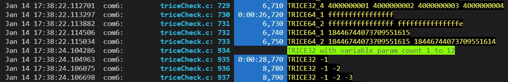
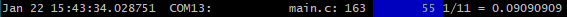

# Getting Started with Trice

<details markdown="1">
<summary>Contents</summary>

---

<!-- mdtoc -->

* [1. Get it](#get-it)
* [2. Install It](#install-it)
* [3. Try it](#try-it)
* [4. Use It](#use-it)
* [5. Fork It (get a contributor)](#fork-it-get-a-contributor)
  * [5.1. ✅ What “forking” means](#what-forking-means)
  * [5.2. 🧭 How to Fork (GitHub)](#how-to-fork-github)
* [6. Clone It](#clone-it)
* [7. Build It](#build-it)
* [8. Modify It](#modify-it)
* [9. Port it](#port-it)
  * [9.1. Target Macros](#target-macros)
  * [9.2. Target Trice Stamps](#target-trice-stamps)
  * [9.3. Trice Checks](#trice-checks)
  * [9.4. Communication Ports](#communication-ports)
  * [9.5. Target Code Overview](#target-code-overview)
  * [9.6. User Code Adaptation](#user-code-adaptation)
  * [9.7. Limitations](#limitations)
  * [9.8. Trice (Time) Stamps](#trice-time-stamps)
  * [9.9. Trice Parameter Bit Widths](#trice-parameter-bit-widths)
* [10. Avoid it](#avoid-it)
  * [10.1. Parser Limitation](#parser-limitation)
  * [10.2. Trice macros in header files](#trice-macros-in-header-files)
  * [10.3. Trice macros inside other macros](#trice-macros-inside-other-macros)
  * [10.4. Upper case only TRICE macros should be written with id(0), Id(0) or ID(0)](#upper-case-only-trice-macros-should-be-written-with-id0-id0-or-id0)

<!-- numbering=true min=2 max=4 slug=github anchor=true link=true toc=true bullets=auto -->
<!-- /mdtoc -->

---

</details>

## 1. <a id="get-it"></a>Get it

* Download [latest release assets](https://github.com/rokath/trice/releases) for your system: Compressed source code and binaries.
* OR Get the repo: 
  * Create a GitHub Account
  * Create SSH key pair inside `~/.ssh/`: `ssh-keygen -t ed25519`
  * Add content of `~/.ssh/id_ed25519.pub` as SSH key to GitHub.
  * Execute `git clone git@github.com:rokath/trice.git` to get the trice repository.
* OR use the  button

## 2. <a id="install-it"></a>Install It

* Place the extracted Trice [binary](https://github.com/rokath/trice/releases/latest) somewhere in your [PATH](https://en.wikipedia.org/wiki/PATH_(variable)).
* Copy the src folder into your project and add all files.
* Copy a triceConfig.h from a subfolder in the examples or test folder and optionally adapt it. See file [*triceDefaultConfig.h*](../../src/triceDefaultConfig.h) for help.
  * Inside the triceConfig.h file you can control, if Trice works in direct or deferred mode or both parallel.

## 3. <a id="try-it"></a>Try it

* Create a file `tryTrice.c` and write in it:

```C
#include "trice.h"

int tryIt( void ){
    trice( "Hello! 👋🙂\a\n" ); // A message with sound and without target timestamp.
}
```

You can also edit any of your existing project files accordingly. Just replace any `printf` with `trice`. (Handle float or double numbers and runtime-generated strings, according to [Trice Similarities and Differences to printf Usage](printf_comparison.md). The file [_test/testdata/triceCheck.c](../../_test/testdata/triceCheck.c) shows many usage examples.
The uppercase Trice macros are inlining the complete Trice code and the lowercase Trice macros are function calls, so most probably you want use `trice` to keep the overall code size smaller.

* Create 2 empty files `til.json` and `li.json` in your project root.
* Run `trice insert` and the trice code line changes to `trice( iD(1234), "Hello! 👋🙂\a\n" );`.
* The 2 JSON files are now filled with information.
* Run `trice clean` and the trice code line changes back to `trice( "Hello! 👋🙂\a\n" );`.

You can use `trice insert` as pre- and `trice clean` as post-compile step, to not spoil your source code with IDs.

> **The optional Trice cache technique avoids un-edited file changes at all, which means no Trice-related build speed disadvantages.**

See [Trice Cache for Compilation Speed](insert_clean_cache.md) for more details and [examples/G1B1_inst/build.sh](../../examples/G0B1_inst/build.sh) as example.

* Or, use `trice insert` in a post-checkout and `trice clean` in a pre-check-in script to keep just the repository clean of Trice IDs. Using only `trice insert` as pre-compile step is possible too, especially when the code is used just in a single project and you wish to have it as compiled.
* When using Trice in libraries for several projects, it may make sense to check-in the libraries with IDs and to use a dedicated ID space for them. See [../_test/testdata/triceCheck.c](../../_test/testdata/triceCheck.c) as an example - especially when building several projects parallel like shown in the examples folder.

A quick setup is possible when using RTT as output channel. Otherwise you need to setup a serial port for Trice data transmission. Other output paths possible too using the auxiliary interface.

## 4. <a id="use-it"></a>Use It

* In a console, like [git bash](https://gitforwindows.org/), type `trice help -all`. You should see the complete Trice tool [CLI](https://en.wikipedia.org/wiki/Command-line_interface) documentation.
  * Do not worry, most of it you will never need.
  * There are only 2 important commands: `trice insert` and `trice log`. Call them with the right CLI switches.
    * `trice help -insert` and `trice help -log` show partial help.
    * Examples:

      | CLI command                                     | Description                                                                                                                                   |
      |-------------------------------------------------|-----------------------------------------------------------------------------------------------------------------------------------------------|
      | `touch ./til.json`                              | Create an empty `til.json file`. This is needed only the very first time.                                                                     |
      | `trice i -src . -src ../myLib`                  | Insert IDs to the current and your `../myLib` folder. This will read\|extend\|modify `./til.json` and use & create the `./li.json` file.      |
      | ...                                             | Compile your project                                                                                                                          |
      | `trice c -src . -src ../myLib`                  | Optionally restore the current and your `../myLib` folder. This will read\|extend\|modify `./til.json` and use & create the `./li.json` file. |
      | `trice l -p com1 -baud 921600 -lf my/path/auto` | Start Logging over UART and create automatically a new log file in `my/path/`.                                                                |
      | `cat filename.log`                              | View a recorded log file.                                                                                                                     |
      | `trice l -p JLINK -args "..."`                  | Start Logging over RTT. Binary log files are collected in `./temp`.                                                                           |
      | `trice l -p FILEBUFFER -args logfile.bin`       | Play a recorded binary log file.                                                                                                              |

    * It is recommended to add `trice insert ...` as pre-compile step into the tool chain.
    * Hint: It is possible to add `trice clean ...` as a post-compile step, so that you can check in your project sources without IDs. That is supported in v0.61.0 and later. This allows to use library sources with trices in different projects and the source code is not spoiled with IDs. The `-cache` CLI switch is recommended then. <small>See [Trice Cache for Compilation Speed](insert_clean_cache.md)</small>.
* The command `trice` does not make any assumptions about the target processor - 8-bit to 64-bit, supports little and big endianness.
* The command `trice` is compiler agnostic - it should work with any compiler.
* The VS Code editor is free to download and use, like shown in the [`examples/F030_inst`](../../examples/F030_inst) project.
  * Even if you do not have such hardware, you can compile the [`examples/F030_inst`](../../examples/F030_inst) project just to get started.
  * When adding or modifying Trice macros inside [examples/F030_inst/Core/Src/main.c](../../examples/F030_inst/Core/Src/main.c) and recompiling you should see automatically changed ID numbers inside the code.
* The examples and test subfolders contain several VS Code Makefile projects and they are also usable as starting points for your configuration.
* You can use Trice calls also inside header files but when running `trice insert` as pre- and `trice clean` as post-compile step, all files including these headers will be re-compiled every time, what may be too time consuming. Enable the Trice cache then. See [Trice Cache for Compilation Speed](insert_clean_cache.md) for more information.

<p align="right">(<a href="#getting-started-with-trice">back to top</a>)</p>

## 5. <a id="fork-it-get-a-contributor"></a>Fork It (get a contributor)

If you wish to get a contributor please fork the Trice repository.

### 5.1. <a id="what-forking-means"></a>✅ What “forking” means

Forking creates **your own copy** of someone else’s repository under your account.  
You can then:

* freely make changes,   
* push commits to your fork, 
* and later submit a **pull request** to propose changes back to the original repo.

### 5.2. <a id="how-to-fork-github"></a>🧭 How to Fork (GitHub)

**1\. Go to the repository you want to fork**

Example: `https://github.com/rokath/trice`

**2\. Click the **“Fork”** button (top-right)**

You’ll be taken to a _Create Fork_ page.

**3\. Choose options (usually leave defaults)**

* **Owner** → your GitHub account
* **Repository name** → auto-filled
* Optional: copy only the default branch
    
Click **Create Fork**.

**4\. Clone your fork locally**

`git clone https://github.com/YOUR_USERNAME/trice.git && cd trice`

**5\. (Optional but recommended) Add the original repo as `upstream`**

This lets you pull updates later.

`git remote add upstream https://github.com/rokath/trice.git`

Check remotes:

`git remote -v`

**6\. Keep your fork updated**

`git fetch upstream git merge upstream/main`

Or:

`git pull upstream main`

## 6. <a id="clone-it"></a>Clone It

**1\. Make sure Git is installed**

Check with:

`git --version`

If not installed, download from [https://git-scm.com](https://git-scm.com/)

**2\. Clone the repository**

Run this command in your terminal or command prompt:

`git clone https://github.com/rokath/trice.git`

This creates a local folder named **trice** with the full project history.

**3\. (Optional) Enter the project folder**

`cd trice`

## 7. <a id="build-it"></a>Build It

See [Build Trice tool from Go sources](tool_build_release.md#build-trice-tool-from-go-sources).

## 8. <a id="modify-it"></a>Modify It

If for example you wish to change the logging capabilities, like changing/extending CLI switches, thanks to **Go** this is very easy also if you are not familiar with **Go**. [See this example](https://github.com/rokath/trice/issues/573#issuecomment-3585705996).

## 9. <a id="port-it"></a>Port it

Trice should be usable on any MCU with any compiler. On ARM MCUs the easiest way is to use SEGGER J-Link with RTT as output. Setting up UART transmission as alternative or additionally is also no big deal.

Compare folders of one of these folder groups:

| Without Instrumentation                         | With Trice Instrumentation                      | Remarks  |
|-------------------------------------------------|-------------------------------------------------|----------|
| [`./examples/F030_bare`](../../examples/F030_bare) | [`./examples/F030_inst`](../../examples/F030_inst) | no RTOS  |
| [`./examples/G0B1_bare`](../../examples/G0B1_bare) | [`./examples/G0B1_inst`](../../examples/G0B1_inst) | FreeRTOS |
| [`./examples/L432_bare`](../../examples/L432_bare) | [`./examples/L432_inst`](../../examples/L432_inst) | FreeRTOS |

This way you see in a quick way any needed adaptations for your target project to port trice to it.

The chapter [Example Projects without and with Trice Instrumentation](examples.md) contains further helpful information.

### 9.1. <a id="target-macros"></a>Target Macros

The easiest and mostly sufficient way to use Trice on the target side is the Trice macro

```C
trice("Hello world!"); // without     timestamp
Trice("Hello world!"); // with 16-bit timestamp
TRice("Hello world!"); // with 32-bit timestamp
```

which you can mostly use as a `printf` replacement in legacy code. See [Trice Similarities and differences to printf usage](printf_comparison.md) for more details. Is uses the `TRICE_DEFAULT_PARAMETER_BIT_WIDTH` value (usually 32), which is equal for all values.

The additional macros

* `trice8`, `trice16`, `trice32`, `trice64`
* `Trice8`, `Trice16`, `Trice32`, `Trice64`
* `TRice8`, `TRice16`, `TRice32`, `TRice64`

are always usable and the number 8, 16, 32, 64 specifies the parameter width, which is equal for all values within one macro. Trice macros are partially disabled, when the value TRICE_SINGLE_MAX_SIZE is defined to be smaller than 104. For example with TRICE_SINGLE_MAX_SIZE == 8, `TRice32` can have no parameter value (4 byte Trice header, 4 byte stamp) and `trice8` can have up to 4 parameter values (4 byte Trice header, 4 byte values) That's mainly to get compiler errors rather than runtime errors.

More examples:

| Trice     | Header | Stamp | max. Values  | Trice Size |
|-----------|--------|-------|--------------|------------|
| `trice8`  | 4      | 0     | 0 \*1 byte   | 4          |
| ...       | ...    | ...   | ...          | ...        |
| `trice8`  | 4      | 0     | 12 \*1 byte  | 16         |
| `Trice8`  | 4      | 2     | 0 \*1 byte   | 6          |
| ...       | ...    | ...   | ...          | ...        |
| `Trice8`  | 4      | 2     | 12 \*1 byte  | 18         |
| `TRice8`  | 4      | 4     | 0  \*1 byte  | 8          |
| ...       | ...    | ...   | ...          | ...        |
| `TRice8`  | 4      | 4     | 12 \*1 byte  | 20         |
| `trice16` | 4      | 0     | 2  \*2 byte  | 8          |
| `Trice16` | 4      | 2     | 1  \*2 byte  | 8          |
| `trice32` | 4      | 0     | 1  \*4 byte  | 8          |
| `Trice32` | 4      | 2     | 1  \*4 byte  | 10         |
| `TRice32` | 4      | 4     | 2  \*4 byte  | 16         |
| `trice64` | 4      | 0     | 1  \*8 byte  | 12         |
| `TRice64` | 4      | 4     | 1  \*8 byte  | 16         |
| ...       | ...    | ...   | ...          | ...        |
| `TRice64` | 4      | 4     | 12  \*8 byte | 104        |

The value TRICE_DEFAULT_PARAMETER_BIT_WIDTH is the parameter bit with for the macros `trice`, `Trice`, `TRice` (without number). It can make sense to set this value to 16 on smaller machines.

The full uppercase macro Trice is a Trice macro only using inline code. Because the main design aim was speed, this was the original design. Then it became clear, that several hundred of Trice macros increase the needed code amount too much and that it is better to have just a function call instead of having inline macros. If speed matters use `TRICE(id(0)`, `TRICE(Id(0)`, `TRICE(ID(0)` else use `trice(iD(0)`, `Trice(iD(0)`, `TRice(iD(0)` or mix usage as you like. The lower case macros internally use Trice like code but each is only a function call and therefore needs less space.

### 9.2. <a id="target-trice-stamps"></a>Target Trice Stamps

* If you wish to have your Trice messages stamped, most probably time stamped, add the 2 hardware specific macros/functions to your project (example in [./examples/F030_inst/Core/Inc/triceConfig.h](../../examples/F030_inst/Core/Inc/triceConfig.h) and [./examples/F030_inst/Core/Src/stm32f0xx_it.c](../../examples/F030_inst/Core/Src/stm32f0xx_it.c) ). The time base is in your hands and is allowed to be different for the 16-bit and 32-bit stamps. Example:

    ```c
    //! ms32 is a 32-bit millisecond counter, counting circularly in steps of 1 every ms.
    extern uint32_t ms32;
    #define TriceStamp16 (SysTick->VAL) // Counts from 31999 -> 0 in each ms.
    #define TriceStamp32  ms32
    ```
* In the code snippet above the 32-bit timestamp is used for milliseconds and the 16.bit timestamp is used as clock counter what allows fine grained time measurements.
* In the screenshot below, the 16-bit timestamp is a parallel counter running between 0-9999 milliseconds, which allows 16-bit timestamps all the time and only every 10 seconds is a full 32-bit timestamp needed.

  


* The trice tool `-ts*` CLI switches allow customization. With `-hs off` host time stamps are suppressed.
* It is also possible to use the stamp option not for time stamps but for any values, like addresses or a voltage or a random number.

_Hint:_ I usually have the 32-bit timestamp as millisecond counter and the 16-bit timestamp as systick counter to measure short execution times.

### 9.3. <a id="trice-checks"></a>Trice Checks

* Optionally copy parts of [./_test/testdata/triceCheck.c](../../_test/testdata/triceCheck.c) to your project if you wish to perform some checks.
  * Do not include this file directly, because it could get changed when `updateTestData.sh` is executed inside the `./test` folder.
  * The only-uppercase `TRICE*` macros include trice code sequences what can lead to a significant code amount if you use plenty of them, whereas the lowercase macros `trice`, `Trice`, `TRice` and their relatives are just function calls and better suited to be used normally.
* In your source files add line `#include "trice.h"` at the top.
* In a function write a trice message like: `TRice( "1/11 = %g\n", aFloat( 1.0/11 ) );`.
* In **project root**:
  * Create empty file: `touch til.json`.
  * `trice insert` should perform **automatically** the following things (The numbers are just examples.):
    * Patch source.c to `TRice( iD(12363), "1/11 = %g\n", aFloat( 1.0/11 ) );`
      * C & H files containing Trice macros, are only modified if needed (missing IDs or changed format strings).
    * Extend `til.json`
      * If no `til.json` is found nothing happens. At least an empty file is needed (Safety feature).
* When the program runs later, it should output something similar to 
* Look into [Trice Similarities and differences to printf usage](printf_comparison.md) for options.
* Read chapter [Trice Project Image Size Optimization](code_size.md) if needed.

### 9.4. <a id="communication-ports"></a>Communication Ports

* For RTT the [SEGGER](https://www.segger.com/downloads/jlink/) source is already included. See [Trice over RTT](rtt.md) for more info.
  * If RTT is used, no hardware-specific adaptations needed and it is the fastest possible data transfer. But you cannot use it in the field usually.
  * The direct trice mode is recommended for RTT. The single trice execution is a bit longer then, but the log is completely done in one shot. It takes about 100-150 processor clocks, aka 1-2 microseconds.
    * Info: All deferred trice modes are faster in the runtime execution but the Trice logs appear slightly delayed. You can tune the Trices down to only 3 Assembler instructions **executable within 6 processor clocks**. See [Trice Speed](performance.md) as example.
* For UART transfer add UART write functionality. The deferred mode is recommended for UART transfer.
* It is possible to log over several channels parallel and to select an ID range for each tag.
* An additional device, like local file, GPIO pin or SPI, is possible by providing an appropriate write functionality.
* See also [Trice without UART](without_uart.md).

### 9.5. <a id="target-code-overview"></a>Target Code Overview

* `./src`: **User Interface**

| File                      | description                                                                                                                                  |
|---------------------------|----------------------------------------------------------------------------------------------------------------------------------------------|
| [trice.h](../../src/trice.h) | trice runtime lib user interface, `#include trice.h` in project files, where to use Trice macros. Add `./src` to your compiler include path. |
| `triceConfig.h`           | Create this file to overwrite  [triceDefaultConfig.h](../../src/triceDefaultConfig.h) as needed.                                                |

* `./src`: **Internal Components** (only partially needed, add all to your project - the configuration selects automatically)

See [Trice Project Image Size Optimization](code_size.md) for compiling `src/*.c` and removing unused library sections from the final image.

| File                                                | description                                                                                                          |
|-----------------------------------------------------|----------------------------------------------------------------------------------------------------------------------|
| [cobs.h](../../src/cobs.h)                             | message packaging, alternatively for tcobs                                                                           |
| [cobsEncode.c](../../src/cobsEncode.c)                 | message encoding, alternatively for tcobs                                                                            |
| [cobsDecode.c](../../src/cobsDecode.c)                 | message decoding, normally not needed                                                                                |
| [trice.c](../../src/trice.c)                           | trice core lib                                                                                                       |
| [trice8McuOrder.h](../../src/trice8McuOrder.h)         | trice MCU endianness lib                                                                                             |
| [trice8McuReverse.h](../../src/trice8McuReverse.h)     | trice MCU reverse endianness lib                                                                                     |
| [trice16McuOrder.h](../../src/trice16McuOrder.h)       | trice MCU endianness lib                                                                                             |
| [trice16McuReverse.h](../../src/trice16McuReverse.h)   | trice MCU reverse endianness lib                                                                                     |
| [trice32McuOrder.h](../../src/trice32McuOrder.h)       | trice MCU endianness lib                                                                                             |
| [trice32McuReverse.h](../../src/trice32McuReverse.h)   | trice MCU reverse endianness lib                                                                                     |
| [trice64McuOrder.h](../../src/trice64McuOrder.h)       | trice MCU endianness lib                                                                                             |
| [trice64McuReverse.h](../../src/trice64McuReverse.h)   | trice MCU reverse endianness lib                                                                                     |
| [SEGGER_RTT.h](../../src/SEGGER_RTT.h)                 | Segger RTT code interface                                                                                            |
| [SEGGER_RTT.c](../../src/SEGGER_RTT.c)                 | Segger RTT code                                                                                                      |
| [SEGGER_RTT_ConfDefaults.h](../../src/SEGGER_RTT_ConfDefaults.h) | SEGGER defaults for settings not supplied by the project |
| [SEGGER_RTT_Conf.h](../../src/default_conf/SEGGER_RTT_Conf.h) | Small Trice fallback configuration; project headers take precedence |
| [SEGGER_RTT_LICENSE.md](../../src/SEGGER_RTT_LICENSE.md) | SEGGER license to retain when redistributing its target sources |
| [tcobs.h](../../src/tcobs.h)                           | message compression and packaging interface                                                                          |
| [tcobsv1Encode.c](../../src/tcobsv1Encode.c)           | message encoding and packaging                                                                                       |
| [tcobsv1Decode.c](../../src/tcobsv1Decode.c)           | message decoding and packaging, normally not needed                                                                  |
| [tcobsv1Internal.h](../../src/tcobsv1Internal.h)       | message decoding and packaging internal interface                                                                    |
| [trice8.h](../../src/trice8.h)                         | 8-bit trice code interface                                                                                           |
| [trice8.c](../../src/trice8.c)                         | 8-bit trice code                                                                                                     |
| [trice16.h](../../src/trice16.h)                       | 16-bit trice code interface                                                                                          |
| [trice16.c](../../src/trice16.c)                       | 16-bit trice code                                                                                                    |
| [trice32.h](../../src/trice32.h)                       | 32-bit trice code interface                                                                                          |
| [trice32.c](../../src/trice32.c)                       | 32-bit trice code                                                                                                    |
| [trice64.h](../../src/trice64.h)                       | 64-bit trice code interface                                                                                          |
| [trice64.c](../../src/trice64.c)                       | 64-bit trice code                                                                                                    |
| [triceAuxiliary.c](../../src/triceAuxiliary.c)         | trice code for auxiliary interfaces                                                                                  |
| [triceDefaultConfig.h](../../src/triceDefaultConfig.h) | This file contains the most probably settings and serves also as a reference for tuning your project *triceConfig.h* |
| [triceDoubleBuffer.c](../../src/triceDoubleBuffer.c)   | trice runtime lib extension needed for fastest deferred mode                                                         |
| [triceStackBuffer.c](../../src/triceStackBuffer.c)     | trice runtime lib extension needed for direct mode                                                                   |
| [triceRingBuffer.c](../../src/triceRingBuffer.c)       | trice runtime lib extension needed for recommended deferred mode                                                     |
| [xtea.h](../../src/xtea.h)                             | XTEA message encryption/decryption interface                                                                         |
| [xtea.c](../../src/xtea.c)                             | XTEA message encryption/decryption code                                                                              |

* The *tcobs\*.\** files are copied from [tcobs v1](https://github.com/rokath/tcobs). They are maintained there and extensively tested and probably not a matter of significant change.
* The SEGGER files are copied and you could check for a newer version at [https://www.segger.com/downloads/jlink/](https://www.segger.com/downloads/jlink/).

<p align="right">(<a href="#getting-started-with-trice">back to top</a>)</p>

### 9.6. <a id="user-code-adaptation"></a>User Code Adaptation

* Replace all strings `puts` with the string `trice`, when the string follows immediately. For runtime generated strings see `triceS`.
* Replace all strings `printf` with the string `trice`, when the format string follows immediately.
* Check for float and double format specifiers in the format strings. The appropriate parameters need to be covered with `aFloat()` or `aDouble()`. Example:

    ```c
    printf( "%d, %3.2f EUR, %g rate\n", i, price, change );
    ```

    ```c
    trice64( "%d, %3.2f EUR, %g rate\n", i, aFloat(price), aDouble(change) );
    ```

  * Because double needs 8 bytes the trice macro in this case needs to be trice64 (see <a href="#trice-parameter-bit-widths">Trice Parameter Bit Widths</a>).

* Check for string format specifiers in the format strings. Put each in a separate trice message. Example:

    ```c
    printf( "name: %16s, surname: %32s, birthday: %4u-%02u-%02u\n", n, s, y, m, d);
    ```

    ```c
    trice( "name: %16s, ", n); trice( "surname: %32s, ", s ); trice( "birthday: %4u-%02u-%02u\n", y, m, d);
    ```

The Trice macros are designed for maximal execution speed and therefore we have to pay the price for their limited capabilities.

* Optionally add tags to get color. Example:

    ```c
    puts( "A message");
    ```

    ```c
   trice( "msg:A message");
    ```

* Add `#include trice.h` to all user files using trice.

### 9.7. <a id="limitations"></a>Limitations

* The maximum parameter count per trice is 12. Buffer macros such as `triceB` accept more data, but limit the payload to `TRICE_SINGLE_MAX_SIZE - 12` bytes: 92 bytes with the default size of 104, or at most 32752 bytes with the largest supported size of 32764. See [Binary Encoding](binary_encoding.md) for the format limit and buffer allowance.
* Each trice must fit into a single line in trice versions before v0.61.0.
  * Not ok before v0.61.0 but ok for later versions:

    ```c
    trice( "hello %u\n",
            year);
    ```

* But several trices can be in one line.
  * OK:

    ```c
    trice( "hello %u\n", year); trice( "good time");
    ```

* Strings directly as parameter are possible now.
  * OK from v0.61.0 with `trice insert` and `trice clean`:

    ```c
    triceS( "hello %s\n", "world" );
    ```

  * OK always:

    ```c
    s = "world"; TRICE_S( "hello %s\n", s );
    #define WORLD "world"
    triceS( "hello %s\n", WORLD );
    ```

You should be aware that these parameter strings go into the target and slow down the execution. So, whenever a string is known at compile time it should be part of the Trice format string.

The Trice source code parser has very limited capabilities, so it cannot handle C-preprocessor string concatenation.

* Excluded trices are seen by the trice insert process.
  * Example: The following code will be patched and get an ID as well:

    ```c
    // trice( "Hi!" );
    ```

* All parameters inside one trice have the same bit width. If for example there are a single double and 10 bytes values, the needed trice macro is `trice64` providing 8 bytes space for all parameter values, therefore increasing the transmit overhead. With the default TCOBS framing the overhead is marginal because of the compression. Also this can be handled by splitting into 2 trices:

  ```C
  // 92 bytes: 4 bytes header plus 11 times 8 bytes
  trice64( "%g: %c%c%c%c%c%c%c%c%c%c", aDouble(3.14159), 61, 62, 63, 64, 65, 66, 67, 68, 69, 10 );

  // 24 bytes: 4 bytes header plus 1 times 8 bytes plus 4 bytes header plus 8 times 1 byte
  trice64( "%g: ", aDouble(3.14159)); trice8( "%c%c%c%c%c%c%c%c%c%c", 61, 62, 63, 64, 65, 66, 67, 68, 69, 10 );
  ```

* See also [Avoid it](#avoid-it).

### 9.8. <a id="trice-time-stamps"></a>Trice (Time) Stamps

* Trice messages can have no or 16-bit or 32-bit (time) stamps.
  * recommended (function calling) syntax:

      ```c
      trice( "hello %u\n", year); // no (time) stamp
      Trice( "hello %u\n", year); // 16-bit (time) stamp
      TRice( "hello %u\n", year); // 32-bit (time) stamp
      ```

  * legacy (inlining) syntax (usable for fastest execution):

      ```c
      TRICE( id(0), "hello %u\n", year); // no (time) stamp
      TRICE( Id(0), "hello %u\n", year); // 16-bit (time) stamp
      TRICE( ID(0), "hello %u\n", year); // 32-bit (time) stamp
      ```

### 9.9. <a id="trice-parameter-bit-widths"></a>Trice Parameter Bit Widths

* The macros `trice`, `Trice`, `TRice` and `TRICE` use 32-bit parameter values per default. See `TRICE_DEFAULT_PARAMETER_BIT_WIDTH` inside [src/triceDefaultConfig.h](../../src/triceDefaultConfig.h) to change that.
* If for example the bit width of all trice parameters is 8-bit, it is writable as trice8 macro, reducing the transmitted byte count per parameter from 4 to 1:

  ```C
  char b[8] = {1,2,3,4,5,6,7,8};

  // 36 bytes: 4 bytes plus 32 (8 times 4) bytes payload
  trice( "%02x %02x %02x %02x %02x %02x %02x %02x\n", b[0], b[1], b[2], b[3], b[4], b[5], b[6], b[7]);`

  // 12 bytes: 4 bytes plus 8 (8 times 1) bytes payload
  trice8( " %02x %02x %02x %02x %02x %02x %02x %02x\n", b[0], b[1], b[2], b[3], b[4], b[5], b[6], b[7]);`

  // 12 bytes: 4 bytes plus 8 (8 times 1) bytes payload in short notation.
  triceB( "deb: %02x\n", &b, sizeof(b) );
  ```

Hint: With the default TCOBS framing 8-bit values as 32-bit parameters typically occupy only 2-bytes during transmission.

## 10. <a id="avoid-it"></a>Avoid it

### 10.1. <a id="parser-limitation"></a>Parser Limitation

Because the implemented source code parser for `trice insert` and `trice clean` is only a simple one, there is one important limitation:

* Do not use an unescaped single double quote in source code comments. Example:

```C
trice( "hi 0" );
// An "allowed" example comment.
trice( "hi 1");
// An \" allowed example comment.
trice( "hi 2");
// A " NOT allowed example comment. This disrupts the parsing.
trice( "hi 3");
// A " NOT allowed example comment. This enables the parsing after a disruption.
trice( "hi 4");
```

* The `trice insert` and `trice clean` will not see the `trice( "hi 3");` line here, but the compiler will mark an error then.
* See also [issue #427](https://github.com/rokath/trice/issues/427), [issue #465](https://github.com/rokath/trice/issues/465) and see also [Limited Trice Parser Capabilities](limitations.md#limited-trice-parser-capabilities).

### 10.2. <a id="trice-macros-in-header-files"></a>Trice macros in header files

* There is nothing wrong, when putting _trice_ macros into header files.
* But: When you use `trice insert` as pre-build command and `trice clean` as post build command, those header files get touched on each build and therefore all source code files including them will be re-translated every time.
* For efficiency avoid that.
* **With inventing the [Trice Cache](insert_clean_cache.md) this is of no relevance.**

### 10.3. <a id="trice-macros-inside-other-macros"></a>Trice macros inside other macros

There is nothing wrong, when putting Trice macros into other macros. But: When running the self made macro, the location information of the inner _trice_ macro will point to the self made macro definition and not to its execution location.

**Example:** When Functions fnA and fnB are executed, the MY_MESSAGE location information points to _file.h_ and not into the appropriate lines inside _file.c_.

_file.h_:

```C
#define MY_MESSAGE trice("msg:Hi\n"); // self made macro
```

_file.c_:

```C
void fnA( void ){
  ...
  MY_MESSAGE
  ...
}

void fnB( void ){
  ...
  MY_MESSAGE
  ...
}
```

### 10.4. <a id="upper-case-only-trice-macros-should-be-written-with-id0-id0-or-id0"></a>Upper case only TRICE macros should be written with id(0), Id(0) or ID(0)

The stamp size 0, 16 or 32 is usually controlled by writing `trice`, `Trice` or `TRICE` or for upper case only Trice macros by using id(0), Id(0) or ID(0). When writing `TRICE("hi");` for example, the Trice CLI switch `-defaultStampSize` controls the ID insertion, but this is then equal for all new `TRICE` messages.

<p align="right">(<a href="#getting-started-with-trice">back to top</a>)</p>

