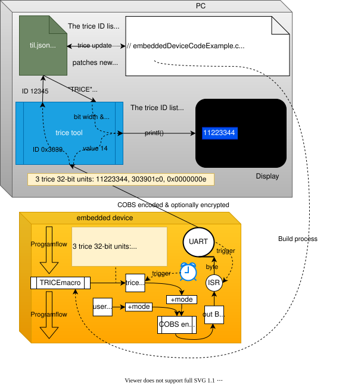

# How it works - the main idea

Contents

<!-- mdtoc -->
<!-- numbering=true min=2 max=4 slug=github anchor=true link=true toc=true bullets=auto -->
<!-- /mdtoc -->

Trice performs **no** [costly](trice_similarities_and_differences_to_printf_usage.md) printf-like functions on the target at all. The Trice macro, instead, just copies an ID together with the optional values to a buffer and is done. In the minimum case this can happen in [6(six!)](trice_speed.md) processor clocks even with target timestamps included. When running on a 64 MHz clock, **light can travel about 30 meters in that time**.

To achieve that, a pre-compile step is needed, executing a `trice insert` command on the PC. This is fast enough not to disturb the build process. The Trice tool parses then the source tree for macros like `trice( "msg: %d Kelvin\n", k );` and patches them to `trice( iD(12345), "msg: %d Kelvin\n", k );`, where `12345` is a generated 14-bit identifier (ID) copied into a [**T**rice **I**D **L**ist](../../demoTIL.json). During compilation, the Trice macro is translated to the `12345` ID only, and the optional parameter values. The format string is ignored by the compiler.

The target code is [project specific](../../examples/F030_inst/Core/Inc/triceConfig.h) configurable.  In **direct mode** the stack or a static buffer is used as Trice buffer and the Trice macro execution includes optionally the quick [COBS](https://en.wikipedia.org/wiki/Consistent_Overhead_Byte_Stuffing) encoding and the data transfer. This more straightforward and slower architecture can be interesting for many cases because it is anyway much faster than printf-like functions calls. Especially when using [Trice over RTT](trice_over_rtt.md) a single Trice is executable within ~100 processor clocks. See `TRICE_DIRECT_SEGGER_RTT_32BIT_WRITE` inside [triceDefaultConfig.h](../../src/triceDefaultConfig.h) and look into the [examples](../../examples) folder. In **deferred mode** a service swaps the Trice double buffer or reads the Trice ring buffer periodically, the configured encoding, default is TCOBS, takes part and with the filled buffer the background transfer is triggered. Out buffer and Trice buffer share the same memory for efficiency.

During runtime the PC Trice tool receives all what happened in the last ~100ms as a package from the UART port. The `0x30 0x39` is the ID 12345 and a map lookup delivers the format string *"msg: %d Kelvin\n"* and also the bit width information. Now the Trice tool can write target timestamp, set msg color and execute `printf("%d Kelvin\n", 0x0000000e);`

---

  

The Trice tool is a background helper giving the developer focus on its programming task. The once generated ID is not changed anymore without need. If for example the format string gets changed into `"msg: %d Kelvin!\n"`, a new ID is inserted automatically and the reference list gets extended. Obsolete IDs are kept inside the [**T**rice **I**D **L**ist](../../demoTIL.json) for compatibility with older firmware versions. It could be possible, when merging code, an ID is used twice for different format strings. In that case, the ID inside the reference list wins and the additional source gets patched with a new ID. This maybe unwanted patching is avoidable with proper [Trice ID management](trice_id_management.md). The reference list should be kept under source code control.

Moreover, using `trice i -cache && make && trice c -cache` in a build script makes the IDs invisible to the developer reducing the data noise giving more space to focus on the development task. See [build.sh](../../examples/L432_inst/build.sh) as a working example and the [Trice Cache](trice_features_overview.md#trice-cache) chapter for details.

(<a href="#how-it-works---the-main-idea">back to top</a>)

