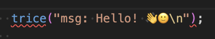
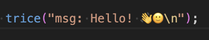
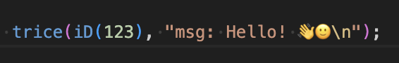

# Deprecated: Insert/Clean and Its Cache

<details markdown="1">
<summary>Contents</summary>

<!-- mdtoc -->

* [1. Existing projects](#existing-projects)
* [2. Importing existing IDs with add](#importing-existing-ids-with-add)
* [3. Trice Cache Idea](#trice-cache-idea)
* [4. Trice Cache Logic](#trice-cache-logic)
* [5. Trice Cache Remarks](#trice-cache-remarks)
* [6. Trice Cache Tests](#trice-cache-tests)
* [7. Possible Trice Cache Editor-Issues And How To Get Around](#possible-trice-cache-editor-issues-and-how-to-get-around)
* [8. Activating the Trice Cache](#activating-the-trice-cache)
* [9. Source editing and editor support](#source-editing-and-editor-support)
* [10. Avoiding False-Positive Editor Warnings](#avoiding-false-positive-editor-warnings)
* [11. Legacy parser examples](#legacy-parser-examples)
* [12. Trice in source code comments](#trice-in-source-code-comments)
* [13. Trice parser exclusion markers](#trice-parser-exclusion-markers)
  * [13.1. Avoid it](#avoid-it)
    * [13.1.1. Parser Limitation](#parser-limitation)
    * [13.1.2. Trice macros in header files](#trice-macros-in-header-files)
    * [13.1.3. Trice macros inside other macros](#trice-macros-inside-other-macros)
    * [13.1.4. Upper case only TRICE macros should be written with id(0), Id(0) or ID(0)](#upper-case-only-trice-macros-should-be-written-with-id0-id0-or-id0)
* [14. Limited Trice Parser Capabilities](#limited-trice-parser-capabilities)
* [15. Insert implementation and workflow details](#insert-implementation-and-workflow-details)
  * [15.1. Starting Conditions](#starting-conditions)
  * [15.2. Aims](#aims)
  * [15.3. Method](#method)
    * [15.3.1. Trice Insert Initialization](#trice-insert-initialization)
  * [15.4. User Code Patching (trice insert)](#user-code-patching-trice-insert)
  * [15.5. User Code Patching Examples](#user-code-patching-examples)
  * [15.6. Exclude folders & files from being parsed (pull request 529)](#exclude-folders--files-from-being-parsed-pull-request-529)
  * [15.7. ID Usage Options](#id-usage-options)
  * [15.8. General ID Management Information](#general-id-management-information)
    * [15.8.1. Option Cleaning in a Post-build process](#option-cleaning-in-a-post-build-process)
    * [15.8.2. Option Let the inserted Trice ID be a Part of the User Code](#option-let-the-inserted-trice-id-be-a-part-of-the-user-code)
    * [15.8.3. Option Cleaning on Repository Check-In](#option-cleaning-on-repository-check-in)
* [16. `TRICE_CLEAN`](#trice_clean)
  * [16.1. `trice clean` After `trice bind`](#trice-clean-after-trice-bind)
* [17. Re-Migration to `trice insert`](#re-migration-to-trice-insert)
* [18. Appendix: `TRICE_CLEAN` States at a Glance](#appendix-trice_clean-states-at-a-glance)
* [19. Automated pre-build insert command example](#automated-pre-build-insert-command-example)

<!-- numbering=true min=2 max=4 slug=github anchor=true link=true toc=true bullets=auto -->
<!-- /mdtoc -->

</details>

**Deprecated workflow. Use [Bind](bind.md) for new projects.** `insert`/`clean` and their `-cache` option remain available for existing projects and cases not supported by Bind. This status does not remove the commands or announce a removal date. It does not apply to Go/compiler build caches.

## 1. <a id="existing-projects"></a>Existing projects

`trice insert` writes numeric IDs into calls before compilation and updates TIL/LI. `trice clean` removes those IDs or restores zero placeholders after compilation. If the project stores inserted sources, Clean is optional. For a new project use Bind; for a supported migration follow [Insert to Bind](bind.md#migration-from-trice-insert).

Keep the accumulated TIL and local LI. Rebuild firmware after ID changes. This chapter also retains historical implementation explanations; for current assignment, range and ordering rules use [IDs and dictionaries](id_management.md).

## 2. <a id="importing-existing-ids-with-add"></a>Importing existing IDs with add

Both `trice add` and `trice insert` can collect existing numeric IDs into TIL/LI. **Add guarantees unchanged source files.** It is not a required preparation step for Insert.

| Behavior | `add` | `insert` |
| --- | --- | --- |
| Collect existing IDs into TIL/LI | ✅ Yes. | ✅ Yes. |
| Call without an ID | Leaves it alone. | Assigns an ID. |
| ID already maps to a different message | Reports the conflict; leaves the source unchanged. | Assigns another eligible ID and changes the source. |
| Write source files | Never. | When needed. |

```c
trice(iD(123), "Existing");
trice("New");
```

With a conflict-free ID `123`, Add collects the first mapping; Insert also gives the second call an ID. Add is useful for importing already instrumented library sources or recovering mappings still present in a firmware's source snapshot. It cannot recover deleted messages or the historical mapping of ID-free Bind sources. Preserve TIL/LI rather than relying on reconstruction.

Add is a specialist helper, not itself declared deprecated by the status of the Insert/Clean workflow. It creates no Bind sidecars. See the [implementation](../../internal/id/addIDs.go) and [source-preservation test](../../internal/id/addIDs_test.go).

The `trice insert` and `trice clean` commands are parsing and modifying the source code files. Even this is a reasonable fast procedure, this could get time consuming on large projects, especially when using these commands as permanent pre-compile and post-compile steps. It is assumed, that usually between 2 compile steps not all project files are changed. The project files majority will stay unchanged despite the ID insertion and removal. This repeated parsing and modifying of unchanged source code is avoidable with the Trice cache technique. Also it could get annoying to recompile files all the time only because they got Trice IDs removed and inserted. With the Trice cache we get also a solution not to re-compile un-edited files as well.

## 3. <a id="trice-cache-idea"></a>Trice Cache Idea

Lets talk about just one source file `$HOME/my/src/foo.c` and imagine we process many in one shot.

* On `trice insert foo.c`, get full path of `foo.c`, then:
  If `.trice/cache/cleaned/home/my/src/foo.c` exists and has the same modification time as `/home/my/src/foo.c`, copy `.trice/cache/inserted/home/my/src/foo.c` (if existing) to `/home/my/src/foo.c`. Otherwise insert IDs into `/home/my/src/foo.c` and afterwards copy it to `.trice/cache/inserted/home/my/src/foo.c`.
* On `trice clean  foo.c`, get full path of `foo.c`, then:
  If `.trice/cache/inserted/home/my/src/foo.c` exists and has the same modification time as `/home/my/src/foo.c`, copy `.trice/cache/cleaned/home/my/src/foo.c` (if existing) to `/home/my/src/foo.c`. Otherwise remove IDs from `/home/my/src/foo.c` and copy it to `.trice/cache/cleaned/home/my/src/foo.c`.
* On any repeated or alternate `trice insert` and `trice clean`, we are done.
* When a file in cleaned or inserted ID state was edited somehow, its IDs are inserted/cleaned and the cache is updated accordingly on `trice clean` or `trice insert` because the file modification time has changed.

## 4. <a id="trice-cache-logic"></a>Trice Cache Logic

When `id.TriceCacheEnabled` is true (applied `-cache` CLI switch) and the folder `~/.trice/cache` exists, we have

* optionally a _cleaned cache file_   `~/.trice/cache/cleaned/fullpath/file`  with mtime of _IDs cleaned_
* optionally an _inserted cache file_ `~/.trice/cache/inserted/fullpath/file` with mtime of _IDs inserted_
* `fullpath/file` with mtime of _IDs cleaned_ **OR** _IDs inserted_ **OR** _last edit_. When mtime of `path/file` is:
  * _IDs cleaned_:
    * On command `trice c`, nothing to do
    * On command `trice i`, copy, if existing, _inserted cache file_ into `fullpath/file`. Otherwise process `trice i` and copy result into _inserted cache file_.
  * _IDs inserted_:
    * On command `trice c`, copy, if existing, _cleaned cache file_  into `fullpath/file`. Otherwise process `trice c` and copy result into _cleaned cache file_.
    * On command `trice i`, nothing to do
  * _last edit_:
    * On command `trice c`, invalidate cache, process `trice c` and update _cleaned cache file_, file gets a new mtime, the mtime of _IDs cleaned_. <sub>On a following command `trice i`, file mtime is _IDs cleaned_, BUT the cache is invalid, so process `trice i` and update cache/inserted.</sub>
    * On command `trice i`, invalidate cache, process `trice i` and update _inserted cache file_, file gets a new mtime, the mtime of _IDs inserted_. <sub>On a following command `trice c`, file mtime is _IDs inserted_, BUT the cache is invalid, so process `trice c` and update cache/cleaned.</sub>

## 5. <a id="trice-cache-remarks"></a>Trice Cache Remarks

* `fullpath/file` means `/home/me/proj3/file` for example. When copied to the cache, the real "fullpath" is there `/home/me/.trice/cache/cleaned/home/me/proj3/file`.

> Should the `.trice/cache` be better located inside the project folder? What, if the user has several projects and several users on the same machine working on projects together? What about libraries containing trice code?

* The `~/.trice/cache` folder should the Trice tool **not** create automatically in the users home folder `$HOME`. The existence of this folder is user controlled. The folder must exist. If several users work on the same project and some use the cache and some not - it is possible this way, even build scripts are shared.
* The `~/.trice/cache` folder should **not** go under revision control.
* A CLI switch `-cache` does enable/disable the Trice cache. Default is off.
* The user should consider what happens, if other pre-compile or post-compile steps are modifying files as well, before enabling the Trice cache.

## 6. <a id="trice-cache-tests"></a>Trice Cache Tests

Nr    | Action   | cCache  | iCache  | ID state   | Edited state | Test function
-------|----------|---------|---------|------------|--------------|-------------------------------------------------------------------------------
0,1   | 0:clean  | 0:inval | 0:inval | 0:cleaned  | X:any        | Test_0_1_0000X_clean_on_invalid_cCache_invalid_iCache_cleaned_file
2,3   | 0:clean  | 0:inval | 0:inval | 1:inserted | X:any        | Test_2_3_00011_clean_on_inalid_cCache_invalid_iCache_inserted_edited_file
4,5   | 0:clean  | 0:inval | 1:valid | 0:cleaned  | X:any        | Test_4_5_0010X_clean_on_invalid_cCache_valid_iCache_cleaned_file
6     | 0:clean  | 0:inval | 1:valid | 1:inserted | 0:not        | Test_6_00110_clean_on_invalid_cCache_valid_iCache_inserted_not_edited_file
7     | 0:clean  | 0:inval | 1:valid | 1:inserted | 1:yes        | Test_7_00111_clean_on_invalid_cCache_valid_iCache_inserted_edited_file
8     | 0:clean  | 1:valid | 0:inval | 0:cleaned  | 0:not        | Test_8_01000_clean_on_valid_cCache_invalid_iCache_cleaned_not_edited_file
9     | 0:clean  | 1:valid | 0:inval | 0:cleaned  | 1:yes        | Test_9_01001_clean_on_valid_cCache_invalid_iCache_cleaned_edited_file
10    | 0:clean  | 1:valid | 0:inval | 1:inserted | 0:not        | Test_10_01011_clean_on_valid_cCache_invalid_iCache_inserted_not_edited_file
11    | 0:clean  | 1:valid | 0:inval | 1:inserted | 1:yes        | Test_11_01011_clean_on_valid_cCache_invalid_iCache_inserted_edited_file
12    | 0:clean  | 1:valid | 1:valid | 0:cleaned  | 0:not        | Test_12_01100_clean_on_valid_iCache_valid_cCache_clean_file_not_edited
13    | 0:clean  | 1:valid | 1:valid | 0:cleaned  | 1:yes        | Test_13_01101_clean_on_valid_iCache_valid_cCache_clean_file_edited
14    | 0:clean  | 1:valid | 1:valid | 1:inserted | 0:not        | Test_14_01110_clean_on_valid_iCache_valid_cCache_inserted_file_not_edited
15    | 0:clean  | 1:valid | 1:valid | 1:inserted | 1:yes        | Test_15_01111_clean_on_valid_iCache_valid_cCache_inserted_file_edited
16,17 | 1:insert | 0:inval | 0:inval | 0:cleaned  | X:any        | Test_16_17_1000X_insert_on_invalid_cCache_invalid_iCache_cleaned_file
18,19 | 1:insert | 0:inval | 0:inval | 1:inserted | X:any        | Test_18_19_1001X_insert_on_invalid_cCache_invalid_iCache_inserted_edited_file
20,21 | 1:insert | 0:inval | 1:valid | 0:cleaned  | X:any        | Test_20_21_1010X_insert_on_invalid_cCache_valid_iCache_cleaned_file
22    | 1:insert | 0:inval | 1:valid | 1:inserted | 0:not        | Test_22_10100_insert_on_invalid_cCache_valid_iCache_inserted_not_edited_file
23    | 1:insert | 0:inval | 1:valid | 1:inserted | 1:yes        | Test_23_10101_insert_on_invalid_cCache_valid_iCache_inserted_edited_file
24    | 1:insert | 1:valid | 0:inval | 0:cleaned  | 0:not        | Test_24_11000_insert_on_valid_cCache_invalid_iCache_cleaned_not_edited_file
25    | 1:insert | 1:valid | 0:inval | 0:cleaned  | 1:yes        | Test_25_11001_insert_on_valid_cCache_invalid_iCache_cleaned_edited_file
26,27 | 1:insert | 1:valid | 0:inval | 1:inserted | X:any        | Test_26_27_1010X_insert_on_invalid_cCache_valid_iCache_cleaned_file
28    | 1:insert | 1:valid | 1:valid | 0:cleaned  | 0:not        | Test_28_11100_insert_on_valid_cCache_valid_iCache_cleaned_not_edited_file
29    | 1:insert | 1:valid | 1:valid | 0:cleaned  | 1:yes        | Test_29_11100_insert_on_valid_cCache_valid_iCache_cleaned_edited_file
30    | 1:insert | 1:valid | 1:valid | 1:inserted | 0:not        | Test_30_11110_insert_on_valid_cCache_valid_iCache_inserted_not_edited_file
31    | 1:insert | 1:valid | 1:valid | 1:inserted | 1:yes        | Test_31_11111_insert_on_valid_cCache_valid_iCache_inserted_edited_file

## 7. <a id="possible-trice-cache-editor-issues-and-how-to-get-around"></a>Possible Trice Cache Editor-Issues And How To Get Around

* When a `trice i -cache && make && trice c -cache` sequence is executed, it could happen that the editor-view is not refreshed for opened and unedited files containing Trice statements.
  * It looks like the Trice IDs were not cleaned.
  * Closing and opening the file again shows, that the Trice IDs are indeed cleaned.
  * If the file is edited then without refreshing the view, that means with the shown Trice IDs, this is no problem, because after saving the edited file, it gets processed anyway, so no data loss is possible.
  * An automatic view refresh (close & open) for the editor could help here. But how to do that in an universal way?
* A workaround is, at least for VS Code, to first run `trice clean` in the build script.
  * See [examples/G1B1_inst/build.sh](../../examples/G0B1_inst/build.sh) for an implementation.

## 8. <a id="activating-the-trice-cache"></a>Activating the Trice Cache

* Create Trice cache folder:

```bash
mkdir -p ~/.trice/cache
```

* Apply `-cache` CLI switch on `trice insert` and `trice clean`. See [../scripts/_230_legacy_insert_ids.sh](../../scripts/_230_legacy_insert_ids.sh) and [../scripts/_240_legacy_clean_ids.sh](../../scripts/_240_legacy_clean_ids.sh), which both call [../scripts/_120_setup_trice_environment.sh](../../scripts/_120_setup_trice_environment.sh) and are used for example in [../examples/G0B1_inst/build.sh](../../examples/G0B1_inst/build.sh).

* Do **NOT** add the Trice cache to the version control.
* It is safe to `rm -rf ~/.trice/cache` and not to use the `-cache` CLI switch anymore.

## 9. <a id="source-editing-and-editor-support"></a>Source editing and editor support

## 10. <a id="avoiding-false-positive-editor-warnings"></a>Avoiding False-Positive Editor Warnings

When the user writes

```C
trice("msg: Hello! 👋🙂\n");
```

after `trice insert` this gets

```C
trice(iD(123), "msg: Hello! 👋🙂\n");
```

and the compiler builds and then with `trice clean`, this gets again

```C
trice("msg: Hello! 👋🙂\n");
```

Sophisticated editors may detect the missing ID and warn by underlining the trice command:



To avoid this you can add the following line to your project specific _triceConfig.h_ file:

```C
#define TRICE_CLEAN 1
```

The Trice tool, will change the value to 0 and change it back to 1, when performing the ID insertion and cleaning, when this line occurs inside the _triceConfig.h_ file. This way these false-positive editor warnings are avoidable:




It is recommended to use the Trice cache in conjunction with this to avoid a permanent re-translation of files including Trice code.

TRICE_CLEAN==1 changes all Trice macros into empty ones. It is used only to silence sophisticated editors. In the cleaned state, when the IDs are removed from the files, the editor could underline the Trice macros indicating a false positive.

Do not use TRICE_CLEAN for disabling Trice macros. The *triceConfig.h* line `#define TRICE_CLEAN 0` changes to `1` with every `trice clean` and to `0` with every `trice insert`. This line is optional and must not be in a different file. If you want to disable Trice macros use TRICE_OFF.

## 11. <a id="legacy-parser-examples"></a>Legacy parser examples

## 12. <a id="trice-in-source-code-comments"></a>Trice in source code comments

* Trice macros commented out, are **visible** for the `trice insert` command and therefore regarded.
  * Example: `// trice("Hi!\n");` is still regarded by the `trice i`.
* During `trice insert` commented out Trice macros, are treated in the same way as active Trice macros. Even after deletion their content stays inside til.json. This is intensionally to get best stability across several firmware versions or variants.
* The trice tool does treat trice statements inside comments or excluded by compiler switches also.

## 13. <a id="trice-parser-exclusion-markers"></a>Trice parser exclusion markers

Use `TRICE_INSERT_OFF` and `TRICE_INSERT_ON` markers to exclude a source section from `trice insert`, `trice clean`, `trice add` and ID refresh parsing.

```C
// TRICE_INSERT_OFF
TRice("This text is ignored by the trice tool.");
// TRICE_INSERT_ON
```

The markers are case-sensitive, must be written as comments, and affect only the Trice tool parser. `TRICE_INSERT_OFF` without a following `TRICE_INSERT_ON` disables Trice parsing until the end of the file. The marker state is local to the scanned file and does not affect source files including that file. This is useful for Trice target sources or other source sections containing Trice-like comments or helper macros that should not create or change IDs.

### 13.1. <a id="avoid-it"></a>Avoid it

#### 13.1.1. <a id="parser-limitation"></a>Parser Limitation

Because the implemented source code parser for `trice insert` and `trice clean` is only a simple one, there is one important limitation:

* Do not use an unescaped single double quote in source code comments. Example:

```C
trice( "hi 0" );
// An "allowed" example comment.
trice( "hi 1");
// An \" allowed example comment.
trice( "hi 2");
// A " NOT allowed example comment. This disrupts the parsing.
trice( "hi 3");
// A " NOT allowed example comment. This enables the parsing after a disruption.
trice( "hi 4");
```

* The `trice insert` and `trice clean` will not see the `trice( "hi 3");` line here, but the compiler will mark an error then.
* See also [issue #427](https://github.com/rokath/trice/issues/427), [issue #465](https://github.com/rokath/trice/issues/465) and see also [Limited Trice Parser Capabilities](insert_clean_cache.md#limited-trice-parser-capabilities).

#### 13.1.2. <a id="trice-macros-in-header-files"></a>Trice macros in header files

* There is nothing wrong, when putting _trice_ macros into header files.
* But: When you use `trice insert` as pre-build command and `trice clean` as post build command, those header files get touched on each build and therefore all source code files including them will be re-translated every time.
* For efficiency avoid that.
* **With inventing the [Trice Cache](insert_clean_cache.md) this is of no relevance.**

#### 13.1.3. <a id="trice-macros-inside-other-macros"></a>Trice macros inside other macros

There is nothing wrong, when putting Trice macros into other macros. But: When running the self made macro, the location information of the inner _trice_ macro will point to the self made macro definition and not to its execution location.

**Example:** When Functions fnA and fnB are executed, the MY_MESSAGE location information points to _file.h_ and not into the appropriate lines inside _file.c_.

_file.h_:

```C
#define MY_MESSAGE trice("msg:Hi\n"); // self made macro
```

_file.c_:

```C
void fnA( void ){
  ...
  MY_MESSAGE
  ...
}

void fnB( void ){
  ...
  MY_MESSAGE
  ...
}
```

#### 13.1.4. <a id="upper-case-only-trice-macros-should-be-written-with-id0-id0-or-id0"></a>Upper case only TRICE macros should be written with id(0), Id(0) or ID(0)

The stamp size 0, 16 or 32 is usually controlled by writing `trice`, `Trice` or `TRICE` or for upper case only Trice macros by using id(0), Id(0) or ID(0). When writing `TRICE("hi");` for example, the Trice CLI switch `-defaultStampSize` controls the ID insertion, but this is then equal for all new `TRICE` messages.

## 14. <a id="limited-trice-parser-capabilities"></a>Limited Trice Parser Capabilities

The Trice tool internal parser has only limited capabilities. In works well in most cases, but could lead to problems in some cases. The compiler run will for sure end up with some error messages in the following examples, so the developer can fix the code.

An example, provided by [@KammutierSpule](https://github.com/kammutierspule), is this:

* started from a empty li.json/til.json

```C
void trice0_test() {
    Trice0( "OK");
    Trice( InvalidUse );
    Trice( "%u", Variable );
}
```

* run `trice insert`

```C
void trice0_test() {
    Trice0( iD(2740), "OK"); // ok, iD is added
    Trice( InvalidUse ); // no warning or error
    Trice( "%u", Variable ); // id is not added / inserted
}
```

As said, the compiler will complain about that in any case.

## 15. <a id="insert-implementation-and-workflow-details"></a>Insert implementation and workflow details

### 15.1. <a id="starting-conditions"></a>Starting Conditions

```diff
@@ To understand this chapter you should look into the Trice tool source code. @@
```

* Before `trice i` is executed on a source tree, the starting conditions are partially undefined:
  * A trice ID list file `til.json` file must exist, but it is allowed to be empty.
    * The `til.json` is a serialized key-value map, where
      * the keys are the IDs i and
      * the values are Trice format string structs (bit width plus format string) named f.
      * When de-serializing, it is not impossible, that an ID is used more than one times. This can only happen, when **til.json** was edited manually, what normally is not done. But could be the result of a `git merge`.
        * The trice tool will report that as error and stop. The user then has to correct the error manually, for example by deleting one of the doubled keys.
      * This ID look-up is the key-value map `idToFmt TriceIDLookUp` as `map[TriceID]TriceFmt`.
        * Each ID i as key, points to one and only one f.
        * The TriceFmt structs contains the parameter width and the format string.
      * The idToFmt is reverted then into `fmtToId triceFmtLookUp` as map[TriceFmt]TriceIDs.
        * `TriceIDs` is a triceID slice because the identical f can have several ids (no shared IDs).
        * The format struct f look-up map fmtToId is used internally for faster access and always in sync with idToFmt.
    * idToFmt and fmtToId together are named lu.
  * A location information file `li.json` may exist or not.
    * The `li.json` is a serialized key-value map `idToLocRef TriceIDLookUpLI`, a `map[TriceID]TriceLI`, where
      * the keys are the IDs i and
      * the values are the location information (filename, line and position in line) structs.
    * Each ID as key points to one and only one location information.
* The `til.json` IDs may occur in the source tree not at all, once or several times. Also it is not guarantied, that the source tree Trices match the `til.json` value.
  * That is possible after code edit, for example or code copied or modified.
  * One and only one position is used and relevant, all others are ignored. If no `til.json` exists on the expected location the user must provide one, at least an empty file.
* The `li.json` IDs may occur in the source tree not at all, once or several times. Also it is not guarantied, that the source tree Trices match the `li.json` value.
  * One and only one position is used and relevant, all others are ignored. If no `li.json` exists on the expected location trice insert creates one there.
* The src tree can contain IDs not present inside `til.json`. This state is seldom, for example after adding sources containing IDs. <!-- To keep `trice i` short in execution. `trice refresh` could be run in such cases. -->

### 15.2. <a id="aims"></a>Aims

* The `trice insert` main aim is to have a consistent state between `til.json`, `li.json` and the source tree with no **ID** used twice.
* Also the changes should be minimal.
* As a general rule lu is only extendable.
* LI is updated for selected sites while ownership outside the scan is retained.
* Files are read in parallel. Allocation and the final assignment are planned in source order before source publication.
* The final assignment follows the [identical-Trice ordering rule](id_management.md#different-ids-for-same-trices) across the selected files. A rename may require a new ID when the old LI path lies outside that selection.

### 15.3. <a id="method"></a>Method

#### 15.3.1. <a id="trice-insert-initialization"></a>Trice Insert Initialization

```Go
// insertIDsData holds the insert run specific data.
type insertIDsData struct {
    idToFmt    TriceIDLookUp     // idToFmt is a trice ID lookup map and is generated from existing til.json file at the begin of SubCmdIdInsert. This map is only extended during SubCmdIdInsert and goes back into til.json afterwards.
    fmtToId    triceFmtLookUp    // fmtToId is a trice fmt lookup map (reversed idToFmt for faster operation) and kept in sync with idToFmt. Each fmt can have several trice IDs (slice).
    idToLocRef TriceIDLookUpLI   // idToLocInf is the trice ID location information as reference generated from li.json (if exists) at the begin of SubCmdIdInsert and is not modified at all. At the end of SubCmdIdInsert a new li.json is generated from itemToId.
    itemToId   TriceItemLookUpID // itemToId is a trice item lookup ID map, extended from source tree during SubCmdIdInsert after each found and maybe modified trice item.
    idToItem   TriceIDLookupItem // idToItem is a trice ID lookup item map (reversed itemToId for faster operation) and kept in sync with itemToId.
}
```

* Create an `insertIDsData` instance.
* De-serialize `til.json` into `idToFmt` and `fmtToId`. On error abort and report for manual correction. One result is a slice with used IDs.
* De-serialize `li.json` into `idToLocRef`. On error abort and report for manual correction. As result the slice with used IDs is extended.
  * If `li.json` contains IDs not already inside `til.json`, these are reported as warning.
  * `idToLocRef` stays untouched and is used only in cases when identical f are found.
* Create a slice `IDSpace` with numbers IDMin ... IDMax (1 ... 16383, or 1000 ... 1999 if specified in the command line that way)
* Remove all used IDs from `IDSpace`.
  * If used IDs outside IDMin and IDmax, for example IDMin=1000, IDmax=1999 and some used IDs are bigger or smaller these are not removable from IDroom what is ok.
* Create empty `itemToId` and `idToItem`.
* Walk the src and create a **s**ource **t**ree **m**ap STM with
  * key=`Trice+LI` and
  * value=**ID**.
* During STM creation use these rules:
  * If the next found f src ID == n != 0:
    * If ID n already inside STM set ID = 0 (that is brutal but ok)
    * Otherwise extend STM with ID n and remove n from ID space
      * It is possible, f is used n times with different IDs, so that is no problem.
      * If f occurs several times with the same ID, the first occurrence provisionally claims it. Final group ordering can assign that ID to another site.
  * If the next found f src ID == 0 (normal case after trice z):
    * Look in flu
      * If not there, create new id and extend STM.
        * The new ID is "new", so forbidden to be inside ilu.
        * If it is accidentally somewhere in the so far unparsed src, we do not know that and therefore do not care about.
          * That is a seldom case and not worth to parse the source tree twice all the time.
        * Patch id into source and extend STM.
      * If the ID slice has len 1 (usually the case), take that n, extend STM and remove f from flu.
        * That is important because f could be copied before.
      * If the ID slice has a len > 1 (several IDs on the same string) check li
        * If li is empty, just remove the first id from the slice and extend STM
        * Loop over slice IDs
          * If a file matches, take the first occurrence, extend STM and remove id from the ID slice
          * If no file matches do the same as when li is empty.
          * That means, after file renaming or code copying between files during trice z state, new IDs are generated for that parts.
            * That is only for same f with several IDs cases
          * File changes during trice i state are ok, because STM is generated with the IDs inside the sources.

Until here the algorithm seem to be ok.

* STM is not needed but maybe helpful during debugging.
* STM than is usable to regenerate li.json and to extend til.json

* After candidate selection, sort each identical group's selected eligible IDs numerically and its sites by relative path, line, and column; then publish matching sources and LI. The Insert cache must contain that final permutation too.
* An unchanged Clean/Insert cycle with the same selected ID pool restores the same assignment. Editing the group of identical sites may change any of their IDs according to the ordering rule.

### 15.4. <a id="user-code-patching-trice-insert"></a>User Code Patching (trice insert)

* A Trice **ID** is inserted by `trice insert` as shown in the table:

  Unpatched User Code | After `trice insert`          | Remark
  ---------------------|-------------------------------|---------------
  `trice( "Hi!\n");`  | `trice( iD(12345), "Hi!\n");` | no stamps
  `Trice( "Hi!\n");`  | `Trice( iD(12345), "Hi!\n");` | 16-bit stamps
  `TRice( "Hi!\n");`  | `TRice( iD(12345), "Hi!\n");` | 32-bit stamps

* `trice insert` preserves existing whitespace directly after the opening Trice parenthesis. For example, `trice("Hi!\n");` becomes `trice(iD(12345), "Hi!\n");`, while `trice( "Hi!\n");` becomes `trice( iD(12345), "Hi!\n");`. This keeps `trice insert` and `trice clean` formatting-preserving for common formatter styles.

* The `-w` or `-spaceInsideParenthesis` switch still requests wide generated ID formatting, for example `trice( iD( 12345 ), "Hi!\n");`. If whitespace after `(` already exists, it is preserved instead of being normalized.

* Legacy code is handled this way:

  Unpatched User Code       | After `trice insert`          | Remark
  ---------------------------|-------------------------------|----------------------------------------------------
  `TRICE( "Hi!\n");`        | `TRICE( id(12345), "Hi!\n");` | no stamps after `trice i -defaultStampSize 0`
  `TRICE( "Hi!\n");`        | `TRICE( Id(12345), "Hi!\n");` | 16-bit stamps after `trice i -defaultStampSize 16`
  `TRICE( "Hi!\n");`        | `TRICE( ID(12345), "Hi!\n");` | 32-bit stamps after `trice i -defaultStampSize 32`
  `TRICE( id(0), "Hi!\n");` | `TRICE( id(12345), "Hi!\n");` | no stamps
  `TRICE( Id(0), "Hi!\n");` | `TRICE( Id(12345), "Hi!\n");` | 16-bit stamps
  `TRICE( ID(0), "Hi!\n");` | `TRICE( ID(12345), "Hi!\n");` | 32-bit stamps

* A pre-build step `trice insert` generates the `Id(12345)` part. Examples:
  * `trice i` in your project root expects a til.json file there and checks sources and **til.json** for changes to insert.
  * `trice i -v -i ../../../til.json -src ../src -src ../lib/src -src ./` is a typical case as automated pre-build step in your project settings telling Trice to scan the project dir and two external directories. Even `trice i` is fast, it is generally quicker to search only relevant places.

### 15.5. <a id="user-code-patching-examples"></a>User Code Patching Examples

* A Trice **ID** is modified as shown in these cases:
  * Previously inserted (patched) user code copied to a different location:

    ```C
    trice(iD(12345), "Hi!\n"); // copied
    trice(iD(12345), "Hi!\n"); // original
    trice(iD(12345), "Hi!\n"); // copied
    ```

  * After updating (patching) again:

    ```C
    trice(iD(12345), "Hi!\n");
    trice(iD( 1233), "Hi!\n"); // re-patched
    trice(iD( 1234), "Hi!\n"); // re-patched
    ```

    * If the code is copied inside the same file, the first occurrence after the copy stays unchanged and the following are modified.
    * If the code is copied to other files only, the copies get new IDs.
  * Previously inserted (patched) user code copied and modified:

    ```C
    trice(iD(12345), "Ha!\n"); // copied and modified
    trice(iD(12345), "Hi!\n"); // original
    trice(iD(12345), "Ha!\n"); // copied and modified
    ```

  * After updating (patching) again:

    ```C
    trice(iD( 2333), "Ha!\n"); // re-patched
    trice(iD(12345), "Hi!\n"); // unchanged
    trice(iD( 1234), "Ha!\n"); // re-patched
    ```

  * If the code is copied to other files, it is re-patched.
* A Trice **ID** is stays the same if the stamp size is changed. Example:

  ```C
  trice( iD(12345), "Hi!" ); // original
  ```

  ```C
  TRice( iD(12345), "Hi!" ); // manually changed stamp size and then "trice i" performed.
  ```

### 15.6. <a id="exclude-folders--files-from-being-parsed-pull-request-529"></a>Exclude folders & files from being parsed (pull request 529)

The pull request [\#529](https://github.com/rokath/trice/pull/529) introduces key enhancement:

```b
    -exclude Flag
    Introduces a command-line flag -exclude that allows users to specify one or more source addresses to be omitted from scanning or processing. This improves flexibility in environments with known noisy or irrelevant sources.
```

-exclude Flag Example

The -exclude flag can be used multiple times to omit specific files or directories from scanning. Wildcards are not supported.

trice insert -v -src ./_test/ -exclude _test/src/trice.h -exclude _test/generated/

### 15.7. <a id="id-usage-options"></a>ID Usage Options

* Per default the `trice insert` command chooses randomly a so far unused ID for new format strings and extends `til.json`.
* After `trice c` all src IDs are removed or 0. In this state the src should go into the version management system.

### 15.8. <a id="general-id-management-information"></a>General ID Management Information

* Each format string gets its unique trice ID. If the same format string is used on different source code locations it gets different trice IDs this way allowing a reliable location information.
* The trice ID-instead-of-String idea lives from pre-compile patching of the user code.
* The user has full control how to deal with that.
* There are the 3 following options and the user has to decide which fits best for him. The [Trice Cache](insert_clean_cache.md) is probably the best fitting setup for many users.

#### 15.8.1. <a id="option-cleaning-in-a-post-build-process"></a>Option Cleaning in a Post-build process

* The code is visually free of IDs all the time.

#### 15.8.2. <a id="option-let-the-inserted-trice-id-be-a-part-of-the-user-code"></a>Option Let the inserted Trice ID be a Part of the User Code

* This is the legacy method. It allows unchanged src translation into code without using the trice tool.
* It is very robust and maybe needed in nasty debugging situations.
* It allows to reconstruct lost til.json information.
* Recommendet for small projects.

#### 15.8.3. <a id="option-cleaning-on-repository-check-in"></a>Option Cleaning on Repository Check-In

* The code is visually free of IDs only inside the repository.

## 16. <a id="trice_clean"></a>`TRICE_CLEAN`

`TRICE_CLEAN` is an optional editor aid for the legacy Insert/Clean workflow. Normally leave it undefined; the library defaults to `0`. Bind sidecars let editors resolve ID-free calls without this setting.

If your editor reports false macro-argument warnings after `trice clean`, you can explicitly define `TRICE_CLEAN` in your project's `triceConfig.h` only. Use `0` for inserted sources or `1` for already cleaned sources. `trice clean` changes the existing definition to `1`; `trice insert` and `trice bind` reset it to `0`. The tool never adds this definition automatically.

**The compiler sees this value too:** `TRICE_CLEAN=1` suppresses ordinary logging code. Run Insert or Bind before building firmware that must log. For deliberately disabling logging, use `TRICE_OFF` instead. `trice bind` does not introduce a new global `TRICE_MODE`.

With `-v`, Bind prints a note when it finds a `TRICE_CLEAN` definition in a scanned `triceConfig.h`. The note explains that Bind normally does not need this optional Insert/Clean editor aid. If Bind plans to reset `1` to `0`, it reports that change explicitly. This is informational and does not fail the command. With `-dry-run`, the planned reset is reported but not written; without `-v`, these notes are omitted.

If `TRICE_CLEAN` exists in `triceConfig.h`:

- `trice bind` keeps its value at `0`,
- `trice bind` does not add the definition,
- `trice bind` does not remove it automatically.

### 16.1. <a id="trice-clean-after-trice-bind"></a>`trice clean` After `trice bind`

Bind-owned Trice calls already contain no IDs greater than zero. Therefore, `trice clean` does not remove IDs from them and deletes neither sidecar includes nor sidecars.

With an existing definition:

```c
#define TRICE_CLEAN 0
```

`trice clean` changes it as before to:

```c
#define TRICE_CLEAN 1
```

The library then uses the clean/off path. Existing sidecars remain as artifacts but do not produce normal logging code.

Without `TRICE_CLEAN`, running `trice clean` after a bind run has practically no effect:

- user Trice calls remain ID-free,
- sidecar includes remain,
- sidecars remain,
- the bind context remains available for the next build.

Running `trice bind` again resets an existing definition to `0` and updates the sidecars.

`TRICE_CLEAN=1` disables logging; it does not make an included header optional. If an owner sidecar or rebase helper is physically missing, the compiler may still report a missing include even in a disabled build. Regenerate the files with `trice bind` before compiling; do not delete isolated include lines to silence the error.

## 17. <a id="re-migration-to-trice-insert"></a>Re-Migration to `trice insert`

A public re-migration subcommand is still not part of the normal user workflow. However, the repository helper script for returning to the clean state uses the same validated bind re-migration as the tests. It removes complete rebase include pairs, their helper headers, sidecar includes, and owner sidecars together, and corrects the affected lines in `li.json`.

Anyone performing the return manually must remove all related artifacts and must not leave behind an individual begin or end include line. The previous workflow then follows:

```text
trice insert
Build
```

## 18. <a id="appendix-trice_clean-states-at-a-glance"></a>Appendix: `TRICE_CLEAN` States at a Glance

State     |    `TRICE_CLEAN` | Own sidecar active | Effect
-----------|-----------------:|-------------------:|-------------------------------
Inserted  | undefined or `0` |              ❌ No | Explicit TIDs from the source
Bound     | undefined or `0` |             ✅ Yes | TIDs from the sidecar
Clean/Off |              `1` |                  — | Existing clean/off path

Tool effect when the definition exists:

Tool           | Effect on `TRICE_CLEAN`
----------------|------------------------:
`trice insert` |          sets it to `0`
`trice clean`  |          sets it to `1`
`trice bind`   |          sets it to `0`

If the definition is absent, `trice bind` does not add it.

---

## 19. <a id="automated-pre-build-insert-command-example"></a>Automated pre-build insert command example

* Scan directories `../src`, `../lib/src` and `./` to insert the IDs there and extend list file `../../../til.json`

```bash
trice i -v -i ../../../til.json -src ../src -src ../lib/src -src ./
```

This is a typical line you can add to your project as an automatic pre-compile step.

