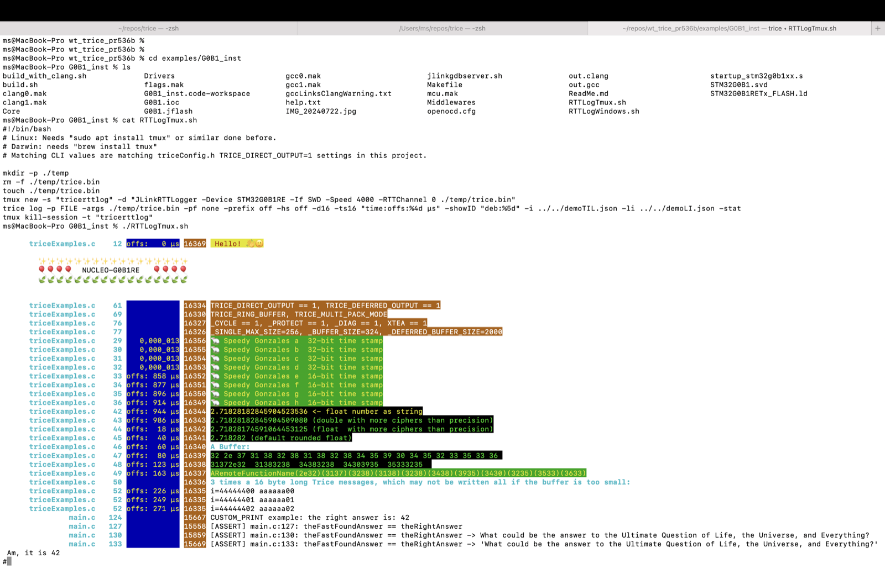

# Integrating Existing Logging Macros

<details markdown="1">
<summary>Contents</summary>

<!-- mdtoc -->

* [1. Legacy User Code Option Separate Physical Output Channel](#legacy-user-code-option-separate-physical-output-channel)
* [2. Legacy User Code Option Trice Adaptation Edits](#legacy-user-code-option-trice-adaptation-edits)
* [3. Legacy User Code Option Print Buffer Wrapping and Framing](#legacy-user-code-option-print-buffer-wrapping-and-framing)
* [4. Legacy User Code Option Trice Aliases Adaptation](#legacy-user-code-option-trice-aliases-adaptation)
  * [4.1. Alias identity and tags in v2](#alias-identity-and-tags-in-v2)
    * [4.1.1. Event tag and presentation](#event-tag-and-presentation)
    * [4.1.2. Stored identity and overrides](#stored-identity-and-overrides)
    * [4.1.3. Frozen name heuristic](#frozen-name-heuristic)
  * [4.2. PR533 Doc](#pr533-doc)
  * [4.3. PR533 Summary](#pr533-summary)
  * [4.4. PR533 Motivation](#pr533-motivation)
  * [4.5. What This PR533 Adds](#what-this-pr533-adds)
  * [4.6. PR533 Example](#pr533-example)
    * [4.6.1. PR533 Check with Trice](#pr533-check-with-trice)
    * [4.6.2. PR533 Check without Trice:](#pr533-check-without-trice)
  * [4.7. PR536 Doc](#pr536-doc)
    * [4.7.1. What This PR536 Adds](#what-this-pr536-adds)
    * [4.7.2. PR536 - The Problem Statement](#pr536---the-problem-statement)
    * [4.7.3. PR536 Implementation Details:](#pr536-implementation-details)
  * [4.8. Alias Example Project](#alias-example-project)

<!-- numbering=true min=2 max=4 slug=github anchor=true link=true toc=true bullets=auto -->
<!-- /mdtoc -->

</details>

Choose how much of the existing logging you can change:

Situation                                                               | Approach                                                                                           | Main trade-off
----------------------------------------------------------------------- | -------------------------------------------------------------------------------------------------- | --------------------------------------------------------------------------------
Calls already use a project macro such as `MyWrn(...)`                  | [Adapt and register the macro as a Trice alias](#legacy-user-code-option-trice-aliases-adaptation) | Keep most call sites; check argument types and alias rules.
You can edit the calls                                                  | [Replace them with Trice calls](#legacy-user-code-option-trice-adaptation-edits)                   | Compact records, but review each format and argument.
Existing code must keep printing text, and a second output is available | [Use separate outputs](#legacy-user-code-option-separate-physical-output-channel)                  | Simple separation; two viewers and no common message order.
Existing code must keep printing text over the same output              | [Wrap and frame its print buffer](#legacy-user-code-option-print-buffer-wrapping-and-framing)      | Adapt the output layer; target-side text formatting still costs time and memory.

Do not mix raw `printf` bytes into a Trice binary stream: use a separate channel or the framing described below. For current alias behavior, start with [Alias identity and tags in v2](#alias-identity-and-tags-in-v2); the later PR notes explain its history.

## 1. <a id="legacy-user-code-option-separate-physical-output-channel"></a>Legacy User Code Option Separate Physical Output Channel

*Advantages:*

* No user code adaptation at all needed.
* Code can mix user prints and Trices.

*Disadvantages:*

* A 2nd physical output is needed.
* The log output goes to one or the other app, what may result in a partial sequence information loss.
* Suboptimal result for target image size and speed, because the legacy user code still prints and transmits strings.

*Details:*

* The legacy user code output drives a terminal app and the Trice output feeds the Trice binary data into the Trice tool.

## 2. <a id="legacy-user-code-option-trice-adaptation-edits"></a>Legacy User Code Option Trice Adaptation Edits

*Advantages:*

* This is the most straight forward method.
* Optimal result for target image size and speed.

*Disadvantages:*

* No mixed user prints and Trices.
* Legacy code gets changed, needs new testing and is not usable parallel in other existing projects anymore.
* Error prone, even when done KI supported.
  * Max 12 integers/floats **OR** a single runtime generated string in one Trice possible, otherwise splitting into several Trices is needed.
  * `float x` values need wrapping with `aFloat(x)`.
  * `double x` needs wrapping with `aDouble(x)`.
  * `int64` and `double` need `trice64` instead of `trice` or generally use 64-bit width `trice`.
* Not applicable for a large legacy code basis.
  * It is (probably) already tested code.
  * It is maybe used "as is" in other projects.
  * It needs a lot of manual editing work. -> This nowadays is expected to be easier with AI.

*Details:*

* All exising user prints are replaced with appropriate Trice macros according chapter [Trice Similarities and Differences to printf Usage](printf_comparison.md).
* When using 64-bit as default Trice bit width, more RAM is used compared to 32-bit, but in combination with the default [TCOBS](https://github.com/rokath/tcobs) compressing framing the transmitted Trice packets do not increase much compared to 32-bit width.

## 3. <a id="legacy-user-code-option-print-buffer-wrapping-and-framing"></a>Legacy User Code Option Print Buffer Wrapping and Framing

> **Trice >= v1.1 feature**, see also issue [\#550](https://github.com/rokath/trice/issues/550)

*Advantages:*

* Code can mix user prints and Trices.
* Legacy code stays unchanged and is usable parallel in other existing projects.

*Disadvantages:*

* Suboptimal result for target image size and speed, because the legacy user code still prints and transmits strings.
* The reserved case, both [Binary Encoding](binary_encoding.md) stamp selector bits are 0, is not available anymore for additional use cases.
* The log output may have a partial sequence information loss.

*Details:*

The Trice binary encoding uses states 1, 2, 3 of the 4 states, the 2 [Binary Encoding](binary_encoding.md) stamp selector bits can have. They located in the starting `uint16_t` ID value to encode the Trice (time) stamp size. If both bits are zero (state 0), the Trice tool can interpret the incoming data buffer according to a passed CLI switch; in this special case just printing it as string.

If the Trice library and the user print both write to the same output, an easy modification would be, to prepend the user print output with a 2-byte count as long its size is < 16383, so that the 2 most significant bits are zero. Additionally, the this way counted buffer needs the same buffer framing as the Trice binary data.

## 4. <a id="legacy-user-code-option-trice-aliases-adaptation"></a>Legacy User Code Option Trice Aliases Adaptation

> **Trice >= v1.1 feature**, see also accepted pull requests [\#533](https://github.com/rokath/trice/pull/533) and [\#536](https://github.com/rokath/trice/pull/536)

*Advantages:*

* Code can mix user prints and Trices.
* Legacy code stays unchanged or mainly unchanged and is usable parallel in other existing projects.
* Nearly optimal result for target image size and speed.
* No special wrapping and need to use the [Binary Encoding](binary_encoding.md) stamp selector bits state 0 for this.
* Especially, when adapting user specific ASSERT macros with `-salias` (see below), even their strings are compiled into the Target image, only in error cases the strings are printed and transmitted.

*Disadvantages:*

* The legacy user code could *partially* still print and transmit strings, especially when `float` or `double` are used.

*Details:*

This cool functionality was contributed by [@srgg](https://github.com/srgg) in pull requests (PR) [\#533](https://github.com/rokath/trice/pull/533) and [\#536](https://github.com/rokath/trice/pull/536) (to be considered as one PR only). It allows code integration containing user specific log statements into Trice instrumented projects without the need to rename the user specific log statements.

In the assumption, most user `printi` statements having only up to 12 integers, those user prints could get covered by adding `-alias printi` to the `trice insert` and `trice clean` commands.

The user `printi` statements containing floats, doubles, strings could get simply renamed into user `prints` and then `-salias prints` will cover them too. That, of course, is a legacy user code change, but it allows to use this slightly modified legacy user code parallel in other projects.

Yes, user `printi` and user `prints` need to be defined too. See [./_test/alias_dblB_de_tcobs_ua/triceConfig.h/triceConfig](../../_test/alias_dblB_de_tcobs_ua/triceConfig.h) as a simple example and its usage in [./_test/alias_dblB_de_tcobs_ua/TargetActivity.c](../../_test/alias_dblB_de_tcobs_ua/TargetActivity.c)

This technique allows also to cover legacy user code specific ASSERT macros, as shown in [./_test/aliasassert_dblB_de_tcobs_ua/triceConfig.h](../../_test/aliasassert_dblB_de_tcobs_ua/triceConfig.h) and used in the tests [./_test/aliasassert_dblB_de_tcobs_ua/TargetActivity.c](../../_test/aliasassert_dblB_de_tcobs_ua/TargetActivity.c).

Despite of these 2 CGO tests the real-world example [./examples/G0B1_inst](../../examples/G0B1_inst/Core/Src/main.c) shows the usage too.

The following sub-chapters are mainly written by [@srgg](https://github.com/srgg) as accompanying documentation to its pull requests.

### 4.1. <a id="alias-identity-and-tags-in-v2"></a>Alias identity and tags in v2

Register scalar project macros with `-alias Name` (`-a`) and string macros with `-salias Name` (`-sa`). Use the same registrations in Bind, Insert, Clean and source-scanning Generate. The macro must transmit the registered payload family; its name does not specify width or arity. Normal default-width configuration still applies.

Names are exact ASCII C identifiers: `[A-Za-z_][A-Za-z0-9_]*`. Names starting with `trice`, ignoring case, are reserved. `A`, `FooS`, `My32` and `MyAssert` are valid scalar names; `TriceWarning` is reserved. The same name under both alias kinds is an error. Repeated definitions of the same kind merge; `Name` plus `Name:Tag` uses the explicit tag. Different explicit tags are errors, including unused definitions. Equivalent tag spellings such as `err` and `ERROR` agree.

`Name:Tag` also registers that tag in the current command. Custom tag names ignore case and have uppercase metadata, as with `sensor` → SENSOR. They do not become name-heuristic words. Build and host both need custom registrations used by format fallback. Valid unused aliases are silent; `-verbose` explains registrations, payload kinds, tag decisions, exclusions and conflicting static prefixes.

#### 4.1.1. <a id="event-tag-and-presentation"></a>Event tag and presentation

For each alias event, select the first applicable source:

Priority | Source
-------- | -----------------------------------------------------------------------
First    | Explicit `Name:Tag` in the current command. `Name:untagged` stops here.
Next     | The frozen name heuristic below.
Next     | A registered tag before the first colon of the static format.
Last     | `untagged`.

No later prefix or received string supplies a fallback. Thus `printi("ctx:err:failed")` is untagged unless `ctx` is registered. For string aliases, only an identifiable literal in the first semantic user argument supplies a static prefix; `MyAssert(condition, "err:failed")` does not search the later argument.

One selected tag controls filters, colors, statistics, levels, JSON/KV and registered [Vis selectors](visualization.md). Successful events count before filtering. Runtime values, subsequent lines and other events on the same display line cannot reclassify an alias event. LI remains at the alias call site; tags also work with `-li off`.

Only a known static prefix belonging to the selected tag can be removed. Active palettes and `-color none` remove its all-lowercase spelling; mixed/uppercase and conflicting prefixes remain. `-color off` preserves every written prefix. JSON/KV use the same removal policy without ANSI colors. No tag prefix is added.

Alias call             | Event tag | Message with `-color none`
---------------------- | --------- | --------------------------
`printi("err:failed")` | ERROR     | `failed`
`MyWrn("wrn:failed")`  | WARNING   | `failed`
`MyWrn("WRN:failed")`  | WARNING   | `WRN:failed`
`MyWrn("err:failed")`  | WARNING   | `err:failed`

A runtime string `wrn:payload` stays intact even when its alias event is WARNING.

#### 4.1.2. <a id="stored-identity-and-overrides"></a>Stored identity and overrides

TIL retains the ID map with only `Type` and `Strg`. New entries store the exact alias name in `Type`. A complete existing `SAlias_Strg('...')SAlias_Strg` wrapper means a string payload; otherwise the alias is scalar. The native processing type is derived separately and never changes the identity key. Scalar formats must not start with `SAlias_Strg('` or end with `')SAlias_Strg`; partial wrappers are errors on read. Marker-like text in the middle is allowed. Loss of both markers cannot always be detected.

Repeated instrumentation keeps IDs stable. Renaming, case changes, a payload-family change or a changed effective format can allocate another ID while preserving old rows. Historical normalized native entries stay native; their former alias names cannot be reconstructed. Mixed dictionaries work without conversion. Older tools need not understand new alias types. Alias commands reparse sources instead of trusting the legacy timestamp cache; old caches are left unchanged. Invalid alias reloads retain the last valid table and the current command policy.

An explicit override is not stored. Repeat it when logging, for example `trice bind -alias MyWrn:err` and `tlog -alias MyWrn:err` alongside the project's ordinary options. Without it the name resolves to WARNING. An override affects all loaded IDs for that name; neither different IDs nor different capture dates preserve different historical tag intentions. Keep required logging options with the capture. The host cannot reliably warn about a forgotten override. Build overrides affect ID ranges; host overrides affect host classification only.

Alias CE selects the event-tag group before source-prefix groups. Scalar aliases follow the existing scalar limits; native `triceS` accepts fixed text, while selected string-alias extensions and all added runtime strings are rejected. A rare change from the original build tag to the stored-format host tag produces a normal warning with workarounds. See the [capability table and fallback examples](context_enrichment.md#alias-tags-and-ce-limits). No additional tag storage or history mechanism is introduced.

#### 4.1.3. <a id="frozen-name-heuristic"></a>Frozen name heuristic

Compare a lowercase copy of the alias name; do not rewrite the stored name. Find all occurrences of all positive substrings, without requiring word boundaries or CamelCase splitting.

Tag and tie priority | Positive substrings
-------------------- | ---------------------------
FATAL                | `fatal`
CRITICAL             | `critical`, `crit`
ERROR                | `error`, `err`
WARNING              | `warning`, `warn`, `wrn`
INFO                 | `informal`, `info`, `inf`
DEBUG                | `debug`, `dbg`, `deb`, `db`
TRACE                | `trace`, `tr`
VERBOSE              | `verbose`

Find every literal exclusion occurrence, ignoring case, including inside compound identifiers. Discard a positive match only when that entire positive-match span is inside an exclusion occurrence. This applies across groups: infrastructure suppresses both its inf and tr. Separate matches elsewhere survive. Do not suppress the whole alias, whole group, partially overlapping longer matches, or derive extra inflections automatically.

Group for reference | Exclusion terms
------------------- | -------------------------------------------------------------------------------------------------------------------------------------------------------------------------------------------------------------------------------------------------------------------------------------------------------------------------------------------------------------------------------------------------------------------------------------------------------------------------------------------------------------------------------------------------------------------------------------------------------------------------------------------------------------------------------------------------------------------------------------------------------------------------------------------------------------------------------------
FATAL               | `nonfatal`, `non_fatal`
CRITICAL            | `criterion`, `criteria`, `critic`, `critique`, `noncritical`, `non_critical`, `criticalsection`, `critical_section`, `criticalregion`, `critical_region`, `criticalpath`, `critical_path`
ERROR               | `interrupt`, `override`, `overridden`, `overriding`, `ferrite`, `ferromagnet`, `ferric`, `ferrous`, `ferrule`, `terrain`, `territory`, `terrestrial`, `berry`, `cherry`
WARNING             | `nowarn`, `no_warn`, `nowarning`, `no_warning`
INFO                | `infrared`, `infrastructure`, `infer`, `inflect`, `infix`, `infimum`, `infinite`, `infinity`, `inflate`, `inflation`, `inflating`, `inflow`, `influx`, `influence`, `infill`, `infect`
DEBUG               | `readback`, `readbinary`, `readbit`, `readbyte`, `readblock`, `readbuffer`, `feedback`, `seedbed`, `broadband`, `deadband`, `fieldbus`, `fieldbuffer`, `modbus`, `redblack`, `codebase`, `codeblock`, `codebook`, `modebit`, `debit`, `debt`, `debounce`, `deblock`, `debian`, `loadbalance`, `loadbalancing`
TRACE               | `abstract`, `attribute`, `constrain`, `contract`, `contrast`, `control`, `electric`, `electrode`, `electron`, `entries`, `entry`, `entropy`, `extract`, `instrument`, `intrinsic`, `matrix`, `matrices`, `metric`, `retrieve`, `retrieval`, `stream`, `strength`, `stress`, `stride`, `string`, `strip`, `strobe`, `strong`, `struct`, `track`, `trap`, `tray`, `treat`, `tree`, `trend`, `tremor`, `transact`, `transceiver`, `transfer`, `transform`, `transient`, `transistor`, `transit`, `translate`, `translation`, `translator`, `transmission`, `transmit`, `transparent`, `transparency`, `transpose`, `transposition`, `transport`, `transducer`, `trial`, `triangle`, `triangular`, `trigger`, `trim`, `trip`, `tristate`, `tri_state`, `true`, `truncate`, `truncation`, `try`, `ultrasonic`, `ultrasound`, `ultraviolet`
VERBOSE             | `nonverbose`, `non_verbose`

trial is included. Bandwidth needs no exclusion because it contains neither db nor deb.

Choose the longest remaining positive match. For equal lengths from different groups, use the table order FATAL, CRITICAL, ERROR, WARNING, INFO, DEBUG, TRACE, VERBOSE. Registry additions, user tags, weights, colors and option order do not alter this contract.

Examples: Log_Error_Warning → WARNING; LogErrWrn → ERROR; CriticalLog → CRITICAL despite the shorter critic exclusion; CriticalSectionError → ERROR; InfrastructureInfo → INFO; ReadbackDebug → DEBUG; TransferTrace and TrialTrace → TRACE; TrialMode → untagged before format fallback.

Freeze these rules for the new TIL meaning. A future list/priority change needs an explicitly reviewed way to preserve the interpretation of existing captures. No new version/history field is part of this work.

### 4.2. <a id="pr533-doc"></a>PR533 Doc

### 4.3. <a id="pr533-summary"></a>PR533 Summary

This PR introduces support for treating user-defined macros as aliases to trice and triceS within the Trice CLI toolchain. The goal is to enable project-specific logging macros to be processed just like built-in Trice macros — including ID generation, decoding, and binary format support — without requiring projects to directly call `trice()` or `triceS()` in their source code.

PR leverages the `-exclude` source feature added in [\#529](https://github.com/rokath/trice/pull/529).

### 4.4. <a id="pr533-motivation"></a>PR533 Motivation

Trice uses a source-scanning and ID generation approach, where the toolchain scans for `trice(...)` and `triceS(...)` calls, injects numeric trace IDs, and builds a mapping database. However, it currently only supports built-in(hardcoded) macros and allows only global on/off control via compile-time flags.

This makes it difficult to:

- Adopt custom naming conventions (`DBG()`, `APP_LOG()`, `MON()`, etc.).
- Redirect trace/logging behavior to other backends (e.g., MicroSD, raw printf, no-op).
- Change behavior per module or configuration without losing Trice tooling support.

### 4.5. <a id="what-this-pr533-adds"></a>What This PR533 Adds

**CLI-level aliasing**: Developers can now declare custom macros to be treated as `trice` or `triceS` equivalents. These user-defined macros will be recognized during scanning, ID injection, and decoding. 

### 4.6. <a id="pr533-example"></a>PR533 Example

*print_macro.h*:

```C
#ifndef TRICE_OFF
  #define DEBUG_PRINT(...)  trice(__VA_ARGS__)
  #define DEBUG_PRINT_S(...)  triceS(__VA_ARGS__)
#else
  #define DEBUG_PRINT(...)  Serial.println(__VA_ARGS__)
  #define DEBUG_PRINT_S(...)  Serial.printf(__VA_ARGS__)
#endif
```

*example.c*:

```C
#include "trice.h"
#include "print_macro.h"

void setup() {
    Serial.begin(115200);

    while (!Serial) {
        delay(10);
    }

   // Add code here to initialize whatever Trice sender TCP/UDP/UART, etc.
   
  // No argument
  DEBUG_PRINT("DEBUG_PRINT test: no args\n");

  char* str = "Test string";
  DEBUG_PRINT_S("DEBUG_PRINT_S test: %s\n", str);
 }
```

#### 4.6.1. <a id="pr533-check-with-trice"></a>PR533 Check with Trice

Insert trice IDs:

```shell
trice insert -alias DEBUG_PRINT -salias DEBUG_PRINT_S  -exclude ./print_macro.h -v
```

Flash the MCU and run the trice receiver on your host machine to receive probes (cli command is config and receiver dependent), for UDP4, it can be:

```shell
   trice log -p UDP4 -v -pf none
```

#### 4.6.2. <a id="pr533-check-without-trice"></a>PR533 Check without Trice:

Clean trice IDs, if any:

```shell
trice clean -alias DEBUG_PRINT -salias DEBUG_PRINT_S  -exclude ./print_macro.h -v
```

Flash with `-DTRICE_OFF`.

### 4.7. <a id="pr536-doc"></a>PR536 Doc

#### 4.7.1. <a id="what-this-pr536-adds"></a>What This PR536 Adds

This is a follow-up to [\#533](https://github.com/rokath/trice/pull/533). It **enforces the consistent use of the "%s" format in all triceS aliases** and fixes that behavior in the newly added test case.

The following simplified example reflects a real use case where custom macros wrap formatting logic:

```C
#define CUSTOM_PRINT_S(id, fmt, ....) triceS(id, "%s", format_message(fmt, ##__VA_ARGS__))
```

#### 4.7.2. <a id="pr536---the-problem-statement"></a>PR536 - The Problem Statement

Determining the Strg argument reliably is challenging due to:

* The unrestricted flexibility of macros (_which I would like to preserve and utilize_).
* Trice core’s limited parsing, which relies on regular expressions.

For instance, custom macros like these show the variability:

``` c
CUSTOM_ASSERT(false, "Message: %s", msg);
CUSTOM_ASSERT(false, "Message without args");
CUSTOM_ASSERT(false);
```

Improving this would likely require Clang integration—adding complexity (e.g., full build flags, complete source context)—whereas Trice’s current regex-based approach remains lightweight and simple to use.

#### 4.7.3. <a id="pr536-implementation-details"></a>PR536 Implementation Details:

`matchTrice()` was re-implemented to improve robustness. It now:

* Locates the macro or alias name followed by (.
* Finds the matching closing parenthesis, correctly handling nested structures.
* Parses the arguments within.

This approach simplifies the logic and allows the parser to skip invalid or partial matches without aborting, enabling continued scanning of the file for valid constructs.

### 4.8. <a id="alias-example-project"></a>Alias Example Project

To use the Alias technique with `examples/G0B1_inst` the following adaptations were made:

* Copied file [./examples/G0B1_inst/Core/Inc/nanoprintf.h](../../examples/G0B1_inst/Core/Inc/nanoprintf.h) from https://github.com/charlesnicholson/nanoprintf
* Created file [./examples/G0B1_inst/Core/Inc/triceCustomAliases.h](../../examples/G0B1_inst/Core/Inc/triceCustomAliases.h) to cover the user code specific `CUSTUM_PRINT` and  `CUSTUM_ASSERT`.
* *Core/Src/main.c*:

  ```diff
  /* Private includes ----------------------------------------------------------*/
  /* USER CODE BEGIN Includes */
  - #include "trice.h"
  + #include "triceCustomAliases.h"
  #include <limits.h> // INT_MAX
  /* USER CODE END Includes */

  ...

    /* USER CODE BEGIN 2 */
  #if !TRICE_OFF
    LogTriceConfiguration();
    SomeExampleTrices(3);
  - #endif
  +   /* Some Custom Trice Alias Examples */  
  +   const int theRightAnswer = 42;
  +   const int theFaCEFoundAnswer = 24;
  +   const char* theQuestion = "What could be the answer to the Ultimate Question of + Life, the Universe, and Everything?";
  +   
  +   // Some Trice custom alias examples
  +   CUSTOM_PRINT("CUSTOM_PRINT example: the right answer is: %d\n", theRightAnswer);
  +   
  +   // Assert with condition 
  +   CUSTOM_ASSERT(theFaCEFoundAnswer == theRightAnswer);
  +   
  +   // Assert with condition and a message: This works too, but triggers a clang + compiler warning, we cannot suppress.
  +   CUSTOM_ASSERT(theFaCEFoundAnswer == theRightAnswer, (char*)theQuestion ); // + https://stackoverflow.com/questions/52692564/+ how-can-i-disable-format-security-error-with-clang
  +   
  +   // Assert with condition and a message and some extra message arguments
  +   CUSTOM_ASSERT(theFaCEFoundAnswer == theRightAnswer, (char*)"'%s' Am, it is %d", + (char*)theQuestion, theRightAnswer);
  + #endif
    /* USER CODE END 2 */

  ```

* After flashing:



