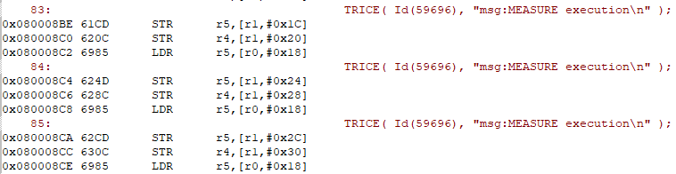
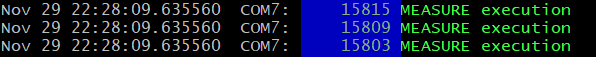
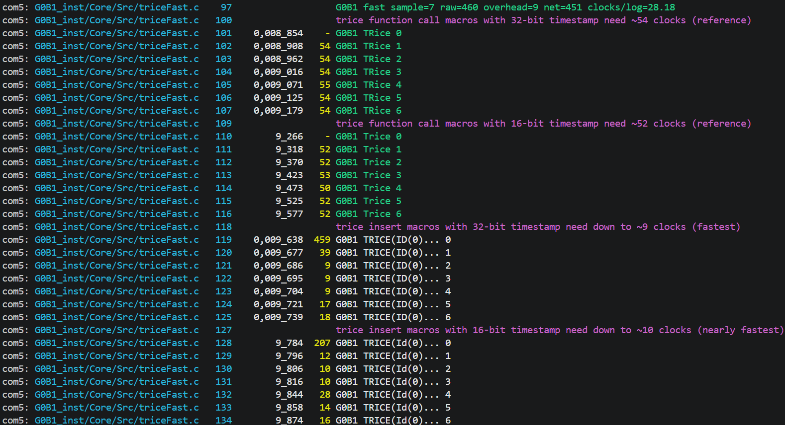
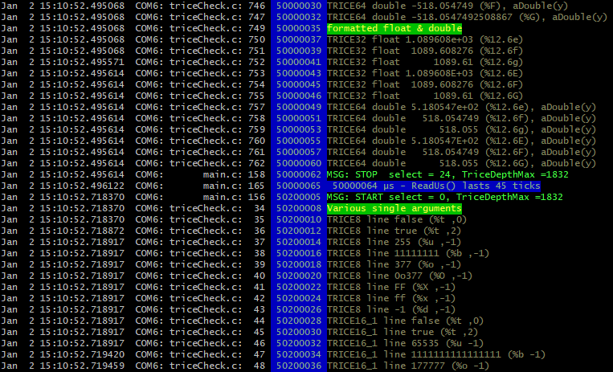
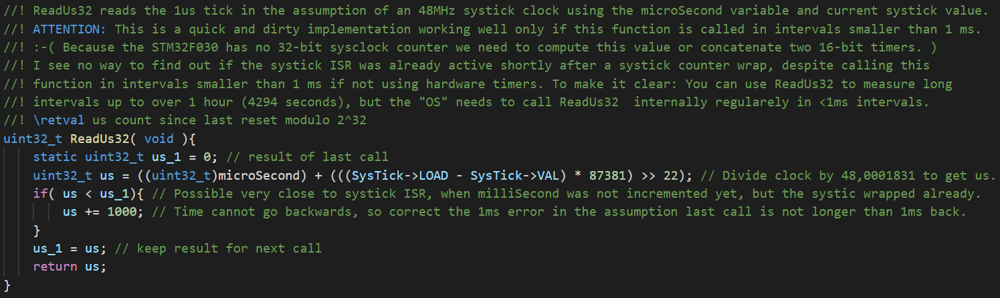
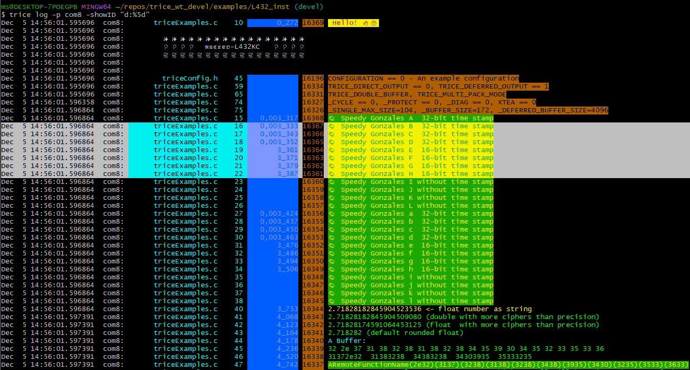
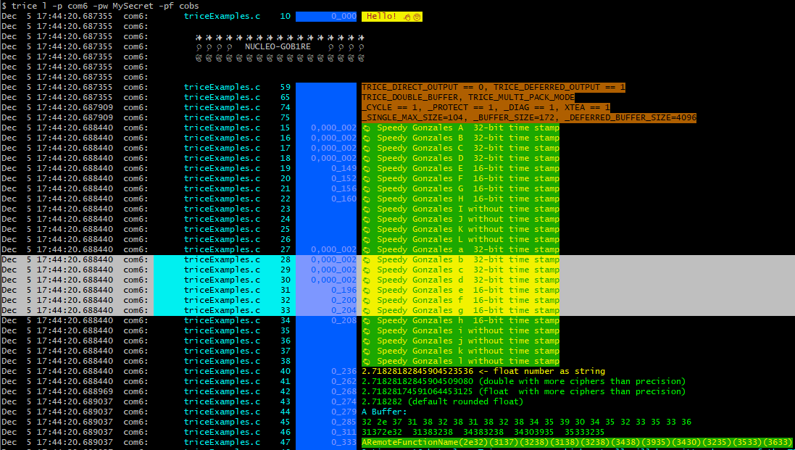
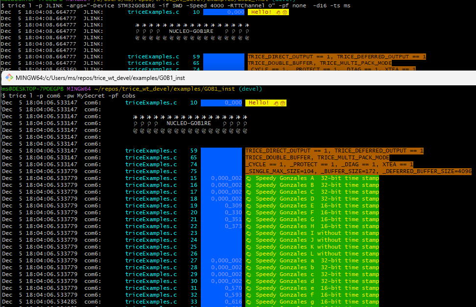

# Performance and Buffer Selection

<details markdown="1">
<summary>Contents</summary>

<!-- mdtoc -->

* [1. Choose the buffer and output mode](#choose-the-buffer-and-output-mode)
* [2. Clock Measurements and Disassembly for fastest configurations](#clock-measurements-and-disassembly-for-fastest-configurations)
  * [2.1. Example Project L432_inst Performance Measurements: Clocks and Disassembly](#example-project-l432_inst-performance-measurements-clocks-and-disassembly)
  * [2.2. Example Project G0B1_inst Performance Measurements: Clocks and Disassembly](#example-project-g0b1_inst-performance-measurements-clocks-and-disassembly)
  * [2.3. GCC and Clang code generation](#gcc-and-clang-code-generation)
  * [2.4. Legacy Measurements (slower)](#legacy-measurements-slower)
  * [2.5. HINT: Trice v2 supports CLI Target stamp transformations, so only the raw clock is sufficient as stamp](#hint-trice-v2-supports-cli-target-stamp-transformations-so-only-the-raw-clock-is-sufficient-as-stamp)
* [3. Target Implementation Options](#target-implementation-options)
  * [3.1. Trice Use Cases TRICE_STATIC_BUFFER and TRICE_STACK_BUFFER - direct mode only](#trice-use-cases-trice_static_buffer-and-trice_stack_buffer---direct-mode-only)
  * [3.2. Trice Use Case TRICE_DOUBLE_BUFFER - deferred mode, fastest Trice execution, more RAM needed](#trice-use-case-trice_double_buffer---deferred-mode-fastest-trice-execution-more-ram-needed)
  * [3.3. Trice Use Case TRICE_RING_BUFFER - deferred mode, balanced Trice execution time and needed RAM](#trice-use-case-trice_ring_buffer---deferred-mode-balanced-trice-execution-time-and-needed-ram)
* [4. A configuration for maximum Trice execution speed with the L432_inst example](#a-configuration-for-maximum-trice-execution-speed-with-the-l432_inst-example)
* [5. A configuration for normal Trice execution speed with the G0B1_inst example](#a-configuration-for-normal-trice-execution-speed-with-the-g0b1_inst-example)

<!-- numbering=true min=2 max=4 slug=github anchor=true link=true toc=true bullets=auto -->
<!-- /mdtoc -->

</details>

## 1. <a id="choose-the-buffer-and-output-mode"></a>Choose the buffer and output mode

| Configuration | Work during the log call | Trade-off |
| --- | --- | --- |
| Stack/static buffer, direct output | Build a record and call the configured writer. | Simple; writer latency affects the caller. Static storage needs protection from concurrent calls. |
| Double buffer, deferred output | Append to the active half; transfer the other half later. | Fast record creation with more reserved RAM. |
| Ring buffer, deferred output | Reserve record space and append. | Uses buffer capacity flexibly, with additional reservation work. |
| Deferred plus parallel direct output | Buffer the record and also perform the direct output. | Direct output adds latency even though the deferred path remains enabled. |

Start with a ring buffer for general use. Measure your largest bursts and transfer interval, and keep [buffer protection and diagnostics](target_configuration.md#buffer-protection-and-diagnostics) enabled while sizing. Choose double buffering when call latency is more important than its RAM cost. All shared-state configurations need suitable critical sections for concurrent calls.

## 2. <a id="clock-measurements-and-disassembly-for-fastest-configurations"></a>Clock Measurements and Disassembly for fastest configurations

The configurations below minimize record creation work. They disable protection, diagnostics and the message cycle counter; hardware counters still provide timing stamps. They require enough buffer space and controlled writers.

The timings below are **recorded measurements**, not a benchmark of every current build. Their MCU, compiler, optimization, timestamps, protection and output settings matter. Distinguish time spent creating the record from later encoding and transport time.

A Trice macro execution can be as cheap like **3 Assembler instructions or 6 processor clocks**:

* Disassembly: 
* Measurement: The blue SYSTICK clock counts backwards 6 clocks for each Trice macro (on an ARM M0+), what is less than 100 ns @64 MHz MCU clock: 

To be honest, that was reached with an older Trice version, which allowed identical IDs to be used on several places with identical Trice messages. Nowadays the Trice IDs are forced to be different even on identical messages to secure valid location information. With Trice v2 that is realistic: 

### 2.1. <a id="example-project-l432_inst-performance-measurements-clocks-and-disassembly"></a>Example Project L432_inst Performance Measurements: Clocks and Disassembly

* `./build_with_clang.sh 98` and flash for example with VS Code Cortex Debug Extension.
* `th@Mac L432_inst % tlog -hs off -prefix off -i ../../demoTIL.json -port /dev/tty.usbmodem0007701629111 -li ../../demoLI.json -liFmt "%40s%4d" -liMaxDirs 2 -ts16delta "note:%9d" -ts32delta "note:%9d" -ts32 "sig: %08x" -ts16 "wr:     %04x" -ts0 "         " -typeX0 "% x"`:
  * Remark: The -ts16 CLI value has 5 and the -ts0 value 9 spaces, if your Markdown renderer does not show that exaxtly.

```txt
    examples/exampleData/triceExamples.c  13                    w: Hello! 👋🙂 

        ✨✨✨✨✨✨✨✨✨✨✨✨✨✨✨✨✨        
        🎈🎈🎈🎈  𝕹𝖀𝕮𝕷𝕰𝕺-L432KC   🎈🎈🎈🎈
        🍃🍃🍃🍃🍃🍃🍃🍃🍃🍃🍃🍃🍃🍃🍃🍃🍃        


                         Core/Src/main.c  84                    CONFIGURATION == 98 - UART, no cycle counter, no critical sections.
    examples/exampleData/triceExamples.c 123                    TRICE_DIRECT_OUTPUT == 0, TRICE_DEFERRED_OUTPUT == 1
    examples/exampleData/triceExamples.c 129                    TRICE_DOUBLE_BUFFER, TRICE_MULTI_PACK_MODE
    examples/exampleData/triceExamples.c 138                    _CYCLE == 0, _PROTECT == 0, _DIAG == 0, XTEA == 0
    examples/exampleData/triceExamples.c 139                    _SINGLE_MAX_SIZE=512, _BUFFER_SIZE=580, _DEFERRED_BUFFER_SIZE=4096
...
    examples/exampleData/triceExamples.c  35 00000d5e         - 🐁 Speedy Gonzales 0 TRICE(ID(0)... insert macro (uppercase-only macro) with 32-bit time stamp
    examples/exampleData/triceExamples.c  36 00000d73        21 🐁 Speedy Gonzales 1 TRICE(ID(0)... insert macro (uppercase-only macro) with 32-bit time stamp
    examples/exampleData/triceExamples.c  37 00000d80        13 🐁 Speedy Gonzales 2 TRICE(ID(0)... insert macro (uppercase-only macro) with 32-bit time stamp
    examples/exampleData/triceExamples.c  38 00000d94        20 🐁 Speedy Gonzales 3 TRICE(ID(0)... insert macro (uppercase-only macro) with 32-bit time stamp
    examples/exampleData/triceExamples.c  39 00000da3        15 🐁 Speedy Gonzales 4 TRICE(ID(0)... insert macro (uppercase-only macro) with 32-bit time stamp
    examples/exampleData/triceExamples.c  40 00000db4        17 🐁 Speedy Gonzales 5 TRICE(ID(0)... insert macro (uppercase-only macro) with 32-bit time stamp
    examples/exampleData/triceExamples.c  41 00000dc3        15 🐁 Speedy Gonzales 6 TRICE(ID(0)... insert macro (uppercase-only macro) with 32-bit time stamp
    examples/exampleData/triceExamples.c  42 00000dd2        15 🐁 Speedy Gonzales 7 TRICE(ID(0)... insert macro (uppercase-only macro) with 32-bit time stamp
    examples/exampleData/triceExamples.c  43 00000de1        15 🐁 Speedy Gonzales 8 TRICE(ID(0)... insert macro (uppercase-only macro) with 32-bit time stamp
    examples/exampleData/triceExamples.c  44 00000df0        15 🐁 Speedy Gonzales 9 TRICE(ID(0)... insert macro (uppercase-only macro) with 32-bit time stamp
    examples/exampleData/triceExamples.c  45 00000dff        15 🐁 Speedy Gonzales A TRICE(ID(0)... insert macro (uppercase-only macro) with 32-bit time stamp
    examples/exampleData/triceExamples.c  46 00000e0c        13 🐁 Speedy Gonzales B TRICE(ID(0)... insert macro (uppercase-only macro) with 32-bit time stamp
    examples/exampleData/triceExamples.c  47 00000e1b        15 🐁 Speedy Gonzales E TRICE(ID(0)... insert macro (uppercase-only macro) with 32-bit time stamp
    examples/exampleData/triceExamples.c  48 00000e2a        15 🐁 Speedy Gonzales F TRICE(ID(0)... insert macro (uppercase-only macro) with 32-bit time stamp
    examples/exampleData/triceExamples.c  49 00000e37        13 🐁 Speedy Gonzales G TRICE(ID(0)... insert macro (uppercase-only macro) with 32-bit time stamp
    examples/exampleData/triceExamples.c  50 00000e45        14 🐁 Speedy Gonzales H TRICE(ID(0)... insert macro (uppercase-only macro) with 32-bit time stamp
...
    examples/exampleData/triceExamples.c  69 00000f28       227 🐁 Speedy Gonzales 0 TRice(... function call macro (mixed-case macro) with 32-bit time stamp
    examples/exampleData/triceExamples.c  70 00000f4f        39 🐁 Speedy Gonzales 1 TRice(... function call macro (mixed-case macro) with 32-bit time stamp
    examples/exampleData/triceExamples.c  71 00000f6b        28 🐁 Speedy Gonzales 2 TRice(... function call macro (mixed-case macro) with 32-bit time stamp
    examples/exampleData/triceExamples.c  72 00000f87        28 🐁 Speedy Gonzales 3 TRice(... function call macro (mixed-case macro) with 32-bit time stamp
    examples/exampleData/triceExamples.c  73 00000fa3        28 🐁 Speedy Gonzales 4 TRice(... function call macro (mixed-case macro) with 32-bit time stamp
    examples/exampleData/triceExamples.c  74 00000fbf        28 🐁 Speedy Gonzales 5 TRice(... function call macro (mixed-case macro) with 32-bit time stamp
    examples/exampleData/triceExamples.c  75 00000fdb        28 🐁 Speedy Gonzales 6 TRice(... function call macro (mixed-case macro) with 32-bit time stamp
    examples/exampleData/triceExamples.c  76 00000ff7        28 🐁 Speedy Gonzales 7 TRice(... function call macro (mixed-case macro) with 32-bit time stamp
    examples/exampleData/triceExamples.c  77 00001013        28 🐁 Speedy Gonzales 8 TRice(... function call macro (mixed-case macro) with 32-bit time stamp
    examples/exampleData/triceExamples.c  78 0000102f        28 🐁 Speedy Gonzales 9 TRice(... function call macro (mixed-case macro) with 32-bit time stamp
    examples/exampleData/triceExamples.c  79 0000104b        28 🐁 Speedy Gonzales A TRice(... function call macro (mixed-case macro) with 32-bit time stamp
    examples/exampleData/triceExamples.c  80 00001067        28 🐁 Speedy Gonzales B TRice(... function call macro (mixed-case macro) with 32-bit time stamp
    examples/exampleData/triceExamples.c  81 00001083        28 🐁 Speedy Gonzales E TRice(... function call macro (mixed-case macro) with 32-bit time stamp
    examples/exampleData/triceExamples.c  82 0000109f        28 🐁 Speedy Gonzales F TRice(... function call macro (mixed-case macro) with 32-bit time stamp
    examples/exampleData/triceExamples.c  83 000010bb        28 🐁 Speedy Gonzales G TRice(... function call macro (mixed-case macro) with 32-bit time stamp
    examples/exampleData/triceExamples.c  84 000010d7        28 🐁 Speedy Gonzales H TRice(... function call macro (mixed-case macro) with 32-bit time stamp
```

> After file and line, the hexadecimal target stamp is followed by its delta in decimal clocks. At 64 MHz, 16 clocks equal 250 ns. These deltas measure the intervals between stamp reads, not isolated complete macro executions. Compiler scheduling can move ordinary buffer stores across stamp reads, so the displayed intervals do not establish a safe upper bound for a log call. They also do not predict execution time on another CPU.

The L432 Disasembly generated with `arm-none-eabi-objdump -d -S --disassemble=SomeExampleTrices examples/L432_inst/out.clang/L432KC.elf`: 

```diss
...
	TRICE(ID(0), "att:🐁 Speedy Gonzales 4 TRICE(ID(0)... insert macro (uppercase-only macro) with 32-bit time stamp\n");
 8006678:	6815      	ldr	r5, [r2, #0]
 800667a:	f64f 5055 	movw	r0, #64853	@ 0xfd55
 800667e:	f6cf 70ff 	movt	r0, #65535	@ 0xffff
 8006682:	f8a1 5062 	strh.w	r5, [r1, #98]	@ 0x62
 8006686:	0c2d      	lsrs	r5, r5, #16
 8006688:	f8a1 0060 	strh.w	r0, [r1, #96]	@ 0x60
 800668c:	f8a1 5064 	strh.w	r5, [r1, #100]	@ 0x64
 8006690:	f8a1 3066 	strh.w	r3, [r1, #102]	@ 0x66
	TRICE(ID(0), "att:🐁 Speedy Gonzales 5 TRICE(ID(0)... insert macro (uppercase-only macro) with 32-bit time stamp\n");
 8006694:	6815      	ldr	r5, [r2, #0]
 8006696:	f100 0716 	add.w	r7, r0, #22
 800669a:	f8a1 506a 	strh.w	r5, [r1, #106]	@ 0x6a
 800669e:	0c2d      	lsrs	r5, r5, #16
 80066a0:	f8a1 7068 	strh.w	r7, [r1, #104]	@ 0x68
 80066a4:	f8a1 506c 	strh.w	r5, [r1, #108]	@ 0x6c
 80066a8:	f8a1 306e 	strh.w	r3, [r1, #110]	@ 0x6e
	TRICE(ID(0), "att:🐁 Speedy Gonzales 6 TRICE(ID(0)... insert macro (uppercase-only macro) with 32-bit time stamp\n");
...
```

### 2.2. <a id="example-project-g0b1_inst-performance-measurements-clocks-and-disassembly"></a>Example Project G0B1_inst Performance Measurements: Clocks and Disassembly

Comparing the same code on the G0B1_inst example project:

* G0B1 MCUs have no DWT counter, so a timer is used for providing the MCU clock.
* `./build_with_clang.sh 98` and flash for example with VS Code Cortex Debug Extension.
* `tlog -hs off -prefix off -i ../../demoTIL.json -port /dev/tty.usbmodem0007792202061 -li ../../demoLI.json -liFmt "%32s%4d" -liMaxDirs 2 -ts16delta "note:%9d" -ts32delta "note:%9d" -ts32 "att: %08x" -ts16 "att:     %04x" -ts0 "         " -typeX0 "% x"`:
  * Remark: The -ts16 CLI value has 5 and the -ts0 value 9 spaces, if your Markdown renderer does not show that exaxtly.

```txt
examples/exampleData/triceExamples.c  35 00002565       310 🐁 Speedy Gonzales 0 TRICE(ID(0)... insert macro (uppercase-only macro) with 32-bit time stamp
examples/exampleData/triceExamples.c  36 0000256e         9 🐁 Speedy Gonzales 1 TRICE(ID(0)... insert macro (uppercase-only macro) with 32-bit time stamp
examples/exampleData/triceExamples.c  37 00002588        26 🐁 Speedy Gonzales 2 TRICE(ID(0)... insert macro (uppercase-only macro) with 32-bit time stamp
examples/exampleData/triceExamples.c  38 00002591         9 🐁 Speedy Gonzales 3 TRICE(ID(0)... insert macro (uppercase-only macro) with 32-bit time stamp
examples/exampleData/triceExamples.c  39 0000259a         9 🐁 Speedy Gonzales 4 TRICE(ID(0)... insert macro (uppercase-only macro) with 32-bit time stamp
examples/exampleData/triceExamples.c  40 000025ac        18 🐁 Speedy Gonzales 5 TRICE(ID(0)... insert macro (uppercase-only macro) with 32-bit time stamp
examples/exampleData/triceExamples.c  41 000025bb        15 🐁 Speedy Gonzales 6 TRICE(ID(0)... insert macro (uppercase-only macro) with 32-bit time stamp
examples/exampleData/triceExamples.c  42 000025ca        15 🐁 Speedy Gonzales 7 TRICE(ID(0)... insert macro (uppercase-only macro) with 32-bit time stamp
examples/exampleData/triceExamples.c  43 000025d9        15 🐁 Speedy Gonzales 8 TRICE(ID(0)... insert macro (uppercase-only macro) with 32-bit time stamp
examples/exampleData/triceExamples.c  44 000025e7        14 🐁 Speedy Gonzales 9 TRICE(ID(0)... insert macro (uppercase-only macro) with 32-bit time stamp
examples/exampleData/triceExamples.c  45 000025eb         4 🐁 Speedy Gonzales A TRICE(ID(0)... insert macro (uppercase-only macro) with 32-bit time stamp
examples/exampleData/triceExamples.c  46 000025f1         6 🐁 Speedy Gonzales B TRICE(ID(0)... insert macro (uppercase-only macro) with 32-bit time stamp
examples/exampleData/triceExamples.c  47 000025f7         6 🐁 Speedy Gonzales E TRICE(ID(0)... insert macro (uppercase-only macro) with 32-bit time stamp
examples/exampleData/triceExamples.c  48 000025fd         6 🐁 Speedy Gonzales F TRICE(ID(0)... insert macro (uppercase-only macro) with 32-bit time stamp
examples/exampleData/triceExamples.c  49 00002603         6 🐁 Speedy Gonzales G TRICE(ID(0)... insert macro (uppercase-only macro) with 32-bit time stamp
examples/exampleData/triceExamples.c  50 00002609         6 🐁 Speedy Gonzales H TRICE(ID(0)... insert macro (uppercase-only macro) with 32-bit time stamp
examples/exampleData/triceExamples.c  69 000027e0       471 🐁 Speedy Gonzales 0 TRice(... function call macro (mixed-case macro) with 32-bit time stamp
examples/exampleData/triceExamples.c  70 0000281b        59 🐁 Speedy Gonzales 1 TRice(... function call macro (mixed-case macro) with 32-bit time stamp
examples/exampleData/triceExamples.c  71 00002851        54 🐁 Speedy Gonzales 2 TRice(... function call macro (mixed-case macro) with 32-bit time stamp
examples/exampleData/triceExamples.c  72 00002887        54 🐁 Speedy Gonzales 3 TRice(... function call macro (mixed-case macro) with 32-bit time stamp
examples/exampleData/triceExamples.c  73 000028ba        51 🐁 Speedy Gonzales 4 TRice(... function call macro (mixed-case macro) with 32-bit time stamp
examples/exampleData/triceExamples.c  74 000028f2        56 🐁 Speedy Gonzales 5 TRice(... function call macro (mixed-case macro) with 32-bit time stamp
examples/exampleData/triceExamples.c  75 00002926        52 🐁 Speedy Gonzales 6 TRice(... function call macro (mixed-case macro) with 32-bit time stamp
examples/exampleData/triceExamples.c  76 00002959        51 🐁 Speedy Gonzales 7 TRice(... function call macro (mixed-case macro) with 32-bit time stamp
examples/exampleData/triceExamples.c  77 00002994        59 🐁 Speedy Gonzales 8 TRice(... function call macro (mixed-case macro) with 32-bit time stamp
examples/exampleData/triceExamples.c  78 000029ca        54 🐁 Speedy Gonzales 9 TRice(... function call macro (mixed-case macro) with 32-bit time stamp
examples/exampleData/triceExamples.c  79 00002a04        58 🐁 Speedy Gonzales A TRice(... function call macro (mixed-case macro) with 32-bit time stamp
examples/exampleData/triceExamples.c  80 00002a3a        54 🐁 Speedy Gonzales B TRice(... function call macro (mixed-case macro) with 32-bit time stamp
examples/exampleData/triceExamples.c  81 00002a70        54 🐁 Speedy Gonzales E TRice(... function call macro (mixed-case macro) with 32-bit time stamp
examples/exampleData/triceExamples.c  82 00002aa6        54 🐁 Speedy Gonzales F TRice(... function call macro (mixed-case macro) with 32-bit time stamp
examples/exampleData/triceExamples.c  83 00002adc        54 🐁 Speedy Gonzales G TRice(... function call macro (mixed-case macro) with 32-bit time stamp
examples/exampleData/triceExamples.c  84 00002b12        54 🐁 Speedy Gonzales H TRice(... function call macro (mixed-case macro) with 32-bit time stamp
```

* `arm-none-eabi-objdump -d -S --disassemble=SomeExampleTrices examples/G0B1_inst/out.clang/G0B1.elf`:

```txt
...

	TRICE(ID(0), "att:🐁 Speedy Gonzales 6 TRICE(ID(0)... insert macro (uppercase-only macro) with 32-bit time stamp\n");
 80027ec:	6831      	ldr	r1, [r6, #0]
 80027ee:	82c2      	strh	r2, [r0, #22]
 80027f0:	0c0b      	lsrs	r3, r1, #16
 80027f2:	8283      	strh	r3, [r0, #20]
 80027f4:	8241      	strh	r1, [r0, #18]
 80027f6:	4639      	mov	r1, r7
 80027f8:	3177      	adds	r1, #119	@ 0x77
 80027fa:	8201      	strh	r1, [r0, #16]
	TRICE(ID(0), "att:🐁 Speedy Gonzales 7 TRICE(ID(0)... insert macro (uppercase-only macro) with 32-bit time stamp\n");
 80027fc:	6831      	ldr	r1, [r6, #0]
 80027fe:	83c2      	strh	r2, [r0, #30]
 8002800:	0c0b      	lsrs	r3, r1, #16
 8002802:	8383      	strh	r3, [r0, #28]
 8002804:	8341      	strh	r1, [r0, #26]
 8002806:	4639      	mov	r1, r7
 8002808:	31b0      	adds	r1, #176	@ 0xb0
 800280a:	8301      	strh	r1, [r0, #24]
	TRICE(ID(0), "att:🐁 Speedy Gonzales 8 TRICE(ID(0)... insert macro (uppercase-only macro) with 32-bit time stamp\n");
 800280c:	6837      	ldr	r7, [r6, #0]
 800280e:	48cd      	ldr	r0, [pc, #820]	@ (8002b44 <SomeExampleTrices+0x444>)
 8002810:	3081      	adds	r0, #129	@ 0x81
 8002812:	2380      	movs	r3, #128	@ 0x80
 8002814:	52e8      	strh	r0, [r5, r3]
	TRICE(ID(0), "att:🐁 Speedy Gonzales 9 TRICE(ID(0)... insert macro (uppercase-only macro) with 32-bit time stamp\n");
 8002816:	6830      	ldr	r0, [r6, #0]
	TRICE(ID(0), "att:🐁 Speedy Gonzales A TRICE(ID(0)... insert macro (uppercase-only macro) with 32-bit time stamp\n");
 8002818:	6831      	ldr	r1, [r6, #0]
	TRICE(ID(0), "att:🐁 Speedy Gonzales B TRICE(ID(0)... insert macro (uppercase-only macro) with 32-bit time stamp\n");
 800281a:	9101      	str	r1, [sp, #4]
 800281c:	6831      	ldr	r1, [r6, #0]
	TRICE(ID(0), "att:🐁 Speedy Gonzales E TRICE(ID(0)... insert macro (uppercase-only macro) with 32-bit time stamp\n");
 800281e:	9102      	str	r1, [sp, #8]
 8002820:	6831      	ldr	r1, [r6, #0]
	TRICE(ID(0), "att:🐁 Speedy Gonzales F TRICE(ID(0)... insert macro (uppercase-only macro) with 32-bit time stamp\n");
...
```

Screenschot:


The yellow column shows intervals between stamp reads. In the disassembly above, Clang reads several successive stamps before completing their records: the reads at `0x08002816`, `0x08002818` and `0x0800281c` are separated by very little work. Consequently, the displayed four- and six-clock deltas do not mean that a complete stamped record takes four or six clocks to create. `volatile` register access preserves the reads but does not keep every ordinary buffer store between them; see the [GCC volatile-access rules](https://gcc.gnu.org/onlinedocs/gcc/Volatiles.html).

Uppercase-only `TRICE(...)` expands inline and can avoid function-call overhead. Lowercase and mixed-case forms call shared functions and can save flash when used at many sites. Choose the form for the required stamp width and call overhead; compare complete timed blocks when evaluating throughput.

### 2.3. <a id="gcc-and-clang-code-generation"></a>GCC and Clang code generation

**Prefer Clang for speed-focused inline `TRICE(...)` builds of these examples.** The inspected G0B1 code shows more efficient address calculations with Clang. The L432 measurements above also use Clang. This recommendation applies to the examined configurations; it is not a guarantee that every Trice form or MCU is faster with Clang.

The inspected G0B1 binaries identify GCC 15.3.1 and Apple Clang 21.0.0. Both build commands use the same relevant settings:

| Setting | GCC | Clang |
| --- | --- | --- |
| Optimization | `-O3` | `-O3` |
| CPU | `-mcpu=cortex-m0plus` | `-mcpu=cortex-m0plus` |
| Configuration | `CONFIGURATION=98` | `CONFIGURATION=98` |
| Record path | Deferred double buffer | Deferred double buffer |
| Protection, diagnostics, message cycle counter | Disabled | Disabled |

GCC emits an assembler listing; Clang adds its cross-target selection and extra warnings. These differences do not select a lower optimization level for GCC. The remaining instruction choices come from the compilers.

For example, GCC uses a register offset and increments it while writing the two halves of a 32-bit stamp in `SomeExampleTrices`:

```asm
adds r6, #2
strh r0, [r3, r6]
lsrs r0, r0, #16
adds r6, #2
strh r0, [r3, r6]
```

Clang uses fixed offsets for the corresponding two stamp stores:

```asm
strh r1, [r0, #2]
lsrs r1, r1, #16
strh r1, [r0, #4]
```

These are excerpts, not complete macro bodies or cycle counts. Register pressure, constant loading and instruction scheduling also differ. A smaller example is the unstamped `trice32fn_0` body: GCC emits eight instructions; Clang emits seven, using `stmia` to combine the record store and local pointer increment.

The G0B1 GCC capture reports `raw=443`, `overhead=7`, `net=436` for 16 records, giving **27.25 clocks per record**. That block in [triceFast.c](../../examples/G0B1_inst/Core/Src/triceFast.c) uses lowercase `trice(...)`, and both binaries call `trice32fn_0`. It measures a different operation from the inline stamped `TRICE(...)` blocks above. No matching Clang block result is recorded here, so this value does not establish a GCC-to-Clang speed ratio.

For a comparison, build and flash each compiler's image with configuration 98, keep its matching decoding tables, and record the compiler version and complete block timings. The existing `fastClock()` measurement uses compiler memory barriers and `DSB` around its block; changing the calls in that block changes what it measures. Inspect both linked images from the repository root:

```sh
arm-none-eabi-objdump -d -S --disassemble=SomeExampleTrices examples/G0B1_inst/out.gcc/G0B1.elf
arm-none-eabi-objdump -d -S --disassemble=SomeExampleTrices examples/G0B1_inst/out.clang/G0B1.elf
```

### 2.4. <a id="legacy-measurements-slower"></a>Legacy Measurements (slower)

A more realistic (typical) timing with target location and µs timestamps, critical section and parameters is shown here with the STM32F030 M0 core:



The MCU is clocked with 48 MHz and a Trice duration is about 2 µs, where alone the internal ReadUs() call is already nearly 1 µs long:



### 2.5. <a id="hint-trice-v2-supports-cli-target-stamp-transformations-so-only-the-raw-clock-is-sufficient-as-stamp"></a>HINT: Trice v2 supports CLI Target stamp transformations, so only the raw clock is sufficient as stamp

- [CLI examples for target stamp conversion](./stamp_expressions.md)
- [48 MHz down-counter → microseconds](./stamp_expressions.md#a-48-mhz-down-counter)
- [32-bit up-counter → µs, ms, or s](./stamp_expressions.md#other-counter-configurations)

## 3. <a id="target-implementation-options"></a>Target Implementation Options

The 32-bit buffer write primitive is:

```C
#define TRICE_PUT(x) do { *TriceBufferWritePosition++ = (uint32_t)(x); } while (0);
```

`TRICE_PUT` itself does not convert byte order; its caller supplies the required order. Record headers and stamps can also use 16-bit writes. The `uint32_t* TriceBufferWritePosition` points to the active buffer; `TRICE_ENTER` and `TRICE_LEAVE` manage the surrounding record operation for the selected buffer and output mode.

### 3.1. <a id="trice-use-cases-trice_static_buffer-and-trice_stack_buffer---direct-mode-only"></a>Trice Use Cases TRICE_STATIC_BUFFER and TRICE_STACK_BUFFER - direct mode only

1. Each single Trice is build inside a common buffer and finally copied inside the sub-macro `TRICE_LEAVE`.
2. Disabled relevant interrupts between `TRICE_ENTER` and `TRICE_LEAVE` are mantadory for `TRICE_STATIC_BUFFER`.
3. Usable for multiple non-blocking physical Trice channels but **not** recommended for some time blocking channels.
4. A copy call is executed inside `TRICE_LEAVE`.

* With appropriate mapping a direct write to physical output(s) is possible:
  * RTT0 without extra copy.
    * A recorded cost of about 100 MCU clocks with `TRICE_DIRECT_SEGGER_RTT_32BIT_WRITE` corresponds to about 1.56 us at 64 MHz.
  * AUX without extra copy.
  * Not (yet) supported UART transfer loop with polling. With 1MBit baud rate, 4-12 bytes would last 40-120 µs.

### 3.2. <a id="trice-use-case-trice_double_buffer---deferred-mode-fastest-trice-execution-more-ram-needed"></a>Trice Use Case TRICE_DOUBLE_BUFFER - deferred mode, fastest Trice execution, more RAM needed

1. Several *trices* are build in a half buffer.
1. Records use the shared buffer; generated code can still use the stack for calls or spills.
1. Use critical sections between `TRICE_ENTER` and `TRICE_LEAVE` for concurrent writers. Controlled measurement profiles can explicitly disable them.
1. Usable for multiple blocking and non-blocking physical Trice channels.
1. No copy call inside `TRICE_LEAVE` but optionally an additional direct mode is supported.

### 3.3. <a id="trice-use-case-trice_ring_buffer---deferred-mode-balanced-trice-execution-time-and-needed-ram"></a>Trice Use Case TRICE_RING_BUFFER - deferred mode, balanced Trice execution time and needed RAM

1. Each single *trices* is build in a ring buffer segment.
1. Records use the shared buffer; generated code can still use the stack for calls or spills.
1. Use critical sections between `TRICE_ENTER` and `TRICE_LEAVE` for concurrent writers. Controlled measurement profiles can explicitly disable them.
1. Usable for multiple blocking and non-blocking physical Trice channels.
1. No copy call inside `TRICE_LEAVE` but optionally an additional direct mode is supported.
1. Record space is reserved inside `TRICE_ENTER`; this is not heap allocation.

## 4. <a id="a-configuration-for-maximum-trice-execution-speed-with-the-l432_inst-example"></a>A configuration for maximum Trice execution speed with the L432_inst example

The disassembly and screenshot in this section are historical. The current configuration 98 still uses raw DWT stamps and deferred double buffering; rebuild and measure the current image before relying on the old intervals.

* To avoid spending extra clock cycles, the function `SomeExampleTrices` in [triceExamples.c](../../examples/exampleData/triceExamples.c) uses the upper case macro `TRICE` for the first "🐁 Speedy Gonzales" Trices.

* The `triceConfig.h` settings are

```C
#define TriceStamp16 ((uint16_t)(*DWT_CYCCNT)) // Raw clocks; wraps after 1.024 ms at 64 MHz.
#define TriceStamp32 (*DWT_CYCCNT)             // Raw clocks; wraps after about 67.1 s at 64 MHz.

#define TRICE_DEFERRED_UARTA 1
#define TRICE_UARTA USART2

#define TRICE_DEFERRED_OUTPUT 1
#define TRICE_BUFFER TRICE_DOUBLE_BUFFER

#define TRICE_PROTECT 0
#define TRICE_DIAGNOSTICS 0
#define TRICE_CYCLE_COUNTER 0
```

* Both stamps read the DWT cycle counter running with the 64 MHz MCU clock. The register is accessed through a pointer to `volatile uint32_t`.
* No direct output, to avoid transmission work during Trice macro execution.
* Configuration 98 explicitly disables critical sections; use controlled writers and sufficient buffer space.
* The Trice double buffer allows the Trice macros to write without checks.
* The Trice protection, diagnostics and cycle counter are disabled to not perform unneeded clocks.
* The current [flags.mak](../../examples/L432_inst/flags.mak) selects `C_FLAGS += -O3` for both compilers.

To inspect a new Clang build, run [./build_with_clang.sh](../../examples/L432_inst/build_with_clang.sh) with `98`, then `arm-none-eabi-objdump -d -S -l out.clang/triceExamples.o` from the example directory. The following output is from the older build:

```bash
out.clang/triceExamples.o:     file format elf32-littlearm


Disassembly of section .text.TriceHeadLine:

00000000 <TriceHeadLine>:
TriceHeadLine():
C:\Users\ms\repos\trice_wt_devel\examples\L432_inst/../exampleData/triceExamples.c:10
#include "trice.h"

//! TriceHeadLine emits a decorated name. The name length should be 18 characters.
void TriceHeadLine(char * name) {
	//! This is usable as the very first trice sequence after restart. Adapt it. Use a UTF-8 capable editor like VS-Code or use pure ASCII.
	TriceS("w: Hello! 👋🙂\n\n        ✨✨✨✨✨✨✨✨✨✨✨✨✨✨✨✨✨        \n        🎈🎈🎈🎈%s🎈🎈🎈🎈\n        🍃🍃🍃🍃🍃🍃🍃🍃🍃🍃🍃🍃🍃🍃🍃🍃🍃        \n\n\n", name);
   0:	f240 0100 	movw	r1, #0
   4:	4602      	mov	r2, r0
   6:	f2c0 0100 	movt	r1, #0
   a:	f643 70f1 	movw	r0, #16369	@ 0x3ff1
   e:	f7ff bffe 	b.w	0 <TriceS>

Disassembly of section .ARM.exidx.text.TriceHeadLine:

00000000 <.ARM.exidx.text.TriceHeadLine>:
   0:	00000000 	andeq	r0, r0, r0
   4:	00000001 	andeq	r0, r0, r1

Disassembly of section .text.SomeExampleTrices:

00000000 <SomeExampleTrices>:
SomeExampleTrices():
C:\Users\ms\repos\trice_wt_devel\examples\L432_inst/../exampleData/triceExamples.c:14
}

//! SomeExampleTrices generates a few Trice example logs and a burst of Trices.
void SomeExampleTrices(int burstCount) {
   0:	b5f0      	push	{r4, r5, r6, r7, lr}
   2:	af03      	add	r7, sp, #12
   4:	e92d 0700 	stmdb	sp!, {r8, r9, sl}
C:\Users\ms\repos\trice_wt_devel\examples\L432_inst/../exampleData/triceExamples.c:15
	TRICE(ID(0), "att:🐁 Speedy Gonzales A  32-bit timestamp\n");
   8:	f240 0100 	movw	r1, #0
   c:	f2c0 0100 	movt	r1, #0
  10:	680d      	ldr	r5, [r1, #0]
  12:	f240 0800 	movw	r8, #0
  16:	f2c0 0800 	movt	r8, #0
  1a:	4604      	mov	r4, r0
  1c:	6829      	ldr	r1, [r5, #0]
  1e:	f8d8 0000 	ldr.w	r0, [r8]
  22:	f06f 0212 	mvn.w	r2, #18
  26:	8041      	strh	r1, [r0, #2]
  28:	0c09      	lsrs	r1, r1, #16
  2a:	1cd3      	adds	r3, r2, #3
  2c:	8081      	strh	r1, [r0, #4]
  2e:	21c0      	movs	r1, #192	@ 0xc0
  30:	8003      	strh	r3, [r0, #0]
  32:	80c1      	strh	r1, [r0, #6]
C:\Users\ms\repos\trice_wt_devel\examples\L432_inst/../exampleData/triceExamples.c:16
	TRICE(ID(0), "att:🐁 Speedy Gonzales B  32-bit timestamp\n");
  34:	682b      	ldr	r3, [r5, #0]
  36:	1c96      	adds	r6, r2, #2
  38:	8143      	strh	r3, [r0, #10]
  3a:	0c1b      	lsrs	r3, r3, #16
  3c:	8106      	strh	r6, [r0, #8]
  3e:	8183      	strh	r3, [r0, #12]
  40:	81c1      	strh	r1, [r0, #14]
C:\Users\ms\repos\trice_wt_devel\examples\L432_inst/../exampleData/triceExamples.c:17
	TRICE(ID(0), "att:🐁 Speedy Gonzales C  32-bit timestamp\n");
  42:	682b      	ldr	r3, [r5, #0]
  44:	1c56      	adds	r6, r2, #1
  46:	8243      	strh	r3, [r0, #18]
  48:	0c1b      	lsrs	r3, r3, #16
  4a:	8206      	strh	r6, [r0, #16]
  4c:	8283      	strh	r3, [r0, #20]
  4e:	82c1      	strh	r1, [r0, #22]
C:\Users\ms\repos\trice_wt_devel\examples\L432_inst/../exampleData/triceExamples.c:18
	TRICE(ID(0), "att:🐁 Speedy Gonzales D  32-bit timestamp\n");
  50:	682b      	ldr	r3, [r5, #0]
  52:	8302      	strh	r2, [r0, #24]
  54:	0c1a      	lsrs	r2, r3, #16
  56:	8343      	strh	r3, [r0, #26]
  58:	8382      	strh	r2, [r0, #28]
  5a:	83c1      	strh	r1, [r0, #30]
  5c:	f64b 7ad4 	movw	sl, #49108	@ 0xbfd4
C:\Users\ms\repos\trice_wt_devel\examples\L432_inst/../exampleData/triceExamples.c:19
	TRICE(Id(0), "att:🐁 Speedy Gonzales E  16-bit timestamp\n");
  60:	682a      	ldr	r2, [r5, #0]
  62:	f6cb 7ad4 	movt	sl, #49108	@ 0xbfd4
  66:	f10a 1318 	add.w	r3, sl, #1572888	@ 0x180018
  6a:	6203      	str	r3, [r0, #32]
  6c:	8482      	strh	r2, [r0, #36]	@ 0x24
  6e:	84c1      	strh	r1, [r0, #38]	@ 0x26
C:\Users\ms\repos\trice_wt_devel\examples\L432_inst/../exampleData/triceExamples.c:20
	TRICE(Id(0), "att:🐁 Speedy Gonzales F  16-bit timestamp\n");
  70:	682a      	ldr	r2, [r5, #0]
  72:	f10a 1317 	add.w	r3, sl, #1507351	@ 0x170017
  76:	6283      	str	r3, [r0, #40]	@ 0x28
  78:	8582      	strh	r2, [r0, #44]	@ 0x2c
  7a:	85c1      	strh	r1, [r0, #46]	@ 0x2e
C:\Users\ms\repos\trice_wt_devel\examples\L432_inst/../exampleData/triceExamples.c:21
	TRICE(Id(0), "att:🐁 Speedy Gonzales G  16-bit timestamp\n");
  7c:	682a      	ldr	r2, [r5, #0]
  7e:	f10a 1316 	add.w	r3, sl, #1441814	@ 0x160016
  82:	6303      	str	r3, [r0, #48]	@ 0x30
  84:	8682      	strh	r2, [r0, #52]	@ 0x34
  86:	86c1      	strh	r1, [r0, #54]	@ 0x36
C:\Users\ms\repos\trice_wt_devel\examples\L432_inst/../exampleData/triceExamples.c:22
	TRICE(Id(0), "att:🐁 Speedy Gonzales H  16-bit timestamp\n");
  88:	682a      	ldr	r2, [r5, #0]
  8a:	f10a 1315 	add.w	r3, sl, #1376277	@ 0x150015
  8e:	8782      	strh	r2, [r0, #60]	@ 0x3c
  90:	f647 72e8 	movw	r2, #32744	@ 0x7fe8
C:\Users\ms\repos\trice_wt_devel\examples\L432_inst/../exampleData/triceExamples.c:23
	TRICE(id(0), "att:🐁 Speedy Gonzales I without timestamp\n");
  94:	f8a0 2040 	strh.w	r2, [r0, #64]	@ 0x40
  98:	f647 72e7 	movw	r2, #32743	@ 0x7fe7
C:\Users\ms\repos\trice_wt_devel\examples\L432_inst/../exampleData/triceExamples.c:24
	TRICE(id(0), "att:🐁 Speedy Gonzales J without timestamp\n");
  9c:	f8a0 2044 	strh.w	r2, [r0, #68]	@ 0x44
  a0:	f647 72e6 	movw	r2, #32742	@ 0x7fe6
C:\Users\ms\repos\trice_wt_devel\examples\L432_inst/../exampleData/triceExamples.c:25
	TRICE(id(0), "att:🐁 Speedy Gonzales K without timestamp\n");
  a4:	f8a0 2048 	strh.w	r2, [r0, #72]	@ 0x48
  a8:	f647 72e5 	movw	r2, #32741	@ 0x7fe5
C:\Users\ms\repos\trice_wt_devel\examples\L432_inst/../exampleData/triceExamples.c:22
	TRICE(Id(0), "att:🐁 Speedy Gonzales H  16-bit timestamp\n");
  ac:	6383      	str	r3, [r0, #56]	@ 0x38
  ae:	87c1      	strh	r1, [r0, #62]	@ 0x3e
C:\Users\ms\repos\trice_wt_devel\examples\L432_inst/../exampleData/triceExamples.c:23
	TRICE(id(0), "att:🐁 Speedy Gonzales I without timestamp\n");
  b0:	f8a0 1042 	strh.w	r1, [r0, #66]	@ 0x42
C:\Users\ms\repos\trice_wt_devel\examples\L432_inst/../exampleData/triceExamples.c:24
	TRICE(id(0), "att:🐁 Speedy Gonzales J without timestamp\n");
  b4:	f8a0 1046 	strh.w	r1, [r0, #70]	@ 0x46
C:\Users\ms\repos\trice_wt_devel\examples\L432_inst/../exampleData/triceExamples.c:25
	TRICE(id(0), "att:🐁 Speedy Gonzales K without timestamp\n");
  b8:	f8a0 104a 	strh.w	r1, [r0, #74]	@ 0x4a
C:\Users\ms\repos\trice_wt_devel\examples\L432_inst/../exampleData/triceExamples.c:26
	TRICE(id(0), "att:🐁 Speedy Gonzales L without timestamp\n");
  bc:	f8a0 204c 	strh.w	r2, [r0, #76]	@ 0x4c
  c0:	f8a0 104e 	strh.w	r1, [r0, #78]	@ 0x4e
TRice0():
C:\Users\ms\repos\trice_wt_devel\examples\L432_inst/../../src/trice.h:741
	Trice32m_0(tid);
	TRICE_UNUSED(pFmt)
}

...
```

* The historical excerpt contains seven instructions between some stamp reads. Instruction counts alone do not determine processor clocks or complete macro execution time.
* The log output is:



The highlighted blue bar records stamp intervals of about 8-10 clocks. At 64 MHz this is 125-156.25 ns. As with the newer examples, stamp intervals alone do not establish the complete execution time of one macro.

## 5. <a id="a-configuration-for-normal-trice-execution-speed-with-the-g0b1_inst-example"></a>A configuration for normal Trice execution speed with the G0B1_inst example

* The `triceConfig.h` settings are

```C
// hardware specific trice lib settings
#include "main.h"
#define TriceStamp16 TIM17->CNT     // 0...999 us
#define TriceStamp32 HAL_GetTick()  // 0...2^32-1 ms (wraps after 49.7 days)

#define TRICE_BUFFER TRICE_RING_BUFFER

// trice l -p JLINK -args="-Device STM32G0B1RE -if SWD -Speed 4000 -RTTChannel 0" -pf none  -d16 -ts ms
//#define TRICE_DIRECT_OUTPUT 1
//#define TRICE_DIRECT_SEGGER_RTT_32BIT_WRITE 1

// trice log -p com7 -pw MySecret -pf COBS
#define TRICE_DEFERRED_OUTPUT 1
#define TRICE_DEFERRED_XTEA_ENCRYPT 1
#define TRICE_DEFERRED_OUT_FRAMING TRICE_FRAMING_COBS
#define TRICE_DEFERRED_UARTA 1
#define TRICE_UARTA USART2

#include "cmsis_gcc.h"
#define TRICE_ENTER_CRITICAL_SECTION { uint32_t primaskstate = __get_PRIMASK(); __disable_irq(); {
#define TRICE_LEAVE_CRITICAL_SECTION } __set_PRIMASK(primaskstate); }
```

* The 16-bit timestamp counts the microseconds within 1 millisecond.
* The 32-bit timestamp counts the milliseconds.
* The ring buffer uses the RAM more effectively for the price of a bit speed.
* In deferred-only mode, encoding, encryption and framing run later in the transfer path. Their CPU cost still affects overall load and the rate at which buffered records can be drained.
* The critical section protects Trices in different tasks from each-other interruption and allows Trices inside interrupts parallel to normal usage.
* Per default are Trice protection, diagnostics and cycle counter active.



* A typical Trice duration is here 4 microseconds (with `-Ospeed`)
* Switcing the optimization to `-Oz` can result in typical 4-5 µs Trice execution time.
* Additionally enabling the Trice direct out over Segger RTT has this impact:



> ❗ **Important:** The Trice execution time is now over 20 microseconds.

Still fast enough for many cases but you hopefully have a good knowledge now how to tune Trice best for your application.

