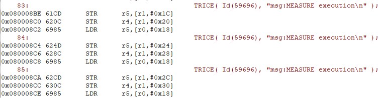
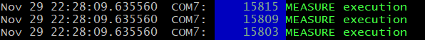
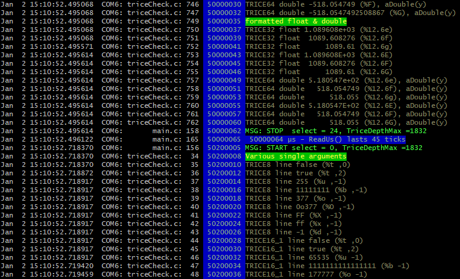
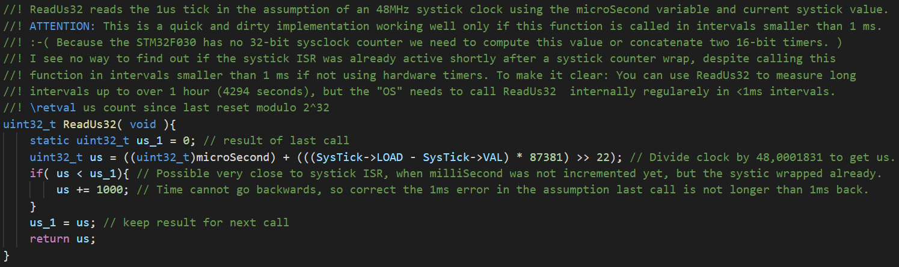
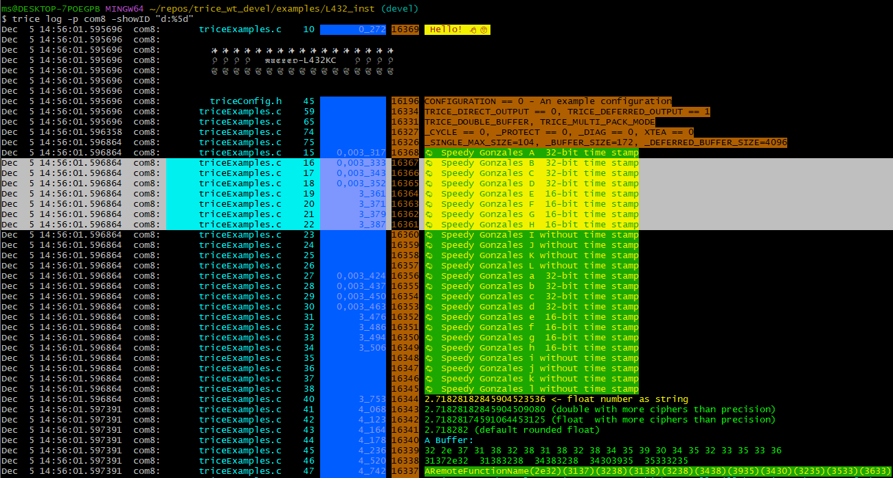
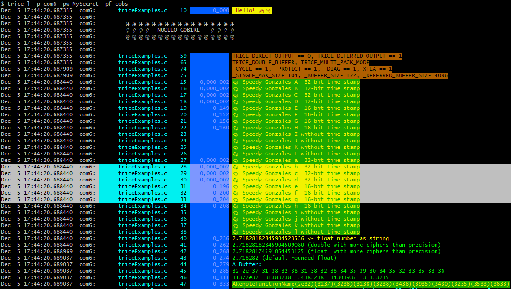
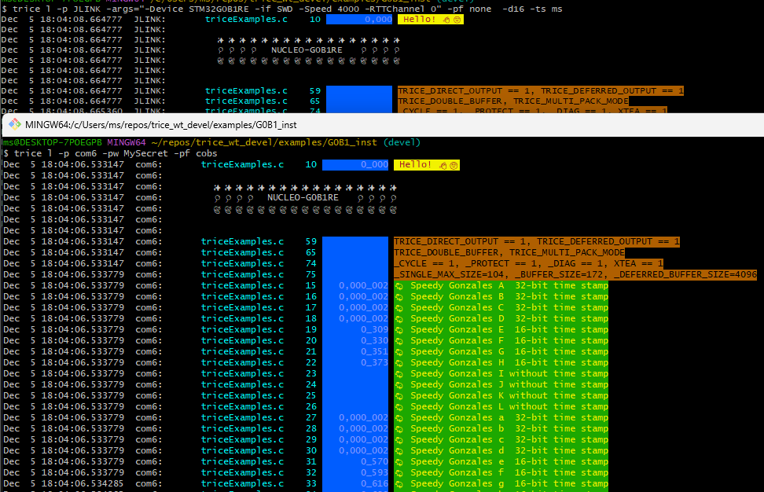

# Trice Performance

<details markdown="1">
<summary>Contents</summary>

---

<!-- mdtoc -->

* [1. Target Implementation Options](#target-implementation-options)
  * [1.1. Trice Use Cases TRICESTATICBUFFER and TRICESTACKBUFFER - direct mode only](#trice-use-cases-tricestaticbuffer-and-tricestackbuffer---direct-mode-only)
  * [1.2. Trice Use Case TRICEDOUBLEBUFFER - deferred mode, fastest Trice execution, more RAM needed](#trice-use-case-tricedoublebuffer---deferred-mode-fastest-trice-execution-more-ram-needed)
  * [1.3. Trice Use Case TRICERINGBUFFER - deferred mode, balanced Trice execution time and needed RAM](#trice-use-case-triceringbuffer---deferred-mode-balanced-trice-execution-time-and-needed-ram)
* [2. A configuration for maximum Trice execution speed with the L432inst example](#a-configuration-for-maximum-trice-execution-speed-with-the-l432inst-example)
* [3. A configuration for normal Trice execution speed with the G0B1inst example](#a-configuration-for-normal-trice-execution-speed-with-the-g0b1inst-example)

<!-- numbering=true min=2 max=4 slug=github anchor=true link=true toc=true bullets=auto -->
<!-- /mdtoc -->

---

</details>

 A Trice macro execution can be as cheap like **3 Assembler instructions or 6 processor clocks**:

* Disassembly: 
* Measurement: The blue SYSTICK clock counts backwards 6 clocks for each Trice macro (on an ARM M0+), what is less than 100 ns @64 MHz MCU clock: 

A more realistic (typical) timing with target location and µs timestamps, critical section and parameters is shown here with the STM32F030 M0 core:



The MCU is clocked with 48 MHz and a Trice duration is about 2 µs, where alone the internal ReadUs() call is already nearly 1 µs long:



## 1. <a id="target-implementation-options"></a>Target Implementation Options

All trice macros use internally this sub-macro:

```C
#define TRICE_PUT(x) do{ *TriceBufferWritePosition++ = TRICE_HTOTL(x); }while(0); //! PUT copies a 32 bit x into the TRICE buffer.
```

The usual case is `#define TRICE_HTOTL(x) (x)`. The `uint32_t* TriceBufferWritePosition` points to a buffer, which is codified and used with the Trice framing sub-macros `TRICE_ENTER` and `TRICE_LEAVE` depending on the use case.

### 1.1. <a id="trice-use-cases-tricestaticbuffer-and-tricestackbuffer---direct-mode-only"></a>Trice Use Cases TRICE_STATIC_BUFFER and TRICE_STACK_BUFFER - direct mode only

1. Each single Trice is build inside a common buffer and finally copied inside the sub-macro `TRICE_LEAVE`.
2. Disabled relevant interrupts between `TRICE_ENTER` and `TRICE_LEAVE` are mantadory for `TRICE_STATIC_BUFFER`.
3. Usable for multiple non-blocking physical Trice channels but **not** recommended for some time blocking channels.
4. A copy call is executed inside `TRICE_LEAVE`.

* With appropriate mapping a direct write to physical output(s) is possible:
  * RTT0 without extra copy.
    * With `TRICE_DIRECT_SEGGER_RTT_32BIT_WRITE` about 100 MCU clocks do the whole work, what is within 1.5 us @ 64 MHz.
  * AUX without extra copy.
  * Not (yet) supported UART transfer loop with polling. With 1MBit baud rate, 4-12 bytes would last 40-120 µs.

### 1.2. <a id="trice-use-case-tricedoublebuffer---deferred-mode-fastest-trice-execution-more-ram-needed"></a>Trice Use Case TRICE_DOUBLE_BUFFER - deferred mode, fastest Trice execution, more RAM needed

1. Several *trices* are build in a half buffer.
1. No stack used.
1. Disabled interrupts between `TRICE_ENTER` and `TRICE_LEAVE`.
1. Usable for multiple blocking and non-blocking physical Trice channels.
1. No copy call inside `TRICE_LEAVE` but optionally an additional direct mode is supported.

### 1.3. <a id="trice-use-case-triceringbuffer---deferred-mode-balanced-trice-execution-time-and-needed-ram"></a>Trice Use Case TRICE_RING_BUFFER - deferred mode, balanced Trice execution time and needed RAM

1. Each single *trices* is build in a ring buffer segment.
1. No stack used.
1. Disabled interrupts between `TRICE_ENTER` and `TRICE_LEAVE`.
1. Usable for multiple blocking and non-blocking physical Trice channels.
1. No copy call inside `TRICE_LEAVE` but optionally an additional direct mode is supported.
1. Allocation call inside `TRICE_ENTER`

## 2. <a id="a-configuration-for-maximum-trice-execution-speed-with-the-l432inst-example"></a>A configuration for maximum Trice execution speed with the L432_inst example

* To not loose any clocks, the function `SomeExampleTrices` in [triceExamples.c](../../examples/exampleData/triceExamples.c) uses the upper case macro `TRICE` for the first "🐁 Speedy Gonzales" Trices.

* The `triceConfig.h` settings are

```C
#define TriceStamp16 (*DWT_CYCCNT) // @64MHz wraps after a bit more than 1ms (MCU clocks)
#define TriceStamp32 (*DWT_CYCCNT) // @64MHz -> 1 µs, wraps after 2^32 µs ~= 1.2 hours

#define TRICE_DEFERRED_UARTA 1
#define TRICE_UARTA USART2

#define TRICE_DEFERRED_OUTPUT 1
#define TRICE_BUFFER TRICE_DOUBLE_BUFFER

#define TRICE_PROTECT 0
#define TRICE_DIAGNOSTICS 0
#define TRICE_CYCLE_COUNTER 0
```

* Both time stamps use the debug watchdog counter running with the 64 MHz MCU clock.
* No direct output to not loose time during the Trice macro execution.
* Critical sections are disabled (default), so be careful where Trices are used.
* The Trice double buffer allows the Trice macros to write without checks.
* The Trice protection, diagnostics and cycle counter are disabled to not perform unneeded clocks.
* Additionally in file [flags.mak](../../examples/L432_inst/flags.mak) the optimization is set to`C_FLAGS += -Ofast`.

After running [./build.sh](../../examples/L432_inst/build.sh), executing ` arm-none-eabi-objdump.exe -D -S -l out.clang/triceExamples.o` shows:

```bash
out.clang/triceExamples.o:     file format elf32-littlearm


Disassembly of section .text.TriceHeadLine:

00000000 <TriceHeadLine>:
TriceHeadLine():
C:\Users\ms\repos\trice_wt_devel\examples\L432_inst/../exampleData/triceExamples.c:10
#include "trice.h"

//! TriceHeadLine emits a decorated name. The name length should be 18 characters.
void TriceHeadLine(char * name) {
	//! This is usable as the very first trice sequence after restart. Adapt it. Use a UTF-8 capable editor like VS-Code or use pure ASCII.
	TriceS("w: Hello! 👋🙂\n\n        ✨✨✨✨✨✨✨✨✨✨✨✨✨✨✨✨✨        \n        🎈🎈🎈🎈%s🎈🎈🎈🎈\n        🍃🍃🍃🍃🍃🍃🍃🍃🍃🍃🍃🍃🍃🍃🍃🍃🍃        \n\n\n", name);
   0:	f240 0100 	movw	r1, #0
   4:	4602      	mov	r2, r0
   6:	f2c0 0100 	movt	r1, #0
   a:	f643 70f1 	movw	r0, #16369	@ 0x3ff1
   e:	f7ff bffe 	b.w	0 <TriceS>

Disassembly of section .ARM.exidx.text.TriceHeadLine:

00000000 <.ARM.exidx.text.TriceHeadLine>:
   0:	00000000 	andeq	r0, r0, r0
   4:	00000001 	andeq	r0, r0, r1

Disassembly of section .text.SomeExampleTrices:

00000000 <SomeExampleTrices>:
SomeExampleTrices():
C:\Users\ms\repos\trice_wt_devel\examples\L432_inst/../exampleData/triceExamples.c:14
}

//! SomeExampleTrices generates a few Trice example logs and a burst of Trices.
void SomeExampleTrices(int burstCount) {
   0:	b5f0      	push	{r4, r5, r6, r7, lr}
   2:	af03      	add	r7, sp, #12
   4:	e92d 0700 	stmdb	sp!, {r8, r9, sl}
C:\Users\ms\repos\trice_wt_devel\examples\L432_inst/../exampleData/triceExamples.c:15
	TRICE(ID(0), "att:🐁 Speedy Gonzales A  32-bit timestamp\n");
   8:	f240 0100 	movw	r1, #0
   c:	f2c0 0100 	movt	r1, #0
  10:	680d      	ldr	r5, [r1, #0]
  12:	f240 0800 	movw	r8, #0
  16:	f2c0 0800 	movt	r8, #0
  1a:	4604      	mov	r4, r0
  1c:	6829      	ldr	r1, [r5, #0]
  1e:	f8d8 0000 	ldr.w	r0, [r8]
  22:	f06f 0212 	mvn.w	r2, #18
  26:	8041      	strh	r1, [r0, #2]
  28:	0c09      	lsrs	r1, r1, #16
  2a:	1cd3      	adds	r3, r2, #3
  2c:	8081      	strh	r1, [r0, #4]
  2e:	21c0      	movs	r1, #192	@ 0xc0
  30:	8003      	strh	r3, [r0, #0]
  32:	80c1      	strh	r1, [r0, #6]
C:\Users\ms\repos\trice_wt_devel\examples\L432_inst/../exampleData/triceExamples.c:16
	TRICE(ID(0), "att:🐁 Speedy Gonzales B  32-bit timestamp\n");
  34:	682b      	ldr	r3, [r5, #0]
  36:	1c96      	adds	r6, r2, #2
  38:	8143      	strh	r3, [r0, #10]
  3a:	0c1b      	lsrs	r3, r3, #16
  3c:	8106      	strh	r6, [r0, #8]
  3e:	8183      	strh	r3, [r0, #12]
  40:	81c1      	strh	r1, [r0, #14]
C:\Users\ms\repos\trice_wt_devel\examples\L432_inst/../exampleData/triceExamples.c:17
	TRICE(ID(0), "att:🐁 Speedy Gonzales C  32-bit timestamp\n");
  42:	682b      	ldr	r3, [r5, #0]
  44:	1c56      	adds	r6, r2, #1
  46:	8243      	strh	r3, [r0, #18]
  48:	0c1b      	lsrs	r3, r3, #16
  4a:	8206      	strh	r6, [r0, #16]
  4c:	8283      	strh	r3, [r0, #20]
  4e:	82c1      	strh	r1, [r0, #22]
C:\Users\ms\repos\trice_wt_devel\examples\L432_inst/../exampleData/triceExamples.c:18
	TRICE(ID(0), "att:🐁 Speedy Gonzales D  32-bit timestamp\n");
  50:	682b      	ldr	r3, [r5, #0]
  52:	8302      	strh	r2, [r0, #24]
  54:	0c1a      	lsrs	r2, r3, #16
  56:	8343      	strh	r3, [r0, #26]
  58:	8382      	strh	r2, [r0, #28]
  5a:	83c1      	strh	r1, [r0, #30]
  5c:	f64b 7ad4 	movw	sl, #49108	@ 0xbfd4
C:\Users\ms\repos\trice_wt_devel\examples\L432_inst/../exampleData/triceExamples.c:19
	TRICE(Id(0), "att:🐁 Speedy Gonzales E  16-bit timestamp\n");
  60:	682a      	ldr	r2, [r5, #0]
  62:	f6cb 7ad4 	movt	sl, #49108	@ 0xbfd4
  66:	f10a 1318 	add.w	r3, sl, #1572888	@ 0x180018
  6a:	6203      	str	r3, [r0, #32]
  6c:	8482      	strh	r2, [r0, #36]	@ 0x24
  6e:	84c1      	strh	r1, [r0, #38]	@ 0x26
C:\Users\ms\repos\trice_wt_devel\examples\L432_inst/../exampleData/triceExamples.c:20
	TRICE(Id(0), "att:🐁 Speedy Gonzales F  16-bit timestamp\n");
  70:	682a      	ldr	r2, [r5, #0]
  72:	f10a 1317 	add.w	r3, sl, #1507351	@ 0x170017
  76:	6283      	str	r3, [r0, #40]	@ 0x28
  78:	8582      	strh	r2, [r0, #44]	@ 0x2c
  7a:	85c1      	strh	r1, [r0, #46]	@ 0x2e
C:\Users\ms\repos\trice_wt_devel\examples\L432_inst/../exampleData/triceExamples.c:21
	TRICE(Id(0), "att:🐁 Speedy Gonzales G  16-bit timestamp\n");
  7c:	682a      	ldr	r2, [r5, #0]
  7e:	f10a 1316 	add.w	r3, sl, #1441814	@ 0x160016
  82:	6303      	str	r3, [r0, #48]	@ 0x30
  84:	8682      	strh	r2, [r0, #52]	@ 0x34
  86:	86c1      	strh	r1, [r0, #54]	@ 0x36
C:\Users\ms\repos\trice_wt_devel\examples\L432_inst/../exampleData/triceExamples.c:22
	TRICE(Id(0), "att:🐁 Speedy Gonzales H  16-bit timestamp\n");
  88:	682a      	ldr	r2, [r5, #0]
  8a:	f10a 1315 	add.w	r3, sl, #1376277	@ 0x150015
  8e:	8782      	strh	r2, [r0, #60]	@ 0x3c
  90:	f647 72e8 	movw	r2, #32744	@ 0x7fe8
C:\Users\ms\repos\trice_wt_devel\examples\L432_inst/../exampleData/triceExamples.c:23
	TRICE(id(0), "att:🐁 Speedy Gonzales I without timestamp\n");
  94:	f8a0 2040 	strh.w	r2, [r0, #64]	@ 0x40
  98:	f647 72e7 	movw	r2, #32743	@ 0x7fe7
C:\Users\ms\repos\trice_wt_devel\examples\L432_inst/../exampleData/triceExamples.c:24
	TRICE(id(0), "att:🐁 Speedy Gonzales J without timestamp\n");
  9c:	f8a0 2044 	strh.w	r2, [r0, #68]	@ 0x44
  a0:	f647 72e6 	movw	r2, #32742	@ 0x7fe6
C:\Users\ms\repos\trice_wt_devel\examples\L432_inst/../exampleData/triceExamples.c:25
	TRICE(id(0), "att:🐁 Speedy Gonzales K without timestamp\n");
  a4:	f8a0 2048 	strh.w	r2, [r0, #72]	@ 0x48
  a8:	f647 72e5 	movw	r2, #32741	@ 0x7fe5
C:\Users\ms\repos\trice_wt_devel\examples\L432_inst/../exampleData/triceExamples.c:22
	TRICE(Id(0), "att:🐁 Speedy Gonzales H  16-bit timestamp\n");
  ac:	6383      	str	r3, [r0, #56]	@ 0x38
  ae:	87c1      	strh	r1, [r0, #62]	@ 0x3e
C:\Users\ms\repos\trice_wt_devel\examples\L432_inst/../exampleData/triceExamples.c:23
	TRICE(id(0), "att:🐁 Speedy Gonzales I without timestamp\n");
  b0:	f8a0 1042 	strh.w	r1, [r0, #66]	@ 0x42
C:\Users\ms\repos\trice_wt_devel\examples\L432_inst/../exampleData/triceExamples.c:24
	TRICE(id(0), "att:🐁 Speedy Gonzales J without timestamp\n");
  b4:	f8a0 1046 	strh.w	r1, [r0, #70]	@ 0x46
C:\Users\ms\repos\trice_wt_devel\examples\L432_inst/../exampleData/triceExamples.c:25
	TRICE(id(0), "att:🐁 Speedy Gonzales K without timestamp\n");
  b8:	f8a0 104a 	strh.w	r1, [r0, #74]	@ 0x4a
C:\Users\ms\repos\trice_wt_devel\examples\L432_inst/../exampleData/triceExamples.c:26
	TRICE(id(0), "att:🐁 Speedy Gonzales L without timestamp\n");
  bc:	f8a0 204c 	strh.w	r2, [r0, #76]	@ 0x4c
  c0:	f8a0 104e 	strh.w	r1, [r0, #78]	@ 0x4e
TRice0():
C:\Users\ms\repos\trice_wt_devel\examples\L432_inst/../../src/trice.h:741
	Trice32m_0(tid);
	TRICE_UNUSED(pFmt)
}

...
```

* There are only 7 assembler instructions between two `TRICE` macros(around line 17).
* The log output is:



As you can see in the highlighted blue timestamp bar, typical 8-10 clocks are needed for one Trice macro. One clock duration @64MHz is 15.625 ns, so we need about 150 ns for a Trice. Light can travel about 50 meter in that time.

## 3. <a id="a-configuration-for-normal-trice-execution-speed-with-the-g0b1inst-example"></a>A configuration for normal Trice execution speed with the G0B1_inst example

* The `triceConfig.h` settings are

```C
// hardware specific trice lib settings
#include "main.h"
#define TriceStamp16 TIM17->CNT     // 0...999 us
#define TriceStamp32 HAL_GetTick()  // 0...2^32-1 ms (wraps after 49.7 days)

#define TRICE_BUFFER TRICE_RING_BUFFER

// trice l -p JLINK -args="-Device STM32G0B1RE -if SWD -Speed 4000 -RTTChannel 0" -pf none  -d16 -ts ms
//#define TRICE_DIRECT_OUTPUT 1
//#define TRICE_DIRECT_SEGGER_RTT_32BIT_WRITE 1

// trice log -p com7 -pw MySecret -pf COBS
#define TRICE_DEFERRED_OUTPUT 1
#define TRICE_DEFERRED_XTEA_ENCRYPT 1
#define TRICE_DEFERRED_OUT_FRAMING TRICE_FRAMING_COBS
#define TRICE_DEFERRED_UARTA 1
#define TRICE_UARTA USART2

#include "cmsis_gcc.h"
#define TRICE_ENTER_CRITICAL_SECTION { uint32_t primaskstate = __get_PRIMASK(); __disable_irq(); {
#define TRICE_LEAVE_CRITICAL_SECTION } __set_PRIMASK(primaskstate); }
```

* The 16-bit timestamp counts the microseconds within 1 millisecond.
* The 32-bit timestamp counts the milliseconds.
* The ring buffer uses the RAM more effectively for the price of a bit speed.
* The encryption and framing has no influence on the Trice execution speed becuse this is done in the background.
* The critical section protects Trices in different tasks from each-other interruption and allows Trices inside interrupts parallel to normal usage.
* Per default are Trice protection, diagnostics and cycle counter active.



* A typical Trice duration is here 4 microseconds (with `-Ospeed`)
* Switcing the optimization to `-Oz` can result in typical 4-5 µs Trice execution time.
* Additionally enabling the Trice direct out over Segger RTT has this impact:



> 🛑 The Trice execution time is now over 20 microseconds❗

Still fast enough for many cases but you hopefully have a good knowledge now how to tune Trice best for your application.

<p align="right">(<a href="#trice-performance">back to top</a>)</p>

