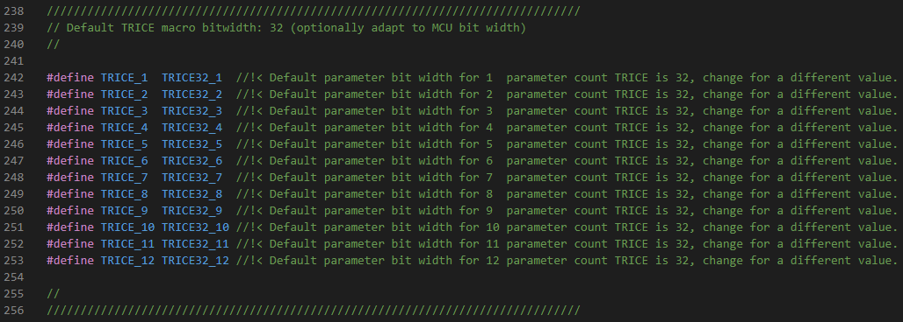
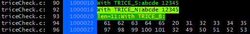
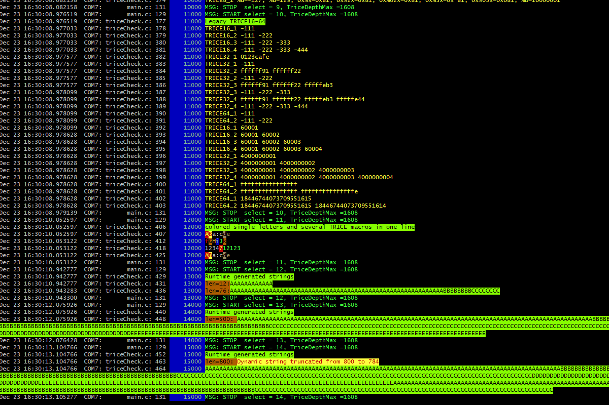
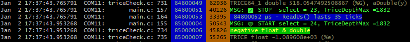

# Trice Compared with `printf`

<details markdown="1">
<summary>Contents</summary>

---

<!-- mdtoc -->

* [1. Printf-like functions](#printf-like-functions)
* [2. Trice IDs](#trice-ids)
* [3. Trice values bit width](#trice-values-bit-width)
* [4. Many value parameters](#many-value-parameters)
* [5. Floating Point Values](#floating-point-values)
* [6. Runtime Generated 0-terminated Strings Transfer with triceS](#runtime-generated-0-terminated-strings-transfer-with-trices)
* [7. Runtime Generated counted Strings Transfer with triceN](#runtime-generated-counted-strings-transfer-with--tricen)
* [8. Runtime Generated Buffer Transfer with triceB](#runtime-generated-buffer-transfer-with-triceb)
* [9. Extended format specifier possibilities](#extended-format-specifier-possibilities)
  * [9.1. Trice format specifier](#trice-format-specifier)
  * [9.2. Length modifier support](#length-modifier-support)
  * [9.3. Overview Table](#overview-table)
* [10. Unsupported printf format features](#unsupported-printf-format-features)
  * [10.1. Dynamic field width with *](#dynamic-field-width-with-)
  * [10.2. Dynamic precision with *](#dynamic-precision-with-)
  * [10.3. Dynamic width and precision together](#dynamic-width-and-precision-together)
  * [10.4. Wide character and wide string formats: %lc and %ls](#wide-character-and-wide-string-formats-lc-and-ls)
  * [10.5. The special %n conversion specifier](#the-special-n-conversion-specifier)
  * [10.6. Security implications of %n](#security-implications-of-n)
  * [10.7. Why Trice does not support %n](#why-trice-does-not-support-n)
* [11. UTF-8 Support](#utf-8-support)
* [12. Switch the language without changing a bit inside the target code](#switch-the-language-without-changing-a-bit-inside-the-target-code)
* [13. Format tags prototype specifier examples](#format-tags-prototype-specifier-examples)

<!-- numbering=true min=2 max=4 slug=github anchor=true link=true toc=true bullets=auto -->
<!-- /mdtoc -->

---

</details>

## 1. <a id="printf-like-functions"></a>Printf-like functions

 ...have a lot of things to do: Copy format string from FLASH memory into a RAM buffer and parse it for format specifiers. Also parse the variadic parameter list and convert each parameter according to its format specifier into a character sequences, what includes several divisions - costly function calls. Concatenate the parts to a new string and deliver it to the output, what often means copying again. A full-featured printf library consumes plenty space and processing time and several open source projects try to make it better in this or that way. Never ever call a printf-like function in time critical code, like an interrupt - it would crash your target in most cases.
The *trice* calls are usable inside interrupts, because they only need a few MCU clocks for execution. Porting legacy code to use it with the Trice library, means mainly to replace Printf-like function calls with `trice` function calls. See also chapter [Legacy User Code Option Print Buffer Wrapping and Framing](legacy_user_code.md#legacy-user-code-option-print-buffer-wrapping-and-framing).

## 2. <a id="trice-ids"></a>Trice IDs

* Each Trice caries a 14-bit nuber ID as replacement for the format string.
* This ID is automatically generated (controllable) and in the source code it is the first parameter inside the Trice macro followed by the format string and optional values.
* The user can decide not to spoil the code by having the IDs permanently in its source code, by just inserting them as a pre-compile step with `trice insert` and removing them as a post-compile step with `trice clean`.
  * The Trice cache makes this invisible to the build system, allowing full translation speed.
* The format string is **not** compiled into the target code. It goes together with the ID into a project specific reference list file [til.json](../../demoTIL.json) (example).

## 3. <a id="trice-values-bit-width"></a>Trice values bit width

* No need to explicit express the value bit width.
* The default parameter width for the Trice macro is 32 bit. It is changeable to 8, 16 or 64-bit:
  * Adapt `TRICE_DEFAULT_PARAMETER_BIT_WIDTH` inside `triceConfig.h`. It influences 
  * Use `-defaultTRICEBitwidth` switch during logging when changing this value.
* The macros `trice8`, `trice16`, `trice32`, `trice64` are usable too, to define the bit width explicit.
  * This leads for the smaller bit widths to less needed space and bandwidth. But when using the default package framing TCOBS, the influence is marginal because of the implicit compression.
* The fastest Trice macro execution is, when MCU bit width matches the macro bit width.
* The implicit TCOBS compression compacts the binary Trice data during the framing.

## 4. <a id="many-value-parameters"></a>Many value parameters

* No need to explicit express the values count.
* Up to 12 values are supported directly. Example:
  * `trice( "%p | %04x %04x %04x %04x %04x %04x %04x %04x %04x | %f\n", p, p[0], p[1], p[2], p[3], p[4], p[5], p[6], p[7], p[8], p[9], aFloat(x));`
  * The long count field can encode up to 32767 payload bytes, but the current target buffer macros impose a lower limit; see [Binary Encoding](binary_encoding.md). Supporting more than 12 values per Trice macro would require extending the target and host code.
* Each macro can be prolonged with the used parameter count, for example `TRICE8_3` or `TRICE_2` to intense compile time checks.
  * This length code extension can be done automatically using `trice u -addParamCount`. This is not needed anymore:
* The _Trice_ tool compares the number of given format specifiers with the written parameters in a precimpile step to minimize the risk of runtime errors.
* There is no variadic values scanning during runtime. The C preprocessor does the work.

## 5. <a id="floating-point-values"></a>Floating Point Values

These types are mixable with integer types but need to be covered by converter function.

* *float* types use the `aFloat()` function and need a minimal value bit width of 32, to secure correct data transfer.
  * Example:

  ```c
   float x = 7.2;
   trice( "%f", aFloat(x));
  ```

* *double* types use the `aDouble()` function and need a value bit width of 64, to secure correct data transfer.
  * Example:

  ```c
   double y = 7.2;
   trice64( "float %f and double %f", aFloat(x), aDouble(y));
  ```

* Both functions are simple and fast:

```C

// aFloat returns passed float value x as bit pattern in a uint32_t type.
static inline uint32_t aFloat( float x ){
    union {
        float f;
        uint32_t u;
    } t;
    t.f = x;
    return t.u;
}

// aDouble returns passed double value x as bit pattern in a uint64_t type.
static inline uint64_t aDouble( double x ){
    union {
        double d;
        uint64_t u;
    } t;
    t.d = x;
    return t.u;
}
```

## 6. <a id="runtime-generated-0-terminated-strings-transfer-with-trices"></a>Runtime Generated 0-terminated Strings Transfer with triceS

* The `%s` format specifier is supported by the Trice macro too but needs specific treatment.
* Strings, known at compile time should be a part of a format string to reduce runtime overhead.
* Strings created at runtime need a special `TRICE_S` (or `triceS`, `TriceS`, `TRiceS`) macro, which accepts exactly one `%s` format specifier. It transfers at most `TRICE_SINGLE_MAX_SIZE - 12` string bytes, excluding the terminating zero byte: 92 bytes by default or at most 32752 bytes with the largest supported configuration. Longer strings are truncated.
  * Example:

  ```c
   char s[] = "Hello again!";
   triceS("A runtime string %20s\n", s);
  ```

Trice was designed mainly for speed. An universal `trice` like `printf` would cost too much runtime and destroy this main Trice advantage.

If you need several `%s`, like in 

```C
char* n = "Ann";
char* f = "Fox";
uint8_t dd = 22;
uint8_t mm = 11;
uint16_t yyyy = 1988;
// ...
print( "Name: %12s, Family: %s, Birthday %2u-%02u-%4u\n",  n, f, dd, mm, yyyy );
```
you can do:

```C
// ...
triceS( "Name: %12s, ",  n );
triceS( "Family: %s, ", f );
trice( "Birthday %2u-%02u-%4u\n", dd, mm, yyyy );
```
 or also

```C
// ...
triceS( "Name: %12s, ",  n ); triceS( "Family: %s, ", f ); trice( "Birthday %2u-%02u-%4u\n", dd, mm, yyyy );
```

## 7. <a id="runtime-generated-counted-strings-transfer-with--tricen"></a>Runtime Generated counted Strings Transfer with  triceN

* It is also possible to transfer a buffer with length n using the `TRICE_N` (or `triceN`, `TriceN`, `TRiceN`) macro.
* This becomes handy for example, when a possibly not 0-terminated string in FLASH memory needs transmission: `triceN( "msg: FLASH string is %s", addr, 16 );`
* There are also specific macros like `trice32B` or `trice16F`. Please look into [triceCheck.c](../../_test/testdata/triceCheck.c) for usage or see the following.

## 8. <a id="runtime-generated-buffer-transfer-with-triceb"></a>Runtime Generated Buffer Transfer with triceB

* A buffer is transmittable with `TRICE_B` (or `triceB`, `TriceB`, `TRiceB`) and specifying just one format specifier, which is then repeated. Example:

```code
  s = "abcde 12345"; // assume this as runtime generated string
  triceS( "msg:Show s with triceS: %s\n", s );
  len = strlen(s);
  triceN( "sig:Show s with triceN:%s\n", s, len );
  triceB( "dbg: %02x\n", s, len ); // Show s as colored code sequence in hex code.
  triceB( "msg: %4d\n", s, len ); // Show s as colored code sequence in decimal code.
```

  This gives output similar to: 

  Channel specifier within the `TRICE_B` format string are supported in Trice versions >= v0.66.0.

 If the buffer is not 8 but 16, 32 or 32 bits wide, the macros `TRICE8_B`, `TRICE16_B`, `TRICE32_B` and  `TRICE64_B`, are usable in the same manner.


## 9. <a id="extended-format-specifier-possibilities"></a>Extended format specifier possibilities

* Because the format string is interpreted by the Trice tool written in [Go](https://en.wikipedia.org/wiki/Go_(programming_language)), the **Go** capabilities partial usable.

### 9.1. <a id="trice-format-specifier"></a>Trice format specifier

* The Trice macros are used in **C** code.
* The format strings are interpreted by the Trice tool, which is written in **Go**.
* The **C** and **Go** format specifier are not equal but similar.
* Therefore, a **T**rice adaptation is internally performed.

### 9.2. <a id="length-modifier-support"></a>Length modifier support

* Trice now accepts the common C length modifiers `hh`, `h`, `l`, `ll`, `j`, `z`, `t`, and `L` together with the corresponding supported conversion specifiers.
* This is useful for ordinary Trice macros as well as for buffer macros such as `TRICE8_B`, `TRICE16_B`, `TRICE32_B`, and `TRICE64_B`.
* The original C format string stays unchanged in the lookup data. Internally, the Trice tool normalizes only a temporary working copy so that the host side can format the values with Go.
* Therefore, these examples are accepted and decoded as expected:
  * `%4ld` behaves like `%4d`
  * `%zu` behaves like `%u`
  * `%02zx` behaves like `%02x`
  * `%02llx` behaves like `%02x`
  * `%04Lf` behaves like `%04f`
* The normalization keeps flags, field width, and precision. Only the C length modifier itself is removed from the host side working copy.
* Invalid combinations are not legalized by Trice. For example, `%LX` is not treated as a valid integer format because `L` belongs to floating-point conversions such as `%Lf`, not to `%X`.

### 9.3. <a id="overview-table"></a>Overview Table

| Format Specifier Type                                           | C | Go | T | (T =Trice) \| remark                                                        |
|-----------------------------------------------------------------|---|----|---|-----------------------------------------------------------------------------|
| signed decimal integer                                          | d | d  | d | Supported.                                                                  |
| unsigned decimal integer                                        | u | -  | u | The Trice tool changes %u into %d and treats value as unsigned.             |
| signed decimal integer                                          | i | d  | i | The Trice tool changes %i into %d and treats value as signed.               |
| signed octal integer                                            | - | o  | o | With `trice log -unsigned=false` value is treated as signed.                |
| unsigned octal integer                                          | o | -  | o | With `trice log` value is treated as unsigned.                              |
| signed octal integer with 0o prefix                             | - | O  | O | With `trice log -unsigned=false` value is treated as signed.                |
| unsigned octal integer with 0o prefix                           | - | -  | O | With `trice log` value is treated as unsigned.                              |
| signed hexadecimal integer lowercase                            | - | x  | x | With `trice log -unsigned=false` value is treated as signed.                |
| unsigned hexadecimal integer lowercase                          | x | -  | x | With `trice log` value is treated as unsigned.                              |
| signed hexadecimal integer uppercase                            | - | X  | X | With `trice log -unsigned=false` value is treated as signed.                |
| unsigned hexadecimal integer uppercase                          | X | -  | X | With `trice log` value is treated as unsigned.                              |
| signed binary integer                                           | - | b  | b | With `trice log -unsigned=false` value is treated as signed.                |
| unsigned binary integer                                         | - | -  | b | With `trice log` value is treated as unsigned.                              |
| decimal floating point, lowercase                               | f | f  | f | `aFloat(value)`\|`aDouble(value)`                                           |
| decimal floating point, uppercase                               | - | F  | F | `aFloat(value)`\|`aDouble(value)`                                           |
| scientific notation (mantissa/exponent), lowercase              | e | e  | e | `aFloat(value)`\|`aDouble(value)`                                           |
| scientific notation (mantissa/exponent), uppercase              | E | E  | E | `aFloat(value)`\|`aDouble(value)`                                           |
| the shortest representation of %e or %f                         | g | g  | g | `aFloat(value)`\|`aDouble(value)`                                           |
| the shortest representation of %E or %F                         | G | G  | G | `aFloat(value)`\|`aDouble(value)`                                           |
| a character as byte                                             | c | -  | c | Value can contain ASCII character.                                          |
| a character represented by the corresponding Unicode code point | c | c  | c | Value can contain UTF-8 characters if the C-File is edited in UTF-8 format. |
| a quoted character                                              | - | q  | q | Supported.                                                                  |
| the word true or false                                          | - | t  | t | Supported.                                                                  |
| a string                                                        | s | s  | s | Use `triceS` macro with one and only one runtime generated string.          |
| pointer address                                                 | p | p  | p | Supported.                                                                  |
| a double %% prints a single %                                   | % | %  | % | Supported.                                                                  |
| Unicode escape sequence                                         | - | U  | - | **Not supported.**                                                          |
| value in default format                                         | - | v  | - | **Not supported.**                                                          |
| Go-syntax representation of the value                           | - | #v | - | **Not supported.**                                                          |
| a Go-syntax representation of the type of the value             | - | T  | - | **Not supported.**                                                          |
| nothing printed                                                 | n | -  | - | **Not supported.**                                                          |

* [x] Long story short: Use the `-unsigned=false` switch when you like to see hex numbers and the like as signed values.
* [x] Look in [triceCheck.c](../../_test/testdata/triceCheck.c) for exampe code producing this:

[](../ref/TriceCheckOutput.gif)

Select the preview to open the full animation.

## 10. <a id="unsupported-printf-format-features"></a>Unsupported `printf` format features

Trice supports the common `printf`-style format specifiers used for embedded logging. Some less common `printf` features are intentionally not supported yet, because they do not fit well into the current lightweight Trice argument handling model or because they introduce side effects that are unsuitable for logging.

This mainly concerns:

* dynamic field width with `*`, for example `%*d`
* dynamic precision with `*`, for example `%.*s` or `%*.*f`
* wide character and wide string formats such as `%lc` and `%ls`
* the `%n` conversion specifier

### 10.1. <a id="dynamic-field-width-with-"></a>Dynamic field width with `*`

In standard `printf`, a field width can either be fixed inside the format string or supplied dynamically.

Example with fixed width:

```c
printf("%10d", value);
```

Example with dynamic width:

```c
printf("%*d", width, value);
```

The `*` is not the value to be printed. It tells `printf` to consume an additional `int` argument from the argument list and to use that value as the field width. Therefore:

```c
printf("%*d", 10, value);
```

behaves like:

```c
printf("%10d", value);
```

A negative dynamic width has a special meaning and implies left-aligned output, similar to the `-` flag.

### 10.2. <a id="dynamic-precision-with-"></a>Dynamic precision with `*`

The same principle exists for precision.

Example with fixed precision:

```c
printf("%.3f", value);
```

Example with dynamic precision:

```c
printf("%.*f", precision, value);
```

Again, the `*` consumes an additional `int` argument. For strings this is often used to limit the maximum number of emitted characters:

```c
printf("%.*s", maxLen, text);
```

### 10.3. <a id="dynamic-width-and-precision-together"></a>Dynamic width and precision together

Both dynamic field width and dynamic precision can be used in the same conversion:

```c
printf("%*.*f", width, precision, value);
```

This consumes three arguments:

```c
int width;
int precision;
double value;
```

The important point is that each `*` consumes an additional `int` argument before the actual value argument. This means that `%*.*f` does not correspond to one runtime value only. It corresponds to `int, int, double`.

Trice is designed so that a format string usually maps to a compact and predictable sequence of transmitted values. Dynamic width and dynamic precision break that simple mapping because the `*` tokens are not visible output conversions, but they still consume additional arguments.

For that reason, Trice currently does not support these forms. Supporting them correctly would require the Trice format analysis to count and encode the hidden width and precision arguments in addition to the visible value arguments.

### 10.4. <a id="wide-character-and-wide-string-formats-lc-and-ls"></a>Wide character and wide string formats: `%lc` and `%ls`

The `%lc` and `%ls` conversions are valid C `printf` forms for wide character and wide string data.

They are not equivalent to `%c` and `%s`:

* `%c` and `%s` operate on narrow character data
* `%lc` and `%ls` operate on wide character data such as `wchar_t`

For Trice this matters because `triceS` and related string handling transport runtime buffers, but the Trice tool does not automatically know how a target represents wide characters internally.

Without additional target-specific metadata, the host side would not know:

* whether `wchar_t` on the target is 16 bit or 32 bit
* which byte order is used
* which encoding semantics should be assumed for the transported code units

Therefore, simply removing the `l` and treating `%lc` like `%c` or `%ls` like `%s` would not be correct. That would silently change the meaning of the original C format string and could decode the payload differently from what the target-side C code actually describes.

For that reason, Trice currently does not support `%lc` and `%ls`. Proper support would require extra target-side type or encoding information so that the host can decode the transported data in an unambiguous and portable way.

### 10.5. <a id="the-special-n-conversion-specifier"></a>The special `%n` conversion specifier

The `%n` specifier is fundamentally different from ordinary `printf` conversions.

Most conversions produce output:

```c
printf("%d", value);
printf("%s", text);
printf("%f", number);
```

The `%n` specifier prints nothing. Instead, it writes the number of characters printed so far into the object pointed to by the corresponding argument.

Example:

```c
int count = 0;

printf("abc%nxyz", &count);
```

The visible output is:

```text
abcxyz
```

After the call, `count` contains `3`, because three characters were printed before `%n` was reached.

Depending on the length modifier, `%n` expects different pointer types:

```c
printf("%n",   &i);   // int *
printf("%hn",  &s);   // short *
printf("%hhn", &c);   // signed char *
printf("%ln",  &l);   // long *
printf("%lln", &ll);  // long long *
```

This means `%n` is not a pure logging conversion. It has a side effect because it writes to memory.

### 10.6. <a id="security-implications-of-n"></a>Security implications of `%n`

The `%n` specifier is also relevant for format-string security.

This is unsafe when `userInput` is not trusted:

```c
printf(userInput);
```

If `userInput` contains format specifiers, `printf` interprets them. If it contains `%n`, `printf` expects a pointer argument and writes through it. If no valid pointer was actually passed, this can cause undefined behavior, memory corruption, or a crash. In more serious cases, uncontrolled format strings can become a security vulnerability.

The correct way to print uncontrolled text is:

```c
printf("%s", userInput);
```

Because `%n` writes to memory and is strongly associated with format-string vulnerabilities, many coding standards and safety-oriented code bases discourage or forbid it.

### 10.7. <a id="why-trice-does-not-support-n"></a>Why Trice does not support `%n`

Trice is a logging and tracing system. Its purpose is to transfer compact log information from the target to the host, where it is decoded into readable text.

The `%n` specifier does not fit this model for several reasons:

1. `%n` produces no log output.
2. `%n` writes to target memory through a pointer argument.
3. The written value depends on the number of characters formatted so far.
4. Trice intentionally avoids full target-side formatting in order to remain small and fast.
5. Supporting `%n` would introduce a side effect into what should be a side-effect-free logging operation.
6. `%n` has known security implications when format strings are not fully controlled.

For these reasons, Trice currently does not support `%n`.

This is intentional. Trice log statements should describe data to be logged, not modify application memory as a side effect of formatting.

## 11. <a id="utf-8-support"></a>UTF-8 Support

This is gratis, if you edit your source files containing the format strings in UTF-8:



The target does not even "know" about that, because it gets only the Trice IDs.

## 12. <a id="switch-the-language-without-changing-a-bit-inside-the-target-code"></a>Switch the language without changing a bit inside the target code

Once the [til.json](../../demoTIL.json) list is done the user can translate it in any language and exchanging the list switches to another language. This is nowadays a simple AI agent task.

## 13. <a id="format-tags-prototype-specifier-examples"></a>Format tags prototype specifier examples

This syntax is supported: `%[flags][width][.precision][length]`

* Because the interpretation is done inside the Trice tool written in Go these all should work:
  * `%-d`
  * `%064b`
  * `%+9.3f`
  * `%+#012.12g`
  * `%+'#012.12E`
  * `%e`
  * `%9.f`

<p align="right">(<a href="#trice-compared-with-printf">back to top</a>)</p>

