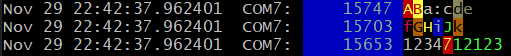
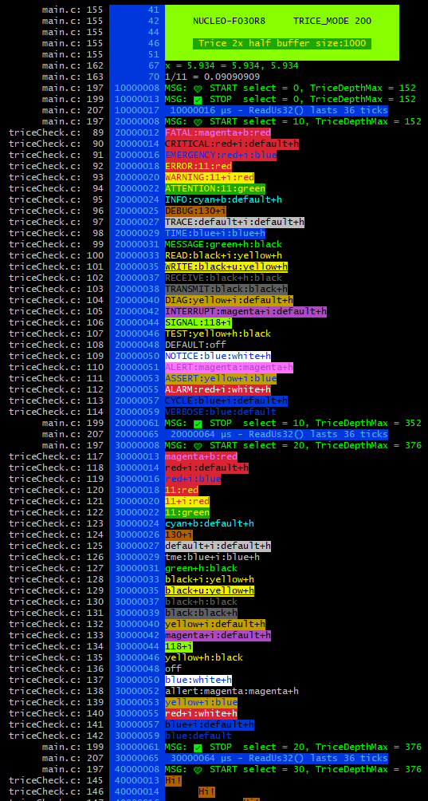
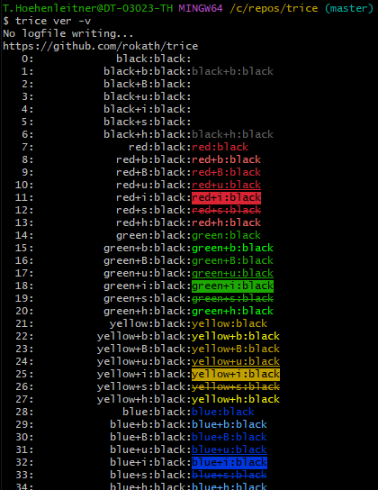

# Tags, Colors, Filters and Statistics

<details markdown="1">
<summary>Contents</summary>

<!-- mdtoc -->

* [1. How to use tags](#how-to-use-tags)
* [2. Tag weights](#tag-weights)
* [3. Selecting tags and priority](#selecting-tags-and-priority)
* [4. Decoder diagnostics](#decoder-diagnostics)
* [5. User-defined tags, weights, and colors](#user-defined-tags-weights-and-colors)
* [6. Untagged application events](#untagged-application-events)
* [7. Event statistics](#event-statistics)
* [8. Output options](#output-options)
* [9. Check color alternatives](#check-color-alternatives)
* [10. Color issues under Windows](#color-issues-under-windows)
* [11. Host filters and target behavior](#host-filters-and-target-behavior)

<!-- numbering=true min=2 max=4 slug=github anchor=true link=true toc=true bullets=auto -->
<!-- /mdtoc -->

</details>

Tags label Trice messages on the host. They can control presentation, selection, ID assignment, and weight-based filtering without adding target runtime data because the tag is part of the format string stored in `til.json`.

[Context Enrichment](context_enrichment.md) also uses tags as selectors: a matching `-ce` rule adds values to selected log messages.

## 1. <a id="how-to-use-tags"></a>How to use tags

Add a tag and a colon in front of a Trice format string:

```c
trice("wrn:Motor temperature is %d C\n", temperature);
```

The Trice tool recognizes `wrn`, applies the Warning color, and removes the prefix when it is completely lower case. A mixed-case or uppercase prefix remains visible:

```text
wrn:fox  -> fox
Wrn:fox  -> Wrn:fox
```

The colors, aliases, and weights are defined in [lineTransformerANSI.go](../../internal/emitter/lineTransformerANSI.go). The tag itself does not require a target-side enable switch. Use `-pick` or `-ban` to select complete tag groups during host logging. Tag-specific ID ranges can additionally assign and route target IDs.

[Macro aliases](legacy_user_code.md#alias-identity-and-tags-in-v2) select one event tag by explicit override, frozen name heuristic, first static registered prefix, then `untagged`. Their conflicting prefixes stay visible: `MyWrn("err:failed")` is WARNING and displays `err:failed`. Received strings cannot supply a removable prefix. [CE](context_enrichment.md#alias-tags-and-ce-limits) selects this event-tag group first; a rare change in format fallback is diagnosed without storing another tag.

Built-in and registered user-defined application tag names are recognized independently of uppercase and lowercase spelling. For example, `rx`, `RX`, `rX`, and `ReCeIvE` all identify RECEIVE, even if that exact spelling is not listed. Registered `sensor`, `Sensor` and `SENSOR` identify one custom group SENSOR. Each group shares a weight, color, event-statistics counter, and derived structured level. This also applies to names supplied to `-pick`, `-ban`, `-logLevel`/`-loglevel`, `-utag`, and `-IDRange`: `-IDRange rX:10,19` assigns that range to every RECEIVE spelling in the source. A second range for another spelling of the same group is rejected.

Recognition does not rewrite message text. With `-color none` or `default`, a recognized prefix is removed only if it contains no uppercase letters: `rx:payload` displays `payload`, while `rX:payload` and `RX:payload` keep their written prefixes. With `-color off`, all written prefixes remain. Registered user-defined tags follow these same presentation rules.

Built-in aliases contain at least two characters. For example, `wr` selects Write, while `wrn`, `WARN`, and `WARNING` select Warning. The former single-letter aliases such as `e`, `i`, `m`, and `w` are not built in for v2. Their prefixes remain visible and their events belong to `untagged` unless those literal names are explicitly registered with `-utag`. Use descriptive built-in names such as `err`, `inf`, `msg`, and `wr` for automatic classification and for `-pick`, `-ban`, `-logLevel`, or `-IDRange`.

It is possible to concatenate individually tagged fragments to produce output such as:



The source for this example is in [`triceCheck.c`](../../_test/testdata/triceCheck.c). For each such color change a separate Trice message is needed, because tags can only occur at the beginning of a format string.

## 2. <a id="tag-weights"></a>Tag weights

Each tag group has one integer weight in the range `0..999`. A larger value means greater importance. The weight belongs to the group and therefore applies to every alias in that group. It is independent of the group's position in the tag table and independent of its color.

The following table lists the default weights defined in [lineTransformerANSI.go](../../internal/emitter/lineTransformerANSI.go). Re-assignment for logging using the CLI is possible: `-utag warn:650`.

Weight | Level boundary | Other groups with this default weight
-----: | -------------- | --------------------------------------------------------------------
900    | FATAL          | EMERGENCY
800    | CRITICAL       | —
700    | ERROR          | ALARM, ASSERT
600    | WARNING        | ALERT, ATTENTION
500    | INFO           | CONFIG, DEFAULT, MESSAGE, NOTICE, `untagged`
300    | DEBUG          | DIAG, READ, RECEIVE, TEST, TRANSMIT, WRITE
100    | TRACE          | DELTATIME, INTERRUPT, MICROSECOND, MILLISECOND, SECOND, SIGNAL, TIME
0      | VERBOSE        | —

Only the eight names in the level-boundary column define levels. Other tags are categories: they receive a [structured level derived from their effective weight](structured_logging.md#json-and-kv-contract), but do not introduce additional boundaries. For example, RECEIVE has default weight 300 and exported level DEBUG; `-utag rx:750` changes its exported level to ERROR while keeping its tag RECEIVE. CLI overrides never move the level boundaries.

`CYCLE_ERROR` is a Trice tool diagnostic rather than an application tag. Its stored value does not define application-message priority.

## 3. <a id="selecting-tags-and-priority"></a>Selecting tags and priority

`-logLevel` defines the base priority threshold: messages at that weight or higher are visible. `-pick` additionally includes matching messages (OR); `-ban` excludes matching messages (AND NOT). The two selectors remain mutually exclusive. Explicit `-logLevel all` shows all application messages and explicit `-logLevel off` hides all, ignoring either selector. When `-logLevel` is omitted, `-pick` alone shows only matches and `-ban` alone hides only matches.

Options after `trice log`  | Result with default weights
-------------------------- | ------------------------------------
`-pick err`                | Only ERROR
`-ban err`                 | Everything except ERROR
`-logLevel info`           | INFO weight and higher
`-logLevel info -pick dbg` | INFO weight and higher, plus DEBUG
`-logLevel info -ban err`  | INFO weight and higher, except ERROR
`-logLevel all -ban err`   | Everything
`-logLevel off -pick err`  | Nothing

`-loglevel` is an equivalent spelling; the last assignment wins. A threshold can be a registered tag or alias, or an integer in `0..999`. For example, `-logLevel info` and `-logLevel 500` use the same default threshold, including MESSAGE and `untagged`. Without a selector, a lower threshold displays more messages.

Supply one selector per option and repeat it for more: `-pick err -pick wrn -pick 200` matches either named group or exactly weight 200. Aliases select their complete group; a named selector does not select other groups sharing its weight. Numeric selectors accept `0..999`, even if no group has that weight; they match exact weights, not ranges or derived levels. `-pick all` matches everything and `-pick off` matches nothing; `-ban all` excludes everything and `-ban off` excludes nothing. With a threshold, `-pick off` therefore leaves the base selection visible. Empty or unknown selectors, colon lists such as `err:wrn`, and ranges such as `200:400` are rejected before input opens, even with explicit `all` or `off`.

All filters use the final weights after [all `-utag` overrides](#user-defined-tags-weights-and-colors), regardless of option order. Changing a weight can therefore change threshold and numeric-selector results. For example, `-utag INFO:750 -logLevel INFO` selects weight 750 and above; `-utag sensor:200 -pick 200` alone selects that sensor group and any other group at weight 200. Filtering uses exact weights, not the fixed structured-level boundaries: weight 650 passes `-logLevel 650` and fails `-logLevel 651` unless picked.

Application events without a recognized tag use `untagged` (default weight 500). CHAR/DUMP remain byte-oriented: recognized prefixes use their tag weights and the same combination rules; unknown fragments have no weight and pass the base threshold. Standalone selectors still match recognized prefixes only. Raw text such as `200:payload` is not a weight annotation.

Selection applies to each complete Trice event before metadata and [visualization](visualization.md) are added. An accepted event keeps all its lines, timestamps, location, ID, prefix and suffix; a rejected event leaves none of these behind. Accepted fragments join until an accepted newline arrives; a rejected newline does not finish the visible line. For example, `msg:A`, `dbg:B\n`, `msg:C\n` produce `AC\n` with standalone `-pick msg`. Remaining visible text is flushed with a newline at EOF.

Metadata belongs to the first accepted event of each visible line. Target timestamp differences use the previous visible line's first accepted event. Multi-line events keep their continuation indentation. `-addNL` appends a newline even to events already ending in one, producing an extra indented blank line. Otherwise, empty events produce no output and accepted newline-only events produce a blank line.

These host filters do not reduce target evaluation or traffic. See [ID Routing](target_routing.md#id-routing) for target selection and [binary logging](cli.md#binary-logfile) for unfiltered recording. Try the filters with the [PC](examples.md#pc-feature-tour) or [G0B1 feature tour](examples.md#g0b1-feature-tour).

## 4. <a id="decoder-diagnostics"></a>Decoder diagnostics

Decoder and transport diagnostics are tool output rather than application messages. Examples include an unknown Trice ID, an invalid COBS/TCOBS frame, an unsupported or truncated packet, and a cycle-counter mismatch. These diagnostics remain visible with restrictive `-pick`, `-ban`, and `-logLevel off` settings. They receive no application metadata, do not enter visualization routing, and are not assigned an application tag.

The translator keeps the diagnostic writer separate from the application line composer. The command currently directs both to its normal local output, while remote display receives application lines only. A machine-readable application sink must keep the separate diagnostic writer on a human-readable tool channel instead of inserting diagnostic text into records. Recoverable decoder diagnostics do not stop logging; writer and input errors retain their existing error handling. Binary recording occurs before decoding and is unaffected.

## 5. <a id="user-defined-tags-weights-and-colors"></a>User-defined tags, weights, and colors

Use the repeatable `-utag` option to register a new tag or change a known group's weight or color for one command. The old `-ulabel` name is rejected in every case spelling.

Commands                  | Accepted values
------------------------- | -----------------------------------
`bind`, `insert`, `clean` | `name`
`log`, `tlog`             | `name`, `name:weight`, `name:color`

```sh
trice log -utag motor -utag sensor:150
trice insert -utag motor
trice bind -utag motor
trice log -utag motor:red:blue
trice log -utag msg:300 -utag msg:red:blue
```

A new tag without an explicit weight receives the final INFO weight after all `-utag` options have been processed. An explicit weight must be between `0` and `999`, inclusive. The color must be exactly one of the tokens printed by `trice generate -colors`, such as `red:blue`. An unknown color is rejected with a hint to that command.

An existing name without either property leaves its group unchanged. An existing name with a weight changes the complete group, including every alias. The last explicit assignment wins:

```sh
-utag msg:150 -utag MSG:600 -utag msg
```

This results in weight `600` for the complete Message group. It does not create additional groups for `msg` or `MSG`.

Weight and color are independent. `-utag msg:300 -utag msg:"yellow+h:green"` gives every built-in Message alias (`msg`, `message`, `MSG`, and `MESSAGE`) weight `300` and the same color. Repeating either property changes only that property; the last value for each property wins. `-utag new:300 -utag NEW:400` sets one NEW group to weight 400. A one-letter user tag is allowed: `-utag x:650` registers one X group, also recognized as `x`.

Custom groups use uppercase canonical names in JSON/KV and statistics, independent of registration order. With `-utag new:300 -utag NEW:650`, `new:payload`, `NEW:payload` and `NeW:payload` all have tag NEW and level WARNING; `-pick new` selects them all. Lowercase `new:` is removed under the normal palette rules, while `NEW:` and `NeW:` remain visible. `-utag rX:750` changes the existing RECEIVE group, so `rx`, `RX`, and `rX` all have weight 750 and level ERROR; it creates no additional user tag. Existing canonical built-in names, including `untagged`, stay unchanged.

`OK` is not a built-in MESSAGE alias. `OK:ready` remains visible and belongs to `untagged` unless explicitly registered, for example with `-utag OK:650`. That registers one OK group, also recognized as `ok` or `Ok`.

Each option accepts exactly one name. The old colon-separated name-list form is invalid. Empty names or values, unknown colors, weights outside `0..999`, purely numeric names, and any case spelling of `all` or `off` are rejected before the command opens or changes its input and output files. A color token itself contains a colon between foreground and background.

For `insert`, `bind` and `clean`, weights and colors are rejected. Registered names participate in tag, CE and applicable `-IDRange` handling; plain ID cleanup needs no extra tag registration. Logging weights and colors are not stored in the source or `til.json`.

Compared with earlier v2 beta behavior, previously separate custom groups such as `new` and `NEW` now merge. Review logging configurations that relied on that distinction; historical dictionaries are not rewritten.

Command-specific user tags, weight overrides, and color overrides are discarded before a later command in the same process starts.

## 6. <a id="untagged-application-events"></a>Untagged application events

The host assigns the built-in `untagged` group once to an application event whose stored format string has no recognized tag. This also applies to an empty prefix, an unknown prefix caused by a typo, or ordinary text containing a colon. For ID-based messages, classification uses the format string from the Trice ID lookup table rather than text supplied as a runtime value.

Stored format string | Visible text with `-color off`
-------------------- | ------------------------------
`Hello`              | `Hello`
`untagged:Hello`     | `untagged:Hello`
`mgs:blah`           | `mgs:blah`
`msg:Hello`          | `msg:Hello`

The host never adds `untagged:` to visible application text. It appears only if the application supplied those characters. For example, `trice("Hello")` displays `Hello` with every palette, while an unknown prefix such as `mgs:blah` remains visible so a typo can be spotted. An explicitly written `untagged:` follows the usual presentation rules for lowercase tags: `-color off` keeps it, while `-color none` and `default` remove the tag from the visible text.

`-pick untagged`, `-ban untagged`, `-logLevel`, and statistics handle this group like other application tags. Its weight is independent of INFO and can be changed for one command with `-utag untagged:150`. An optional color such as `-utag untagged:red:default` still styles text output with `-color default`, without printing the group name. `-color none` and `-color off` leave it uncolored.

Decoder and transport diagnostics are not untagged application events. Byte-oriented CHAR and DUMP decoder chunks also receive no synthetic event tag because they do not identify individual application events. Classification changes neither source format strings, lookup-table entries, IDs, nor recorded raw bytes.

## 7. <a id="event-statistics"></a>Event statistics

`-tagStat` counts successfully decoded application events by tag group, including `untagged`; `-triceStat` counts successfully decoded ID-based Trice events by ID. `-stat` prints both reports. These totals are recorded before `-pick`, `-ban`, `-logLevel`, and visualization routing, so they include events hidden from the text display. One call counts once even if it spans several output lines; several calls on one line count separately. Palette changes, metadata columns, and repeated report printing do not change the totals. Decoder diagnostics and malformed records are excluded. Formatted ID-less `typeX0` records contribute to tag statistics but have no Trice ID to count. Byte-oriented CHAR/DUMP chunks have no event boundary and do not contribute to these event totals.

The Trice statistics path column grows to fit the recorded locations after `-liMaxDirs`, up to the fixed file-field width in `-liFmt`. For example, `-liFmt '%32s%4d'` limits this column to 32 characters. Longer paths start with `…` and retain their filename suffix; UTF-8 characters remain intact. Without a fixed string-field width, paths are shown in full. The heading and separators follow the same width as the rows.

## 8. <a id="output-options"></a>Output options



With `-color default`, recognized lower-case tag prefixes are removed and their configured colors are applied. With `-color none`, lower-case prefixes are removed without adding colors. With `-color off`, prefixes remain unchanged and no colors are added.

## 9. <a id="check-color-alternatives"></a>Check color alternatives

There are over 1000 foreground, background, and style combinations:



Choose a built-in palette with `trice log -color dark`, `-color light`, or `-color contrast`. `dark` is the default and uses bright foregrounds for dark terminals; `light` uses darker foregrounds for light terminals. `contrast` adds explicit backgrounds and emphasis to distinguish tag groups. `default` and `color` are aliases for `dark`; `none` and `off` retain their prefix-handling behavior described above.

Warm colors identify warnings and errors, while informational messages use cool colors or green. Related I/O tags use related hues with different emphasis. The time-unit tags intentionally share one style. Actual ANSI hues depend on the terminal's color settings; the palette does not change the terminal background.

Run `trice generate -colors` to display the supported color strings and a preview of all three tag palettes. Use `-utag name:color` for a per-command override; it takes precedence over the chosen palette. The assignments are kept together in [lineTransformerANSI.go](../../internal/emitter/lineTransformerANSI.go).

## 10. <a id="color-issues-under-windows"></a>Color issues under Windows

If a Windows console displays ANSI escape sequences instead of colors, use a terminal with ANSI color support, such as Windows Terminal, Git Bash, or [Alacritty](../../third_party/alacritty/ReadMe.md). Additional background is available in [Windows console with ANSI colors handling](https://superuser.com/questions/413073/windows-console-with-ansi-colors-handling/1050078#1050078).

## 11. <a id="host-filters-and-target-behavior"></a>Host filters and target behavior

`-logLevel`, `-pick` and `-ban` select messages on the host. They do not remove log calls from firmware or reduce bytes already transmitted. [Target routing](target_routing.md) instead selects configured output channels by ID range; [compile-time disabling](target_configuration.md#target-side-compile-time--trice-on-off) removes target logging.


