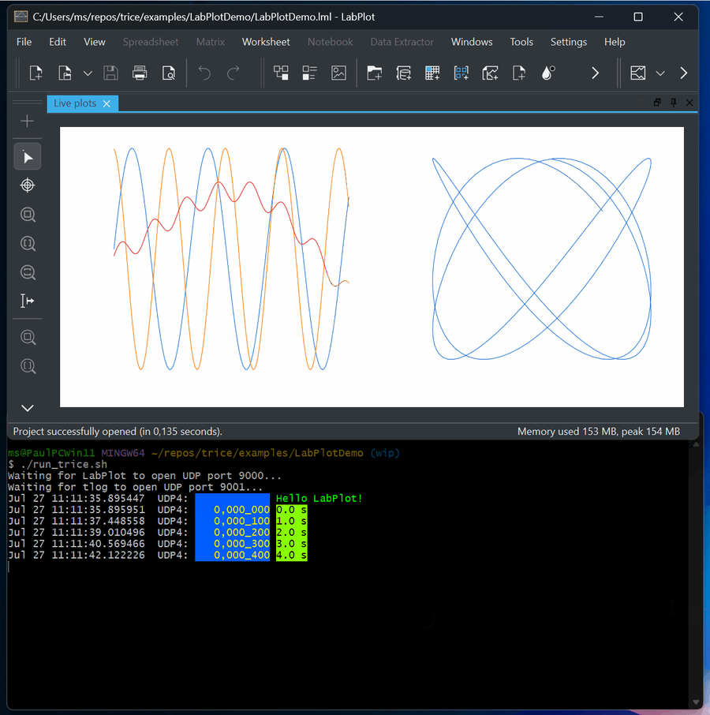

# Trice Command Line Interface & Examples

<details markdown="1">
<summary>Contents</summary>

---

<!-- mdtoc -->

* [1. Common information](#common-information)
* [2. Further examples](#further-examples)
  * [2.1. Automated pre-build insert command example](#automated-pre-build-insert-command-example)
  * [2.2. Some Log examples](#some-log-examples)
  * [2.3. Logging over a display server](#logging-over-a-display-server)
  * [2.4. Logfile output](#logfile-output)
  * [2.5. Binary Logfile](#binary-logfile)
  * [2.6. TCP4 output](#tcp4-output)
  * [2.7. TCP4 input](#tcp4-input)
  * [2.8. UDP4 input](#udp4-input)
  * [2.9. Stimulate target with a user command over UART](#stimulate-target-with-a-user-command-over-uart)
  * [2.10. Explore and modify tags and their colors](#explore-and-modify-tags-and-their-colors)
  * [2.11. Location Information](#location-information)
* [3. Visualization output with -vis](#visualization-output-with--vis)
* [4. Setting up the LabPlot Demo](#setting-up-the-labplot-demo)
  * [4.1. The common live-data format](#the-common-live-data-format)
  * [4.2. ./examples/DemoDataCSV](#examplesdemodatacsv)
  * [4.3. ./examples/DemoDataTrice](#examplesdemodatatrice)
  * [4.4. Quick LabPlot demonstration](#quick-labplot-demonstration)
  * [4.5. Recreate the project in LabPlot](#recreate-the-project-in-labplot)
  * [4.6. Troubleshooting and adaptations](#troubleshooting-and-adaptations)

<!-- numbering=true min=2 max=4 slug=github anchor=true link=true toc=true bullets=auto -->
<!-- /mdtoc -->

---

</details>

The trice tool is very easy to use even it has a plenty of options. Most of them normally not needed.
The trice tool can be started in several modes (sub-commands), each with several mandatory or optional switches. Switches can have a single parameter string or not.

```b
trice sub-command -switch1 -switch2 parameter -switch3 ...
```

Which sub-command switches are usable for each sub-command is shown with `trice help -all`. This gives also information about their default values.

Info for a special sub-command is shown with `trice help -log` for example.

* The command history is usable for example inside the bash, simply enter CTRL-R and start typing `trice...` and you can select from the history.
* The most convenient way is to use trice inside scripts like in [this](../../examples/L432_inst/build.sh) example.

## 1. <a id="common-information"></a>Common information

* `trice h -all` shows all options of the current version.
* `trice ver` prints version information.
* `trice s` shows you all found serial ports for your convenience.
* `trice l -p COM17` could fail if something is wrong. Additional switches are for help tracking the issue:
  * Use log witch `-s[howInputBytes]` to check if any bytes are received at all. 
  * With `-debug` you can see the [T]COBS packages and decoded Trice packages. 

* `trice i` in the root of your project parses all source files for Trice macros, adds automatically ID´s if needed and updates a file named **til.json** containing all ID´s with their format string information. To start simply generate an empty file named **til.json** in your project root. You can add `trice i` to your build process and need no further manual execution.

* `trice ds` starts a display server listening on default ip address *127.0.0.1:61487* or any specified value. This is possible also on a remote device, lets say with ip address 192.168.1.200.
* `trice l -p COM18 -ds` sends the log strings to a display server with default ip address *127.0.0.1:61487* or any specified value, if for example `-ipa 192.168.1.200` the trice logs go to the remote device. You can start several trice log instances, all transmitting to the same display server.

## 2. <a id="further-examples"></a>Further examples

### 2.1. <a id="automated-pre-build-insert-command-example"></a>Automated pre-build insert command example

* Scan directories `../src`, `../lib/src` and `./` to insert the IDs there and extend list file `../../../til.json`

```bash
trice i -v -i ../../../til.json -src ../src -src ../lib/src -src ./
```

This is a typical line you can add to your project as an automatic pre-compile step.

### 2.2. <a id="some-log-examples"></a>Some Log examples

* Log trice messages on COM3 8N1 115200 baud

```bash
trice log -i ./myProject/til.json -p=COM3
```

* Log trice messages on COM3 8N1 9600 baud and use default til.json

```bash
trice l -s COM3 -baud=9600
```

### 2.3. <a id="logging-over-a-display-server"></a>Logging over a display server

* Start displayserver on ip 127.0.0.1 (localhost) and port 61497

```bash
trice ds
```

* Log trice messages on COM3 and display on display server

```bash
trice l -ds -p COM3
```

* Shutdown remote display server on IP 192.168.1.23 port 45678

```bash
trice sd -r 192.168.1.23:45678
```

The IP address and port are free selectable. Using a display server, allows to watch the logs of one or many MCUs on a local or remote machine with the same or different display servers.

A local Trice instance sends Trice messages to a display server only, when a log line is complete (if consisting of several Trices). By using the CLI switches `-prefix` and `-suffix` you can decorate the loglines target specific to distinguish them in the output window(s).

### 2.4. <a id="logfile-output"></a>Logfile output

```bash
trice l -p COM3 -logfile auto
```

This creates a new logfile `2022-05-16_2216-40_trice.log` with the actual timestamp on each Trice start.

```bash
trice l -p COM3 -logfile trice.log
```

This creates a new logfile `trice.log` on first start and appends to it on each next Trice start.

Logfiles are text files one can see with 3rd party tools. Example: `cat trice.log`. They contain also the PC reception timestamps if where enabled.

### 2.5. <a id="binary-logfile"></a>Binary Logfile

```bash
trice l -p COM3 -binaryLogfile auto
```

This creates a new binary logfile `2022-05-16_2216-40_trice.bin` with the actual timestamp on each Trice start.

```bash
trice l -p COM3 -binaryLogfile trice.bin
```

This creates a new binary logfile `trice.bin` on first start and appends to it on each next Trice start.

Binary logfiles store the Trice messages as they come out of the target in binary form. They are much smaller than normal logfiles, but the Trice tool with the matching *til.json* is needed for displaying them and the PC timestamps are the displaying time: `trice l -p FILEBUFFER -args trice.bin`.

Recording happens before decoding, `-pick`, `-ban`, `-logLevel`, and visualization. These host options therefore do not remove received bytes from the binary recording, even with `-logLevel off`. Partial or malformed input is also recorded; a recording write failure is returned as an error. Data already lost or suppressed on the target cannot be recovered from this file.

Replay can use a different selection, for example `trice log -p FILEBUFFER -args trice.bin -pick err -pick wrn`. Keep the matching dictionary and decoding settings (encoding, framing, and encryption) with the recording. An explicit binary filename is appended to across runs; use a new filename when separate captures are needed. Keep binary recording disabled during replay, or write to a different file, never the replay input itself.

Binary logfiles are handy in the field for long data recordings.

When using RTT, the data are exchanged over a file interface. These binary logfiles are stored in the project [./temp] folder and accessible for later view: `trice l -p FILEBUFFER -args ./temp/logfileName.bin`. Of course the host timestamps are the playing time then.

### 2.6. <a id="tcp4-output"></a>TCP4 output

```bash
trice l -p COM3 -tcp 127.0.0.1:23
```

This additionally sends Trice output to a 3rd party TCP listener, for example like Putty:

 


### 2.7. <a id="tcp4-input"></a>TCP4 input

```bash
trice l -p TCP4 -args "192.168.2.3:45678"
```

This expects a TCP4 server at IP address `192.168.2.3` with port number `45678` to read binary Trice data from.

### 2.8. <a id="udp4-input"></a>UDP4 input

The pull request [\#529](https://github.com/rokath/trice/pull/529) introduces key enhancement:

```b
    IPv4 UDP Receiver
    Adds support for receiving data over IPv4 using UDP. This enables integration with systems that broadcast or transmit telemetry, logs, or other messages over the network.
```

-port UDP4 Example

To receive Trice logs over IPv4 UDP, use the -port UDP4 option. By default, it listens on 0.0.0.0:17005, which accepts packets on all network interfaces. You can specify a different address or multicast group via -args.

trice log -p UDP4

### 2.9. <a id="stimulate-target-with-a-user-command-over-uart"></a>Stimulate target with a user command over UART

Sometimes it is handy to stimulate the target during development. For that a 2nd screen is helpful what is possible using the display server option:


### 2.10. <a id="explore-and-modify-tags-and-their-colors"></a>Explore and modify tags and their colors

See chapter [Trice Tags and Color](trice_tags_color_and_weights.md).

### 2.11. <a id="location-information"></a>Location Information

The `add`, `bind`, `insert`, and `clean` commands generate the file selected by `-li|locationInformation`. Each entry stores one canonical source path and its line number:

```json
{
  "1234": {
    "File": "examples/TriceABC/src/main.c",
    "Line": 42
  }
}
```

`File` is relative to `-liRoot` and always uses `/` separators. The default root is the directory containing the selected `li.json`. An explicit relative `-liRoot` is resolved from the current working directory. If a relative path cannot be represented, for example across Windows volumes, Trice stores a normalized absolute path without resolving symbolic links.

For example, when `build/demoLI.json` and `examples/TriceABC/src/main.c` are below the project directory, the default stores `../examples/TriceABC/src/main.c`. To store a project-relative path instead, run:

```bash
trice insert -li build/demoLI.json -liRoot . -src examples/TriceABC
```

During logging, `-liMaxDirs` controls how much of the stored path is shown. Its default `0` shows only the filename. For `examples/TriceABC/src/main.c`, values `1`, `2`, and `3` show `src/main.c`, `TriceABC/src/main.c`, and the complete stored path respectively. Leading `..` components describe the relation to `-liRoot` and are not displayed or counted. `-liFmt` continues to control the surrounding filename and line-number format.

Location information must match the exact firmware version. In field deployments, keeping `li.json` private and showing the numeric ID with `-showID` can be preferable. Use `trice log -li off` to disable location loading and display explicitly, even when a local LI exists.

LI also supplies source ownership evidence during ID processing. Keep the local file between Bind, Clean, and Insert runs even if you log without source locations: identical messages can occur at different sites, and TIL alone does not preserve their source associations. Removing LI can change ID reuse, particularly in partial scans. Passing `-li off` to an ID-processing command disables its LI use and generation too; use the switch only on `log` when you want to retain that evidence.

The repository's active demo location tables are generated locally and ignored by Git; their build and ID-workflow scripts create a missing LI before processing IDs. A custom workflow must initialize a missing LI as well when LI is enabled, because ID processing requires an existing file. Preserve the matching LI as a firmware or capture artifact when later location lookup matters. Keeping LI in version control remains an option for applications that need to preserve source ownership across checkouts.

## 3. <a id="visualization-output-with--vis"></a>Visualization output with `-vis`

`tlog` and `trice log` support the same repeatable `-vis` option for sending selected numeric measurements to external visualization tools. Consumers can, for example, be LabPlot, Serial Studio, PlotJuggler, uPlot, Grafana, or a custom program; these names do not imply a tool-specific protocol. Trice itself does not draw a graph. It transforms one typed Trice message into one user-defined text record and writes that record to a file or UDP destination.

The syntax is:

```text
-vis='<tag>:printf("<go-fmt>",<expression-list>)@<file-path-or-udp-sink>[;log=keep|drop]'
```

For example, this target message keeps its visualization details independent of the host tool:

```c
TRice("imu:ax=%f,ay=%f,az=%f\n", aFloat(ax), aFloat(ay), aFloat(az));
```

It can be written as CSV:

```bash
tlog ... \
  -vis='imu:printf("%d,%0.3f,%0.3f,%0.3f\n",ts32,v0,v1,v2)@imu.csv'
```

or sent as one UDP datagram per record:

```bash
tlog ... \
  -vis='imu:printf("%0.3f,%0.3f,%0.3f\n",v0*0.5,v1*0.5,v2*0.5)@udp://127.0.0.1:7010;log=drop'
```

The selector matches the original Trice format prefix `<tag>:`. `-pick` and `-ban` run first. A message removed by either existing filter is therefore invisible both to normal output and to `-vis`.

The supported fields are:

```text
id                unsigned Trice ID
ts                raw 16- or 32-bit Target-Stamp, with one width latched per rule
ts16              raw 16-bit Target-Stamp
ts32              raw 32-bit Target-Stamp
v0 ... v11        typed positional Trice values
```

The value fields are positional and can be reordered in the expression list. `-vis` does not extract names such as `ax` or `rpm` from the human-readable target format and does not accept those names as identifiers. For example, `printf("%g,%g\n",v2,v0)` deliberately emits the third value before the first. Structured Logging field names are not visualization expression identifiers; use `v0` through `v11` for this interface.

A Target-Stamp is an unscaled number. `-vis` does not assume that it represents time and does not perform unit conversion, wrap extension, or mixed-width reconstruction. Scaling is explicit in an expression, for example `ts32*0.001`. A rule may use `ts16` or `ts32`, but not both. A generic `ts` rule is disabled with a warning if an otherwise eligible message later changes between 16 and 32 bits.

Separate rules make the expected stamp width explicit:

```bash
tlog ... \
  -vis='fast:printf("%d,%g\n",ts16,v0)@fast.csv' \
  -vis='slow:printf("%d,%g\n",ts32,v0)@slow.csv'
```

Expressions support decimal, floating-point, and hexadecimal literals, parentheses, unary minus, and `+`, `-`, `*`, `/`. A direct field retains its signed, unsigned, floating-point, or Boolean type. Arithmetic is evaluated as `float64`. A floating result used with an integer verb must be finite and inside the `int64` range; it is then truncated toward zero.

The `printf` encoder supports:

```text
integer:       %d %b %o %x %X
floating:      %f %e %E %g %G
generic:       %v
Boolean:       %t with a direct Boolean field
literal:       %%
formatting:    literal width and precision, such as %08x or %0.3f
```

`%u`, dynamic `*` width or precision, explicit argument indexes, string conversions, and other Go formatting verbs are not supported. The expression count must equal the number of consuming verbs. The encoder adds no implicit newline; include `\n` in the format when the receiving tool expects one. A one-line JSON record is possible as well:

```bash
tlog ... \
  -vis='imu:printf("{\"stamp\":%d,\"x\":%g,\"y\":%g,\"z\":%g}\n",ts32,v0,v1,v2)@udp://127.0.0.1:7011'
```

A bare path and `file:<path>` both select an append-only file:

```text
@out.csv
@logs/imu.csv
@file:out.csv
```

Missing files are created. Rules using the same normalized file path share one open file. `file://out.csv` is rejected because standard URI parsing treats `out.csv` as a host, not as a relative path. Full file-URI semantics are not part of this implementation.

UDP destinations use:

```text
@udp://127.0.0.1:7010
@udp://localhost:7010
```

The address is resolved and opened before decoding starts. File and UDP writes are synchronous. There is no queue, retry, reconnect, acknowledgement, TCP, WebSocket, or named-pipe support in this first implementation.

`log=keep` is the default and leaves the decoded message in normal output. `log=drop` removes it from normal output only after that rule has encoded and written the visualization record successfully. All overlapping rules are still attempted; one successful `log=drop` rule wins. An ignored record or a failed encoder or sink write does not drop the normal log.

Only fixed-width numeric Trice messages are eligible. The first twelve values are addressable as `v0` through `v11`; additional values do not prevent a rule from using that addressable prefix and remain available to normal logging. `Trice` string, buffer, function-display, character, typeX0, `CHAR`, and `DUMP` inputs are not supported. Named values, specialized JSON or binary encoders, TCP, WebSocket, named pipes, and process pipes are deferred behind the same selector/encoder/sink separation. One eligible Trice must also form one complete log line by itself. Partial, multi-line, and multi-Trice lines continue through normal logging but are ignored by `-vis`; verbose mode reports every such occurrence.

At startup, each rule checks all matching historical `til.json` entries. Incompatible old entries are excluded independently, so one stale ID does not block another compatible ID. A rule with no compatible entry is disabled with a prominent warning. Rules are also disabled, never silently, after a generic Target-Stamp width conflict, an unsafe runtime expression conversion, or a sink failure. Normal logging continues.

## 4. <a id="setting-up-the-labplot-demo"></a>Setting up the LabPlot Demo

[](../ref/LabPlotDemo.gif)

Select the preview to open the full animation.

This section uses [LabPlot](https://labplot.org/), a cross-platform interactive
plotting application. The finished, ready-to-run example is in
`./examples/LabPlotDemo/`; the guided learning path is in
`./examples/LabPlotUser/`. The project uses a UDP socket so that it can
display an endless stream without repeatedly importing files.

### 4.1. <a id="the-common-live-data-format"></a>The common live-data format

Both producers describe the same three signals: `x`, `y`, and `z`. LabPlot
receives normalized numeric CSV records with this column layout:

```text
time_s,x,y,z
```

The finished project predeclares the four numeric columns and performs one
initial read while loading. This prepares LabPlot's UDP socket before the
first live record arrives. The UDP stream therefore needs no header row.

The LabPlot demo rate is 50 samples per second. The project retains 500 rows.
The time plot is configured for the last 500 values, so its horizontal
resolution stays constant and it always displays approximately the most
recent ten seconds. The Lissajous plot uses only the last 150 values, which
creates a moving three-second trace instead of an increasingly dense full
history. A slow phase modulation of `y` makes the figure change continuously.
The CSV producer sends this format directly. The Trice producer sends binary
Trice records to `tlog`; `tlog` decodes them and sends the same CSV format
onward. This separation means that one LabPlot project works for both
examples.

### 4.2. <a id="examplesdemodatacsv"></a>./examples/DemoData_CSV

The [CSV producer](../../examples/DemoData_CSV/src/main.c) is a small C11 program
for Windows, macOS, and Linux. Each newline-terminated record contains
`time_s,x,y,z`, all represented as `double`; time is in seconds. It writes to
standard output by default, to a fresh file with `--output FILE`, or to UDP
with one record per datagram. Use `--help` for all options.

Both data producers require a C compiler and CMake 3.16 or newer. Run their
`build.sh` in Git Bash on Windows or a POSIX shell on macOS/Linux; restore its
executable permission with `chmod +x build.sh` if necessary. Executables are
installed in each project's `bin/`, with intermediate files in `build/`.
For the CSV producer, the equivalent explicit CMake commands are:

```sh
cd examples/DemoData_CSV
cmake -S . -B build
cmake --build build --config Release
cmake --install build --config Release --prefix .
```

These commands also work in PowerShell. Its executable invocation is
`.\bin\DemoData_CSV.exe`; in Git Bash use `./bin/DemoData_CSV`.

From the CSV project directory, try:

```sh
./build.sh
./bin/DemoData_CSV
./bin/DemoData_CSV --rate 50 --samples 500 --no-delay --header --output DemoData_CSV.csv
./bin/DemoData_CSV --udp 127.0.0.1 9000
```

Run these alternatives separately. The second command runs continuously at
50 Hz; interrupt it with `Ctrl-C`. The third writes ten seconds of data
without real-time waiting. On Windows PowerShell the UDP command is
`.\bin\DemoData_CSV.exe --udp 127.0.0.1 9000`.

For Serial Studio, choose **Quick Plot (Comma Separated Values)**, then
**Network Socket > UDP**, set local port `9000`, connect, and start the UDP
producer. Quick Plot treats all four columns as values. A custom project can
instead name the columns and use the first column as a timestamp axis. Its
input must be `seconds,x,y,z`; do not send `--header` on the live stream.
There is currently no versioned `DemoData.ssproj` in this repository.

Both producers use the following signal model for time `t` in seconds:

```text
phase = (pi/3) * sin(2*pi*0.04*t)
x = sin(2*pi*0.70*t)
y = sin(2*pi*0.91*t + pi/2 + phase)
z = 0.6*sin(2*pi*0.13*t) + 0.2*x*y + pulse
```

The pulse has height `0.8` during the final 250 ms of every eight-second
interval. The slow phase modulation keeps the Lissajous plot moving. The
Trice producer calculates the signals as doubles and transmits float32 values.

After running `build.sh` inside `./examples/DemoData_CSV/`, the executable is
installed in the local `bin/` folder. You can run it there:

```txt
th@Thomass-MacBook-Pro-7 bin % ./DemoData_CSV --header -o log.csv
^C
th@Thomass-MacBook-Pro-7 bin % head log.csv                           
time_s,x,y,z
0.000000,0.000000,1.000000,0.000000
0.020000,0.087851,0.992854,0.027246
0.040000,0.175023,0.971519,0.053608
0.060000,0.260842,0.936300,0.078239
0.080000,0.344643,0.887701,0.100367
0.100000,0.425779,0.826415,0.119328
0.120000,0.503623,0.753319,0.134594
0.140000,0.577573,0.669459,0.145795
0.160000,0.647056,0.576032,0.152736
th@Thomass-MacBook-Pro-7 bin % 
```

### 4.3. <a id="examplesdemodatatrice"></a>./examples/DemoData_Trice

The [Trice producer](../../examples/DemoData_Trice/src/main.c) transports the
same signals as binary Trice records. Keep it inside the repository: its
CMake project uses the unchanged target library from `../../src`.
Its [build script](../../examples/DemoData_Trice/build.sh) prepares Bind and the
repository-root `demoTIL.json` before building; it requires the Trice host
tool in addition to the CSV producer's prerequisites. Use this script rather
than plain CMake commands that omit Bind preparation. There is no private
`til.json` or fixed `iD(1000)` for this ID-free producer.

The 32-bit target stamp uses units of **10 ms**: at 50 Hz the stamps are
`0, 2, 4, ...`. Convert with `seconds = ts/100.0` or
`milliseconds = ts*10`; `ts*100` does not give seconds.

From `examples/DemoData_Trice`:

```sh
./build.sh
./bin/DemoData_Trice --samples 500 --no-delay
trice log -p FILEBUFFER -args DemoData_Trice.bin -pf TCOBS -til ../../demoTIL.json -li off
```

Without an output option, the producer recreates `DemoData_Trice.bin` in the
current directory (`wb` truncates its previous contents). `--output FILE`
selects another fresh file, `--stdout` writes binary data to standard output,
and `--udp HOST PORT` sends one complete TCOBS-framed record per datagram.
Without `--samples` it runs until interrupted. `--samples 500` counts signal
samples, not all log records: startup and periodic diagnostic logs are extra.
Use `--help` for all options. On Windows PowerShell, run
`.\bin\DemoData_Trice.exe` with the same arguments.

After running `build.sh` inside `./examples/DemoData_Trice/`, the executable is
installed in the local `bin/` folder. You can run it there:

- Create binary log file:

```txt
th@Thomass-MacBook-Pro-7 bin % ./DemoData_Trice -o log.bin
Writing log.bin
^C
```

- Show logs in binary log file: 

```txt
th@Thomass-MacBook-Pro-7 bin % tlog -p FILEBUFFER -args log.bin -til ../../../demoTIL.json -ulabel vis_demo | head
Jul 25 15:38:55.411676  FILEBUFFER:    0,000_000 0.000000,1.000000,0.000000
Jul 25 15:38:55.411691  FILEBUFFER:    0,000_002 0.087851,0.992854,0.027246
Jul 25 15:38:55.411705  FILEBUFFER:    0,000_004 0.175023,0.971519,0.053608
Jul 25 15:38:55.411714  FILEBUFFER:    0,000_006 0.260842,0.936300,0.078239
Jul 25 15:38:55.411725  FILEBUFFER:    0,000_008 0.344643,0.887701,0.100367
Jul 25 15:38:55.411737  FILEBUFFER:    0,000_010 0.425779,0.826415,0.119328
Jul 25 15:38:55.411752  FILEBUFFER:    0,000_012 0.503623,0.753319,0.134594
Jul 25 15:38:55.411765  FILEBUFFER:    0,000_014 0.577573,0.669459,0.145795
Jul 25 15:38:55.411776  FILEBUFFER:    0,000_016 0.647056,0.576032,0.152736
th@Thomass-MacBook-Pro-7 bin %
```

- Get CSV log file:

```txt
th@Thomass-MacBook-Pro-7 bin % tlog -p FILEBUFFER -args log.bin -til ../../../demoTIL.json -ulabel vis_demo -vis='vis_demo:printf("%0.3f,%0.3f,%0.3f,%0.3f\n",ts/100.0,v0,v1,v2)@log.csv;header="time_s,X,Y,Z\n";log=drop'
th@Thomass-MacBook-Pro-7 bin % head log.csv
time_s,X,Y,Z
0.000,0.000,1.000,0.000
0.020,0.088,0.993,0.027
0.040,0.175,0.972,0.054
0.060,0.261,0.936,0.078
0.080,0.345,0.888,0.100
0.100,0.426,0.826,0.119
0.120,0.504,0.753,0.135
0.140,0.578,0.669,0.146
0.160,0.647,0.576,0.153
th@Thomass-MacBook-Pro-7 bin % 
```

The preceding file visualization rule recreates `log.csv` when `tlog` starts.
Its header is written once per sink; the quoted Go string supports `\n`.
Keep a single backslash in the shell's single-quoted rule. `log=drop` suppresses
the successfully visualized records, while unrelated diagnostic logs remain.

For a live Serial Studio or other CSV viewer listening on UDP `9000`, start
the decoder from the repository root before starting the binary producer:

```sh
trice log -p UDP4 -args 127.0.0.1:9001 -pf TCOBS -til demoTIL.json -ulabel vis_demo \
  -vis='vis_demo:printf("%0.6f,%0.6f,%0.6f,%0.6f\n",ts/100.0,v0,v1,v2)@udp://127.0.0.1:9000;log=drop'
```

In another terminal, also from the repository root:

```sh
examples/DemoData_Trice/bin/DemoData_Trice --udp 127.0.0.1 9001
```

On Windows the executable has an `.exe` suffix. The producer sends **binary
Trice** to `9001`, not CSV; connecting it directly to the viewer on `9000`
cannot work. The decoder converts its records to `seconds,x,y,z`. The LabPlot
launchers below automate this pipeline and its receiver-readiness checks.

### 4.4. <a id="quick-labplot-demonstration"></a>Quick LabPlot demonstration

Install LabPlot 2.12 or newer. From the repository root, run one of these
commands in a POSIX shell:

```sh
./examples/LabPlotDemo/run_csv.sh
./examples/LabPlotDemo/run_trice.sh
```

The script opens `LabPlotDemo.lml` and starts the selected producer. The first
script sends CSV directly to UDP port `9000`. The second uses UDP port `9001`
for binary Trice input and runs `tlog` as the decoder/forwarder to port `9000`.
The script first waits until LabPlot has opened port `9000`, then starts
`tlog` and waits until its input port `9001` is ready. Only then does it start
the Trice producer. The project opens one worksheet containing two plots side
by side:

* `Time series`: `x`, `y`, and `z` versus `time_s`, always showing the last
  500 values (ten seconds).
* `Lissajous`: `y` versus `x`, showing the last 150 values (three seconds) on
  fixed axes. The producer's slow phase drift keeps the figure in motion.

Press `Ctrl-C` in the shell to stop the producer and decoder. If LabPlot is
not found automatically, set `LABPLOT` to its executable. On Windows, Git
Bash is a suitable shell; for example, use
`LABPLOT=/c/Program\ Files/LabPlot/bin/labplot.exe`.

### 4.5. <a id="recreate-the-project-in-labplot"></a>Recreate the project in LabPlot

The following steps explain the project without requiring prior LabPlot
knowledge. Start `run_csv.sh` first and leave it running.

1. Create a new LabPlot project and choose **Add New > Live Data Source**.
2. Select **Network UDP Socket**, enter host `127.0.0.1` and port `9000`.
3. Select the ASCII filter, comma as separator, and disable header detection.
   Set all four data types to `Double` and enter the names `time_s`, `x`, `y`,
   and `z`.
4. Select **Update on new data** and retain `500` values. This is the moving
   ten-second window at the demo's 50 Hz rate.
5. Add a worksheet with a Cartesian plot. Add three XY curves. For every
   curve choose `time_s` as the X column and choose `x`, `y`, or `z` as the Y
   column. Enable the legend, label the axes `time [s]` and `value`, and enable
   automatic range scaling. In the plot's range
   settings select **Last values** and enter `500`; otherwise the time axis
   keeps growing and the curves become increasingly compressed.
6. Add a second Cartesian plot to the same worksheet and select a horizontal
   two-column worksheet layout. Add one XY curve with `x` as its X column and
   `y` as its Y column. Select **Last values** and enter `150`. Fixed X and Y
   ranges from `-1.1` to `1.1` keep the scale stable while the three-second
   trace and the signal's slow phase drift make the movement visible.
7. Save the project as `LabPlotUser.lml`.

The finished [LabPlotDemo.lml](../../examples/LabPlotDemo/LabPlotDemo.lml) contains
these settings and no machine-specific paths. Open it manually if LabPlot is
already running. The [LabPlotUser directory](../../examples/LabPlotUser/) is the
place for your recreated `LabPlotUser.lml`; this section is its complete
rebuild guide. Both producers end at the same numeric UDP stream, for example
`0.000000,0.000000,1.000000,0.000000`.

Stop the producer and start the other launcher without changing the LabPlot
project. Keep only one producer sending to UDP `9000` and keep the live source
connected. The Trice launcher first waits for LabPlot on `9000`, then for its
decoder on `9001`. The supplied project predeclares all four numeric columns
and triggers an initial read when loaded so that LabPlot prepares its socket.

### 4.6. <a id="troubleshooting-and-adaptations"></a>Troubleshooting and adaptations

* `labplot` must be discoverable or selected with `LABPLOT`. macOS also checks
  its standard application bundle. Windows searches `ProgramFiles`,
  `ProgramW6432`, and `LOCALAPPDATA` for `labplot.exe` or `labplot2.exe`;
  an explicit `LABPLOT` override takes precedence. `TLOG` can select a decoder
  outside `PATH`. Producer executables stay in each demo's `bin/`, with CMake
  intermediates in `build/`.
* If the plots remain empty, verify that the producer is running and that no
  other process owns UDP port `9000`.
* If `tlog` reports that a `-vis` rule was disabled because writing to port
  `9000` was refused, LabPlot was not listening when the decoder started.
  Restart `run_trice.sh`; its readiness check normally prevents this race.
  Once a visualization rule is disabled, normal logging intentionally
  resumes, and its `log=drop` option is no longer applied.
* For the Trice path, verify that `tlog` is on `PATH` and that
  `demoTIL.json` is present at the repository root. Set `TLOG` or
  `TRICE_TIL` when using non-default locations.
* Keep the complete `-vis` expression inside one pair of quotes. The semicolon
  separates `header` and `log` options inside that expression; it must not be
  interpreted by the shell.
* To show another history length, change the retained-value count to
  `50 * seconds`. For example, `1000` values show approximately 20 seconds.
* The Trice path still uses UDP port `9001` internally between the demo and
  `tlog`. If that port is busy, stop the other receiver or change it in
  `run_trice.sh` and its `-args` value together.

<p align="right">(<a href="#trice-command-line-interface--examples">back to top</a>)</p>

