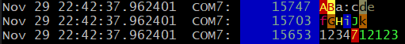
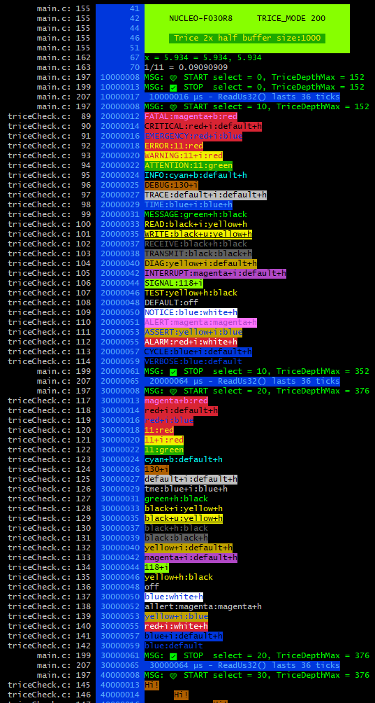
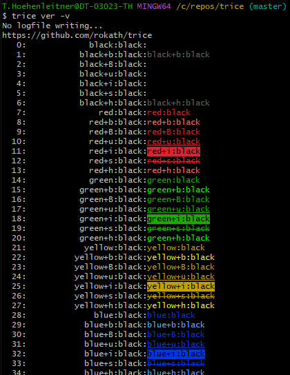

# Trice Tags, Color, and Weights

<details markdown="1">
<summary>Contents</summary>

<!-- mdtoc -->

* [1. How to use tags](#how-to-use-tags)
* [2. Tag weights](#tag-weights)
* [3. Selecting tags and priority](#selecting-tags-and-priority)
* [4. Decoder diagnostics](#decoder-diagnostics)
* [5. User-defined tags, weights, and colors](#user-defined-tags-weights-and-colors)
* [6. Untagged application events](#untagged-application-events)
* [7. Event statistics](#event-statistics)
* [8. Output options](#output-options)
* [9. Check color alternatives](#check-color-alternatives)
* [10. Color issues under Windows](#color-issues-under-windows)

<!-- numbering=true min=2 max=4 slug=github anchor=true link=true toc=true bullets=auto -->
<!-- /mdtoc -->

</details>

Tags label Trice messages on the host. They can control presentation, selection, ID assignment, and weight-based filtering without adding target runtime data because the tag is part of the format string stored in `til.json`.

[Context Enrichment](trice_context_enrichment.md) also uses tags as selectors: a matching `-ce` rule adds values to selected log messages.

## 1. <a id="how-to-use-tags"></a>How to use tags

Add a tag and a colon in front of a Trice format string:

```c
trice("wrn:Motor temperature is %d C\n", temperature);
```

The Trice tool recognizes `wrn`, applies the Warning color, and removes the prefix when it is completely lower case. A mixed-case or uppercase prefix remains visible:

```text
wrn:fox  -> fox
Wrn:fox  -> Wrn:fox
```

The colors, aliases, and weights are defined in [lineTransformerANSI.go](../../internal/emitter/lineTransformerANSI.go). The tag itself does not require a target-side enable switch. Use `-pick` or `-ban` to select complete tag groups during host logging. Tag-specific ID ranges can additionally assign and route target IDs.

Built-in application tag names and aliases are recognized independently of uppercase and lowercase spelling. For example, `rx`, `RX`, `rX`, and `ReCeIvE` all identify RECEIVE, even if that exact spelling is not listed. They share a weight, color, event-statistics counter, and derived structured level. This also applies to built-in names supplied to `-pick`, `-ban`, `-logLevel`/`-loglevel`, `-ulabel`, and `-IDRange`: `-IDRange rX:10,19` assigns that range to every RECEIVE spelling in the source. A second range for another spelling of the same group is rejected.

Recognition does not rewrite message text. With `-color none` or `default`, a recognized prefix is removed only if it contains no uppercase letters: `rx:payload` displays `payload`, while `rX:payload` and `RX:payload` keep their written prefixes. With `-color off`, all written prefixes remain. User-defined tags follow a separate, exact-spelling rule described [below](#user-defined-tags-weights-and-colors).

Built-in aliases contain at least two characters. For example, `wr` selects Write, while `wrn`, `WARN`, and `WARNING` select Warning. The former single-letter aliases such as `e`, `i`, `m`, and `w` are not built in for v2. Their prefixes remain visible and their events belong to `untagged` unless those literal names are explicitly registered with `-ulabel`. Use descriptive built-in names such as `err`, `inf`, `msg`, and `wr` for automatic classification and for `-pick`, `-ban`, `-logLevel`, or `-IDRange`.

It is possible to concatenate individually tagged fragments to produce output such as:



The source for this example is in [`triceCheck.c`](../../_test/testdata/triceCheck.c). For each such color change a separate Trice message is needed, because tags can only occur at the beginning of a format string.

## 2. <a id="tag-weights"></a>Tag weights

Each tag group has one integer weight in the range `0..999`. A larger value means greater importance. The weight belongs to the group and therefore applies to every alias in that group. It is independent of the group's position in the tag table and independent of its color.

The following table lists the default weights defined in [lineTransformerANSI.go](../../internal/emitter/lineTransformerANSI.go). Re-assignment for logging using the CLI is possible: `-ulabel warn:650`.

| Weight | Level boundary | Other groups with this default weight |
| ---: | --- | --- |
| 900 | FATAL | EMERGENCY |
| 800 | CRITICAL | — |
| 700 | ERROR | ALARM, ASSERT |
| 600 | WARNING | ALERT, ATTENTION |
| 500 | INFO | CONFIG, DEFAULT, MESSAGE, NOTICE, `untagged` |
| 300 | DEBUG | DIAG, READ, RECEIVE, TEST, TRANSMIT, WRITE |
| 100 | TRACE | DELTATIME, INTERRUPT, MICROSECOND, MILLISECOND, SECOND, SIGNAL, TIME |
| 0 | VERBOSE | — |

Only the eight names in the level-boundary column define levels. Other tags are categories: they receive a [structured level derived from their effective weight](structured_logging.md#json-and-kv-contract), but do not introduce additional boundaries. For example, RECEIVE has default weight 300 and exported level DEBUG; `-ulabel rx:750` changes its exported level to ERROR while keeping its tag RECEIVE. CLI overrides never move the level boundaries.

`CYCLE_ERROR` is a Trice tool diagnostic rather than an application tag. Its stored value does not define application-message priority.

## 3. <a id="selecting-tags-and-priority"></a>Selecting tags and priority

Use the repeatable `-pick` option to display selected tag groups or exact weights, or `-ban` to suppress them. The two options are mutually exclusive. Supply exactly one selector per option and repeat the option for additional selectors:

```sh
trice log -pick err -pick wrn -pick notice
trice log -ban dbg -ban trace -ban verbose
```

Aliases select the complete group. `-pick all` selects every message and `-pick off` selects none; `-ban all` suppresses every message and `-ban off` suppresses none. Empty selectors and unknown names are command-line errors. Colon-separated lists such as `-pick err:wrn` are rejected with a hint to repeat the option. Weight ranges such as `-ban 200:400` are not supported.

An integer from `0` through `999` selects exactly that effective weight, independently of the tag name or derived level:

```sh
trice log -ulabel sensor:200 -ban 200
trice log -ulabel sensor:200 -pick 200
trice log -pick err -pick 200 -pick 450
```

The first excludes all events at weight 200 but keeps weights 199 and 201. The second displays only weight 200. The third displays the Error group plus any groups at weights 200 or 450: repeated selectors form a union. A named selector selects only its group, not other groups sharing that weight. Numeric selection uses the current weights after all `-ulabel` overrides, including the weight of `untagged`. Weights 199, 200 and 201 all derive level TRACE, but `-pick 200` still selects only 200. A valid numeric selector is accepted even if no registered group currently has that weight.

Typed application events without a recognized tag use `untagged` for numeric selection. Byte-oriented CHAR/DUMP fragments have no event weight; a numeric selector matches their recognized tag prefixes only. Raw text such as `200:payload` is not a weight annotation.

Use `-logLevel` or its equivalent spelling `-loglevel` with `all`, `off`, a registered tag or alias, or a numeric weight from `0` through `999`. An application event passes when its tag group's weight is greater than or equal to the threshold. A lower threshold therefore displays more messages:

```sh
trice log -logLevel info
trice log -logLevel 500
trice log -loglevel 500
```

These commands use the same threshold with the default INFO weight of 500. Both spellings share one setting; if repeated or mixed, the last assignment wins. Unknown level names and numeric values outside `0..999` are rejected before the input channel is opened. Application messages without a recognized format-string tag use the built-in `untagged` group with default weight 500. `-logLevel off` suppresses all application events.

With the default weights, `-logLevel info` includes Message and `untagged` events because they also have weight 500. It excludes Debug and technical categories such as Receive (300), Trace (100), and Verbose (0). Without either spelling of the option, the threshold defaults to `all`.

Use a threshold when the requirement is “Warning and everything more important”, including new user tags assigned sufficiently high weights. For example, `trice log -ulabel motor:780 -logLevel wrn` includes `motor` alongside Warning, Attention, Alert, Error, and higher-weight groups. Use `-pick` for a specific set of groups such as Receive and Transmit, regardless of their weights. Combining both expresses a selected subsystem or category set with a minimum priority.

Filtering uses the exact effective weight, not the derived level's lower boundary. A tag with weight 650 passes `-loglevel 650` and fails `-loglevel 651`, although its structured level is WARNING in both cases. A named threshold also uses the tag's effective weight: `-ulabel INFO:750 -logLevel INFO` selects weight 750 and above; it does not change the fixed INFO level boundary of 500.

These are host-side filters. They do not avoid target argument evaluation or reduce data already transmitted by the target. Target ID routing is configured separately as described in [ID Routing](trice_id_management.md#id-routing); received raw bytes can still be kept in a [binary logfile](trice_command_line_interface_examples.md#binary-logfile).

For a short capture to experiment with, run the [PC feature tour](example_projects_without_and_with_trice_instrumentation.md#pc-feature-tour) and compare `./show_json.sh`, `./show_json.sh -pick info`, and `./show_json.sh -logLevel wrn`. The [G0B1 feature tour](example_projects_without_and_with_trice_instrumentation.md#g0b1-feature-tour) applies the same output choices to a board capture.

All `-ulabel` values are applied before `-pick`, `-ban`, and `-logLevel` are resolved. Option order therefore does not matter:

```sh
trice log -pick motor -ulabel motor:650
trice log -ulabel motor:650 -pick motor
```

`-pick` or `-ban` and `-logLevel` jointly decide whether each application event is displayed. An accepted event keeps its timestamps, source location, ID, prefix, suffix, and all lines of its text; a rejected event leaves none of these behind. For example, `-pick err -pick wrn -logLevel err` shows only Error events. A line assembled from several Trice calls contains only the accepted calls, including their accepted newline characters. The same decision also applies to visualization routing. Byte-oriented CHAR/DUMP chunks have no typed event boundary and retain their fragment-based selection behavior.

Each Trice call is one event. Accepted fragments are concatenated until an accepted newline arrives; a rejected newline does not finish the visible line. For example, the three calls `msg:A`, `dbg:B\n`, `msg:C\n` produce `AC\n` with either `-pick msg` or `-logLevel msg` using the default weights. A multi-line event is accepted or rejected as a whole, preserving its continuation indentation. At the end of buffered input, a remaining visible fragment is flushed with a newline.

Metadata columns belong to the first accepted event of each visible line. Target timestamp differences use the previous visible line's first accepted event; rejected events and later fragments on the same line do not update that reference. `-addNL` appends a newline to every event, including one already ending in a newline; the latter produces an additional indented blank line. Without `-addNL`, an empty event produces no visible output, while an accepted newline-only event produces a blank line.

## 4. <a id="decoder-diagnostics"></a>Decoder diagnostics

Decoder and transport diagnostics are tool output rather than application messages. Examples include an unknown Trice ID, an invalid COBS/TCOBS frame, an unsupported or truncated packet, and a cycle-counter mismatch. These diagnostics remain visible with restrictive `-pick`, `-ban`, and `-logLevel off` settings. They receive no application metadata, do not enter visualization routing, and are not assigned an application tag.

The translator keeps the diagnostic writer separate from the application line composer. The command currently directs both to its normal local output, while remote display receives application lines only. A machine-readable application sink must keep the separate diagnostic writer on a human-readable tool channel instead of inserting diagnostic text into records. Recoverable decoder diagnostics do not stop logging; writer and input errors retain their existing error handling. Binary recording occurs before decoding and is unaffected.

## 5. <a id="user-defined-tags-weights-and-colors"></a>User-defined tags, weights, and colors

Use the repeatable `-ulabel name`, `-ulabel name:weight`, or `-ulabel name:color` option to register a new tag or change a known group's weight or color for one command:

```sh
trice log -ulabel motor -ulabel sensor:150
trice insert -ulabel motor:250
trice bind -ulabel motor:250
trice log -ulabel motor:red:blue
trice log -ulabel msg:300 -ulabel msg:red:blue
```

A new tag without an explicit weight receives the final INFO weight after all `-ulabel` options have been processed. An explicit weight must be between `0` and `999`, inclusive. The color must be exactly one of the tokens printed by `trice generate -colors`, such as `red:blue`. An unknown color is rejected with a hint to that command.

An existing name without either property leaves its group unchanged. An existing name with a weight changes the complete group, including every alias. The last explicit assignment wins:

```sh
-ulabel msg:150 -ulabel MSG:600 -ulabel msg
```

This results in weight `600` for the complete Message group. It does not create additional groups for `msg` or `MSG`.

Weight and color are independent. `-ulabel msg:300 -ulabel msg:"yellow+h:green"` gives every built-in Message alias (`msg`, `message`, `MSG`, and `MESSAGE`) weight `300` and the same color. Repeating either property changes only that property; the last value for each property wins. Free user labels are literal: `-ulabel new:300 -ulabel NEW:400` creates two distinct labels with no user-defined alias relationship. A one-letter user tag is allowed: `-ulabel x:650` registers the literal tag `x` with weight 650; it does not also register `X`.

The distinction also applies to event classification and CLI selection. With `-ulabel new:300 -ulabel NEW:650`, `new:payload` has tag `new` and level DEBUG, while `NEW:payload` has tag `NEW` and level WARNING. `-pick new` selects only the first label. An unregistered spelling such as `NeW:payload` belongs to `untagged` and keeps its prefix; using `NeW` as a pick, ban, or level selector is an error. In contrast, `-ulabel rX:750` changes the existing RECEIVE group, so `rx`, `RX`, and `rX` all have weight 750 and level ERROR; it creates no additional user tag.

`OK` is not a built-in MESSAGE alias. `OK:ready` remains visible and belongs to `untagged` unless explicitly registered, for example with `-ulabel OK:650`. That registers the literal user tag `OK`; it does not also register `ok` or `Ok`.

Each option accepts exactly one name. The old colon-separated name-list form is invalid. Empty names or values, unknown colors, weights outside `0..999`, purely numeric names, `all`, and `off` are rejected before the command opens or changes its input and output files. A color token itself contains a colon between foreground and background.

For `insert` and `bind`, only the registered name participates in tag and `-IDRange` handling. Weight and color change no target data and are not stored in the source or `til.json`.

Command-specific user tags, weight overrides, and color overrides are discarded before a later command in the same process starts.

## 6. <a id="untagged-application-events"></a>Untagged application events

The host assigns the built-in `untagged` group once to an application event whose stored format string has no recognized tag. This also applies to an empty prefix, an unknown prefix caused by a typo, or ordinary text containing a colon. For ID-based messages, classification uses the format string from the Trice ID lookup table rather than text supplied as a runtime value.

| Stored format string | Visible text with `-color off` |
| --- | --- |
| `Hello` | `Hello` |
| `untagged:Hello` | `untagged:Hello` |
| `mgs:blah` | `mgs:blah` |
| `msg:Hello` | `msg:Hello` |

The host never adds `untagged:` to visible application text. It appears only if the application supplied those characters. For example, `trice("Hello")` displays `Hello` with every palette, while an unknown prefix such as `mgs:blah` remains visible so a typo can be spotted. An explicitly written `untagged:` follows the usual presentation rules for lowercase tags: `-color off` keeps it, while `-color none` and `default` remove the tag from the visible text.

`-pick untagged`, `-ban untagged`, `-logLevel`, and statistics handle this group like other application tags. Its weight is independent of INFO and can be changed for one command with `-ulabel untagged:150`. An optional color such as `-ulabel untagged:red:default` still styles text output with `-color default`, without printing the group name. `-color none` and `-color off` leave it uncolored.

Decoder and transport diagnostics are not untagged application events. Byte-oriented CHAR and DUMP decoder chunks also receive no synthetic event tag because they do not identify individual application events. Classification changes neither source format strings, lookup-table entries, IDs, nor recorded raw bytes.

## 7. <a id="event-statistics"></a>Event statistics

`-tagStat` counts successfully decoded application events by tag group, including `untagged`; `-triceStat` counts successfully decoded ID-based Trice events by ID. `-stat` prints both reports. These totals are recorded before `-pick`, `-ban`, `-logLevel`, and visualization routing, so they include events hidden from the text display. One call counts once even if it spans several output lines; several calls on one line count separately. Palette changes, metadata columns, and repeated report printing do not change the totals. Decoder diagnostics and malformed records are excluded. Formatted ID-less `typeX0` records contribute to tag statistics but have no Trice ID to count. Byte-oriented CHAR/DUMP chunks have no event boundary and do not contribute to these event totals.

## 8. <a id="output-options"></a>Output options



With `-color default`, recognized lower-case tag prefixes are removed and their configured colors are applied. With `-color none`, lower-case prefixes are removed without adding colors. With `-color off`, prefixes remain unchanged and no colors are added.

## 9. <a id="check-color-alternatives"></a>Check color alternatives

There are over 1000 foreground, background, and style combinations:



Choose a built-in palette with `trice log -color dark`, `-color light`, or `-color contrast`. `dark` is the default and uses bright foregrounds for dark terminals; `light` uses darker foregrounds for light terminals. `contrast` adds explicit backgrounds and emphasis to distinguish tag groups. `default` and `color` are aliases for `dark`; `none` and `off` retain their prefix-handling behavior described above.

Warm colors identify warnings and errors, while informational messages use cool colors or green. Related I/O tags use related hues with different emphasis. The time-unit tags intentionally share one style. Actual ANSI hues depend on the terminal's color settings; the palette does not change the terminal background.

Run `trice generate -colors` to display the supported color strings and a preview of all three tag palettes. Use `-ulabel name:color` for a per-command override; it takes precedence over the chosen palette. The assignments are kept together in [lineTransformerANSI.go](../../internal/emitter/lineTransformerANSI.go).

## 10. <a id="color-issues-under-windows"></a>Color issues under Windows

If a Windows console displays ANSI escape sequences instead of colors, use a terminal with ANSI color support, such as Windows Terminal, Git Bash, or [Alacritty](../../third_party/alacritty/ReadMe.md). Additional background is available in [Windows console with ANSI colors handling](https://superuser.com/questions/413073/windows-console-with-ansi-colors-handling/1050078#1050078).

<p align="right">(<a href="#trice-tags-color-and-weights">back to top</a>)</p>

