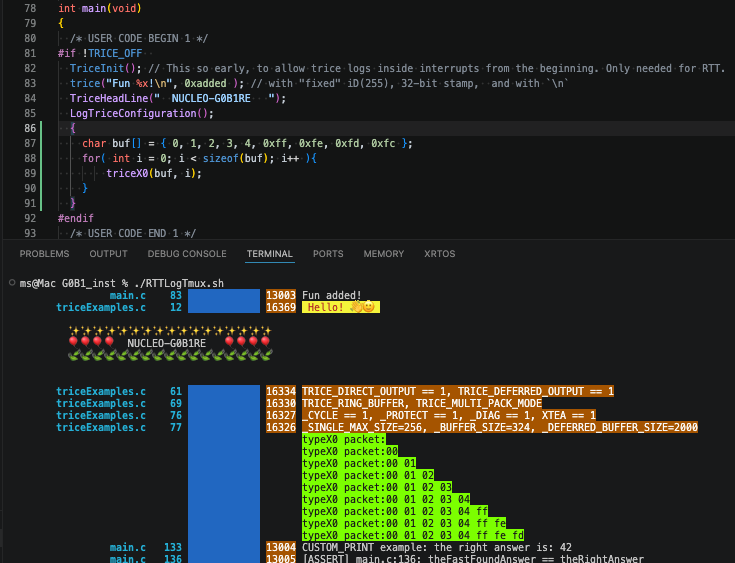

# typeX0 User Packets

<details markdown="1">
<summary>Contents</summary>

<!-- mdtoc -->

* [1. Packet Classification](#packet-classification)
* [2. The typeX0 Counted Format](#the-typex0-counted-format)
* [3. CLI Option `-typeX0`](#cli-option--typex0)
* [4. typeX0 Target Code](#typex0-target-code)
  * [4.1. Target-side counted helper](#target-side-counted-helper)
  * [4.2. typeX0 Build Switches](#typex0-build-switches)
  * [4.3. `typeX0` Usage in `./examples/G0B1_inst`](#typex0-usage-in-examplesg0b1_inst)
* [5. Go implementation layout](#go-implementation-layout)
* [6. Tests](#tests)
* [7. Initial scope](#initial-scope)

<!-- numbering=true min=2 max=4 slug=github anchor=true link=true toc=true bullets=auto -->
<!-- /mdtoc -->

</details>

Trice already has buffer macros for transferring runtime data buffers. `triceN` transfers a byte buffer as a counted string, and `trice8B`, `trice16B`, `trice32B`, `trice64B` and `triceB` transfer buffers as sequences of equally sized values formatted on the host side. These macros are the preferred choice when the data belongs to a normal Trice message and should use the usual Trice ID, `til.json` entry and format string handling.

`typeX0` is an additional, more decoupled way to move user data through the same Trice transport path. It uses selector bits `00` in the first 16-bit word, interpreted in the configured Trice byte order (default little endian), and therefore carries no 14-bit Trice ID. The host-side meaning is selected by the Trice tool option `-typeX0=...`. This makes it useful for user payloads that should share the same UART/RTT/file/framing interface as Trice messages, but should not require an ID, a `til.json` entry or a fixed Trice format string.

Important: The `typeX0` packages do not influence the cycle counter and do not carry a cycle counter value (or you implement your own). They also do not carry a Trice ID, target timestamp or location information normally. If log metadata columns such as `-showID`, `-li` or target timestamps are enabled, X0 output keeps the column alignment but blanks the actual values.

The current implementation supports `-typeX0=counted:<formatstring>`. This is intentionally just one example implementation of the selector-0 extension space. Other interpretations, for example forwarding, extended counted buffers or application-specific binary formats, can be added later without changing regular Trice messages. The counted implementation is expected to cover most use cases.

## 1. <a id="packet-classification"></a>Packet Classification

For each decoded record or package, the receiver first checks the available length:

```text
len == 0:
    invalid or ignored transport artifact

len == 1:
    error: unsupported short packet

len >= 2:
    read first uint16 using the configured Trice byte order
    selector = firstWord >> 14

    if selector == 0:
        handle as typeX0 packet

    else if len < 4:
        error: unsupported short packet

    else:
        handle as regular Trice packet
```

Summary:

Packet length | Selector | Packet Type        | Trice Tool Action
--------------:|---------:|--------------------|-------------------------
`0` |        - | `user0B`           | ignored (reserved)
`1` |        - | `user1B`           | error (reserved)
`2..3` |   `!= 0` | `user2B`, `user3B` | error (reserved)
`>= 2` |      `0` | `typeX0`           | according `-typeX0` CLI
`>= 4` |   `!= 0` | regular Trice      | default

Packet length 0 is possible when framing like COBS is used and 2 delimiter bytes (usually 0) occur without a package in between.

Short user packets such as user0B, ..., user3B are intentionally not supported. They can be added later if a concrete requirement appears. They do not carry length information and therefore cannot safely share a framed group with following records.

Short non-X0 user packets are not supported initially. They should be reported as errors and can be specified later if a real requirement appears.

## 2. <a id="the-typex0-counted-format"></a>The typeX0 Counted Format

A counted `typeX0` record starts with one 16-bit word:

```text
bits 15..14 = 00
bits 13..0  = count
```

The lower 14 bits contain the payload byte count:

```text
firstWord = count
count     = firstWord & 0x3fff
payload   = record[2 : 2+count]
```

The logical payload length is exactly `count` bytes. Counts `0` and `1` are valid. Little endian examples without alignment padding are:

```text
00 00                         count 0, empty payload
01 00 xx                      count 1, one payload byte, little endian example
02 00 xx yy                   count 2, two payload bytes, little endian example
```

The optional target helper `src/triceX0.c` writes into the normal Trice target buffer and keeps the next record 32-bit aligned. Therefore its physical buffer use is:

```text
physicalRecordLen = align4(2 + count)
```

The zero padding bytes are not part of the payload. A host decoder shall use the count field to determine the payload and shall skip alignment padding where required by the decoded Trice buffer stream. Padding bytes written by the target helper are zero. The decoder consumes alignment padding only when the expected bytes are present and zero; otherwise following bytes can be the next record in a mixed package. Zero-only padding after a regular framed Trice message is removed before selector-0/typeX0 handling.

Malformed counted X0 examples are:

```text
available bytes < 2 + count
alignment padding is consumed but not zero
```

Configuration errors such as an unsupported `-typeX0` mode are reported separately.

## 3. <a id="cli-option--typex0"></a>CLI Option `-typeX0`

The Trice tool option is:

```text
-typeX0=[mode:]<format>
```

Supported values:

```text
-typeX0=error
```

Treat every `typeX0` packet as an error after normal Trice padding has been removed. This is also the default when `-typeX0` is not specified.

```text
-typeX0=counted:ignore
-typeX0=ignore
```

Silently discard valid counted `typeX0` packets. Malformed X0 packets are still errors.
The second form is a shorthand for `counted:ignore`.

```text
-typeX0=all:ignore
```

Silently discard the complete decoded selector-0 package without checking an X0 length. This is only valid for non-mixed X0 packages. If normal Trices or other counted X0 records are behind the first selector-0 word in the same decoded package, they are discarded too.

```text
-typeX0=counted:<format>
-typeX0=<format>
```

Interpret `typeX0` packets as counted payloads and print the payload with Go `fmt`. The second form is a shorthand for `counted:<format>`.
The shorthand form is valid only when `<format>` contains no colon. If the format string contains a colon, use the explicit `counted:` prefix.

A future `mode:argument` prefix is a possible extension.

The format receives exactly one Go argument:

```go
payload []byte
```

Conceptually:

```go
fmt.Fprintf(out, format, payload)
```

Go `fmt` consumes arguments, not bytes. Therefore a normal format should contain one non-indexed formatting verb. To print the same payload more than once, use Go's explicit argument index syntax.

Examples:

```text
-typeX0="%s"
```

Print payload bytes as a string.

```text
-typeX0="% x\n"
```

Print payload bytes as lower-case hex with spaces.

```text
-typeX0="counted:X0: %q\n"
```

Print the payload quoted.

```text
-typeX0="%[1]s %[1] x\n"
```

Print the same payload twice, once as string and once as spaced hex.

## 4. <a id="typex0-target-code"></a>typeX0 Target Code

`typeX0` is a free format selector-0 space the user can define. The only protocol requirement is that the 2 most significant bits in the very first `uint16_t` word, in the configured endianness, are zero. If the encoding carries length information, as the `counted` example does, multiple X0 records and normal Trice messages can be interleaved in one framed package. If no length information is encoded in the X0 record, each X0 record needs individual framing with COBS, TCOBS or another application-defined framing method.

`triceX0.c` contains the counted buffer reference implementation. The Trice tool then needs the CLI switch `-typeX0=[mode:]<format>`, where `counted` is the default mode for values without a colon. Examples:

CLI switch `trice log ...`     | Meaning
--------------------------------|---------------------------------------------------------------------
`-typeX0=all:ignore`           | ignore the complete non-mixed X0 package without length checking
`-typeX0=counted:ignore`       | just check for valid length and ignore
`-typeX0=ignore`               | just check for valid length and ignore (short for `counted:ignore`)
`-typeX0=counted:"sig:%60s\n"` | print a right-aligned string with tag `sig:`
`-typeX0="%60s\n"`             | print a right-aligned string without a tag (short form, no colon)
`-typeX0="sig:%60s\n"`         | invalid `sig:` mode because shorthand cannot contain a colon
`-typeX0=sig:"%60s\n"`         | invalid `sig:` mode
`-typeX0=forward:<ADDRESS>`    | send X0 package to ADDRESS (not implemented)

Hint: Depending on shell quoting, these forms can all pass the same raw option value `counted:sig:%60s\n` to the CLI parser:

* `-typeX0=counted:"sig:%60s\n"`
* `-typeX0="counted:sig:%60s\n"`
* `-typeX0=counted:sig:%60s\n`

The `typeX0` CLI parser takes the string in front of the first colon as typeX0 mode. Therefore format strings containing a colon cannot be given in the short form.

Known modes are:
- `error`: The Trice tool reports `typeX0` as an error by default when no `-typeX0` CLI switch is given.
- `counted`: explicit mode for counted X0 records and default mode for `-typeX0=` values without a colon.
- `all`: exact `all:ignore` mode for discarding a complete non-mixed X0 package.
- `forward`: possible extension for `trice log` functionality, not specified or implemented yet.

This can be extended in many ways. `typeX0` is just a way to mix application-defined binary data with Trice messages over the same output channel. Many cases are probably already covered by using Trice macros such as `trice8B`, `trice16B`, `trice32B`, `trice64B`, `triceS`, `triceN`, ...

### 4.1. <a id="target-side-counted-helper"></a>Target-side counted helper

The counted helper is optional target code and lives in:

```text
src/triceX0.h
src/triceX0.c
```

The public function is intentionally small:

```c
void triceX0(const void* buf, uint16_t len);
```

In the counted mode (default) it writes selector `00`, stores the resulting payload length in the lower 14 bits and appends that many payload bytes. If `len` exceeds the supported range, the helper truncates to the smaller limit of `TRICE_SINGLE_MAX_SIZE - 5` and `0x3fff`, increments the dynamic buffer truncation diagnostic counter, and sends the truncated payload. It uses the normal Trice critical-section model with `TRICE_ENTER` / `TRICE_LEAVE` and the normal Trice output path. It does not use `TRICE_PUT_BUFFER()` after `TRICE_PUT16()`, because X0 has only a 2-byte header and the physical record size must be aligned as `align4(2 + len)`.

For projects or tests that want this helper, define in `triceConfig.h`:

```c
#define TRICE_TX_X0_COUNTED_BUFFER_SUPPORT 1
```

A project can also provide its own selector-0 writer. The counted helper is only the reference implementation for the `-typeX0=counted:<format>` use case.

### 4.2. <a id="typex0-build-switches"></a>typeX0 Build Switches

The counted typeX0 helper is controlled independently from the normal Trice macro switch:

```c
#define TRICE_TX_X0_COUNTED_BUFFER_SUPPORT 1
```

When `TRICE_TX_X0_COUNTED_BUFFER_SUPPORT == 1`, the target-side function

```c
void triceX0(const void* buf, uint16_t len);
```

is a real function and writes counted selector-0 records into the configured Trice output backend. The project must then compile `src/triceX0.c` together with the other Trice target sources. When `TRICE_TX_X0_COUNTED_BUFFER_SUPPORT == 0`, `triceX0()` is an inline no-op helper and no X0 backend code is needed.

This switch is intentionally independent from `TRICE_OFF`:

`TRICE_OFF` | `TRICE_TX_X0_COUNTED_BUFFER_SUPPORT` | Setting
-------------|--------------------------------------|-------------------------------------------------------------------------
`== 0`      | `== 0`                               | normal Trice macros are active, `triceX0()` is a no-op
`== 0`      | `== 1`                               | normal Trice macros are active, `triceX0()` emits counted X0 records
`== 1`      | `== 0`                               | normal Trice macros are off, `triceX0()` is a no-op
`== 1`      | `== 1`                               | normal Trice macros are off, `triceX0()` still emits counted X0 records

The 4th combination is useful for applications that want to use only selector-0 user packets while keeping all normal Trice statements compiled out. The Trice tool can still scan normal Trice statements in the source code for ID maintenance, but the compiler receives no normal Trice output code from them.

`TRICE_CLEAN` is a tool-managed source state and should not be used as an application switch. `trice clean` may set it to `1` to make cleaned source files compile without inserted IDs and without editor warnings; `trice insert` sets it back to `0`. With `TRICE_TX_X0_COUNTED_BUFFER_SUPPORT == 1`, the counted X0 helper is intended to compile in both states. Normal Trice macros remain disabled while `TRICE_CLEAN == 1`, but `triceX0()` stays available as a real function.

In short:

* `TRICE_OFF` controls normal Trice macro code generation.
* `TRICE_CLEAN` reflects the insert/clean source state.
* `TRICE_TX_X0_COUNTED_BUFFER_SUPPORT` controls whether `triceX0()` is a real counted X0 writer.

A project configuration that wants counted X0 support and still allows command-line overrides can use:

```c
#ifndef TRICE_TX_X0_COUNTED_BUFFER_SUPPORT
#define TRICE_TX_X0_COUNTED_BUFFER_SUPPORT 1
#endif
```

Then builds can explicitly test or select the behavior with compiler defines such as:

```bash
-DTRICE_OFF=1 -DTRICE_TX_X0_COUNTED_BUFFER_SUPPORT=1
-DTRICE_OFF=1 -DTRICE_TX_X0_COUNTED_BUFFER_SUPPORT=0
```

### 4.3. <a id="typex0-usage-in-examplesg0b1_inst"></a>`typeX0` Usage in `./examples/G0B1_inst`



The point here is that with CLI switch `-typeX0=ignore` the counted X0 packages are invisible after their length has been checked. A future `-typeX0=forward:<ADDRESS>` option could be implemented as a `trice log` extension.

## 5. <a id="go-implementation-layout"></a>Go implementation layout

Keep the `typeX0` mode parsing and handling centralized so later modes can be added without spreading switch logic through the decoder.

Code layout:

```text
internal/args/...
    define CLI flag -typeX0 and help text

internal/decoder/typeX0.go
    hold the configured TypeX0 value
    parse error, ignore, all:ignore, counted:<format>, <format>
    format counted payloads with Go fmt
    reject unsupported mode prefixes clearly

internal/trexDecoder/trexDecoder.go
    detect selector == 0
    pass the remaining record buffer to the typeX0 helper
    append returned output to the decoder result
    consume the logical X0 record and zero alignment padding when present
```

Unsupported future modes shall fail with a clear diagnostic, for example:

```text
unsupported typeX0 mode "forward"
```

This structure keeps future extensions local. For example:

```text
-typeX0=forward:<ADDRESS>
```

could later forward valid X0 payload bytes to another sink instead of formatting them.

## 6. <a id="tests"></a>Tests

The counted X0 path is tested through the existing `_test/testdata/triceCheck.c` mechanism, because these test lines are processed by many Trice configurations.

The shared test configurations that build `triceCheck.c` define:

```c
#define TRICE_TX_X0_COUNTED_BUFFER_SUPPORT 1
```

`src/triceX0.c` is compiled into the CGO test target through the master file `_test/testdata/cgoPackage.go`. Generated `generated_cgoPackage.go` copies are refreshed from that master file by `scripts/_330_renew_ids_and_refresh_tests.sh`.

The X0 block in `_test/testdata/triceCheck.c` is guarded by `TRICE_TX_X0_COUNTED_BUFFER_SUPPORT == 1` and intentionally mixes different counted X0 lengths with normal Trices:

```c
#if TRICE_TX_X0_COUNTED_BUFFER_SUPPORT == 1
        break; case __LINE__: triceX0(x0Payload, 0);
        break; case __LINE__: triceX0(x0Payload, 5); trice8B("wr:X0-B: %02x\n", x0Payload, 5);
        break; case __LINE__: triceX0(x0Payload, 2); triceX0(x0Payload + 2, 4); trice("wr:X0 tail\n");
#endif
```

The current shared CGO test option formats the X0 payload with the `sig:` prefix:

```text
counted:sig:% x\n
```

For maintenance, keep these parts aligned:

1. The master CGO file includes `../../src/triceX0.c`.
2. `triceCheck.c` uses `TRICE_TX_X0_COUNTED_BUFFER_SUPPORT == 1` as guard.
3. The X0 test block uses different lengths and mixed packages with `trice`, `triceS`, `TriceS`, `trice8B`, `Trice8B` and `TRice8B`.
4. `_test/.../triceConfig.h` files that build `triceCheck.c` enable `TRICE_TX_X0_COUNTED_BUFFER_SUPPORT`.
5. `_test` CGO checks set `decoder.TypeX0` to `counted:sig:% x\n`.
6. The full `_test/` matrix remains the final coverage check.


Additional focused Go unit tests cover:

```text
no -typeX0        -> X0 packet is an error
-typeX0=error     -> X0 packet is an error
-typeX0=ignore    -> valid X0 packet produces no output
-typeX0=all:ignore -> complete selector-0 package is consumed without counted parsing
-typeX0="%s"      -> payload is printed as string
-typeX0="[%s]"    -> payload is printed with formatting
-typeX0="% x"     -> payload is printed as spaced hex
-typeX0=counted:sig:%s -> explicit counted mode is needed when the format contains a colon
-typeX0=sig:%s   -> unsupported mode "sig"
malformed X0      -> error, also with -typeX0=ignore
unsupported mode  -> clear error
mixed package     -> counted X0 can be followed by a regular Trice in framed data
NONE framing      -> counted X0 consumes zero alignment padding when present
```

## 7. <a id="initial-scope"></a>Initial scope

The initial implementation includes only:

```text
selector-0 detection for records with len >= 2
counted X0 payloads
-typeX0=error as default
-typeX0=counted:ignore
-typeX0=ignore as counted shorthand
-typeX0=all:ignore
-typeX0=counted:<format>
-typeX0=<format> as counted shorthand only when <format> contains no colon
errors for unsupported short non-X0 packets
clear errors for malformed X0 packets and unsupported modes
```

No `counted32`, `forward`, JSON descriptor, plugin interface or `user1B` / `user2B` / `user3B` handling is part of the initial scope.

