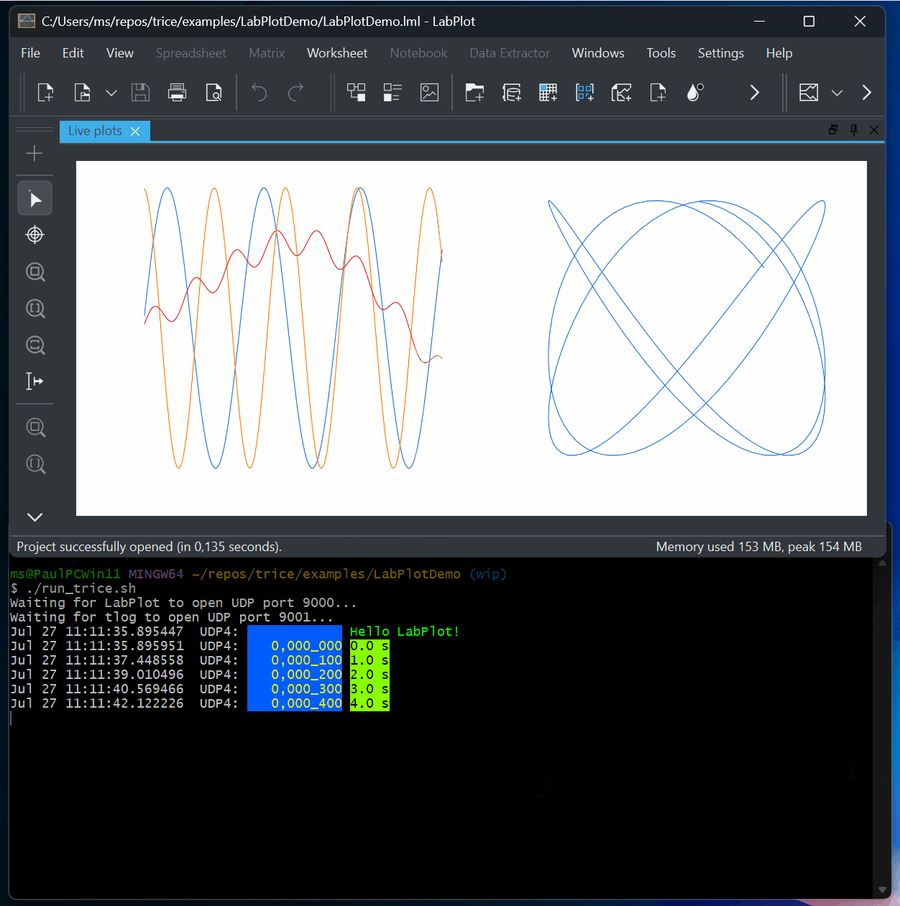

# Visualization

<details markdown="1">
<summary>Contents</summary>

<!-- mdtoc -->

* [1. Visualization output with `-vis`](#visualization-output-with--vis)
  * [1.1. Save two values as CSV](#save-two-values-as-csv)
  * [1.2. Select messages and handle aliases](#select-messages-and-handle-aliases)
  * [1.3. Syntax and numeric expressions](#syntax-and-numeric-expressions)
    * [1.3.1. Built-in names: values, ID and target stamp](#built-in-names-values-id-and-target-stamp)
    * [1.3.2. Choose ts, ts16 or ts32](#choose-ts-ts16-or-ts32)
    * [1.3.3. Plot measurements taken at irregular times](#plot-measurements-taken-at-irregular-times)
    * [1.3.4. Host time, missing stamps and counter wraps](#host-time-missing-stamps-and-counter-wraps)
  * [1.4. Files, UDP and normal log output](#files-udp-and-normal-log-output)
  * [1.5. Supported records and failure behavior](#supported-records-and-failure-behavior)
* [2. Setting up the LabPlot Demo](#setting-up-the-labplot-demo)
  * [2.1. The common live-data format](#the-common-live-data-format)
  * [2.2. ./examples/DemoData_CSV](#examplesdemodata_csv)
  * [2.3. ./examples/DemoData_Trice](#examplesdemodata_trice)
  * [2.4. Quick LabPlot demonstration](#quick-labplot-demonstration)
  * [2.5. Recreate the project in LabPlot](#recreate-the-project-in-labplot)
  * [2.6. Troubleshooting and adaptations](#troubleshooting-and-adaptations)
* [3. Appendix: Visualization expression reference](#appendix-visualization-expression-reference)
  * [3.1. Arithmetic and formatting](#arithmetic-and-formatting)
  * [3.2. A formatted JSON line](#a-formatted-json-line)

<!-- numbering=true min=2 max=4 slug=github anchor=true link=true toc=true bullets=auto -->
<!-- /mdtoc -->

</details>

## 1. <a id="visualization-output-with--vis"></a>Visualization output with `-vis`

Use `-vis` to save measurements as CSV or send them to a plotting program over UDP. Each selected numeric Trice call supplies one output record. `tlog` and `trice log` accept the same rules.

### 1.1. <a id="save-two-values-as-csv"></a>Save two values as CSV

Suppose a motor reports speed in rpm and current in mA. These two calls represent two successive samples:

```c
// Keep both measurements in one call so they form one CSV row.
trice("motor:rpm=%u,current_mA=%u\n", 1500, 120);
trice("motor:rpm=%u,current_mA=%u\n", 1520, 125);
```

Run Bind and rebuild the firmware after adding these calls. From the directory containing its matching `til.json`, run the following in Bash or Git Bash. Replace `COM7` and add your usual baud/framing options if needed:

```bash
trice log -p COM7 -utag motor \
  -vis='motor:printf("%d,%d\n",v0,v1)@motor.csv;header="rpm,current_mA\n"'
```

A new `motor.csv` then contains:

```csv
rpm,current_mA
1500,120
1520,125
```

`motor` selects the tag, `v0` is the first value, and `v1` the second. The comma and `\n` create columns and rows. `header` supplies the column names; omit it for data-only output. **Each logging run replaces an existing output file.** Choose a new filename to keep an earlier recording.

Want to…                                          | Use
------------------------------------------------- | -----------------------------------------------------------------------------------------------------------
Save both values                                  | `printf("%d,%d\n",v0,v1)`
Reverse the columns                               | `printf("%d,%d\n",v1,v0)`
Convert mA to A                                   | `printf("%d,%.3f\n",v0,v1/1000)` → `1500,0.120` for the first sample; change the header to `rpm,current_A`.
Use a named field such as `rpm` in the expression | Use `v0` instead. Field names are not expression variables.
Combine values from two separate calls            | Put them in one call first. `-vis` does not join events.

The normal log remains visible. The [LabPlot animation](../ref/LabPlotDemo.gif) shows a complete three-signal example with live plots and parallel text output. To try it, follow the [LabPlot demo](#quick-labplot-demonstration); to send your own values, use [UDP output](#files-udp-and-normal-log-output). Trice writes the data; the receiving program draws the graph.

### 1.2. <a id="select-messages-and-handle-aliases"></a>Select messages and handle aliases

To collect temperatures from warning messages in a CSV file, suppose your firmware uses a project macro `MyWrn`, registered as a [Trice alias](legacy_user_code.md#alias-identity-and-tags-in-v2):

```c
MyWrn("err:temperature=%u\n", 85);
```

Run this command in the directory containing the firmware's matching `til.json`, replacing `COM7` with your serial port:

```bash
trice log -p COM7 -vis='wrn:printf("%d\n",v0)@warnings.csv'
```

During the run, each matching call adds this line to `warnings.csv`:

```text
85
```

Here, `wrn` means "take warning messages", `v0` is their first numeric value, and `@warnings.csv` names the output file. The name `MyWrn` makes this a warning even though its text begins with `err:`. Changing the rule to `err:printf(...)` would exclude this message. `wrn`, `WRN` and `WARNING` select the same warnings.

For a custom name that has not been registered with `-utag`, the start of the text decides. For example, `-vis='imu:printf("%d\n",v0)@imu.csv'` writes `21` from `trice("imu:temperature=%u\n", 21)`, but ignores text starting with `IMU:`. With `-utag imu`, both spellings select the IMU tag; a warning alias still belongs to warnings even if its text starts with `imu:`.

`-pick` and `-ban` run first. A message removed by either filter reaches neither normal output nor `-vis`.

### 1.3. <a id="syntax-and-numeric-expressions"></a>Syntax and numeric expressions

The examples below use the motor call from section 1.1: `v0` is speed in rpm and `v1` is current in mA. The first sample is `1500,120`. Use the firmware's matching dictionary and input settings; replace `COM7` with your port.

The complete rule form is:

```text
-vis='<tag>:printf("<format>",<expressions>)@<destination>[;log=keep|drop][;header="<text>"]'
```

Square brackets mark optional parts; do not type them. Choose either `keep` or `drop` for `log`.

**Save both measurements.**

```bash
trice log -p COM7 -utag motor \
  -vis='motor:printf("%d,%d\n",v0,v1)@motor.csv'
```

The first row in `motor.csv` is `1500,120`. `motor` selects messages, `printf` creates the row, and `@motor.csv` selects the file. The comma separates the two columns; `\n` ends the row. This host formatter uses `%d` for integers, including values logged with `%u` on the target. Normal text output remains visible.

**Convert current to amperes and name the columns.**

```bash
trice log -p COM7 -utag motor \
  -vis='motor:printf("%d,%.3f\n",v0,v1/1000)@motor-amps.csv;header="rpm,current_A\n"'
```

`v1/1000` converts mA to A; `%.3f` keeps three decimal places. `header` writes the first line. The file starts with:

```csv
rpm,current_A
1500,0.120
```

**Send the same values to a live viewer and hide their normal log lines.**

```bash
trice log -p COM7 -utag motor \
  -vis='motor:printf("%d,%.3f\n",v0,v1/1000)@udp://127.0.0.1:7010;log=drop'
```

The receiver on UDP port **7010** gets `1500,0.120` followed by a newline. That port is an example, not a default. This command sends no header. `log=drop` hides a motor message only after its visualization write succeeds; other messages continue normally. [Destination rules](#files-udp-and-normal-log-output) explain ports and supported outputs.

Repeat `-vis` in one command to write to several destinations, for example a CSV file and a UDP viewer at the same time.

#### 1.3.1. <a id="built-in-names-values-id-and-target-stamp"></a>Built-in names: values, ID and target stamp

These are all the available expression names. They are lowercase and refer to the **current received record**:

Name         | Meaning                                            | Example
------------ | -------------------------------------------------- | -------------------------------------------------------------------------
`v0` … `v11` | First through twelfth numeric value from the call  | The motor call provides `v0 = 1500`, `v1 = 120`.
`id`         | The record's unsigned Trice ID                     | If Bind assigned ID 4711, `printf("%d,%d\n",id,v0)` produces `4711,1500`.
`ts16`       | Raw 16-bit target stamp                            | A transmitted stamp of 1000 gives `ts16 = 1000`.
`ts32`       | Raw 32-bit target stamp                            | A transmitted stamp of 1000 gives `ts32 = 1000`.
`ts`         | Raw target stamp, accepting either width initially | The first eligible stamped record determines the width for this rule.

Use `v0` … `v11` for **payload values**; `id` and the stamp names are additional metadata. Source variable names and structured field names such as `rpm` are not expression variables. For example, `printf("%d,%d\n",v1,v0)` reverses the motor columns to `120,1500`; using `rpm` instead of `v0` is rejected.

#### 1.3.2. <a id="choose-ts-ts16-or-ts32"></a>Choose ts, ts16 or ts32

Use `ts16` or `ts32` when you know the transmitted stamp width. Use `ts` when the same command should work with either a 16-bit-stamp firmware build or a 32-bit-stamp build. The records selected by one `ts` rule must keep the same width during that logging run.

For a motor record with stamp `1000` and speed `1500`, add one of these options to `trice log -p COM7 -utag motor`:

Option                                              | Result
--------------------------------------------------- | ------------------------------------------------------------------------------------------------------------------------------
`-vis='motor:printf("%d,%d\n",ts16,v0)@time16.csv'` | Writes `1000,1500` for a 16-bit stamp. Skips 32-bit and unstamped records.
`-vis='motor:printf("%d,%d\n",ts32,v0)@time32.csv'` | Writes `1000,1500` for a 32-bit stamp. Skips 16-bit and unstamped records.
`-vis='motor:printf("%d,%d\n",ts,v0)@time.csv'`     | Writes `1000,1500` with either initial width. Skips unstamped records. A later width change disables this rule with a warning.

For example, if the `ts` rule first accepts a 16-bit record and later a 32-bit record, it writes no row for the second record and stops visualizing further records for the rest of the run. Normal logging continues. If both widths are expected, use two explicit-width rules instead. A single rule containing both `ts16` and `ts32` is rejected: one record carries only one stamp width.

The names do not determine the unit. `1000` means one second only if your firmware supplies milliseconds. A stamp may instead be a hardware tick count or a task identifier; see [target stamps](stamps.md).

#### 1.3.3. <a id="plot-measurements-taken-at-irregular-times"></a>Plot measurements taken at irregular times

Measurements do **not** need equal time intervals. Include the target time as a CSV column and use that column as the plot's horizontal axis.

Suppose the motor logs when its readings change. In an already configured project, this call carries a 32-bit stamp:

```c
// Capture both measurements with a 32-bit target stamp.
TRice32("motor:rpm=%u,current_mA=%u\n", speed_rpm, current_mA);
```

Here, `TR` selects the 32-bit stamp; the final `32` selects the value width. The firmware's `TriceStamp32()` must provide the stamp. For this example it returns elapsed **milliseconds**, and the three calls occur at 1000, 1040 and 1175 ms. Run Bind and rebuild after changing the calls.

```bash
trice log -p COM7 -utag motor \
  -vis='motor:printf("%.3f,%d,%.3f\n",ts32/1000,v0,v1/1000)@motor-time.csv;header="time_s,rpm,current_A\n"'
```

With successive readings of `(1500,120)`, `(1520,125)` and `(1490,118)`, `motor-time.csv` contains:

```csv
time_s,rpm,current_A
1.000,1500,0.120
1.040,1520,0.125
1.175,1490,0.118
```

Plot `rpm` or `current_A` against `time_s`. The gaps are 40 ms and 135 ms, not equal. `-vis` emits one row per accepted event; it does not insert samples, interpolate or resample. For live UDP, replace `@motor-time.csv` with the receiver's address and omit the header if the viewer expects numeric rows only.

#### 1.3.4. <a id="host-time-missing-stamps-and-counter-wraps"></a>Host time, missing stamps and counter wraps

**Host timestamps are not available inside `-vis`.** There is no `hs`, `hostTime` or `now` expression name. Enabling `-hs` changes normal log output, not the CSV data. Without a target stamp, a stamp-based rule skips the record; it does not substitute the host time or zero. A time value sent as an ordinary numeric argument can still be used through its `v0` … `v11` position.

All stamp names read the raw transmitted number. They do not start at zero for a new recording and do not reconstruct counter wraps. For example, a 16-bit millisecond counter wrapping from 65535 to 0 gives this output with `printf("%.3f\n",ts16/1000)`:

```csv
65.535
0.000
```

For a continuous time axis, use a target time counter that does not wrap during the recording, or reconstruct wraps afterwards. The [stamp-display expressions](stamp_expressions.md) offer `unwrap` and `delta` for normal log columns; these functions are **not supported in `-vis`**. Options such as `-ts32 ms` or `-ts32 'printf(...)'` do not change the raw `ts32` value used here.

See the [expression reference](#appendix-visualization-expression-reference) for all supported operators, output formats and conversion limits.

### 1.4. <a id="files-udp-and-normal-log-output"></a>Files, UDP and normal log output

**The supported destinations are regular files and UDP sockets. There is no default UDP port.** The `@` separates the expression from its destination; it is required.

Destination in a rule                                                     | Behavior
------------------------------------------------------------------------- | ----------------------------------------------------------------------------
`@motor.csv`                                                              | File in the host command's working directory.
`@logs/motor.csv` or `@file:logs/motor.csv`                               | File in an existing `logs` directory. Both forms mean the same thing.
`@udp://127.0.0.1:7010`                                                   | UDP receiver on the same PC, port 7010.
`@udp://localhost:7010`                                                   | Same idea with a hostname; other resolvable hostnames work too.
`@udp://192.168.1.50:9000`                                                | UDP receiver on another computer, port 9000.
`@udp://[::1]:7010`                                                       | UDP over IPv6 loopback; brackets surround the IPv6 address.
`@udp://127.0.0.1`                                                        | Rejected: the port is missing.
`@udp://127.0.0.1:0`                                                      | Rejected: the port must be a number from 1 through 65535.
`@file://motor.csv`                                                       | Rejected: file-URI syntax is unsupported; use a plain path or `file:<path>`.
`@tcp://localhost:7010`, `@ws://localhost:7010`, `@http://localhost:7010` | Rejected: TCP, WebSocket and HTTP outputs are unsupported.
`@pipe://plot`                                                            | Rejected: named pipes and process pipes are unsupported.

There is no stdout destination shortcut: `@-` means a file literally named `-`, not standard output.

**Files:** missing files are created; existing contents are replaced when the destination opens at startup. Parent directories must already exist. An existing destination must be a regular file, not a directory or pipe. Rules using the same normalized path share one open file, so their rows go into the same new recording.

**UDP:** choose the port configured in your receiving program. `7010` and `9000` above are examples; the supplied LabPlot project listens on `9000`. The port in `-vis` is the **destination** port, independent of the Trice input selected by `-p`. Omitting it fails during startup with `UDP sink must use udp://host:port`; no port is assumed.

Start the receiver first and configure its expected columns. Each accepted event is sent as one datagram. UDP has no delivery acknowledgement; a successful write does not prove that a viewer received it. The destination is resolved and opened before decoding starts. File and UDP writes are synchronous, with no queue, retry or reconnect.

**Column names:** `;header="rpm,current_A\n"` writes that text once per shared destination at startup. Include the newline yourself. Rules sharing a destination must agree on any nonempty header; conflicting headers fail at startup. With UDP the header is a separate datagram, so include it only if the receiver expects it.

**Normal log output:** `log=keep` is the default. `log=drop` suppresses an event only after that rule has encoded and written its visualization record successfully. All overlapping rules are attempted; one successful `log=drop` rule wins. An ignored record or a failed write does not suppress the normal log.

### 1.5. <a id="supported-records-and-failure-behavior"></a>Supported records and failure behavior

Use one fixed-width numeric call ending in one newline, as in the motor example. The following limits apply:

Input                                                                              | Result
---------------------------------------------------------------------------------- | ----------------------------------------------------------------------------------
One numeric call forming one complete line                                         | Eligible; use `v0` through `v11` for its first twelve values.
A string, buffer, function-display, character, typeX0, CHAR or DUMP record         | No visualization record; use normal logging.
A partial line, multiple lines in one call, or a line assembled from several calls | Normal logging continues; `-vis` ignores the record and verbose mode explains why.
Named structured fields                                                            | Numeric values remain positional: use `v0`, `v1`, etc.

Additional values beyond the first twelve remain available to normal logging. Specialized JSON or binary encoders, TCP, WebSocket, named pipes, and process pipes are not provided.

At startup, each rule checks all matching historical `til.json` entries. Incompatible old entries are excluded independently, so one stale ID does not block another compatible ID. A rule with no compatible entry is disabled with a prominent warning. Rules are also disabled, never silently, after a generic Target-Stamp width conflict, an unsafe runtime expression conversion, or a sink failure. Normal logging continues.

## 2. <a id="setting-up-the-labplot-demo"></a>Setting up the LabPlot Demo

[](../ref/LabPlotDemo.gif)

Select the preview to open the animation. On the left, three signals change over time; on the right, one signal is plotted against another. The terminal below continues to show text messages.

This section uses [LabPlot](https://labplot.org/), a cross-platform interactive
plotting application. The finished, ready-to-run example is in
`./examples/LabPlotDemo/`; the guided learning path is in
`./examples/LabPlotUser/`. The project uses a UDP socket so that it can
display an endless stream without repeatedly importing files.

### 2.1. <a id="the-common-live-data-format"></a>The common live-data format

Both producers describe the same three signals: `x`, `y`, and `z`. LabPlot
receives normalized numeric CSV records with this column layout:

```text
time_s,x,y,z
```

Plot in the animation | Horizontal axis    | Vertical axis
--------------------- | ------------------ | ----------------------------------------
Time series, left     | `time_s`, column 1 | Three curves: `x`, `y`, `z`, columns 2–4
Lissajous, right      | `x`, column 2      | `y`, column 3

The finished project predeclares the four numeric columns and performs one
initial read while loading. This prepares LabPlot's UDP socket before the
first live record arrives. The UDP stream therefore needs no header row.

The LabPlot demo rate is 50 samples per second. The project retains 500 rows.
The time plot is configured for the last 500 values, so its horizontal
resolution stays constant and it always displays approximately the most
recent ten seconds. The Lissajous plot uses only the last 150 values, which
creates a moving three-second trace instead of an increasingly dense full
history. A slow phase modulation of `y` makes the figure change continuously.
The CSV producer sends this format directly. The Trice producer sends binary
Trice records to `tlog`; `tlog` decodes them and sends the same CSV format
onward. This separation means that one LabPlot project works for both
examples.

### 2.2. <a id="examplesdemodata_csv"></a>./examples/DemoData_CSV

The [CSV producer](../../examples/DemoData_CSV/src/main.c) is a small C11 program
for Windows, macOS, and Linux. Each newline-terminated record contains
`time_s,x,y,z`, all represented as `double`; time is in seconds. It writes to
standard output by default, to a fresh file with `--output FILE`, or to UDP
with one record per datagram. Use `--help` for all options.

Both data producers require a C compiler and CMake 3.16 or newer. Run their
`build.sh` in Git Bash on Windows or a POSIX shell on macOS/Linux; restore its
executable permission with `chmod +x build.sh` if necessary. Executables are
installed in each project's `bin/`, with intermediate files in `build/`.
For the CSV producer, the equivalent explicit CMake commands are:

```sh
cd examples/DemoData_CSV
cmake -S . -B build
cmake --build build --config Release
cmake --install build --config Release --prefix .
```

These commands also work in PowerShell. Its executable invocation is
`.\bin\DemoData_CSV.exe`; in Git Bash use `./bin/DemoData_CSV`.

From the CSV project directory, try:

```sh
./build.sh
./bin/DemoData_CSV
./bin/DemoData_CSV --rate 50 --samples 500 --no-delay --header --output DemoData_CSV.csv
./bin/DemoData_CSV --udp 127.0.0.1 9000
```

Run these alternatives separately. The second command runs continuously at
50 Hz; interrupt it with `Ctrl-C`. The third writes ten seconds of data
without real-time waiting. On Windows PowerShell the UDP command is
`.\bin\DemoData_CSV.exe --udp 127.0.0.1 9000`.

For Serial Studio, choose **Quick Plot (Comma Separated Values)**, then
**Network Socket > UDP**, set local port `9000`, connect, and start the UDP
producer. Quick Plot treats all four columns as values. A custom project can
instead name the columns and use the first column as a timestamp axis. Its
input must be `seconds,x,y,z`; do not send `--header` on the live stream.
There is currently no versioned `DemoData.ssproj` in this repository.

Both producers use the following signal model for time `t` in seconds:

```text
phase = (pi/3) * sin(2*pi*0.04*t)
x = sin(2*pi*0.70*t)
y = sin(2*pi*0.91*t + pi/2 + phase)
z = 0.6*sin(2*pi*0.13*t) + 0.2*x*y + pulse
```

The pulse has height `0.8` during the final 250 ms of every eight-second
interval. The slow phase modulation keeps the Lissajous plot moving. The
Trice producer calculates the signals as doubles and transmits float32 values.

After running `build.sh` inside `./examples/DemoData_CSV/`, the executable is
installed in the local `bin/` folder. You can run it there:

```txt
th@Thomass-MacBook-Pro-7 bin % ./DemoData_CSV --header -o log.csv
^C
th@Thomass-MacBook-Pro-7 bin % head log.csv                           
time_s,x,y,z
0.000000,0.000000,1.000000,0.000000
0.020000,0.087851,0.992854,0.027246
0.040000,0.175023,0.971519,0.053608
0.060000,0.260842,0.936300,0.078239
0.080000,0.344643,0.887701,0.100367
0.100000,0.425779,0.826415,0.119328
0.120000,0.503623,0.753319,0.134594
0.140000,0.577573,0.669459,0.145795
0.160000,0.647056,0.576032,0.152736
th@Thomass-MacBook-Pro-7 bin % 
```

### 2.3. <a id="examplesdemodata_trice"></a>./examples/DemoData_Trice

The [Trice producer](../../examples/DemoData_Trice/src/main.c) transports the
same signals as binary Trice records. Keep it inside the repository: its
CMake project uses the unchanged target library from `../../src`.
Its [build script](../../examples/DemoData_Trice/build.sh) prepares Bind and the
repository-root `demoTIL.json` before building; it requires the Trice host
tool in addition to the CSV producer's prerequisites. Use this script rather
than plain CMake commands that omit Bind preparation. There is no private
`til.json` or fixed `iD(1000)` for this ID-free producer.

The 32-bit target stamp uses units of **10 ms**: at 50 Hz the stamps are
`0, 2, 4, ...`. Convert with `seconds = ts/100.0` or
`milliseconds = ts*10`; `ts*100` does not give seconds.

From `examples/DemoData_Trice`:

```sh
./build.sh
./bin/DemoData_Trice --samples 500 --no-delay
trice log -p FILEBUFFER -args DemoData_Trice.bin -pf TCOBS -til ../../demoTIL.json -li off
```

Without an output option, the producer recreates `DemoData_Trice.bin` in the
current directory (`wb` truncates its previous contents). `--output FILE`
selects another fresh file, `--stdout` writes binary data to standard output,
and `--udp HOST PORT` sends one complete TCOBS-framed record per datagram.
Without `--samples` it runs until interrupted. `--samples 500` counts signal
samples, not all log records: startup and periodic diagnostic logs are extra.
Use `--help` for all options. On Windows PowerShell, run
`.\bin\DemoData_Trice.exe` with the same arguments.

After running `build.sh` inside `./examples/DemoData_Trice/`, the executable is
installed in the local `bin/` folder. You can run it there:

- Create binary log file:

```txt
th@Thomass-MacBook-Pro-7 bin % ./DemoData_Trice -o log.bin
Writing log.bin
^C
```

- Show logs in binary log file: 

```txt
th@Thomass-MacBook-Pro-7 bin % tlog -p FILEBUFFER -args log.bin -til ../../../demoTIL.json -utag vis_demo | head
Jul 25 15:38:55.411676  FILEBUFFER:    0,000_000 0.000000,1.000000,0.000000
Jul 25 15:38:55.411691  FILEBUFFER:    0,000_002 0.087851,0.992854,0.027246
Jul 25 15:38:55.411705  FILEBUFFER:    0,000_004 0.175023,0.971519,0.053608
Jul 25 15:38:55.411714  FILEBUFFER:    0,000_006 0.260842,0.936300,0.078239
Jul 25 15:38:55.411725  FILEBUFFER:    0,000_008 0.344643,0.887701,0.100367
Jul 25 15:38:55.411737  FILEBUFFER:    0,000_010 0.425779,0.826415,0.119328
Jul 25 15:38:55.411752  FILEBUFFER:    0,000_012 0.503623,0.753319,0.134594
Jul 25 15:38:55.411765  FILEBUFFER:    0,000_014 0.577573,0.669459,0.145795
Jul 25 15:38:55.411776  FILEBUFFER:    0,000_016 0.647056,0.576032,0.152736
th@Thomass-MacBook-Pro-7 bin %
```

- Get CSV log file:

```txt
th@Thomass-MacBook-Pro-7 bin % tlog -p FILEBUFFER -args log.bin -til ../../../demoTIL.json -utag vis_demo -vis='vis_demo:printf("%0.3f,%0.3f,%0.3f,%0.3f\n",ts/100.0,v0,v1,v2)@log.csv;header="time_s,X,Y,Z\n";log=drop'
th@Thomass-MacBook-Pro-7 bin % head log.csv
time_s,X,Y,Z
0.000,0.000,1.000,0.000
0.020,0.088,0.993,0.027
0.040,0.175,0.972,0.054
0.060,0.261,0.936,0.078
0.080,0.345,0.888,0.100
0.100,0.426,0.826,0.119
0.120,0.504,0.753,0.135
0.140,0.578,0.669,0.146
0.160,0.647,0.576,0.153
th@Thomass-MacBook-Pro-7 bin % 
```

The preceding file visualization rule recreates `log.csv` when `tlog` starts.
Its header is written once per sink; the quoted Go string supports `\n`.
Keep a single backslash in the shell's single-quoted rule. `log=drop` suppresses
the successfully visualized records, while unrelated diagnostic logs remain.

For a live Serial Studio or other CSV viewer listening on UDP `9000`, start
the decoder from the repository root before starting the binary producer:

```sh
trice log -p UDP4 -args 127.0.0.1:9001 -pf TCOBS -til demoTIL.json -utag vis_demo \
  -vis='vis_demo:printf("%0.6f,%0.6f,%0.6f,%0.6f\n",ts/100.0,v0,v1,v2)@udp://127.0.0.1:9000;log=drop'
```

In another terminal, also from the repository root:

```sh
examples/DemoData_Trice/bin/DemoData_Trice --udp 127.0.0.1 9001
```

On Windows the executable has an `.exe` suffix. The producer sends **binary
Trice** to `9001`, not CSV; connecting it directly to the viewer on `9000`
cannot work. The decoder converts its records to `seconds,x,y,z`. The LabPlot
launchers below automate this pipeline and its receiver-readiness checks.

### 2.4. <a id="quick-labplot-demonstration"></a>Quick LabPlot demonstration

Install LabPlot 2.12 or newer. From the repository root, run one of these
commands in a POSIX shell:

```sh
./examples/LabPlotDemo/run_csv.sh
./examples/LabPlotDemo/run_trice.sh
```

The script opens `LabPlotDemo.lml` and starts the selected producer. The first
script sends CSV directly to UDP port `9000`. The second uses UDP port `9001`
for binary Trice input and runs `tlog` as the decoder/forwarder to port `9000`.
The script first waits until LabPlot has opened port `9000`, then starts
`tlog` and waits until its input port `9001` is ready. Only then does it start
the Trice producer. The project opens one worksheet containing two plots side
by side:

* `Time series`: `x`, `y`, and `z` versus `time_s`, always showing the last
  500 values (ten seconds).
* `Lissajous`: `y` versus `x`, showing the last 150 values (three seconds) on
  fixed axes. The producer's slow phase drift keeps the figure in motion.

Press `Ctrl-C` in the shell to stop the producer and decoder. If LabPlot is
not found automatically, set `LABPLOT` to its executable. On Windows, Git
Bash is a suitable shell; for example, use
`LABPLOT=/c/Program\ Files/LabPlot/bin/labplot.exe`.

### 2.5. <a id="recreate-the-project-in-labplot"></a>Recreate the project in LabPlot

The following steps explain the project without requiring prior LabPlot
knowledge. Start `run_csv.sh` first and leave it running.

1. Create a new LabPlot project and choose **Add New > Live Data Source**.
2. Select **Network UDP Socket**, enter host `127.0.0.1` and port `9000`.
3. Select the ASCII filter, comma as separator, and disable header detection.
   Set all four data types to `Double` and enter the names `time_s`, `x`, `y`,
   and `z`.
4. Select **Update on new data** and retain `500` values. This is the moving
   ten-second window at the demo's 50 Hz rate.
5. Add a worksheet with a Cartesian plot. Add three XY curves. For every
   curve choose `time_s` as the X column and choose `x`, `y`, or `z` as the Y
   column. Enable the legend, label the axes `time [s]` and `value`, and enable
   automatic range scaling. In the plot's range
   settings select **Last values** and enter `500`; otherwise the time axis
   keeps growing and the curves become increasingly compressed.
6. Add a second Cartesian plot to the same worksheet and select a horizontal
   two-column worksheet layout. Add one XY curve with `x` as its X column and
   `y` as its Y column. Select **Last values** and enter `150`. Fixed X and Y
   ranges from `-1.1` to `1.1` keep the scale stable while the three-second
   trace and the signal's slow phase drift make the movement visible.
7. Save the project as `LabPlotUser.lml`.

The finished [LabPlotDemo.lml](../../examples/LabPlotDemo/LabPlotDemo.lml) contains
these settings and no machine-specific paths. Open it manually if LabPlot is
already running. The [LabPlotUser directory](../../examples/LabPlotUser/) is the
place for your recreated `LabPlotUser.lml`; this section is its complete
rebuild guide. Both producers end at the same numeric UDP stream, for example
`0.000000,0.000000,1.000000,0.000000`.

Stop the producer and start the other launcher without changing the LabPlot
project. Keep only one producer sending to UDP `9000` and keep the live source
connected. The Trice launcher first waits for LabPlot on `9000`, then for its
decoder on `9001`. The supplied project predeclares all four numeric columns
and triggers an initial read when loaded so that LabPlot prepares its socket.

### 2.6. <a id="troubleshooting-and-adaptations"></a>Troubleshooting and adaptations

* `labplot` must be discoverable or selected with `LABPLOT`. macOS also checks
  its standard application bundle. Windows searches `ProgramFiles`,
  `ProgramW6432`, and `LOCALAPPDATA` for `labplot.exe` or `labplot2.exe`;
  an explicit `LABPLOT` override takes precedence. `TLOG` can select a decoder
  outside `PATH`. Producer executables stay in each demo's `bin/`, with CMake
  intermediates in `build/`.
* If the plots remain empty, verify that the producer is running and that no
  other process owns UDP port `9000`.
* If `tlog` reports that a `-vis` rule was disabled because writing to port
  `9000` was refused, LabPlot was not listening when the decoder started.
  Restart `run_trice.sh`; its readiness check normally prevents this race.
  Once a visualization rule is disabled, normal logging intentionally
  resumes, and its `log=drop` option is no longer applied.
* For the Trice path, verify that `tlog` is on `PATH` and that
  `demoTIL.json` is present at the repository root. Set `TLOG` or
  `TRICE_TIL` when using non-default locations.
* Keep the complete `-vis` expression inside one pair of quotes. The semicolon
  separates `header` and `log` options inside that expression; it must not be
  interpreted by the shell.
* To show another history length, change the retained-value count to
  `50 * seconds`. For example, `1000` values show approximately 20 seconds.
* The Trice path still uses UDP port `9001` internally between the demo and
  `tlog`. If that port is busy, stop the other receiver or change it in
  `run_trice.sh` and its `-args` value together.

## 3. <a id="appendix-visualization-expression-reference"></a>Appendix: Visualization expression reference

### 3.1. <a id="arithmetic-and-formatting"></a>Arithmetic and formatting

Expressions support decimal, floating-point and hexadecimal literals, parentheses, unary minus, and `+`, `-`, `*`, `/`. For example, `(v0-100)*0.5` produces `10.0` from a value of `120` when formatted with `%.1f`. Function calls, array indexing and other operators are unsupported.

A direct field retains its signed, unsigned, floating-point or Boolean type. Arithmetic uses `float64`, so `v1/1000` can produce `0.120` rather than integer zero. An arithmetic result used with an integer verb must be finite and inside the `int64` range; it is then truncated toward zero.

Output          | Supported conversions             | Example
--------------- | --------------------------------- | -----------------------------------------------------------
Integer         | `%d`, `%b`, `%o`, `%x`, `%X`      | `printf("%04x\n",v0)` writes `002a` for integer 42.
Floating-point  | `%f`, `%e`, `%E`, `%g`, `%G`      | `printf("%.3f\n",v0/1000)` writes `0.120` for 120.
Generic         | `%v`                              | Uses the expression value's type.
Boolean         | `%t`, with a direct Boolean field | `printf("%t\n",v0)` writes `true` for a Boolean true value.
Literal percent | `%%`                              | `printf("%d%%\n",v0)` writes `75%` for 75.

Literal widths and precisions such as `%08x` and `%.3f` are supported. `%u`, dynamic `*` width or precision, explicit argument indexes and string conversions are not. Use `%d` for unsigned decimal output. The expression count must equal the number of consuming conversions; `%%` consumes none. No newline is added automatically: include `\n` in the format.

### 3.2. <a id="a-formatted-json-line"></a>A formatted JSON line

For finite numeric values, `printf` can also create a JSON line. Suppose an IMU record has a 32-bit stamp of 1000 and values `0.5`, `1` and `-0.25`:

```bash
trice log -p COM7 -utag imu \
  -vis='imu:printf("{\"stamp\":%d,\"x\":%g,\"y\":%g,\"z\":%g}\n",ts32,v0,v1,v2)@imu.jsonl'
```

The resulting line is:

```json
{"stamp":1000,"x":0.5,"y":1,"z":-0.25}
```

The property names come from the quoted format; the expressions still use `ts32`, `v0`, `v1` and `v2`. This is the same `printf` encoder, not a separate JSON encoder. For normal structured log events with named fields and metadata, use [`-logFormat json`](structured_logging.md).
